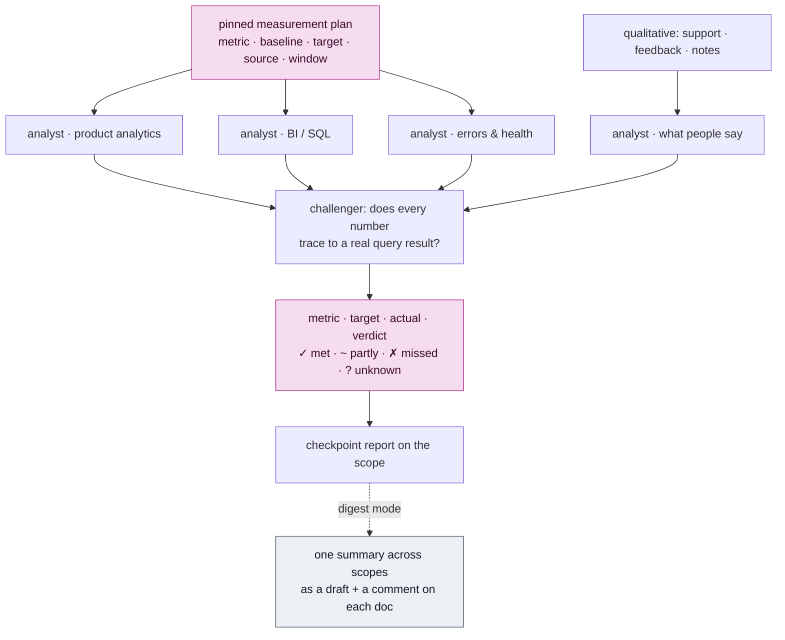
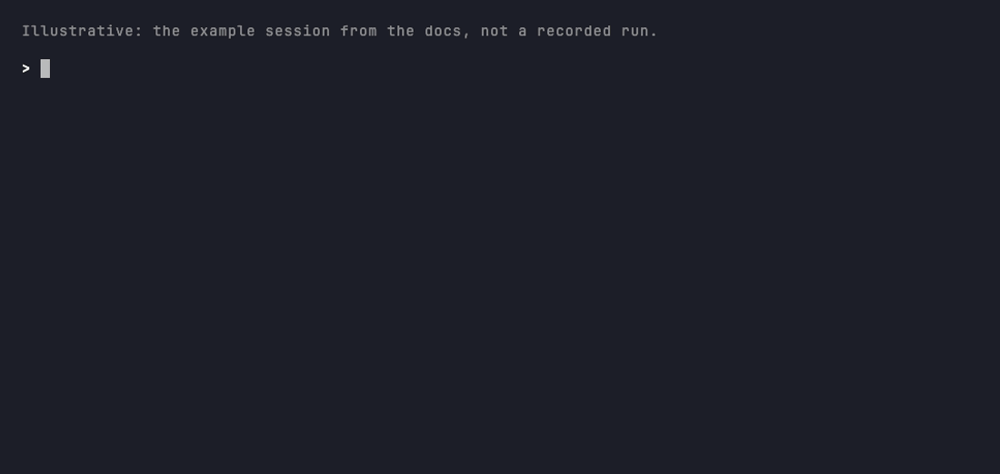
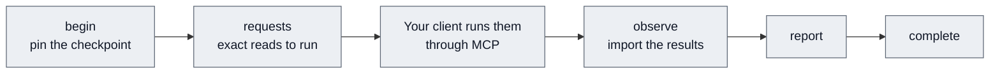

# measure-impact — put the real numbers next to the promise

> **TL;DR** — At each checkpoint — launch, day 7, day 30 by default — it runs the measurement plan the spec pinned, against the sources that plan names, and lays every result beside its target with a verdict. It adds what people are saying, and it never fills a gap with a guess: a number it couldn't read is reported as missing. The outcome is the evidence `decide-next` needs.

Reading real sources through providers is experimental.

## At a glance

| | |
| --- | --- |
| **Block** | Learn — first step |
| **Invoke** | `/wholeloop:measure-impact` · `$wl-measure-impact` · `/wl-measure-impact` |
| **Decision point** | None — it measures; [`decide-next`](./decide-next.md) decides |
| **Reads** | The scope's pinned measurement plan (metric · baseline · target · source · window) · qualitative sources |
| **Writes** | A checkpoint report on the scope · optionally published via `docs` and commented on the tracker item |
| **Slots** | `learn.report` (the team's own impact-review format, if any) |
| **Capabilities** | any `source.*` named by the plan · `docs` · `tracker` · `comms.draft` (digest) |
| **Agents** | `analyst` (one per source) · `challenger` (checks the numbers trace back to real data) |

## When to use it — and when not

**Use it when** a checkpoint is due on something that shipped — or whenever you want an honest read of whether a change did what it was meant to do.

**Don't use it to** decide. It reports evidence with verdicts per metric; the call on what to do next is yours, in [`decide-next`](./decide-next.md).

## How it works



1. **The plan is pinned, not reinvented.** The query, source and window written at spec time are reused as-is, so day 30 measures the same thing day 0 promised. The checkpoint pins its exact source revision; an invocation cannot override its measurement contract. History retains earlier reports.
2. **Checkpoints are configurable.** Launch, D+7 and D+30 by default; a team can set its own (`learn.checkpoints`), and a scope can add one ("pilot exit").
3. **Every number has a receipt.** Each value links to the query or dashboard it came from. The core checks value/reference/window coverage and constructs numeric rows; live semantic grounding evaluation remains separate.
4. **Gaps stay gaps.** An unreachable source, a missing event, an empty window → **unknown**, with what is missing and who could fix it. Never an estimate dressed as a measurement.
5. **Numbers and voices.** Support tickets, feedback and notes go in a separate section, so anecdotes inform the decision without being mistaken for metrics.
6. **Digest mode.** `wl measure digest` prepares a comms **draft** and per-scope comment blocks from the latest completed reports of open scopes, or explicit --for IDs. The conductor can explicitly create unsent drafts or append notes to scope documents; nothing is published by planning a digest.

## Standalone use

Give it a metric and a time range ("export success rate since 1 September, in Metabase") or a scope ID. Without a pinned plan it asks for the target and the source before reading anything: a verdict needs something to compare against.

## Run it



*Illustrative: the example session below, animated. Its wording depends on your client and model.*

The same session as text:

```text
> /wholeloop:measure-impact scope-a9e0 --checkpoint d30

Measure — scope-a9e0 "Find an order" · checkpoint D+30
Plan      pinned at spec approval · 3 metrics · window 30 days, Europe/Madrid
Sources   PostHog ✓ · Metabase ✓ · Zendesk ✗ not connected

▸ analysts started: product analytics · BI · what people say
✓ time_to_find_order    41 s → 18 s     target ≤ 25 s     met
~ orders_page_exit      34% → 27%       target ≤ 20%      partly
? support_tickets       unknown         Zendesk unreachable → open question
▸ challenger: every number traces to a stored query result ✓
  "What people say": 4 feedback notes, kept apart from the metrics

Produced
  Checkpoint report   scope-a9e0 · D+30     wl open scope-a9e0
Open questions        1                     support tickets · who: support lead
Next                  /wholeloop:decide-next scope-a9e0
```

| Client | Invoke | Parallel analysts run as |
| --- | --- | --- |
| Claude Code | `/wl-measure-impact …`, or `/wholeloop:measure-impact …` with the plugin | native subagents |
| Codex CLI | `$wl-measure-impact …` | native subagents |
| OpenCode | Ask for `wl-measure-impact` | native subagents |
| Copilot CLI | Ask for `wl-measure-impact` | native subagents (`/fleet`) |
| Gemini CLI · Cursor | Ask for `wl-measure-impact` | native where available, otherwise headless or one by one |
| Antigravity | Ask for `wl-agy-measure-impact` | native where available, otherwise headless or one by one |

## Before & after

- **Fed by:** the measurement plan from [`write-spec`](../define/write-spec.md), the dashboards from [`prepare-launch`](../rollout/prepare-launch.md), and the final stage of [`ramp-exposure`](../rollout/ramp-exposure.md).
- **Feeds:** [`decide-next`](./decide-next.md).

## Gotchas & FAQ

**"It says unknown for a metric I know is fine."** Then the source behind it isn't reachable from here. Connect the provider (`wl mcp add …`) and re-run; a new observation/report retains the prior history.

**"Can I compare against a different baseline?"** An invocation cannot override the pinned baseline. Record a new agreed measurement revision and retain earlier reports for comparison; unknown baselines remain explicit.

**"Nobody remembers to run D+30."** [`status`](../utilities.md#status) lists every checkpoint that is due, and `next` brings you here when one is.

## Core commands

The commands behind the skill, for scripts and skill authors:

```bash
wl measure schema --json
wl measure begin --for scope-a9e0 --checkpoint d30 --json
wl measure requests --for scope-a9e0 --json
# The host executes exact read requests and normalizes bounded source responses.
wl measure observe --for scope-a9e0 --file observations.json --json
wl measure report --for scope-a9e0 --json
wl measure complete --for scope-a9e0 --json
wl measure schedule --for scope-a9e0 --json
wl measure digest --for scope-a9e0,scope-b1f2 --json
```



### The checkpoint and its window

- **Launch anchor.** Used on its own, `begin` needs a description, `--owner`, `--measurement` (the same contract `prepare-launch` uses) and `--launched-at`, a launch time backed by evidence. A final ramp confirmation can supply that time; a prepared draft cannot. It stays pinned for every later checkpoint.
- **Window.** `--at` fixes the end of a past window. Queries use the original metric's rolling days, time zone and exact unit.
- **Schedule.** `learn.checkpoints` defaults to `launch`, `d7` and `d30`; a custom name needs `--after-days`. A checkpoint that is not due yet leaves no invented history, and `wl status` shows the dates and points `next` at due work.

### Reading the sources

The CLI plans the reads and imports their results; **it signs in to no service**.

- Results use `wholeloop/impact-read-responses@1`: the exact request, run and time, and one result or a reason it was unavailable per request. A number looks like `{ "value": 18, "unit": "seconds" }`.
- `--qualitative` adds agreed queries to support, feedback, meeting or knowledge sources, each with an ID, provider, operation, query, days and time zone. Their bodies become `{ "text": "sanitized source quote" }` and stay separate from the metrics.
- Never put credentials or private logs in a response file.
- From the SDK, `ImpactWorkflow` can be used directly; `runImpact` gives each source its own read-only analyst and a separate layout step.

### The report

- **Your report instructions are pinned.** A custom layout is set with `wl measure format --for <id> --file <layout.json>` before completion: each section has a plain title and lists metric and qualitative IDs. The host picks headings and order; the core keeps every value and its source. New evidence invalidates an old layout.
- **Every number links** to its stored query, the hash of the raw content, the observation and its window, and the metric contract. A missing observation keeps its reason.
- **Partial progress** needs a known baseline that was not yet met and a result closer to the target. An unknown baseline, or a regression from a baseline already met, never counts as progress.
- **Comparison, not causation.** A report says what changed, not why.
- Completion keeps the canonical artifacts; repeated checkpoints keep their earlier histories.

### Digests

`wl measure digest` plans locally. Publishing one is a separate, explicit SDK call (`dispatchImpactDigest`), which either creates an unsent communication draft or appends a note to each scope's document, marked so it can be found again. It keeps unrelated content, records its intent first and does not retry an ambiguous write. The notes are part of the document body, not threaded comments.

### Scheduled checkpoints, unattended

An external scheduler such as cron can run `wl measure tick --for <scope-id,...>` as often as it likes.

- Each due checkpoint is scheduled **once**, identified by its scope, launch, source and observation policy. A relaunch or a changed plan schedules new work. Scheduling reads nothing.
- Readings still go through `measure requests` and `measure observe`.
- Unknown values stay unknown: an unattended run ends *completed with unknowns* only when its contract allows it, and is blocked otherwise.

Each scheduled checkpoint can also run as its own read-only **`learning-observation`** autonomous delivery run, under a grant for that exact plan whose read rules name the scope. It reads only through your client's MCP connection, settles the checkpoint once and asks the delegated `learning-outcome` judges for a recommendation. That recommendation names every unknown and counterargument, and **changes nothing**: no flag, deploy, message or closed work. Supervised runs are refused here; use `measure-impact` and `decide-next` yourself instead.

<!-- docnav -->
[◀ ramp-exposure](../rollout/ramp-exposure.md)  ·  [📖 Docs index](../../README.md)  ·  [🧭 Concepts](../../concepts.md)  ·  [decide-next ▶](decide-next.md)
