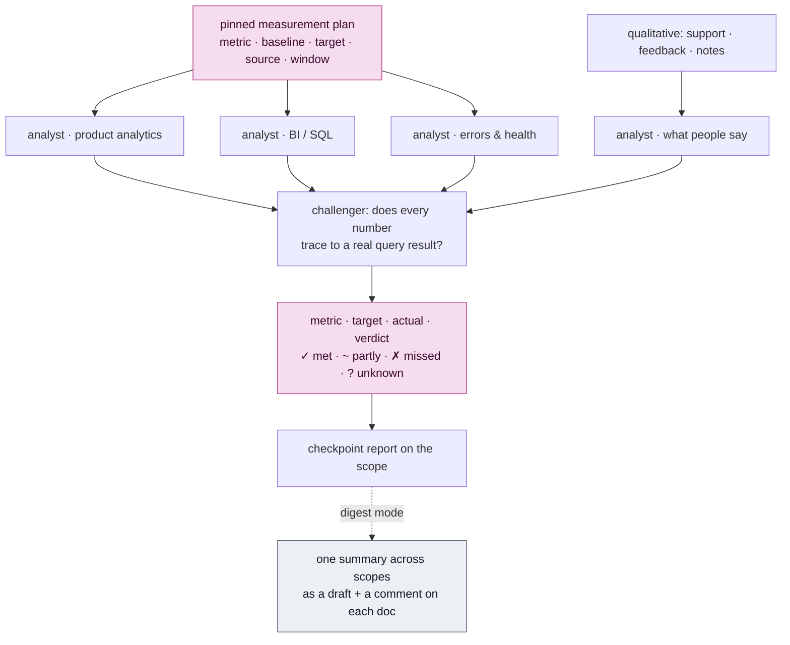

# measure-impact — put the real numbers next to the promise

> **TL;DR** — At each checkpoint — launch, day 7, day 30 by default — it runs the measurement plan the spec pinned, against the sources that plan names, and lays every result beside its target with a verdict. It adds what people are saying, and it never fills a gap with a guess: a number it couldn't read is reported as missing. The outcome is the evidence `decide-next` needs.

> [!NOTE]
> **Status: 🚧 partial.** Local checkpoint planning, exact normalized reads, grounded arithmetic, qualitative quotes, repository-guided layouts and explicit draft/document-note dispatch are fixture-tested. Real clients, source semantics and publication remain owner verification. Tracked in [P4-03](../../../roadmap/phase-4-rollout-learn.md#p4-03--measure-impact-and-the-analyst).

---

## At a glance

| | |
| --- | --- |
| **Block** | Learn — first step |
| **Invoke** | `/wholeloop:measure-impact` · `$wl-measure-impact` · `/wl-measure-impact` |
| **Decision point** | None — it measures; [`decide-next`](./decide-next.md) decides |
| **Reads** | The scope's pinned measurement plan (metric · baseline · target · source · window) · qualitative sources |
| **Writes** | A checkpoint report on the scope · optionally published via `docs` and commented on the tracker item |
| **Slots** | `learn.report` (the team's own impact-review format, if any) |
| **Capabilities** | any `source.*` named by the plan · `docs` · `tracker` · `comms.draft` (digest) |
| **Agents** | `analyst` (one per source) · `challenger` (checks the numbers trace back to real data) |

## When to use it — and when not

**Use it when** a checkpoint is due on something that shipped — or whenever you want an honest read of whether a change did what it was meant to do.

**Don't use it to** decide. It reports evidence with verdicts per metric; the call on what to do next is yours, in [`decide-next`](./decide-next.md).

## How it works



1. **The plan is pinned, not reinvented.** The query, source and window written at spec time are reused as-is, so day 30 measures the same thing day 0 promised. The checkpoint pins its exact source revision; an invocation cannot override its measurement contract. History retains earlier reports.
2. **Checkpoints are configurable.** Launch, D+7 and D+30 by default; a team can set its own (`learn.checkpoints`), and a scope can add one ("pilot exit").
3. **Every number has a receipt.** Each value links to the query or dashboard it came from. The core checks value/reference/window coverage and constructs numeric rows; live semantic grounding evaluation remains separate.
4. **Gaps stay gaps.** An unreachable source, a missing event, an empty window → **unknown**, with what is missing and who could fix it. Never an estimate dressed as a measurement.
5. **Numbers and voices.** Support tickets, feedback and notes go in a separate section, so anecdotes inform the decision without being mistaken for metrics.
6. **Digest mode.** `wl measure digest` prepares a comms **draft** and per-scope comment blocks from the latest completed reports of open scopes, or explicit --for IDs. The conductor can explicitly create unsent drafts or append notes to scope documents; nothing is published by planning a digest.

## Standalone use

Give it a metric and a time range ("export success rate since 1 September, in Metabase") or a scope ID. Without a pinned plan it asks for the target and the source before reading anything — a verdict needs something to compare against.

## Run it

```bash
wl measure schema --json
wl measure begin --for scope-a9e0 --checkpoint d30 --json
wl measure requests --for scope-a9e0 --json
# The host executes exact read requests and normalizes bounded source responses.
wl measure observe --for scope-a9e0 --file observations.json --json
wl measure report --for scope-a9e0 --json
wl measure complete --for scope-a9e0 --json
wl measure schedule --for scope-a9e0 --json
wl measure digest --for scope-a9e0,scope-b1f2 --json
```

Standalone begin supplies a description, --owner, --measurement (the same explicit contract used by launch) and an evidence-backed --launched-at timestamp. A final ramp confirmation may supply that anchor; prepared drafts cannot. The anchor stays pinned across checkpoints. --at fixes the historical window end; queries use the original metric's rolling days/timezone and exact unit. Not-yet-due checkpoints leave no synthetic history. learn.checkpoints defaults to launch/d7/d30; custom names require --after-days. Status exposes dates and next points at due work.

The CLI plans/imports reads; it authenticates no service itself. Normalized results use wholeloop/impact-read-responses@1, the exact request run/at and one result or unavailable reason per fingerprint. Scalar JSON bodies are `{ "value": 18,
"unit": "seconds" }`. The SDK can use ImpactWorkflow directly; runImpact gives one read-only analyst each source and a separate layout interface.

Optional --qualitative takes agreed queries with id/provider/operation/query/days/ timezone. Supported sources are support, feedback, meetings and knowledge; bodies normalize to `{ "text": "sanitized source quote" }`. Quotes remain separate from metric assertions. Do not put credentials or private logs in response files.

Actual learn.report instructions are loaded and pinned. A custom report uses `wl measure format --for <id> --file <layout.json>` before completion: each section has a plain title plus metric and qualitative ID arrays. The host chooses headings and order, while the core preserves every value and mandatory source metadata. Harness defaults have a built-in layout. New evidence invalidates old layouts. Partial progress requires a known unmet baseline and a result closer to the target; unknown baseline or regression from an already met baseline cannot imply progress.

Every numeric row links to its exact stored query, raw-content hash, observation reference/window and metric contract. Missing observations retain reasons. Reports measure comparison, not causal attribution. Completion retains canonical artifacts, and repeated checkpoints keep immutable earlier histories with latest projections.

Digest planning is local. Explicit SDK dispatchImpactDigest creates comms.draft only or appends a stable marker-bound note through fresh same-operation docs.update; it preserves unrelated content. It journals intent and retains ambiguity without retry. These notes are document-body comments, not native threaded comments. [ADR-0040](../../decisions/0040-pinned-impact-observations-and-report-layouts.md) records the grounding, layout and publication boundaries.

| CLI | Invoke | Parallel analysts |
| --- | --- | --- |
| Claude Code | `/wholeloop:measure-impact …` | native subagents |
| Codex CLI | `$wl-measure-impact …` | native subagents |
| OpenCode | `/wl-measure-impact …` | native subagents |
| Copilot CLI | `/wl-measure-impact …` | native subagents (`/fleet`) |
| Gemini CLI · Antigravity · Cursor | `/wl-measure-impact …` | native where available, otherwise headless or one by one |

## Before & after

- **Fed by:** the measurement plan from [`write-spec`](../define/write-spec.md), the dashboards from [`prepare-launch`](../rollout/prepare-launch.md), and the final stage of [`ramp-exposure`](../rollout/ramp-exposure.md).
- **Feeds:** [`decide-next`](./decide-next.md).

## Gotchas & FAQ

**"It says unknown for a metric I know is fine."** Then the source behind it isn't reachable from here. Connect the provider (`wl mcp add …`) and re-run; a new observation/report retains the prior history.

**"Can I compare against a different baseline?"** An invocation cannot override the pinned baseline. Record a new agreed measurement revision and retain earlier reports for comparison; unknown baselines remain explicit.

**"Nobody remembers to run D+30."** [`status`](../utilities.md#status) lists every checkpoint that is due, and `next` brings you here when one is.

---

## Schedule due checkpoints unattended

An external scheduler such as cron can run `wl measure tick --for <scope-id,...>` as often as it likes. Each due checkpoint is scheduled once, identified by its scope, launch, measurement source and observation policy; a relaunch or a changed plan schedules new work, and nothing is read while scheduling. Readings still go through `measure requests` and `measure observe`. Unknown values stay unknown: an unattended run ends completed-with-unknowns only when its contract allows it, and is blocked otherwise. A machine learning recommendation names every unknown and counterargument and never changes flags, deploys, sends messages or closes work. See [ADR-0194](../../decisions/0194-scheduled-observations-and-learning-recommendations.md).

<!-- docnav -->
[◀ ramp-exposure](../rollout/ramp-exposure.md)  ·  [📖 Docs index](../../README.md)  ·  [🧭 Concepts](../../concepts.md)  ·  [decide-next ▶](decide-next.md)
