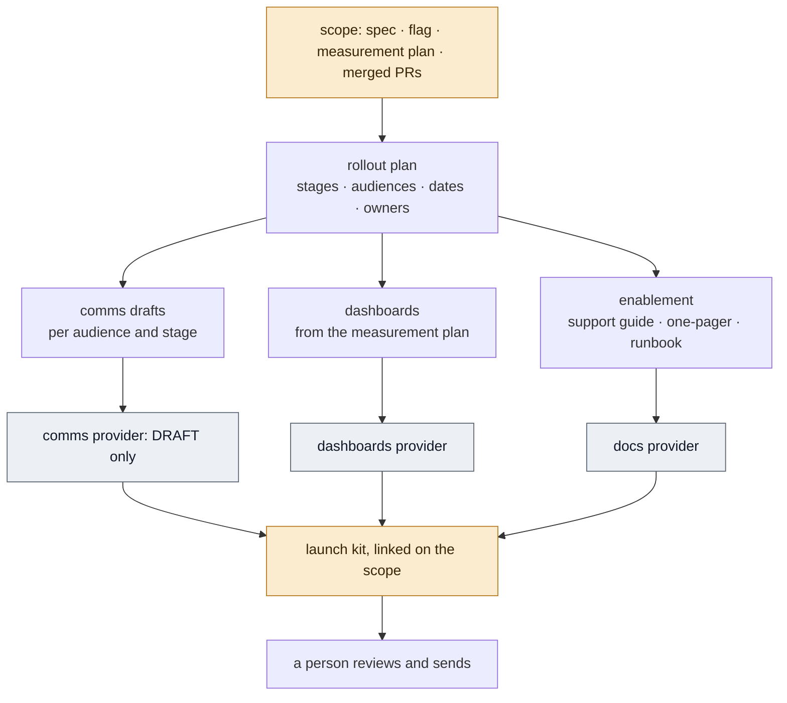
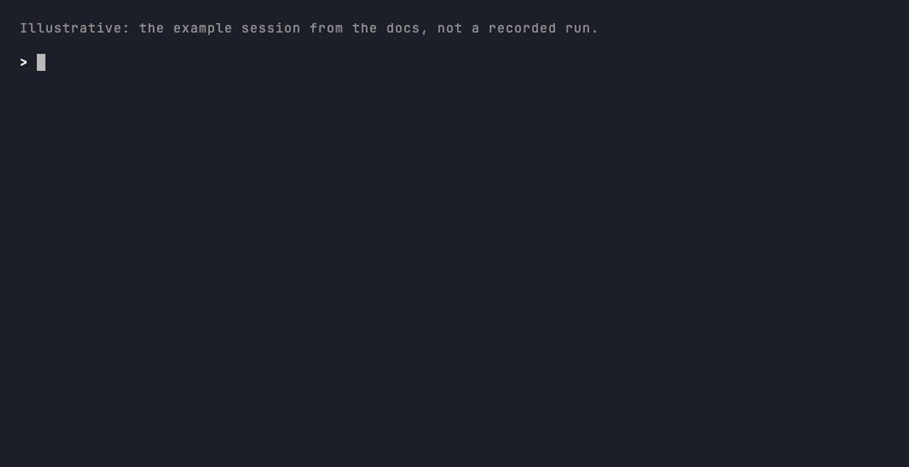

# prepare-launch — get everything ready before anyone sees the change

> **TL;DR** — Turns a merged scope into a launch kit: a rollout plan, announcement drafts for every audience, dashboards built from the spec's measurement plan, and enablement material for the people who will answer questions about it. Everything is prepared; nothing is sent. A person reads, adjusts and sends.

No launcher can send a message. Provider publication is experimental.

## At a glance

| | |
| --- | --- |
| **Block** | Rollout — first step |
| **Invoke** | `/wholeloop:prepare-launch` · `$wl-prepare-launch` · `/wl-prepare-launch` |
| **Decision point** | None — nothing leaves your hands here |
| **Reads** | A scope (its spec, flag, measurement plan, merged PRs) · or a description of what is shipping |
| **Writes** | Rollout plan · comms **drafts** · dashboards · enablement docs — each through its provider, all linked on the scope |
| **Slots** | `comms.voice` (tone and style guide) · `launch.templates` (the team's own plan or runbook formats) |
| **Capabilities** | `comms.draft` · `dashboards.create` · `docs.create` · `flags` (read the flag's current state) |
| **Agents** | `launcher` — can draft, cannot send |

## When to use it — and when not

**Use it when** code is merged (or about to be) and people outside the build — users, support, sales, other teams — need to hear about it, see it measured, or know how to help with it.

**Don't use it for** changes nobody outside the team will notice. Skip it with a reason ("internal refactor, no audience") and the skip is recorded on the scope.

## How it works



1. **The plan comes first.** Stages, audiences and dates are agreed before any text is drafted, so every message fits a moment in the ramp.
2. **Drafting is the only comms verb.** The `comms` capability has `draft` and nothing else — there is no way to express "send" — and the `launcher` agent has no sending tools. A Slack draft, a Teams draft or an email draft lands where you can edit it.
3. **Dashboards are built from the plan the spec pinned.** The metrics, sources and targets chosen in [`write-spec`](../define/write-spec.md) become dashboards now, so the numbers `measure-impact` reads later are the same ones everyone watched.
4. **Your voice, not the harness's.** A style guide, a brand skill or past announcements bound to `comms.voice` set the tone. Without one, drafts stay plain and say so.
5. **Missing provider? Manual-ready output.** If a dashboards or comms provider isn't connected, you get a precise spec or ready-to-paste text instead, and the gap is noted on the scope.

## Standalone use

Give it a description of what is shipping ("CSV export for the orders list, flag `orders_csv_export`, live next Tuesday") and it builds the same kit. Without a measurement plan it asks which two or three numbers tell you the launch went well, and where they live; it never picks metrics for you.

## Run it



*Illustrative: the example session below, animated. Its wording depends on your client and model.*

The same session as text:

```text
> /wholeloop:prepare-launch scope-a9e0

Prepare launch — scope-a9e0 "orders date filter"
Flag      orders_date_filter (off everywhere)
Plan      internal → 10% → 50% → 100% over 2 weeks (from the spec)
Voice     docs/brand/voice.md (repo)

▸ rollout plan written
▸ drafted: internal announcement · release note · support heads-up
▸ dashboard "Orders date filter" — 4 charts (PostHog)
▸ support guide + runbook (Notion)

Produced
  Rollout plan       Notion · Launch / Orders date filter     wl open scope-a9e0
  Slack draft        #product-updates (not sent)              open in Slack → Drafts
  Release note       draft in docs provider
  Dashboard          PostHog · Orders date filter
  Support guide      Notion
Next              ramp-exposure when you're ready to start the internal stage
```

| Client | Invoke |
| --- | --- |
| Claude Code, installed skills | `/wl-prepare-launch …` |
| Claude Code, generated plugin | `/wholeloop:prepare-launch …` |
| Codex CLI | `$wl-prepare-launch …` |
| OpenCode · Copilot · Gemini · Cursor | Ask for `wl-prepare-launch` |
| Antigravity | Ask for `wl-agy-prepare-launch` |

## Before & after

- **Fed by:** a merged scope from [`open-pr`](../build/open-pr.md) and its spec's measurement plan, or a description on its own.
- **Feeds:** [`ramp-exposure`](./ramp-exposure.md), which uses the plan's stages and the dashboards' numbers as exit criteria.

## Gotchas & FAQ

**"Can it post the announcement once I approve it?"** No. Sending is a person's act, by design. The draft is one click away from sent.

**"Our dashboards live in two tools."** Configure two providers with the `dashboards` capability and map each metric to its source in the measurement plan.

**"I don't use feature flags."** Then the plan has a single stage, and [`ramp-exposure`](./ramp-exposure.md) records one go/no-go instead of a ramp.

## Core commands

The commands behind the skill, for scripts and skill authors:

```text
wl launch schema --json
wl launch begin --for <scope> --json
wl launch complete --for <id> --file <kit.json> --json
wl launch report --for <id> --json
wl launch dispatch --for <id> --key <dashboard-key> --mcp <inventory> --json
```

**Inputs.** The kit is drafted from the scope's exact `cut-scopes` and specification revision, and its metrics; flags on the command cannot replace them. Used on its own, `begin` needs a description, `--owner` and `--measurement`. Missing success criteria become questions; no number or merge history is invented.

**Drafting.** The launcher role receives your voice and template guidance and your profile, and no way to publish anything.

- On Codex, custom agents inherit every MCP server you configured, so there is no native launcher there. Instead, `wl launch draft --for <id> --engine headless --adapter codex` drafts in one isolated, read-only worker without your configuration or MCP servers, and stores the kit through the same validation.
- Completion writes the rollout, communication and enablement drafts and the dashboard specifications, outside the repository.
- Each dashboard points to its metric in the stored measurement plan, with its query, unit, baseline, target, window and revision. No chart value is invented while drafting.

**Publishing drafts** is a separate, explicit SDK call, `dispatchLaunchArtifact`, limited to three operations that create drafts.

- It records its intent before calling the provider, caches completed results and keeps ambiguous ones for inspection.
- A communication counts as done only when the provider shows an **unsent** draft. Known sending routes, and mappings such as `send=true` or `draft=false`, are refused. What a real client permits and what a server does internally still need conformance checks.
- Without a provider, you get the complete local artifact to use by hand.

**Dashboards.** `wl launch dispatch` plans one completed dashboard. With a reviewed binding in your client's MCP inventory, it prints the exact tool and arguments for the client to call; otherwise it returns the local hand-off. It writes no state and reads no credential. wholeloop has no dashboard client of its own, so a created chart never proves that its queries are valid or its values right. Follow [client-owned transport setup](../../extending/providers.md#client-owned-mcp-transport); a failed call never switches to another transport.

<!-- docnav -->
[◀ open-pr](../build/open-pr.md)  ·  [📖 Docs index](../../README.md)  ·  [🧭 Concepts](../../concepts.md)  ·  [ramp-exposure ▶](ramp-exposure.md)
