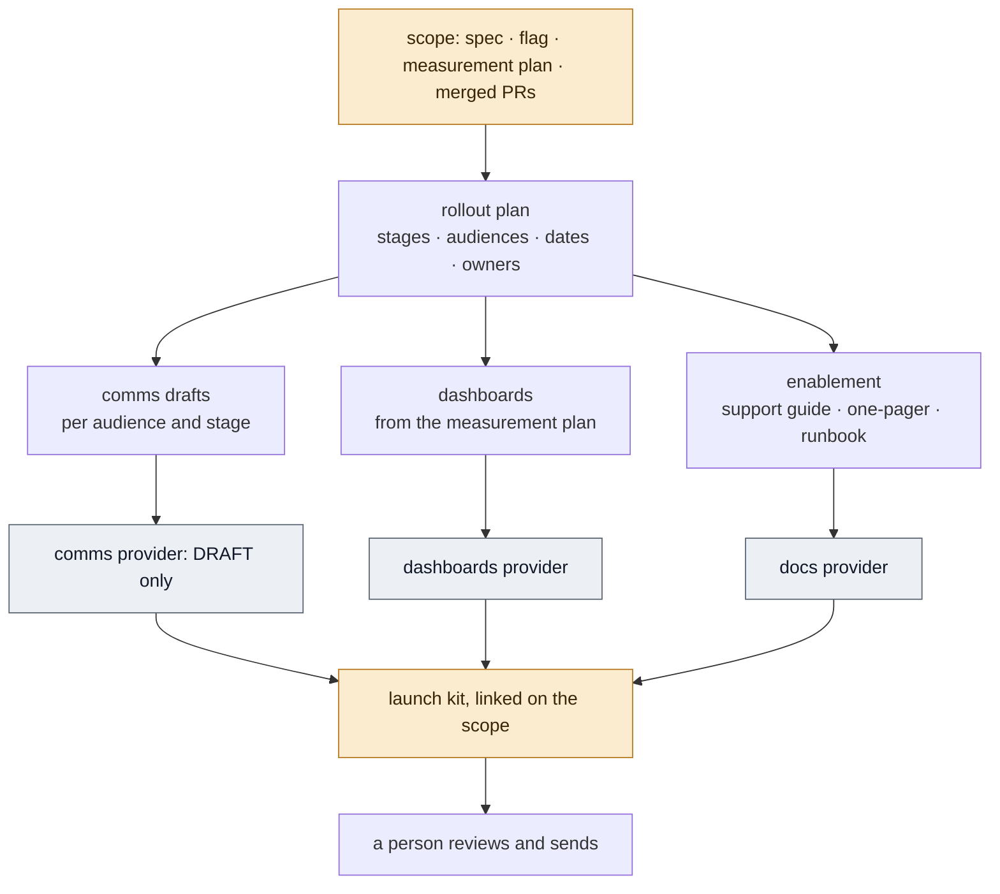

# prepare-launch — get everything ready before anyone sees the change

> **TL;DR** — Turns a merged scope into a launch kit: a rollout plan, announcement drafts for every audience, dashboards built from the spec's measurement plan, and enablement material for the people who will answer questions about it. Everything is prepared; nothing is sent. A person reads, adjusts and sends.

> [!NOTE]
> **Status: 🚧 partial.** The local/core implementation includes pinned measurement inputs, loaded voice/templates, a read-only drafting host, complete local kits, exact-metric dashboard specs, handoffs and an intent-journaled draft/create publication boundary. Real per-CLI adapter no-send tests remain pending with P1 adapters/conformance; synthetic hosts do not satisfy that criterion. Authenticated provider execution and merge/flag observations remain owner verification. Tracked in [P4-01](../../../roadmap/phase-4-rollout-learn.md#p4-01--prepare-launch-and-the-launcher).

---

## At a glance

| | |
| --- | --- |
| **Block** | Rollout — first step |
| **Invoke** | `/wholeloop:prepare-launch` · `$wl-prepare-launch` · `/wl-prepare-launch` |
| **Decision point** | None — nothing leaves your hands here |
| **Reads** | A scope (its spec, flag, measurement plan, merged PRs) · or a description of what is shipping |
| **Writes** | Rollout plan · comms **drafts** · dashboards · enablement docs — each through its provider, all linked on the scope |
| **Slots** | `comms.voice` (tone and style guide) · `launch.templates` (the team's own plan or runbook formats) |
| **Capabilities** | `comms.draft` · `dashboards.create` · `docs.create` · `flags` (read the flag's current state) |
| **Agents** | `launcher` — can draft, cannot send |

## When to use it — and when not

**Use it when** code is merged (or about to be) and people outside the build — users, support, sales, other teams — need to hear about it, see it measured, or know how to help with it.

**Don't use it for** changes nobody outside the team will notice. Skip it with a reason ("internal refactor, no audience") and the skip is recorded on the scope.

## How it works



1. **The plan comes first.** Stages, audiences and dates are agreed before any text is drafted, so every message fits a moment in the ramp.
2. **Drafting is the only comms verb.** The `comms` capability has `draft` and nothing else — there is no way to express "send" — and the `launcher` agent has no sending tools. A Slack draft, a Teams draft or an email draft lands where you can edit it.
3. **Dashboards are built from the plan the spec pinned.** The metrics, sources and targets chosen in [`write-spec`](../define/write-spec.md) become dashboards now, so the numbers `measure-impact` reads later are the same ones everyone watched.
4. **Your voice, not the harness's.** A style guide, a brand skill or past announcements bound to `comms.voice` set the tone. Without one, drafts stay plain and say so.
5. **Missing provider? Manual-ready output.** If a dashboards or comms provider isn't connected, you get a precise spec or ready-to-paste text instead, and the gap is noted on the scope.

## Standalone use

Give it a description of what is shipping ("CSV export for the orders list, flag `orders_csv_export`, live next Tuesday") and it builds the same kit. Without a measurement plan it asks which two or three numbers tell you the launch went well, and where they live — it never picks metrics for you.

The core commands are `wl launch begin --for <scope> --json`, `launch complete
--for <id> --file <kit.json>`, `launch report --for <id>` and `launch schema`. Standalone entry supplies a description, --owner and --measurement. The core asks for missing success criteria rather than inventing measurement numbers or merge history. The source is the scope's exact cut-scopes/spec revision, with owned metric selection; invocation flags cannot replace it.

The launcher receives actual voice/template content and profile instructions, without publication methods. Completion writes rollout/comms/enablement artifacts and dashboard specs outside the repository. Each dashboard carries an exact metricRef into its stored measurement.json, retaining query/unit/baseline/target/ window and original revision. No chart values are inferred during drafting.

`dispatchLaunchArtifact` is an explicit conductor SDK boundary for the three allowed draft/create operations. Its intent precedes the host call, completed results are cached and ambiguous outcomes stay retained for inspection. A comms success needs an explicit unsent draft observation. Known sending routes and send=true/draft=false mappings are rejected; real client permissions and opaque server semantics still require conformance. Missing providers return the complete local artifact for manual use. See [ADR-0038](../../decisions/0038-pinned-launch-kits-and-separate-publication-capabilities.md).

Remote dispatch prefers the native client’s observed MCP tool/schema and reviewed operation binding. Follow [client-owned transport setup](../../extending/providers.md#client-owned-mcp-transport); missing contracts retain pending handoffs and failed calls never activate HTTP. Native drafts remain unsent local artifacts.

The optional HTTP launch dispatch CLI previews a selected Grafana, PostHog, Metabase or Mixpanel dashboard and only creates it with --live through that same once-intent boundary. The bridge binds the artifact digest, exact PromQL/source pointer, folder and datasource, then verifies stored configuration by readback. It does not establish valid queries/rendered values or traffic. PostHog additionally checks project/timezone and both dashboard/insight attachment views, retaining known partial references as pending. Metabase creates an owned native SQL question and explicitly leaves its SQL time scope unverified for owner review. Mixpanel binds explicit workspace/native report parameters and verifies its dedicated report relationship, with unverified owner-reviewed time scope. The Amplitude operation remains a pending handoff until a reviewed MCP contract is supplied; a dedicated HTTP host is not a release requirement. See [remote bridges](../../extending/remote-bridges.md#grafana-dashboard-creation).

## Run it

```text
> /wholeloop:prepare-launch scope-a9e0

Prepare launch — scope-a9e0 "orders date filter"
Flag      orders_date_filter (off everywhere)
Plan      internal → 10% → 50% → 100% over 2 weeks (from the spec)
Voice     docs/brand/voice.md (repo)

▸ rollout plan written
▸ drafted: internal announcement · release note · support heads-up
▸ dashboard "Orders date filter" — 4 charts (PostHog)
▸ support guide + runbook (Notion)

Produced
  Rollout plan       Notion · Launch / Orders date filter     wl open scope-a9e0 --plan
  Slack draft        #product-updates (not sent)              open in Slack → Drafts
  Release note       draft in docs provider
  Dashboard          PostHog · Orders date filter
  Support guide      Notion
Next              ramp-exposure when you're ready to start the internal stage
```

| CLI | Invoke |
| --- | --- |
| Claude Code | `/wholeloop:prepare-launch …` |
| Codex CLI | `$wl-prepare-launch …` |
| OpenCode | `/wl-prepare-launch …` |
| Copilot CLI | `/wl-prepare-launch …` |
| Gemini CLI · Antigravity · Cursor | `/wl-prepare-launch …` |

## Before & after

- **Fed by:** a merged scope from [`open-pr`](../build/open-pr.md) and its spec's measurement plan, or a description on its own.
- **Feeds:** [`ramp-exposure`](./ramp-exposure.md), which uses the plan's stages and the dashboards' numbers as exit criteria.

## Gotchas & FAQ

**"Can it post the announcement once I approve it?"** No. Sending is a person's act, by design. The draft is one click away from sent.

**"Our dashboards live in two tools."** Configure two providers with the `dashboards` capability and map each metric to its source in the measurement plan.

**"I don't use feature flags."** Then the plan has a single stage, and [`ramp-exposure`](./ramp-exposure.md) records one go/no-go instead of a ramp.

---

<!-- docnav -->
[◀ open-pr](../build/open-pr.md)  ·  [📖 Docs index](../../README.md)  ·  [🧭 Concepts](../../concepts.md)  ·  [ramp-exposure ▶](ramp-exposure.md)
