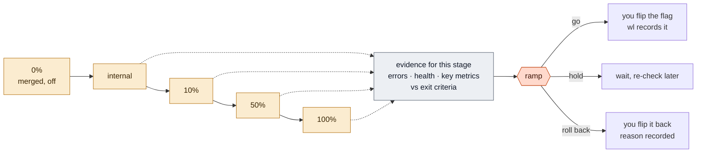

# ramp-exposure — widen the audience one checked stage at a time

> **TL;DR** — Moves a scope from nobody to everyone in stages — internal, a small percentage, half, all — and at each stage gathers the evidence that says whether it is safe to go further: errors, health signals, the key metrics. It proposes the next move; a person flips the flag. Run it whenever the next stage is due, even weeks apart.

> [!NOTE]
> **Status: 📐 design.** Tracked in [P4-02](../../../roadmap/phase-4-rollout-learn.md#p4-02--ramp-exposure).

---

## At a glance

| | |
|---|---|
| **Block** | Rollout |
| **Invoke** | `/wholeloop:ramp-exposure` · `$wl-ramp-exposure` · `/wl-ramp-exposure` |
| **Decision point** | **ramp** — at every stage, no exceptions |
| **Reads** | The scope's rollout plan and flag · live signals from your providers |
| **Writes** | Per-stage evidence and your decision on the scope · optional stage notes to the tracker or docs |
| **Slots** | `flags.naming` (to locate the flag) · `ramp.criteria` (team-standard exit criteria) |
| **Capabilities** | `flags` (read state only) · `source.errors` · `source.observability` · `source.product-analytics` |
| **Agents** | `launcher` (gathers evidence, drafts stage notes) |

## When to use it — and when not

**Use it when** a change sits behind a flag or any other exposure control, and you want each widening to be a deliberate, evidenced choice instead of a hopeful one.

**Don't use it when** there is nothing to ramp — a change with no flag ships at merge. In that case run it once as a single go/no-go check, or skip it with a reason.

## How it works



1. **Every stage has exit criteria.** They come from the rollout plan (or `ramp.criteria`): for example "no new error types for 48 h", "p95 latency within 10% of baseline", "export success rate above 98%".
2. **Evidence before advice.** The step reads current signals from your error, observability and analytics providers, lays them next to the criteria, and only then recommends go, hold or roll back.
3. **The machine never touches the flag.** The `flags` capability reads state and nothing more. You change it in your flag tool; the step confirms the new state on its next run and records who moved it and when.
4. **One decision per stage.** A recommendation of "go" is still a question. There is no auto-advance, no batch of stages, no "ramp to 100% if green".
5. **Re-entrant.** Each run looks at the scope, finds the current stage and picks up from there — next week, from a different CLI, or by a different person.
6. **Unreadable signal is not a pass.** If a source can't be reached, that criterion is marked unknown, and the recommendation says so.

## Standalone use

Give it a flag name and the criteria you care about ("`orders_csv_export`, watch Sentry errors and export success rate"). Without a rollout plan it proposes a staged plan, asks you to confirm it, then checks the current stage.

## Run it

```text
> /wholeloop:ramp-exposure scope-a9e0

Ramp — scope-a9e0 "orders date filter"
Flag      orders_date_filter · currently 10% (you set it 3 days ago)
Stage     10% → next proposed: 50%

Exit criteria for 10%               Now                    Status
  No new error types (72 h)         0 new (Sentry)         ✓
  p95 /orders latency ≤ +10%        +4% (Datadog)          ✓
  Filter used in ≥ 5% of visits     7.2% (PostHog)         ✓
  Support tickets mentioning it     unknown — no source    ? 

Recommendation  go to 50% · one criterion unknown (support)
Decision?   [ Go — I'll set 50% ]  [ Hold ]  [ Roll back ]

> Go — I'll set 50%

Recorded  stage 50% approved by you · re-check due in 72 h
Next      re-run after you change the flag; I'll confirm it's at 50%
```

| CLI | Invoke |
|---|---|
| Claude Code | `/wholeloop:ramp-exposure …` |
| Codex CLI | `$wl-ramp-exposure …` |
| OpenCode | `/wl-ramp-exposure …` |
| Copilot CLI | `/wl-ramp-exposure …` |
| Gemini CLI · Antigravity · Cursor | `/wl-ramp-exposure …` |

## Before & after

- **Fed by:** [`prepare-launch`](./prepare-launch.md) (plan, stages, dashboards); comms drafted there go out at the stages they were written for.
- **Feeds:** [`measure-impact`](../learn/measure-impact.md) — reaching 100% (or the final stage) starts the launch checkpoint.

## Gotchas & FAQ

**"Can I let it ramp automatically overnight?"** No. Each widening is a person's decision; that is the point of this step.

**"We use LaunchDarkly / Unleash / GrowthBook."** Pick the matching `flags` provider. If yours isn't listed, a read-only provider manifest is enough ([extending](../../extending/providers.md)).

**"Our flag is a config file, not a service."** Use the `config` flags provider: it reads the value from the repo and you change it by PR.

---

<!-- docnav -->
[◀ prepare-launch](prepare-launch.md)  ·  [📖 Docs index](../../README.md)  ·  [🧭 Concepts](../../concepts.md)  ·  [measure-impact ▶](../learn/measure-impact.md)
