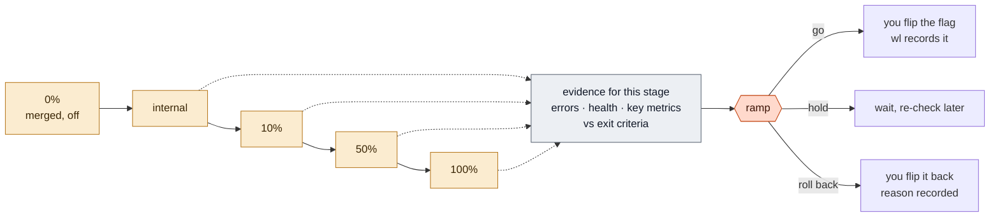
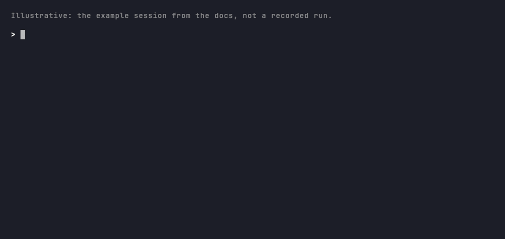
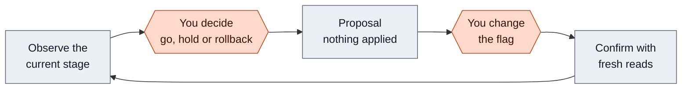

# ramp-exposure — widen the audience one checked stage at a time

> **TL;DR** — Moves a scope from nobody to everyone in stages — internal, a small percentage, half, all — and at each stage gathers the evidence that says whether it is safe to go further: errors, health signals, the key metrics. It proposes the next move; a person flips the flag. Run it whenever the next stage is due, even weeks apart.

Flag changes through providers are experimental.

## At a glance

| | |
| --- | --- |
| **Block** | Rollout |
| **Invoke** | `/wholeloop:ramp-exposure` · `$wl-ramp-exposure` · `/wl-ramp-exposure` |
| **Decision point** | **ramp** — at every stage, no exceptions |
| **Reads** | The scope's rollout plan and flag · live signals from your providers |
| **Writes** | Per-stage evidence and your decision on the scope · optional stage notes to the tracker or docs |
| **Slots** | `ramp.criteria` (loaded and pinned team-standard exit criteria); confirm the flag explicitly |
| **Capabilities** | `flags` (read state and propose only) · `source.errors` · `source.observability` · `source.product-analytics` |
| **Agents** | `launcher` (gathers evidence, drafts stage notes) |

## When to use it — and when not

**Use it when** a change sits behind a flag or any other exposure control, and you want each widening to be a deliberate, evidenced choice instead of a hopeful one.

**Don't use it when** there is nothing to ramp — a change with no flag ships at merge. In that case run it once as a single go/no-go check, or skip it with a reason.

## How it works



1. **Every stage has exit criteria.** They come from the rollout plan (or `ramp.criteria`): for example "no new error types for 48 h", "p95 latency within 10% of baseline", "export success rate above 98%".
2. **Evidence before advice.** The step reads current signals from your error, observability and analytics providers, lays them next to the criteria, and only then recommends go, hold or roll back.
3. **The machine never touches the flag.** The core reads state and prepares unapplied proposals through `flags.propose-change`. You change it in your flag tool; the step confirms the new state on its next run and records who moved it and when.
4. **One decision per stage.** A recommendation of "go" is still a question. There is no auto-advance, no batch of stages, no "ramp to 100% if green".
5. **Re-entrant.** Each run looks at the scope, finds the current stage and picks up from there — next week, from a different CLI, or by a different person.
6. **Unreadable signal is not a pass.** If a source can't be reached, that criterion is marked unknown, and the recommendation says so.

## Standalone use

Give it a flag name and the criteria you care about ("`orders_csv_export`, watch Sentry errors and export success rate"). Without a rollout plan it proposes a staged plan, asks you to confirm it, then checks the current stage.

## Run it



*Illustrative: the example session below, animated. Its wording depends on your client and model.*

The same session as text:

```text
> /wholeloop:ramp-exposure scope-a9e0

Ramp — scope-a9e0 "Find an order" · flag orders_search_v1 (LaunchDarkly)
Stage     10% → next 50%
Window    48 h since the 10% confirmation, ends today 14:00

▸ reading signals: Sentry errors · Grafana p95 latency · PostHog search success
✓ new error types         0           exit: 0
✓ p95 latency             312 ms      exit: within 10% of 298 ms
? search success rate     unknown     PostHog not connected in this client
▸ challenger: success rate is a required check — go is not available

Recommendation   HOLD — 1 required check unknown
Decision: [hold] [roll back] [connect PostHog and re-check]

Recorded   hold · by Ana López · reason "waiting for search success data"
Next       re-check after PostHog is connected; the flag was not touched
```

| Client | Invoke |
| --- | --- |
| Claude Code, installed skills | `/wl-ramp-exposure …` |
| Claude Code, generated plugin | `/wholeloop:ramp-exposure …` |
| Codex CLI | `$wl-ramp-exposure …` |
| OpenCode · Copilot · Gemini · Cursor | Ask for `wl-ramp-exposure` |
| Antigravity | Ask for `wl-agy-ramp-exposure` |

## Before & after

- **Fed by:** [`prepare-launch`](./prepare-launch.md) (plan, stages, dashboards); comms drafted there go out at the stages they were written for.
- **Feeds:** [`measure-impact`](../learn/measure-impact.md) — reaching 100% (or the final stage) starts the launch checkpoint.

## Gotchas & FAQ

**"Can I let it ramp automatically overnight?"** No. Each widening is a person's decision; that is the point of this step.

**"We use LaunchDarkly / Unleash / GrowthBook."** The built-in `launchdarkly`, `unleash` and `growthbook` providers read flag state through your client's MCP connection; configure one as your `flags` provider. If yours isn't listed, a read-only provider manifest is enough ([extending](../../extending/providers.md)).

**"Our flag is a config file, not a service."** Use an explicitly configured read/propose provider, or a manual control with evidence. The built-in `config-flags` provider reads it and stores unapplied proposals. You change the value by PR.

## Core commands

The commands behind the skill, for scripts and skill authors:

```bash
wl ramp schema --json
wl ramp begin "orders filter ramp" --owner Alex --file ramp-plan.json --json
wl ramp requests --for scope-a9e0 --mode observe --json
# The host executes the returned reads and supplies normalized results.
wl ramp observe --for scope-a9e0 --file read-responses.json --json
wl ramp decide go --for scope-a9e0 --basis <observation-event> --by Alex --reason "checked error and latency windows" --json
wl ramp proposal --for scope-a9e0 --json
# A person changes the flag externally; collect fresh confirmation reads.
wl ramp requests --for scope-a9e0 --mode confirm --json
wl ramp confirm --for scope-a9e0 --by Alex --file confirmation-responses.json --json
wl ramp report --for scope-a9e0 --json
```



**The plan** (`wholeloop/ramp-plan@1`) records the environment, who confirmed it, optionally the flag and the source digest, and its stages. Used on its own, the step needs the same facts.

- **Each stage** has a key, an audience, whether it is enabled, its exposure, its exit condition and its checks.
- **Each check** has a key, a provider and source operation, an exact query, a unit, an operator (`lt`, `lte`, `eq`, `gte`, `gt`), a threshold, whether it is required, a lookback in hours and a time zone.

**Reads.** The CLI takes explicit plans and results your client already read; it never signs in to or queries a service itself.

- Prefer the client's MCP tools ([client-owned transport](../../extending/providers.md#client-owned-mcp-transport)). `wl provider read-flags <id> --flag <key> --environment <key> --mcp <inventory> --json` shows the exact call the client would make, or that the state stays an open question.
- Results use `wholeloop/ramp-read-responses@1`: the exact request, run, stage, time and mode, and one result or a reason it was unavailable per request. A number looks like `{ "value": 0, "unit": "errors" }`; a flag read keeps its flag, environment, enabled state, exposure and audience at a known revision.
- **A missing value is unknown, never zero.** A failed or missing read stays unknown; there is no other service client to fall back to.
- Use sanitized values only: never credentials or raw private logs in a response file.
- From the SDK, `RampWorkflow` can be used directly with a real `ProviderHost`.

**Decisions.**

- A required check that is unknown or failing blocks *go*. An unknown optional check needs `--ack` with its key.
- Every confirmation starts a fresh, full lookback window for the next stage.
- If the controls change or cannot be read, the ramp holds; restoring them restarts the window.
- The position in the ramp, the evidence and who decided what, when and on what basis survive replay and resume.

**Applying.** The local proposal applies nothing. An explicit SDK call, `dispatchRampProposal`, may create a **proposal** in the flag provider, and only that: it records its intent first, requires `applied=false`, caches receipts and refuses to retry blindly after an ambiguous result. With manual flag control, the plan omits the flag and you supply `--evidence` when confirming.

<!-- docnav -->
[◀ prepare-launch](prepare-launch.md)  ·  [📖 Docs index](../../README.md)  ·  [🧭 Concepts](../../concepts.md)  ·  [measure-impact ▶](../learn/measure-impact.md)
