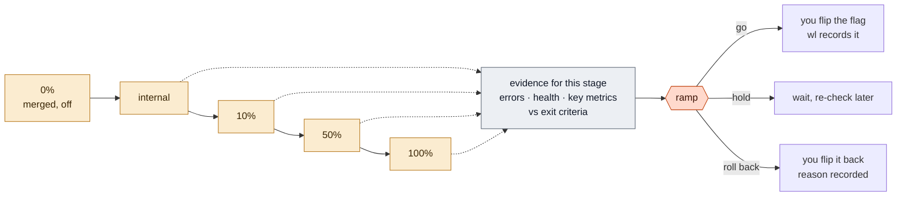

# ramp-exposure — widen the audience one checked stage at a time

> **TL;DR** — Moves a scope from nobody to everyone in stages — internal, a small percentage, half, all — and at each stage gathers the evidence that says whether it is safe to go further: errors, health signals, the key metrics. It proposes the next move; a person flips the flag. Run it whenever the next stage is due, even weeks apart.

> [!NOTE]
> **Status: 🚧 partial.** The local core implements pinned plans, normalized evidence, per-stage human decisions, proposal-only dispatch and separate confirmations. Real client/provider execution remains owner verification. Tracked in [P4-02](../../../roadmap/phase-4-rollout-learn.md#p4-02--ramp-exposure).

---

## At a glance

| | |
| --- | --- |
| **Block** | Rollout |
| **Invoke** | `/wholeloop:ramp-exposure` · `$wl-ramp-exposure` · `/wl-ramp-exposure` |
| **Decision point** | **ramp** — at every stage, no exceptions |
| **Reads** | The scope's rollout plan and flag · live signals from your providers |
| **Writes** | Per-stage evidence and your decision on the scope · optional stage notes to the tracker or docs |
| **Slots** | `ramp.criteria` (loaded and pinned team-standard exit criteria); confirm the flag explicitly |
| **Capabilities** | `flags` (read state and propose only) · `source.errors` · `source.observability` · `source.product-analytics` |
| **Agents** | `launcher` (gathers evidence, drafts stage notes) |

## When to use it — and when not

**Use it when** a change sits behind a flag or any other exposure control, and you want each widening to be a deliberate, evidenced choice instead of a hopeful one.

**Don't use it when** there is nothing to ramp — a change with no flag ships at merge. In that case run it once as a single go/no-go check, or skip it with a reason.

## How it works



1. **Every stage has exit criteria.** They come from the rollout plan (or `ramp.criteria`): for example "no new error types for 48 h", "p95 latency within 10% of baseline", "export success rate above 98%".
2. **Evidence before advice.** The step reads current signals from your error, observability and analytics providers, lays them next to the criteria, and only then recommends go, hold or roll back.
3. **The machine never touches the flag.** The core reads state and prepares unapplied proposals through `flags.propose-change`. You change it in your flag tool; the step confirms the new state on its next run and records who moved it and when.
4. **One decision per stage.** A recommendation of "go" is still a question. There is no auto-advance, no batch of stages, no "ramp to 100% if green".
5. **Re-entrant.** Each run looks at the scope, finds the current stage and picks up from there — next week, from a different CLI, or by a different person.
6. **Unreadable signal is not a pass.** If a source can't be reached, that criterion is marked unknown, and the recommendation says so.

## Standalone use

Give it a flag name and the criteria you care about ("`orders_csv_export`, watch Sentry errors and export success rate"). Without a rollout plan it proposes a staged plan, asks you to confirm it, then checks the current stage.

## Run it

The CLI accepts explicit plans and host-normalized reads; it does not authenticate or query remote services itself. Use sanitized scalar/flag observations, never credentials or raw private logs in response files. Prefer the native client’s observed MCP tools through [client-owned transport planning](../../extending/providers.md#client-owned-mcp-transport). Missing or failed MCP reads remain unknown and never activate an HTTP bridge automatically. Proposals stay native and unapplied.

```bash
wl ramp schema --json
wl ramp begin "orders filter ramp" --owner Alex --file ramp-plan.json --json
wl ramp requests --for scope-a9e0 --mode observe --json
# The host executes the returned reads and supplies normalized results.
wl ramp observe --for scope-a9e0 --file read-responses.json --json
wl ramp decide go --for scope-a9e0 --basis <observation-event> --by Alex --reason "checked error and latency windows" --json
wl ramp proposal --for scope-a9e0 --json
# A person changes the flag externally; collect fresh confirmation reads.
wl ramp requests --for scope-a9e0 --mode confirm --json
wl ramp confirm --for scope-a9e0 --by Alex --file confirmation-responses.json --json
wl ramp report --for scope-a9e0 --json
```

`ramp-plan.json` uses wholeloop/ramp-plan@1: environment, confirmedBy, optional flag/sourceDigest and stages. Every stage includes key, audience, enabled, exposure, exit and checks. A check specifies key, provider, source operation, exact query, unit, operator (lt/lte/eq/gte/gt), threshold, required, lookbackHours and timezone. Standalone plans require the same explicit facts.

Read results use wholeloop/ramp-read-responses@1 with the exact request run, stage, at and mode plus results: each fingerprint carries either a normalized result or an unavailable reason. Numeric bodies are `{ "value": 0, "unit":
"errors" }`; flag bodies preserve flag, environment, enabled, exposure and audience with a complete revision-bound read. A missing unit/value is unknown, never zero. The SDK can use RampWorkflow with an actual ProviderHost directly.

The local proposal applies nothing. An explicit conductor SDK invocation of `dispatchRampProposal` may create a provider proposal only; it journals intent, requires applied=false, caches receipts and refuses blind retries after ambiguity. A manual-control plan omits flag and supplies --evidence during confirmation. Unknown optional checks require --ack with their keys; required unknown/failing checks block go. Every confirmation starts a fresh full lookback for the next stage. Changed/unreadable controls hold the ramp; restoration resets that window. Replay/resume retain the cursor, exact evidence and who/when/basis of each decision. [ADR-0039](../../decisions/0039-evidence-bound-human-exposure-stages.md) explains why generic approvals, mixed windows and automatic flag changes were rejected.

| CLI | Invoke |
| --- | --- |
| Claude Code | `/wholeloop:ramp-exposure …` |
| Codex CLI | `$wl-ramp-exposure …` |
| OpenCode | `/wl-ramp-exposure …` |
| Copilot CLI | `/wl-ramp-exposure …` |
| Gemini CLI · Antigravity · Cursor | `/wl-ramp-exposure …` |

## Before & after

- **Fed by:** [`prepare-launch`](./prepare-launch.md) (plan, stages, dashboards); comms drafted there go out at the stages they were written for.
- **Feeds:** [`measure-impact`](../learn/measure-impact.md) — reaching 100% (or the final stage) starts the launch checkpoint.

## Gotchas & FAQ

**"Can I let it ramp automatically overnight?"** No. Each widening is a person's decision; that is the point of this step.

**"We use LaunchDarkly / Unleash / GrowthBook."** Provider manifests and real-service fixtures are tracked in P4-05; configure an explicit `flags` provider when available. If yours isn't listed, a read-only provider manifest is enough ([extending](../../extending/providers.md)).

**"Our flag is a config file, not a service."** Use an explicitly configured read/propose provider, or a manual control with evidence. The built-in config-file provider is tracked in P4-05. You change the value by PR.

---

<!-- docnav -->
[◀ prepare-launch](prepare-launch.md)  ·  [📖 Docs index](../../README.md)  ·  [🧭 Concepts](../../concepts.md)  ·  [measure-impact ▶](../learn/measure-impact.md)
