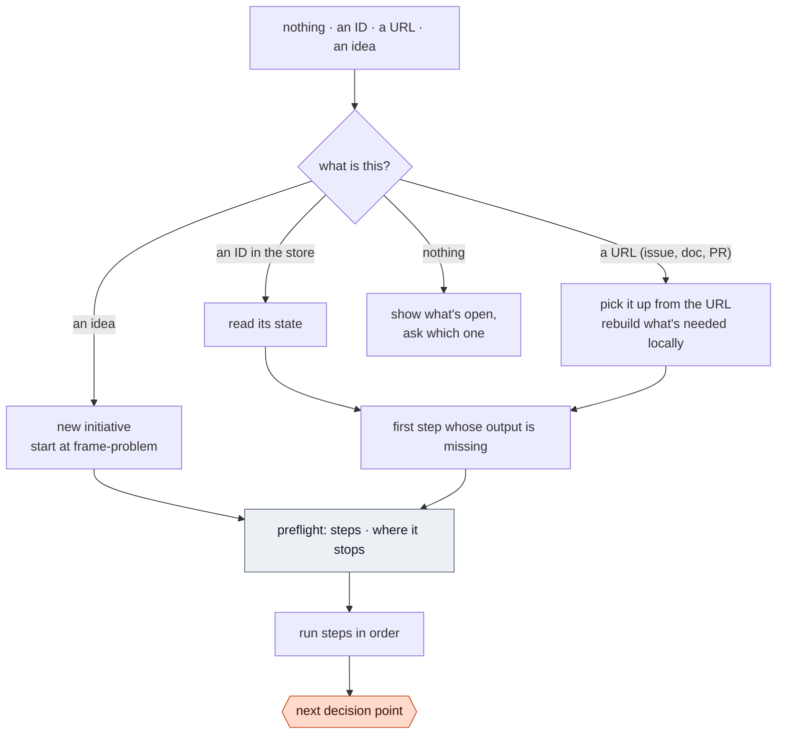
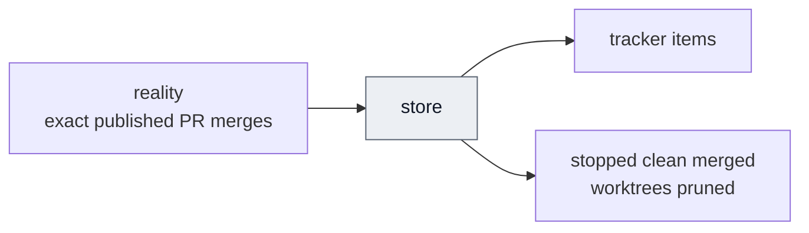

# Utilities — next, status, setup, sync

> **TL;DR** — Four helpers that move you around the flow rather than through one step of it. `next` is the single front door: it figures out where things stand and runs forward to the next decision. `status` shows what is where and what is waiting on whom. `setup` configures your profile, providers and CLIs. `sync` keeps the store and your external tools in agreement.

> [!NOTE]
> **Status: 🚧 partial.** Canonical skills and local `wl next`, `wl status`, `wl setup` and evidence-backed `wl sync` are implemented in [P1-12](../../roadmap/phase-1-walking-skeleton.md#p1-12--first-skills--next-status-setup-frame-problem). Generated client installation remains pending conformance. The scenarios below describe the target flow; picking up from a URL remains [P2-08](../../roadmap/phase-2-define.md#p2-08--adopt-from-a-url-publish-as-you-go), `sync` implementation/owner checks are tracked in [P4-06](../../roadmap/phase-4-rollout-learn.md#p4-06--sync).

---

## At a glance

| Utility | Invoke | Reads | Writes | Decision point |
| --- | --- | --- | --- | --- |
| **next** | `/wholeloop:next` · `$wl-next` · `/wl-next` | anything: nothing, an ID, a URL, an idea | whatever the steps it runs write | the ones in those steps |
| **status** | `/wholeloop:status` · `$wl-status` · `/wl-status` | the store | nothing | none |
| **setup** | `/wholeloop:setup` · `$wl-setup` · `/wl-setup` | your CLIs' config, the repo | user / project config · MCP config of chosen CLIs | none |
| **sync** | `/wholeloop:sync` · `$wl-sync` · `/wl-sync` | the store · `codehost` · `tracker` | the store · tracker items | none |

---

## Available local commands

```text
wl next "Find old orders faster" --owner Alex --json
wl next init-0123abcd --json
wl status --json
wl status init-0123abcd --json
wl setup --json
wl setup --profile pair --docs local-docs --tracker local-tracker --scope user --json
```

`next` begins framing from a sentence and reuses initiatives with an equivalent normalized title. Missing ownership becomes a
question before creating an item; no input selects the sole open item or asks
which one to continue. IDs reuse unfinished runs. After framing completion it
can begin the spec and then stops at its required approval. Later unavailable
steps remain explicit limits. Pending decisions
become questions for a person, never automatic approvals. URL adoption and
`--through` routing remain planned.

`status` reports stored items, owners, step plans, pending decisions and unread
message counts without consuming messages or writing the store. It does not yet
read live integrations or scheduled checkpoints.

`setup` returns batched choices or applies an explicit subset of profile/docs/
tracker choices. `--scope user|project|run` is required before applying choices.
All selections validate before an atomic settings write. Run scope returns a
transient override; project profile suggestions still yield to user preferences.
Adapter installation, MCP configuration edits and authentication remain manual.
The canonical skills live in `harness/skills/`; live client execution awaits the
adapter/conformance tasks, while compiled CLI workflow tests exercise these paths.

The remaining examples show the broader target behavior.

## next

**The one entry point.** Give it anything; it works out what you mean, says what it is about to do, and runs the flow forward until a person needs to decide.



- **States the plan before acting.** Which steps, in which order, and where it will stop — in a few lines. Say "only up to the spec" and it stops there.
- **Never repeats finished work.** It starts from the first step whose output doesn't exist yet; a step skipped with a reason stays skipped.
- **Picks up from a URL.** A tracker issue, a document or a PR is enough to rebuild the local state the next step needs, matching existing records instead of duplicating them.
- **The whole front in one go.** `next "idea" --through build` runs Define and Build back to back, still stopping at **approve** and **test it**.
- **Respects your `stops` setting.** With `stops: each-step` it pauses after every step even when no decision is due ([profile](../configuration/profile.md)).

```text
> /wholeloop:next https://linear.app/acme/issue/ENG-482

Found     ENG-482 "Filter orders by date" → no local record yet, picking it up
Has       spec (approved in Linear) · 1 scope · no slices
Plan      slice-work → build-slice → verify-works ⇄ review-code → stop at "test it"
Go?       [ Go ]  [ Only slice-work ]  [ Change the plan ]
```

## status

**What is where, and who is it waiting on.** Read-only, instant, safe anywhere.

```text
> /wholeloop:status

Waiting on you
  approve      init-41c2 spec "orders date filter"           since 2 days
  test it      slice-0d4e (green)                             wl open slice-0d4e
  ramp         scope-a9e0 at 10% · criteria met               re-check was due today
Due checkpoints
  D+30         scope-7c21 "CSV export"                        measure-impact scope-7c21
In progress
  build        slice-77ab · round 2 of 4 verify               started 14 min ago
```

`status <id>` zooms into one item; `--json` prints the same data for scripts and dashboards.

## setup

**Configure once, change any time.** Interactive, short, and it only asks about what you're about to use.

| Area | What it sets | Where it's remembered |
| --- | --- | --- |
| **Profile** | verbosity, depth, challenge, pace, stops, teaching, language — or a preset | your user config |
| **Providers** | which tool fulfils each capability (docs, tracker, codehost, sources…) | project config (team) or user config (you) |
| **CLIs** | which CLIs get adapters installed, user-wide or for this project | the CLIs' own config folders |
| **MCP servers** | install recipes for the providers you picked, per CLI (`wl mcp add <provider> --target <cli>`) | each CLI's MCP config |

```text
> /wholeloop:setup providers

Docs       ( ) local markdown  (•) Notion ✓ detected  ( ) Confluence  ( ) Google Docs
Tracker    ( ) local  ( ) GitHub Issues  (•) Linear ✓ detected  ( ) Jira
Codehost   (•) GitHub ✓ gh signed in  ( ) GitLab
Analytics  [x] PostHog ✓ detected  [ ] Mixpanel ✗ not connected → show install
Remember   (•) this repo (shared via .wholeloop/config.yml)  ( ) only me
```

Nothing has to be configured up front: every step asks for what it needs the first time and offers to remember the answer. `setup` is just the place to see and change it all at once.

## sync

**Make the store and your tools agree.** Read exact published PR merge observations, certify slice/part delivery and preserve unresolved sources. Explicit SDK tracker targets use revision-bound reads/transitions; flags and arbitrary issues are not inferred.



- **Exact merges close delivery work.** Match the published PR URL/repository/head/base/commit and complete non-draft merged state. A closed-unmerged PR or changed head cannot close its item. Every repository part needs certified closure before its slice; manually closed work does not count.
- **Scopes become delivery-ready.** Every current slice must have certified merge evidence. The scope remains open for rollout/learning and routes to prepare-launch; decide-next owns final outcome closure. Reopened work invalidates old readiness and needs a newly tested PR plan.
- **Tracker targets are explicit.** An SDK conductor supplies provider/ref/exact target state and a tracker host. Read a complete matching current revision, journal intent, transition only certified work and observe final state. Missing bindings stay handoffs. Later external edits are reported without reapplying old targets.
- **Uncertain writes are read-reconciled.** A lost transition response keeps its intent. A later read may confirm success; otherwise preserve ambiguity without a second write. Repeated unchanged work adds no journal events.
- **Cleanup is conservative.** Reuse stopped/clean/owned/locally-merged worktree pruning outside the state lock. Retain active/dirty/locked/unmerged work, branches and processes. Squash/rebase merges may need local integration confirmation or explicit owner cleanup.

```bash
wl sync --json
wl sync --for scope-a9e0b1c2 --prune off --json
wl sync --for scope-a9e0b1c2 --file normalized-pr-observations.json --json
```

Default code-host reads use gh/glab and their credential stores; the command does
not push, merge or fetch. An imported wholeloop/sync-observations@1 file contains
observations with exact published plan event/ref and a normalized complete result
or explicit unavailable reason. Imports are labelled and prove no authentication.
Unknown source reads preserve open work and return a precondition exit code.

The SDK `SyncWorkflow.run` accepts a codehost factory and optional tracker host,
plus explicit per-item provider/ref/state targets. Target references/state IDs are
never guessed or derived from unresolved publication placeholders. The CLI has no
authenticated tracker executor; that bridge remains the host's responsibility.
Reports include changes, unknown observations, delivery readiness, tracker outcomes
and retained/pruned worktrees. [ADR-0043](../decisions/0043-certified-delivery-sync-and-recoverable-tracker-status.md)
explains the distinction between delivered code and a decided product outcome.

---

## Gotchas & FAQ

**"Do I need `next` at all?"** No. Calling a step directly is just as valid; `next` saves you from remembering which one comes now.

**"Can a teammate continue my work?"** Yes, if the work lives in a shared tool (tracker, docs, PRs). They run `next <URL>` and it rebuilds what's needed on their machine. Purely local work stays on yours.

**"Will `sync` overwrite edits made in the tracker?"** Content is never rewritten. Explicit SDK targets move status only after current reads; later external state edits are reported as drift and preserved. Unbound references remain handoffs.

---

<!-- docnav -->
[◀ decide-next](learn/decide-next.md)  ·  [📖 Docs index](../README.md)  ·  [🧭 Concepts](../concepts.md)  ·  [Configuration ▶](../configuration/README.md)
