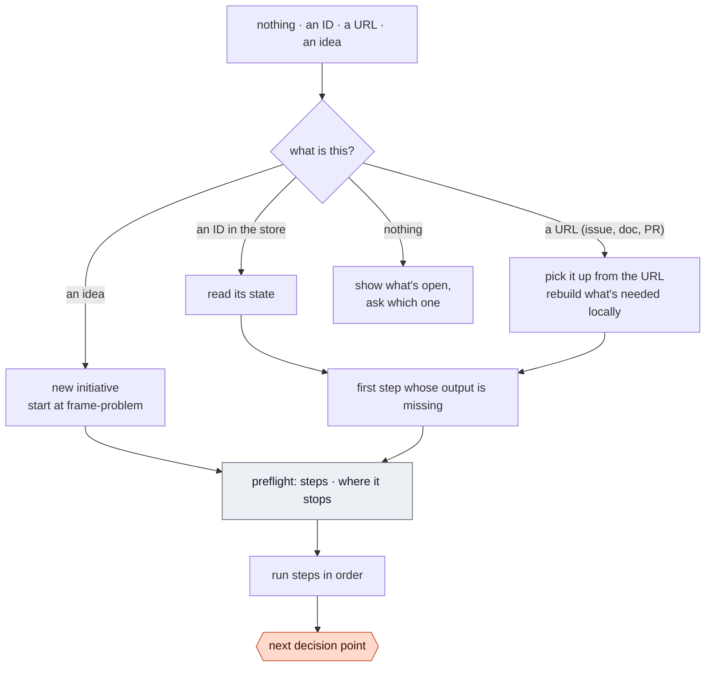
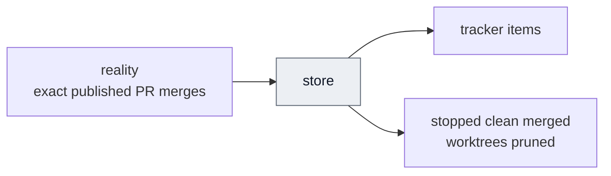

# Utilities — next, status, setup, sync

> **TL;DR** — The `next` skill orchestrates available steps until a decision; the terminal `wl next` returns the next core contract. `status` inspects stored work, `setup` selects scoped profile/destination preferences, and `sync` reconciles exact delivery evidence. None of these names implies automatic model calls or client authentication.

> [!NOTE]
> **Status: 🚧 partial.** Canonical skills and local `wl next`, `wl status`, `wl setup` and evidence-backed `wl sync` are implemented, as are URL adoption and explicit shared publication. Generated client installation and `sync` against hosted services still need native conformance.

---

## At a glance

| Utility | Invoke | Reads | Writes | Decision point |
| --- | --- | --- | --- | --- |
| **next** | `/wholeloop:next` · `$wl-next` · `/wl-next` | anything: nothing, an ID, a URL, an idea | whatever the steps it runs write | the ones in those steps |
| **status** | `/wholeloop:status` · `$wl-status` · `/wl-status` | the store | nothing | none |
| **setup** | `/wholeloop:setup` · `$wl-setup` · `/wl-setup` | layered harness config and provider/profile catalogs | explicitly selected user/project settings, or transient run overrides | explicit choice of scope before saving |
| **sync** | `/wholeloop:sync` · `$wl-sync` · `/wl-sync` | the store · `codehost` · `tracker` | the store · tracker items | none |

---

## Available local commands

Examples below use the `wl` command from the npm package; from a source build, run `node /absolute/path/to/dist/wl.mjs` in its place. In the native conversation select/request the installed `wl-...` skill; Antigravity uses `wl-agy-...`, and a separate Claude plugin uses `/wholeloop:...`. [Client setup](../platforms/local-onboarding.md) explains namespaces; the [core tour](../tutorials/local-core.md) demonstrates the terminal behavior.

```text
wl next "Find old orders faster" --owner Alex --json
wl next init-0123abcd --json
wl status --json
wl status init-0123abcd --json
wl setup --json
wl setup --profile pair --docs local-docs --tracker local-tracker --scope user --json
```

`next` begins framing from a sentence and reuses initiatives with an equivalent normalized title. Missing ownership becomes a question before creating an item; no input selects the sole open item or asks which one to continue. IDs reuse unfinished runs. After framing completion it can begin the spec and then stops at its required approval. Later unavailable steps remain explicit limits. Pending decisions become questions for a person, never automatic approvals. `--through` routing remains planned.

`status` reports stored items, owners, step plans, pending decisions and unread message counts without consuming messages or writing the store. Recorded workspaces and impact schedules appear when present. It does not poll live integrations or infer deployment/service state from them.

`setup` returns batched choices or applies an explicit subset of profile/docs/tracker choices. `--scope user|project|run` is required before applying choices. All selections validate before an atomic settings write. Run scope returns a transient override; project profile suggestions still yield to user preferences. Installation uses separate explicit commands; MCP edits and authentication remain client-owned setup. Canonical skills live in `harness/skills/`; compiled CLI workflow tests and scoped native observations are recorded separately in [acceptance](../v1-acceptance.md).

The sections below describe skill/orchestrator behavior alongside core commands. A terminal call returns its contract or receipt; the coding client must perform any model-backed work and explicitly selected external handoffs. Setup does not install adapters, edit MCP configuration or authenticate services.

## Adopt a URL and publish Define artifacts

`wl next <HTTPS-URL> --json` matches stored adoption/document/tracker/PR links first. Fragments and known tracking parameters do not create new identities; semantic queries remain distinct. Multiple initiatives require an explicit ID. For an unknown URL, next asks for the source provider/kind and owner/title. It never invents an authenticated fetch or approvals from imported prose.

A client reads the document/item and normalizes a complete result with its exact reference, body and revision. Save sanitized observations outside the repository:

```json
{"schema":"wholeloop/shared-read@1","provider":"notion","kind":"docs","ref":"https://docs.example.com/work/42","result":{"status":"succeeded","ref":"https://docs.example.com/work/42","body":"# Order search\n\nShared context.","revision":"observed-revision","complete":true}}
```

```text
wl next https://docs.example.com/work/42 --provider notion --kind docs --file /tmp/shared-read.json --owner Alex --json
wl adopt https://docs.example.com/work/42 --provider notion --kind docs --file /tmp/shared-read.json --owner Alex --json
```

`adopt` stops after import; `next` continues the stored initiative. A missing owner/title becomes batched questions before writing anything. Tracker bodies normalize to a JSON string containing title, body and optional owner. Imports are labelled observations; they do not prove that this process authenticated a tool.

Each initiative defaults to local. To share, provide a destination array such as `[{"key":"team-docs","provider":"notion","kind":"docs","ref":"https://docs.example.com/work/42"}]`. Omit ref to create a separate resource per artifact; supply ref to append into an existing document/item. Explicit HTTPS destinations are pinned across mode changes.

```text
wl share mode --for init-0123abcd --mode shared --by Alex --file /tmp/targets.json --json
wl share requests --for init-0123abcd --json
wl share request --for init-0123abcd --key <outbox-key> --json
wl share reconcile --for init-0123abcd --key <outbox-key> --ref <published-URL> --file /tmp/published-read.json --json
wl share report --for init-0123abcd --json
wl share mode --for init-0123abcd --mode local --by Alex --json
```

Shared mode queues all completed research, framing, specification and scope artifacts belonging to the initiative, including an unambiguously adopted research brief. Future completions queue in the same journal transaction. A standalone unadopted brief has no initiative destinations and stays local.

The conductor consumes these requests through an explicit ProviderHost. The SDK SharingWorkflow.mode(..., host) publishes existing artifacts; complete(..., host) completes and flushes future work. The CLI queues and exposes a once-only intent: it does not authenticate or execute opaque MCP writers. After share request, the client performs the requested create or fresh read/append/conditional update, then supplies a separate complete read for reconciliation. Only exact artifact content earns a published receipt and stored link; the local CLI receipt alone means queued. A lost response remains ambiguous: find the resource and read it, never blindly repeat the write. Local mode pauses new requests, while a request already handed to a client remains that client's responsibility.

## next

**The one entry point.** Give it anything; it works out what you mean, says what it is about to do, and runs the flow forward until a person needs to decide.



- **States the plan before acting.** Which steps, in which order, and where it will stop — in a few lines. Say "only up to the spec" and it stops there.
- **Never repeats finished work.** It starts from the first step whose output doesn't exist yet; a step skipped with a reason stays skipped.
- **Picks up from a URL.** A tracker issue, a document or a PR is enough to rebuild the local state the next step needs, matching existing records instead of duplicating them.
- **The whole front in one go.** `next "idea" --through build` runs Define and Build back to back, still stopping at **approve** and **test it**.
- **Respects your `stops` setting.** With `stops: each-step` it pauses after every step even when no decision is due ([profile](../configuration/profile.md)).

```text
> /wholeloop:next https://linear.app/acme/issue/ENG-482

Found     ENG-482 "Filter orders by date" → no local record yet, picking it up
Has       spec (approved in Linear) · 1 scope · no slices
Plan      slice-work → build-slice → verify-works ⇄ review-code → stop at "test it"
Go?       [ Go ]  [ Only slice-work ]  [ Change the plan ]
```

## status

**What is where, and who is it waiting on.** Read-only, instant, safe anywhere.

```text
> /wholeloop:status

Waiting on you
  approve      init-41c2 spec "orders date filter"           since 2 days
  test it      slice-0d4e (green)                             wl open slice-0d4e
  ramp         scope-a9e0 at 10% · criteria met               re-check was due today
Due checkpoints
  D+30         scope-7c21 "CSV export"                        measure-impact scope-7c21
In progress
  build        slice-77ab · round 2 of 4 verify               started 14 min ago
```

`status <id>` zooms into one item; `--json` prints the same data for scripts and dashboards.

## setup

**Configure once, change any time.** Interactive, short, and it only asks about what you're about to use.

| Area | What it sets | Where it's remembered |
| --- | --- | --- |
| **Profile** | verbosity, depth, challenge, pace, stops, teaching, language — or a preset | your user config |
| **Providers** | which tool fulfils each capability (docs, tracker, codehost, sources…) | project config (team) or user config (you) |
| **CLIs** | which CLIs get adapters installed, user-wide or for this project | the CLIs' own config folders |
| **MCP servers** | install recipes for the providers you picked, per CLI (`wl mcp add <provider> --target <cli>`) | each CLI's MCP config |

```text
> /wholeloop:setup providers

Docs       ( ) local markdown  (•) Notion ✓ detected  ( ) Confluence  ( ) Google Docs
Tracker    ( ) local  ( ) GitHub Issues  (•) Linear ✓ detected  ( ) Jira
Codehost   (•) GitHub ✓ gh signed in  ( ) GitLab
Analytics  [x] PostHog ✓ detected  [ ] Mixpanel ✗ not connected → show install
Remember   (•) this repo (shared via .wholeloop/config.yml)  ( ) only me
```

Nothing has to be configured up front: every step asks for what it needs the first time and offers to remember the answer. `setup` is just the place to see and change it all at once.

## sync

**Make the store and your tools agree.** Read exact published PR merge observations, certify slice/part delivery and preserve unresolved sources. Explicit SDK tracker targets use revision-bound reads/transitions; flags and arbitrary issues are not inferred.



- **Exact merges close delivery work.** Match the published PR URL/repository/head/base/commit and complete non-draft merged state. A closed-unmerged PR or changed head cannot close its item. Every repository part needs certified closure before its slice; manually closed work does not count.
- **Scopes become delivery-ready.** Every current slice must have certified merge evidence. The scope remains open for rollout/learning and routes to prepare-launch; decide-next owns final outcome closure. Reopened work invalidates old readiness and needs a newly tested PR plan.
- **Tracker targets are explicit.** An SDK conductor supplies provider/ref/exact target state and a tracker host. Read a complete matching current revision, journal intent, transition only certified work and observe final state. Missing bindings stay handoffs. Later external edits are reported without reapplying old targets.
- **Uncertain writes are read-reconciled.** A lost transition response keeps its intent. A later read may confirm success; otherwise preserve ambiguity without a second write. Repeated unchanged work adds no journal events.
- **Cleanup is conservative.** Reuse stopped/clean/owned/locally-merged worktree pruning outside the state lock. Retain active/dirty/locked/unmerged work, branches and processes. Squash/rebase merges may need local integration confirmation or explicit owner cleanup.

```bash
wl sync --json
wl sync --for scope-a9e0b1c2 --prune off --json
wl sync --for scope-a9e0b1c2 --file normalized-pr-observations.json --json
```

Default code-host reads use gh/glab and their credential stores; the command does not push, merge or fetch. An imported wholeloop/sync-observations@1 file contains observations with exact published plan event/ref and a normalized complete result or explicit unavailable reason. Imports are labelled and prove no authentication. Unknown source reads preserve open work and return a precondition exit code.

The SDK `SyncWorkflow.run` accepts a codehost factory and optional tracker host, plus explicit per-item provider/ref/state targets. Target references/state IDs are never guessed or derived from unresolved publication placeholders. The CLI has no authenticated tracker executor; that bridge remains the host's responsibility. Reports include changes, unknown observations, delivery readiness, tracker outcomes and retained/pruned worktrees. [ADR-0043](../decisions/0043-certified-delivery-sync-and-recoverable-tracker-status.md) explains the distinction between delivered code and a decided product outcome.

---

## Gotchas & FAQ

**"Do I need `next` at all?"** No. Calling a step directly is just as valid; `next` saves you from remembering which one comes now.

**"Can a teammate continue my work?"** Yes, if the work lives in a shared tool (tracker, docs, PRs). They run `next <URL>` and it rebuilds what's needed on their machine. Purely local work stays on yours.

**"Will `sync` overwrite edits made in the tracker?"** Content is never rewritten. Explicit SDK targets move status only after current reads; later external state edits are reported as drift and preserved. Unbound references remain handoffs.

---

<!-- docnav -->
[◀ decide-next](learn/decide-next.md)  ·  [📖 Docs index](../README.md)  ·  [🧭 Concepts](../concepts.md)  ·  [Configuration ▶](../configuration/README.md)
