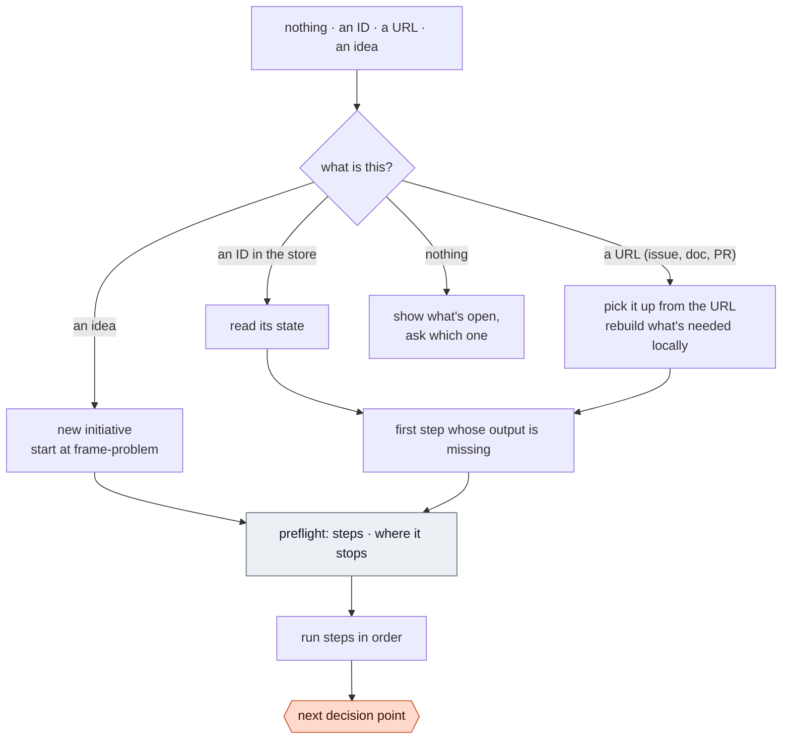
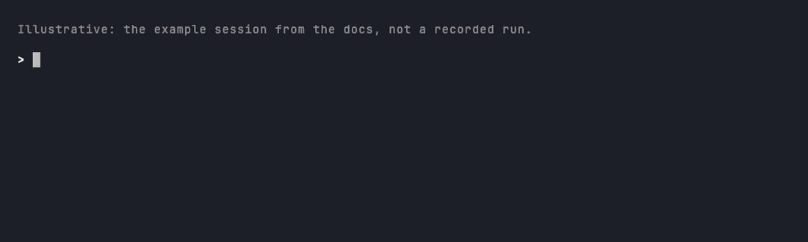
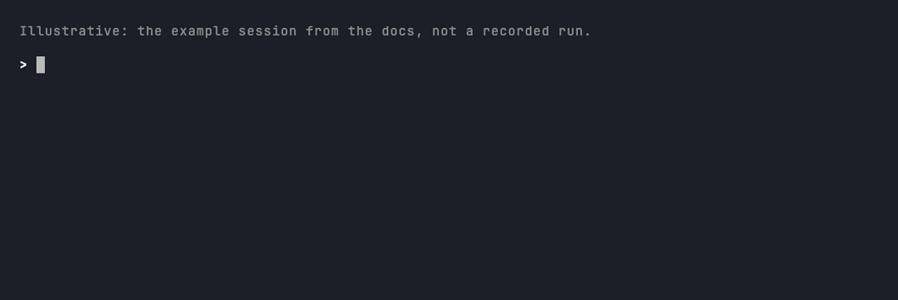
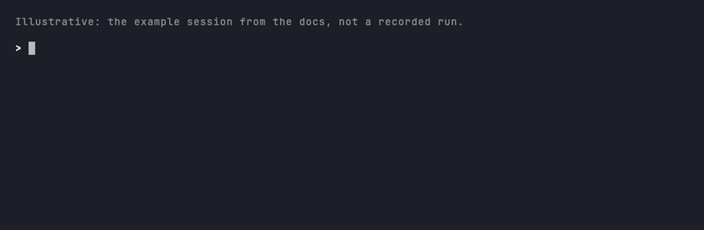
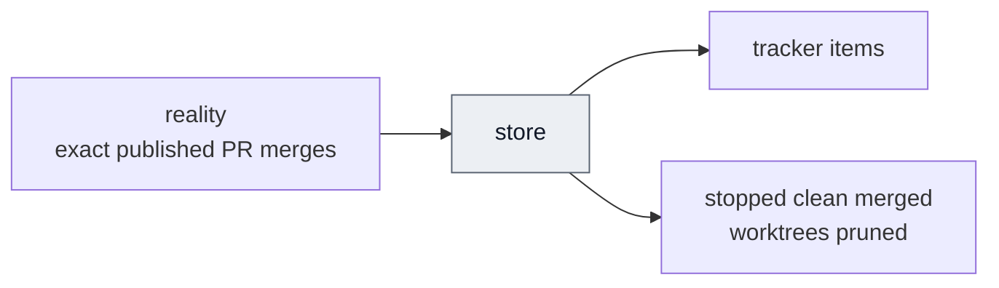
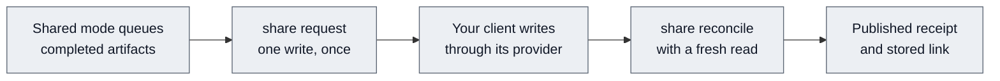

# Utilities — next, status, setup, sync

> **TL;DR** — Four helpers move you around the flow. **`next`** continues whatever is open until a decision is due, **`status`** shows what is where and who it is waiting on, **`setup`** saves your profile and tool choices, and **`sync`** brings the store in line with merged pull requests. In a terminal, `wl next` only returns the next step's contract; the `wl-next` skill in your client does the work.

`sync` against hosted services runs through the client and is experimental.

## At a glance

| Utility | Invoke | Reads | Writes | Decision point |
| --- | --- | --- | --- | --- |
| **next** | `/wholeloop:next` · `$wl-next` · `/wl-next` | anything: nothing, an ID, a URL, an idea | whatever the steps it runs write | the ones in those steps |
| **status** | `/wholeloop:status` · `$wl-status` · `/wl-status` | the store | nothing | none |
| **setup** | `/wholeloop:setup` · `$wl-setup` · `/wl-setup` | layered harness config and provider/profile catalogs | explicitly selected user/project settings, or transient run overrides | explicit choice of scope before saving |
| **sync** | `/wholeloop:sync` · `$wl-sync` · `/wl-sync` | the store · `codehost` · `tracker` | the store · tracker items | none |

## next

**The one entry point.** Give it anything; it works out what you mean, says what it is about to do, and runs the flow forward until a person needs to decide.



- **States the plan before acting.** Which steps, in which order and where it will stop, in a few lines. Say "only up to the spec" and it stops there.
- **Never repeats finished work.** It starts from the first step whose output does not exist yet; a step skipped with a reason stays skipped.
- **Picks up from a URL.** A tracker issue, a document or a PR is enough to rebuild the local state the next step needs, matching existing records instead of duplicating them.
- **Pending decisions become questions** for a person, never automatic approvals.
- **Respects your `stops` setting.** With `stops: each-step` it pauses after every step even when no decision is due ([profile](../configuration/profile.md)).



*Illustrative: the example session below, animated. Its wording depends on your client and model.*

The same session as text:

```text
> /wholeloop:next https://linear.app/acme/issue/ENG-482

Found     ENG-482 "Filter orders by date" → no local record yet, picking it up
Has       spec (approved in Linear) · 1 scope · no slices
Plan      slice-work → build-slice → verify-works ⇄ review-code → stop at "test it"
Go?       [ Go ]  [ Only slice-work ]  [ Change the plan ]
```

## status

**What is where, and who is it waiting on.** It only reads, so it is safe anywhere. In a terminal:

```console
$ wl status
In progress
init-3cf1140a Find tasks by title in … · frame

0 unread messages. Add --json for the full status.
```

The core groups the same tree by **Waiting on you**, **Due** and **In progress**, then by the most recent observation. Your client forwards its plain text. A parent stays beside its children and follows their most urgent state; it shows an active child separately without advancing its own work.



*Illustrative: synthetic stored work rendered by the same core tree. A recorded failure is historical evidence, not a new check.*

The same session as text:

```text
> /wholeloop:status

In progress
init-00000001 Search orders · review · 1/1 children open · via slice-00000001
  └ scope-00000001 Date filter · review · 1/2 children open · via slice-00000001
    └ slice-00000001 Accept a date range · review · review 1/3 FAIL recorded, 1…

0 unread messages. Add --json for the full status.
```

`status <id>` zooms into one item; **`--all`** includes closed work. A closed parent remains as context when it has an open descendant. JSON retains every selected stored record, including closed ones, and adds the parent link, direct child counts and the tree's plain `display.text`.

An approval is **upcoming** while its producing step is running; it appears in Waiting on you only after that step completes or is explicitly skipped. Check results name their recorded round, verdict and remaining findings; a recorded pass never certifies current workspace bytes. Due checkpoints and workspace state appear beside the item. Rows fit the terminal width; redirected output and client text stay plain, and `NO_COLOR` takes precedence over `FORCE_COLOR`.

Status also retains owners, step plans, measurement schedules and unread message counts in JSON. It never marks messages as read, changes the parent's required approvals or polls a service to guess what was deployed.

## setup

**Configure once, change any time.** It is short, and it only asks about what you are about to use.

| Area | What it sets | Where it is remembered |
| --- | --- | --- |
| **Profile** | verbosity, depth, challenge, pace, stops, teaching, language, or a preset | the scope you choose |
| **Providers** | which tool fulfils each capability: documents, tracker, code host, sources | the scope you choose |

Two related tasks are **not** part of setup, on purpose:

- **Installing into a client** is `wl install` ([getting started](../getting-started.md#install-for-one-client)).
- **Connecting a service** happens in your client's own MCP settings. `wl mcp add <provider>` prints a configuration snippet without credentials for you to add there.

In a terminal, `wl setup` with no choices returns the questions to answer, with exit code 2:

```console
$ wl setup
{
  "schema": "wholeloop/setup@1",
  "applied": false,
  "questions": [
    {
      "id": "profile",
      "prompt": "Which interaction profile?",
      …
    {
      "id": "scope",
      "prompt": "Where should these choices be remembered?",
      …
```

Every choice is validated before anything is written, and saving needs an explicit `--scope`:

| Scope | Remembered for |
| --- | --- |
| `user` | you, in every repository |
| `project` | everyone in this repository; your user profile still wins for personal style |
| `run` | this run only; nothing is saved |

In your client, the skill shows the same choices interactively:



*Illustrative: the example session below, animated. Its wording depends on your client and model.*

The same session as text:

```text
> /wholeloop:setup providers

Docs       ( ) local markdown  (•) Notion ✓ detected  ( ) Confluence  ( ) Google Docs
Tracker    ( ) local  ( ) GitHub Issues  (•) Linear ✓ detected  ( ) Jira
Codehost   (•) GitHub ✓ gh signed in  ( ) GitLab
Analytics  [x] PostHog ✓ detected  [ ] Mixpanel ✗ not connected → show install
Remember   (•) this repo (shared via .wholeloop/config.yml)  ( ) only me
```

Nothing has to be configured up front: every step asks for what it needs the first time and offers to remember the answer. `setup` is just the place to see and change it all at once.

## sync

**Make the store and your tools agree.** Sync reads the merged state of the pull requests wholeloop published, marks the delivered work as done, and moves tracker items only when you named them explicitly. It never guesses flags or unrelated issues.



- **Only exact merges close work.** The PR's URL, repository, head, base and commit must match what was published, and it must be merged, not just closed. A changed head cannot close its item. Every repository part must be closed this way before its slice; work closed by hand does not count.
- **A scope becomes ready for rollout**, not closed, when every current slice has merge evidence. It moves on to `prepare-launch`; only `decide-next` closes it. Reopened work loses that readiness and needs a newly tested PR.
- **Tracker moves are explicit.** The client names the provider, the item and the target state. Sync reads the item's current revision, records its intent, moves only certified work and reads the final state back. Without a binding, it stays a hand-off; later edits made in the tracker are reported, never overwritten.
- **Uncertain writes are reconciled by reading.** A lost response keeps its intent; a later read may confirm it, otherwise the ambiguity stays visible and nothing is written twice. Running sync again on unchanged work records nothing new.
- **Cleanup is conservative.** Only stopped, clean worktrees merged locally are pruned. Active, dirty, locked or unmerged work, branches and processes stay. After a squash or rebase merge, you may need to confirm or clean up by hand.

```bash
wl sync --json
wl sync --for scope-a9e0b1c2 --prune off --json
wl sync --for scope-a9e0b1c2 --file normalized-pr-observations.json --json
```

- **Reads** go through `gh` or `glab` and their own credential stores. Sync never pushes, merges or fetches.
- **`--file`** imports observations your client made (`wholeloop/sync-observations@1`): each names the exact published plan event and either a complete result or the reason it was unavailable. Imports are labelled as such and prove no sign-in.
- **When a source cannot be read**, the work stays open and the command exits with code 3.
- **From the SDK**, `SyncWorkflow.run` takes a code-host factory, an optional tracker host and explicit targets per item. Targets are never guessed. The CLI itself has no signed-in tracker client.

The report lists what changed, what could not be observed, delivery readiness, tracker outcomes and which worktrees were kept or pruned. Delivered code and a decided product outcome stay separate: merging is not the end of the loop.

## Gotchas & FAQ

**"Do I need `next` at all?"** No. Calling a step directly is just as valid; `next` saves you from remembering which one comes now.

**"Can a teammate continue my work?"** Yes, if the work lives in a shared tool (tracker, docs, PRs). They ask for `wl-next` with the URL and it rebuilds what is needed on their machine. Purely local work stays on yours.

**"Will `sync` overwrite edits made in the tracker?"** No. Content is never rewritten, status moves only after a current read, and later edits in the tracker are reported as drift and kept.

## Core commands

The terminal commands behind the skills, for scripts and skill authors. In a conversation, ask for the installed `wl-...` skill instead (`wl-agy-...` on Antigravity, `/wholeloop:...` with the Claude plugin). The [core tour](../tutorials/local-core.md) shows them running.

```text
wl next "Find old orders faster" --owner Alex --json
wl next init-0123abcd --json
wl status --json
wl status init-0123abcd --json
wl setup --json
wl setup --profile pair --docs local-docs --tracker local-tracker --scope user --json
```

**`wl next`** begins framing from a sentence, and reuses an initiative whose title matches, ignoring case and spacing. A missing owner becomes a question before anything is created. With no input, it picks the only open item or asks which one to continue; with an ID, it reuses the unfinished run. After framing, it can begin the specification, and then stops at its approval. Running several steps in one request (`--through`) is planned, not available.

A terminal call returns a contract or a receipt and stops; model-backed work, and any hand-off you selected, is the client's job.

### Adopt a URL and publish Define artifacts

**Adopting a URL.** `wl next <HTTPS-URL> --json` first looks for the URL among stored links: adopted sources, documents, tracker items and PRs. A fragment or a known tracking parameter does not make it a new URL; a different query does. If several initiatives match, you must give the ID. For an unknown URL, it asks for the provider, the kind, the owner and the title. It never pretends to have fetched anything, and imported text never counts as an approval.

Your client reads the document or item and passes a complete result with its exact reference, body and revision. Save these sanitized observations outside the repository:

```json
{"schema":"wholeloop/shared-read@1","provider":"notion","kind":"docs","ref":"https://docs.example.com/work/42","result":{"status":"succeeded","ref":"https://docs.example.com/work/42","body":"# Order search\n\nShared context.","revision":"observed-revision","complete":true}}
```

```text
wl next https://docs.example.com/work/42 --provider notion --kind docs --file /tmp/shared-read.json --owner Alex --json
wl adopt https://docs.example.com/work/42 --provider notion --kind docs --file /tmp/shared-read.json --owner Alex --json
```

- `adopt` stops after importing; `next` continues with the stored initiative.
- A missing owner or title becomes questions before anything is written.
- A tracker item's body is a JSON string with its title, body and optional owner.
- Imports are labelled as observations; they do not prove that wholeloop signed in to anything.

**Publishing Define artifacts.** Each initiative is **local** by default. To share its artifacts, give a list of destinations, such as `[{"key":"team-docs","provider":"notion","kind":"docs","ref":"https://docs.example.com/work/42"}]`. Leave out `ref` to create one new resource per artifact, or give it to append to an existing document or item. HTTPS destinations you set stay pinned when you switch modes.

```text
wl share mode --for init-0123abcd --mode shared --by Alex --file /tmp/targets.json --json
wl share requests --for init-0123abcd --json
wl share request --for init-0123abcd --key <outbox-key> --json
wl share reconcile --for init-0123abcd --key <outbox-key> --ref <published-URL> --file /tmp/published-read.json --json
wl share report --for init-0123abcd --json
wl share mode --for init-0123abcd --mode local --by Alex --json
```



- **What is queued.** Shared mode queues every completed research brief, framing, specification and scope of the initiative, and every later one as it completes. A standalone brief that was never adopted has no destinations and stays local.
- **Who writes.** The CLI only queues each write and hands it out once; it signs in to nothing and runs no MCP tool. Your client performs the write, then supplies a separate, complete read of the result. From the SDK, `SharingWorkflow.mode(..., host)` publishes existing artifacts and `complete(..., host)` publishes new ones as they complete.
- **What counts as published.** Only a read showing the exact artifact content earns a published receipt and a stored link. Until then, the receipt says *queued*.
- **Lost responses.** Find the resource and read it; never repeat the write blindly.
- **Going back to local** pauses new requests. A request already handed to a client stays that client's responsibility.

<!-- docnav -->
[◀ decide-next](learn/decide-next.md)  ·  [📖 Docs index](../README.md)  ·  [🧭 Concepts](../concepts.md)  ·  [Configuration ▶](../configuration/README.md)
