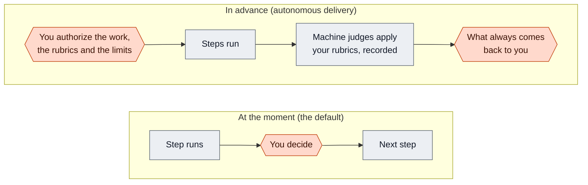

# Philosophy — why the harness is the half that is yours

> **TL;DR** — An agent is a **model plus a harness**. The model is rented and the same for everyone; the harness decides what context it gets, in what order work happens and where a person decides. wholeloop is a harness for the whole path from a loose idea to a measured result. It follows what your repository already knows, works for one person as well as for a team, and lets you decide either at each step or in advance, within limits you set.

## Contents

- [Same model, different results](#same-model-different-results)
- [The half that is yours](#the-half-that-is-yours)
- [A goal before a tool](#a-goal-before-a-tool)
- [The principles, with their reasons](#the-principles-with-their-reasons)
- [Rules fix the questions, not the answers](#rules-fix-the-questions-not-the-answers)
- [The method works without the tool](#the-method-works-without-the-tool)
- [How this philosophy has evolved](#how-this-philosophy-has-evolved)

## Same model, different results

Take two engineers and one feature.

- **Before starting**, one looks at the data and the other opens the editor. They are solving different problems, and nobody notices until review.
- **While building**, one argues with the model's first answer and the other accepts it. On screen both look equally finished, which is exactly what makes it dangerous.
- **After building**, every review asks different questions, every rollout re-decides the same four things, and what was learned after launch lives in someone's notes, or nowhere.

The model is identical in every one of those moments. The process around it is not. **A faster tool amplifies whatever process you already have, including the absence of one.**

The same happens to one person on two different days. On Monday, with time, you look at the data first; on Friday, in a hurry, you open the editor. You do not need a team to be inconsistent, only a deadline. A harness gives a team a shared path, and gives one person a path they can keep with themselves.

## The half that is yours

| Half | What it is | Who has it |
| --- | --- | --- |
| **Model** | The reasoning engine | Everyone: the same version, on the same day |
| **Harness** | What context the agent gets and from where, which tools it can reach, in what order things happen, where it stops and who decides, how you know afterwards that it worked | Only you, and usually decided differently by each person without anyone deciding it |

Something everyone has cannot be your edge. The harness can.

## A goal before a tool

The point is not automation for its own sake. It is **where people spend their time**.

Some work costs mostly volume: writing code, writing tests, running checks, looking at whether a metric moved. If agents take that work, the hours that come back can go to what no model does yet: working out whether what is asked for is what is needed, hearing what a user cannot quite say, deciding what deserves to exist.

That only works when handing work over is reliable enough that nobody has to watch it, and reliability is a property of the process, not of the model. It also stays **an option, never a mandate**: anyone can still write a piece by hand, and the checks treat their work exactly the same.

## The principles, with their reasons

### 1. Ask, never guess

A confident assumption is the most dangerous mistake an agent can make, because it does not look like a mistake. A machine that is wrong and says so is easy to correct; one that is wrong with confidence produces polished work on a false premise.

So any fact the harness lacks, such as a path, a goal, a metric or a destination, becomes a **question**, batched with the others. Anything a source cannot reach stays an **open question**, never a plausible fill-in. No setting can relax this: a quieter interaction profile asks fewer things at once, never fewer things in total.

### 2. Deterministic process, adaptive content

The flow runs the same steps in the same order for everyone. A step may resolve to *"not applicable, because X"*, but it is never skipped silently. What changes from one piece of work to the next is what each step **produces**.

In wholeloop this is literal. The process lives in the `wl` core, which is ordinary code with tests; the prompts do only the creative part.

### 3. Your repository first

Your repository already encodes how it is built: skills for its backend, a design system, lint rules, a test command, a pull request convention. A generic harness that ignores them produces generic code.

Every step therefore **looks for what your repository already has and prefers it**. It falls back to its own defaults only when nothing more specific exists. [Repository guidance](./configuration/repo-skills.md) shows how that lookup works.

### 4. Bring your own tools

Confluence or Notion, Jira or Linear, Mixpanel or PostHog: the flow does not care. It needs *capabilities*, such as "write a document", "track a work item" or "query product analytics", and lets you choose who provides each one.

When the provider you need does not exist yet, adding it is a manifest file, not a fork. [Writing a provider](./extending/providers.md) shows one.

### 5. People own every decision, at the moment or in advance

The harness does not stop because it technically cannot go on. It stops because going on would produce a tidy answer to a question nobody has finished asking. Those stops are **hand-offs**: the point where processing information ends and product judgement begins. Approving a specification, running the change on your own machine and deciding whether to kill something that shipped all belong to a person.

There are two ways to take those decisions:

- **At the moment.** The supervised flow stops at the same [decision points](./concepts.md#decision-points) every time, in every mode. This is the default.
- **In advance.** You decide once which work is authorized, which rubric judges each decision, within which limits and budget, and what always comes back to you. A machine then applies that decision; it never makes one nobody delegated.

Delegating is an **explicit, recorded authorization**, never a style setting: no interaction profile can switch a decision point off. Some decisions are never delegated at all:

- widening the machine's own authority;
- changing what counts as accepted;
- supplying a fact only a person knows.

This principle first read *"people decide at fixed points"*. The supervised flow still works that way; what changed is that a person can also take the decision earlier.

### 6. Always legible

People rarely stop trusting a tool because of what it does. They stop when they cannot tell what it is doing. So every run:

1. states a **preflight** before it starts: what will happen, where, what it will never do and how to stop it;
2. **reports** one line per event as it goes;
3. stops the moment you say so;
4. ends with a **receipt** of what it produced, actionable rows first, each with the command that opens or undoes it.

How those lines look, and how quickly a stop takes effect, also depends on the coding client.

### 7. Done means measured, not merged

More than half of the flow comes after the merge: drafting the announcements, widening exposure step by step and, weeks later, putting the real numbers next to what the specification promised. The follow-up that used to depend on who remembered simply happens.

### 8. Small, correctable, alive

A harness is a snapshot of how you work on the day it was written. It stays useful only while it keeps up with you:

- **The conversation leads, the harness follows.** Rules change in a retro, a thread or your own review of last week's work, never in a commit nobody thought through.
- **A repeated failure is a candidate rule**, once it has happened more than once. One case is an anecdote.
- **Changes to the checks get measured** against a set of known defects and harmless look-alikes. A fix that makes a reviewer cry wolf is not a fix.
- **Removing counts as much as adding.** A rule nobody can justify is a leftover.

That is also why skills are short and every hard rule has something that *executes* it: code, a test or a lint. A rule that exists only as prose is decoration the agent can reason around.

## Rules fix the questions, not the answers

The obvious objection is that all this turns people into a template. It does not.

The rules fix the **questions**: what to ask before building, what counts as evidence, where a person decides, what *done* means. They leave the **answers** alone. Two engineers still work differently, and so does one engineer on two different days. They just answer the same questions, in the same order, against the same bar.

## The method works without the tool

You can apply the idea behind wholeloop without installing it:

1. Take one step of your own work, such as researching an idea, preparing a rollout or checking a result a month later.
2. Write it down as precisely as if a machine had to run it: what it may decide on its own, what it must never assume, where it must stop for a person.
3. Review that description with whoever does the work, even if that is only you a week later.

A new colleague fills the gaps in such a description with common sense. A machine cannot, so writing for one exposes every assumption nobody had stated. **The agreement that review produces is the real result**: the questions everyone answers, the points where a person decides and a shared idea of done. wholeloop is that agreement, written once for the whole path from idea to measured result and made executable.

## How this philosophy has evolved

The earlier wording stays visible above where it changed, because the reasoning behind each change matters as much as where it led.

1. **From a team to a repository.** It began as a way to move one team's way of working into a repository, so the process would survive whoever happened to be driving. Writing it down showed that nothing in it needed a team: the same questions keep one person consistent with themselves.
2. **From an idea to a measured result, with people at fixed points.** The first complete flow covered the path from zero to one, with human checks between the steps: approve the specification, test the change, widen the rollout, decide. Those checks remain the default.
3. **From fixed points to delegated decisions.** Autonomous delivery added a second way to decide: authorize the work once, pin the rubrics that judge each decision, and let independent machine judges apply them, inside budgets, with every judgement recorded. It shipped as experimental in 1.0.0.
4. **Where it is going.** The long-term goal is a harness you can configure anywhere from fully supervised to a software factory that works around the clock with nobody at the keyboard. Each step toward it keeps the limits above: a person still decides what is authorized and what counts as done, and the machine still asks rather than guesses. The [roadmap](../roadmap/phase-8-software-factory.md) describes that path; none of it describes current behaviour.

---

<!-- docnav -->
[◀ Docs index](README.md)  ·  [📖 Docs index](README.md)  ·  [🧭 Concepts](concepts.md)  ·  [Getting started ▶](getting-started.md)
