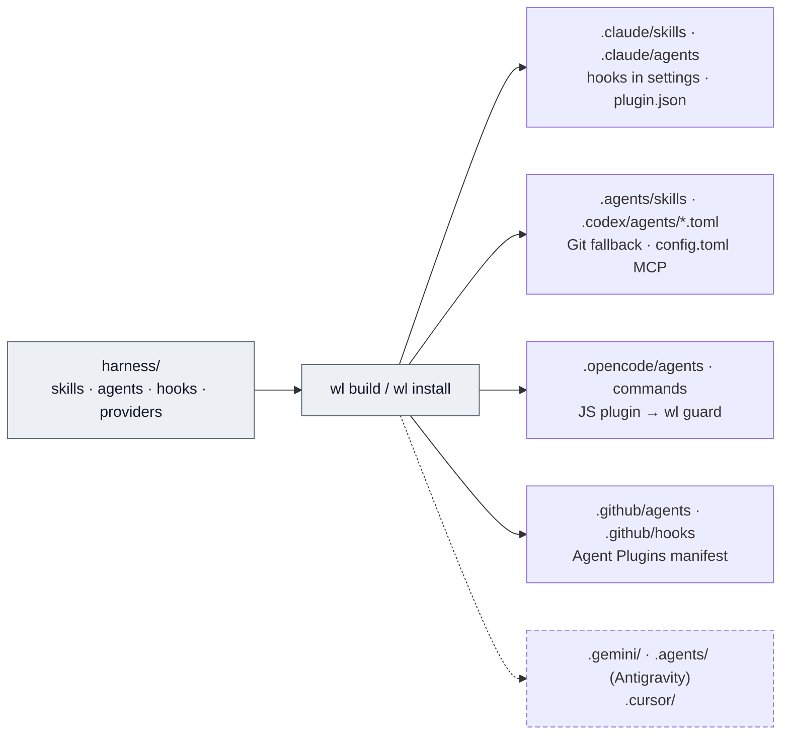

# Platforms — one harness, every agentic CLI

> **TL;DR** — The canonical harness is written once in open formats; a per-CLI adapter generates the files each tool expects. Tier A CLIs are supported from the first release; tier B follow. Where a CLI lacks a feature, the harness degrades to an equivalent — never to less coverage.

> [!NOTE]
> **Status: 🚧 partial.** Local artifact generation for all four tier-A targets and self-contained core packaging are implemented; owned native installation, guard bindings and a disposable framing runner are available. Actual discovery/permissions remain owner verification. Local CLI availability was checked on macOS; [conformance notes](../../test/conformance/notes/README.md) list the remaining manual checks. Matrix researched in October 2026 from official documentation; items marked ❓ are verified in [P0-03](../../roadmap/phase-0-foundations.md#p0-03--cli-conformance-spike). Once conformance runs exist, this page is generated from their results.

---

## Tiers

| Tier | CLIs | Why |
| --- | --- | --- |
| **A** | Claude Code · OpenAI Codex CLI · OpenCode · GitHub Copilot CLI | Native skills, subagents, hooks and a structured question tool (or close to it); Copilot also reads Claude-format hooks and skills, so it costs little extra |
| **B** | Gemini CLI · Google Antigravity CLI · Cursor CLI | Supported formats, but gaps to bridge: parallel subagents (Gemini), a structured ask tool (Antigravity), hook loading in the CLI (Cursor) |

Antigravity CLI replaced Gemini CLI for free and personal accounts in June 2026, while enterprise and API-key users keep Gemini CLI — so they are separate targets.

## Capability matrix

| | Claude Code | Codex | OpenCode | Copilot | Gemini | Antigravity | Cursor |
| --- | --- | --- | --- | --- | --- | --- | --- |
| Agent Skills (`SKILL.md`) | ✅ `.claude/skills` | ✅ `.agents/skills` | ✅ both | ✅ both + `.github/skills` | ✅ `.agents/skills` | ✅ `.agents/skills` | ✅ most dirs |
| Reads `AGENTS.md` | only without `CLAUDE.md` | ✅ | ✅ | ✅ | via setting | ✅ | ✅ |
| Subagents | ✅ parallel | ✅ TOML | ✅ | ✅ `/fleet` | ✅ (parallel ❓) | ✅ | ✅ |
| Read-only agents enforced | ✅ | ⚠️ not enforced | ✅ permissions | ✅ tools | ✅ tools | ✅ tools | ✅ readonly |
| Hooks | ✅ | ✅ | ⚠️ JS plugin | ✅ (reads Claude's) | ✅ | ✅ own schema | ✅ (CLI ❓) |
| Structured questions | ✅ | ⚠️ limited ❓ | ✅ | ✅ | ✅ | ❓ | ⚠️ ❓ |
| MCP | ✅ | ✅ TOML | ✅ | ✅ | ✅ | ✅ `serverUrl` | ✅ |
| Headless mode | `claude -p` | `codex exec` | `opencode run` | `copilot -p` | `gemini -p` | `agy -p` | `agent -p` |
| Plugin packaging | Claude plugins | Agent Plugins | npm/JS | Agent Plugins | extensions | plugins | Agent Plugins |

## How gaps are bridged

| Gap | Bridge |
| --- | --- |
| No parallel subagents | `headless` engine — `wl fanout` runs workers through the CLI's headless mode — or `sequential` ([engines](../architecture/orchestration-and-gates.md#three-engines-one-result)) |
| Read-only not enforced | The core checks the worktree is unchanged after every gate round; a change fails the round |
| No structured question tool | Plain-text questions with numbered options; the skill stops and waits |
| No usable hooks | Explicit `wl guard hooks install` carries the critical guards; general install is pending |
| Different MCP dialects | `wl mcp add` renders each provider's neutral recipe into the target's format |

## What gets generated



- **Skills** keep only the portable front-matter fields; CLI-specific extras live in a sidecar the adapter reads.
- **Agents** are written with abstract capabilities (`read`, `write`, `shell`, `web`) and a model tier; each adapter maps them to that CLI's tool names or permission map.
- **Names** are namespaced where the CLI has no plugin namespace: `wholeloop:research` in Claude Code, `wl-research` elsewhere.
- **Golden files** pin every adapter's output; a change in generated files is a reviewed diff.

## Available local generation

```text
wl build --target claude --out /tmp/wholeloop-claude --dry-run --json
wl build --target claude --out /tmp/wholeloop-claude --json
claude plugin validate /tmp/wholeloop-claude --strict
```

This creates a distribution tree, without installing it or editing client/MCP
configuration: seventeen skills, eight agents, shared canonical resources,
.claude-plugin/plugin.json, an executable bin/wl.mjs and a versioned ownership/hash
manifest. The core embeds its canonical resources, so the output works away from
the source checkout. Plugin skills call their bundled core; a conductor supplies
its resolved plugin root to agents. Missing context is a question, not a PATH guess.

Model tiers render to native aliases and capabilities to explicit tool lists.
Observer roles omit write tools and use plan restrictions; shell/managed policy
behavior still needs real-client enforcement checks. The manifest reports native
conformance unverified; native guard bindings and explicit Git fallback management are rendered. No permission bypass is emitted.

Generation is deterministic. An unchanged owned tree reports already-correct;
upgrades preserve the previous tree at the backup path returned in the receipt.
Changed files/modes, unsafe links and unowned directories are refused. Select a
new output path to preserve deliberate local edits. TypeScript host workflow
sources are not copied with broken imports; their executable CLI paths are bundled.

Golden/compiled CLI fixtures passed, including executing the copied core outside
this checkout. Claude 2.1.299 plugin validate --strict also returned Validation
passed for an isolated generated plugin. This static check is not installation,
skill discovery, model execution or a live conformance pass. Native guard bindings are implemented;
actual discovery/install/Linux checks remain in the
[manual checklist](../../roadmap/manual-verification.md). See
[ADR-0047](../decisions/0047-self-contained-client-artifacts-and-owned-output-upgrades.md).

### Additional tier-A targets

```text
wl build --target codex --out /tmp/wholeloop-codex --json
wl build --target opencode --out /tmp/wholeloop-opencode --json
wl build --target copilot --out /tmp/wholeloop-copilot --json
```

| Target | Skill tree | Agent tree | Metadata |
| --- | --- | --- | --- |
| Codex | `skills/wl-*/SKILL.md` | `.codex/agents/wl-*.toml` project/user overlays | Agent Plugins 1.0 root `plugin.json` |
| OpenCode | `.opencode/skills/wl-*/SKILL.md` | `.opencode/agents/wl-*.md` | Native `opencode.json` |
| Copilot | `skills/wl-*/SKILL.md` | `com.github.copilot/agents/wl-*.agent.md` | Agent Plugins 1.0 root `plugin.json` |

Every non-Claude skill includes a tiny scripts/wl.mjs launcher importing the one
packaged core. Use the exact loaded skill directory reported by the client; if it
is absent, ask rather than invent a path. Call that launcher with adapter root
--json for the verified artifact root and pass the result to agents. Root validation
checks layout/version/executable hash and refuses source-checkout/corrupted claims.
Launchers work through directory symlinks without duplicating the executable.

OpenCode/Copilot observers receive no shell/write channel; command/provider evidence
comes from the conductor. OpenCode read roles can read shared resources outside the
checkout; writer roles retain native external-directory asks. Copilot agents explicitly
inherit repository instructions and do not opt into automatic inferred delegation.
Codex agent files cannot lower the parent's sandbox/approval policy: supported
feature reductions are rendered, while checked read-only parent/headless execution
and the core snapshot checks remain necessary. Do not interpret instructions as a
new sandbox. Additional targets inherit the selected model and retain tier hints.

Codex agent files are installation overlays: loading a portable skill package alone
does not prove native agent discovery. All target manifests retain conformance
unverified; OpenCode/Copilot native guard bindings and the Codex Git fallback are implemented. Static/native listings do not establish a live
model run or permission enforcement. See [ADR-0048](../decisions/0048-native-target-layouts-and-checked-launcher-roots.md)
and the [manual checklist](../../roadmap/manual-verification.md).

## Installing

Use the built core for an explicit native overlay installation:

```text
node dist/wl.mjs install --target all --scope user --dry-run --json
node dist/wl.mjs install --target all --scope user --json
node dist/wl.mjs doctor --json
node dist/wl.mjs uninstall --target all --scope user --json
```

| Target | Personal root | Project root | Native guard binding |
| --- | --- | --- | --- |
| Claude | .claude/skills and agents, or CLAUDE_CONFIG_DIR | .claude/ | scoped skill/agent frontmatter |
| Codex | .agents/skills and CODEX_HOME/agents | .agents/skills and .codex/agents | explicit per-repository Git fallback |
| OpenCode | XDG config/opencode or OPENCODE_CONFIG_DIR | .opencode/ | plugins/wholeloop.js |
| Copilot | COPILOT_HOME or .copilot/ | .github/ | hooks/wholeloop.json |

All installed native names use wl-; generated Claude plugins retain their plugin
namespace. Skills invoke their one packaged core through relative launchers; the
conductor passes its checked artifact root to roles. User distributions and all
ownership/control/backups stay in the external store. Project distribution is
explicit generated output at .wholeloop/distribution/target and relocates with the
checkout. Existing shared settings/credentials are never read/re-emitted by install.

Current matching installs are idempotent; observed edits/unowned data are refused.
Uninstall retains backups/history and removes matching owned files plus created
empty parents. Source/plugin generation remains available independently. Native
restart, project trust, compatibility precedence, permissions and Linux still need
actual conformance. Git-hook activation/removal remains a separate per-repository
handoff. See [getting started](../getting-started.md) and [ADR-0050](../decisions/0050-owned-native-overlays-and-explicit-activation.md).

## Standalone conformance

The [standalone conformance runner](../architecture/determinism-and-testing.md#disposable-standalone-conformance)
prepares project-local overlays for each tier-A target and exact version pin. Its
fixture mode reports simulation only; actual pinned live process/journal checks
require an explicit --live run. Native authentication/trust/permissions, stdout
protocol, hook activation and broader matrix entries stay separate. No actual
model results have been recorded by the local fixture tests.

## Adding a CLI

An adapter is a TypeScript module implementing one interface: where files go, how front matter maps, how tools and permissions are named, how hooks are registered, how MCP is configured, how headless mode is invoked, and which capabilities the CLI has. It ships with golden files and a conformance scenario. Guide: [contributing/authoring](../contributing/authoring.md#adapters).

---

<!-- docnav -->
[◀ Lenses, templates, profiles](../extending/lenses-templates-profiles.md)  ·  [📖 Docs index](../README.md)  ·  [🧭 Concepts](../concepts.md)  ·  [Architecture ▶](../architecture/README.md)
