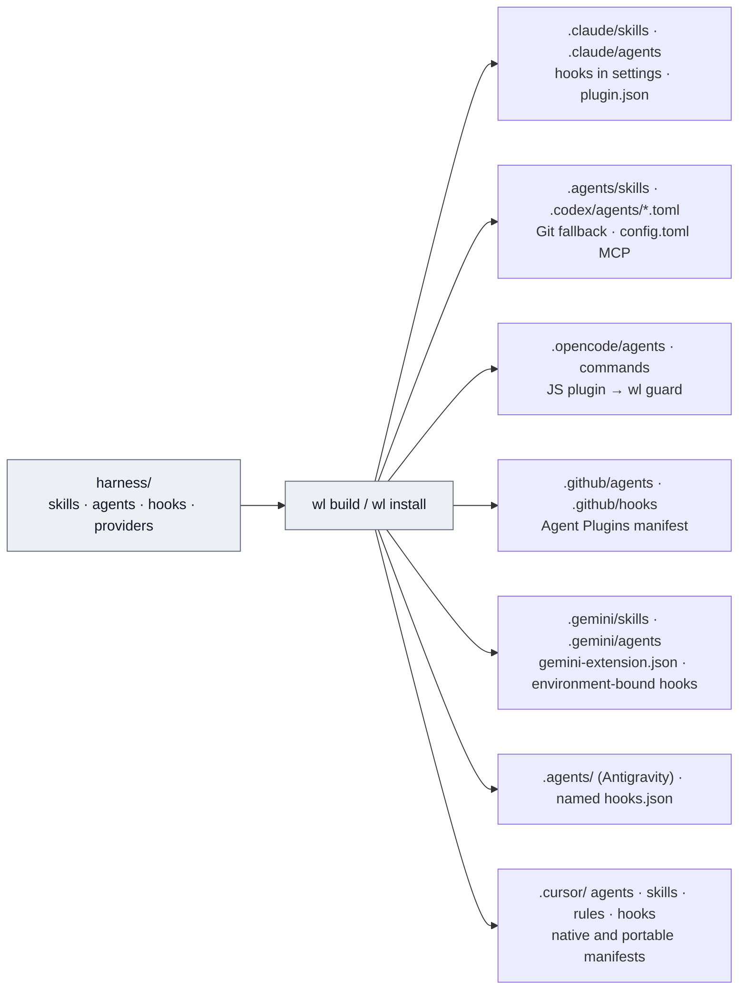

# Platforms — one harness, every agentic CLI

> **TL;DR** — The canonical harness is written once in open formats; a per-CLI adapter generates the files each tool expects. Tier A CLIs are supported from the first release; tier B follow. Where a CLI lacks a feature, the harness degrades to an equivalent — never to less coverage.

> [!NOTE]
> **Status: 🚧 partial.** Local artifact generation for all four tier-A targets plus Gemini, Antigravity and Cursor and self-contained core packaging are implemented; owned native installation, guard bindings and a disposable framing runner are available. Actual discovery/permissions remain owner verification. Local CLI availability was checked on macOS; [conformance notes](../../test/conformance/notes/README.md) list the remaining manual checks. Matrix researched in October 2026 from official documentation; items marked ❓ are verified in [P0-03](../../roadmap/phase-0-foundations.md#p0-03--cli-conformance-spike). Local adapter declarations are generated and checked from code. Explicit fresh collection and bounded reported matrices support page comparison/regeneration; structural issue drafts/delivery are implemented; host version resolution/private acquisition are implemented; disabled nightly automation is implemented, while owner activation and actual native/service checks remain pending.

---

## Tiers

| Tier | CLIs | Why |
| --- | --- | --- |
| **A** | Claude Code · OpenAI Codex CLI · OpenCode · GitHub Copilot CLI | Native skills, subagents, hooks and a structured question tool (or close to it); Copilot also reads Claude-format hooks and skills, so it costs little extra |
| **B** | Gemini CLI · Google Antigravity CLI · Cursor CLI | Supported formats, but gaps to bridge: parallel subagents (Gemini), a structured ask tool (Antigravity), hook loading in the CLI (Cursor) |

Antigravity CLI replaced Gemini CLI for free and personal accounts in June 2026, while enterprise and API-key users keep Gemini CLI — so they are separate targets.

## Capability matrix

| | Claude Code | Codex | OpenCode | Copilot | Gemini | Antigravity | Cursor |
| --- | --- | --- | --- | --- | --- | --- | --- |
| Agent Skills (`SKILL.md`) | ✅ `.claude/skills` | ✅ `.agents/skills` | ✅ both | ✅ both + `.github/skills` | ✅ `.agents/skills` | ✅ `.agents/skills` | ✅ most dirs |
| Reads `AGENTS.md` | only without `CLAUDE.md` | ✅ | ✅ | ✅ | via setting | ✅ | ✅ |
| Subagents | ✅ parallel | ✅ TOML | ✅ | ✅ `/fleet` | ✅ (parallel ❓) | ✅ | ✅ |
| Read-only agents enforced | ✅ | ⚠️ not enforced | ✅ permissions | ✅ tools | ✅ tools | ✅ tools | ✅ readonly |
| Hooks | ✅ | ✅ | ⚠️ JS plugin | ✅ (reads Claude's) | ✅ | ✅ own schema | ✅ (CLI ❓) |
| Structured questions | ✅ | ⚠️ limited ❓ | ✅ | ✅ | ✅ | ❓ | ⚠️ ❓ |
| MCP | ✅ | ✅ TOML | ✅ | ✅ | ✅ | ✅ `serverUrl` | ✅ |
| Headless mode | `claude -p` | `codex exec` | `opencode run` | `copilot -p` | `gemini -p` | `agy -p` | `agent -p` |
| Plugin packaging | Claude plugins | Agent Plugins | npm/JS | Agent Plugins | extensions | plugins | Agent Plugins |

## Local adapter declarations

This table is generated from the same adapter registry used by build/install.
It describes local output and declared enforcement boundaries. A rendered format,
read-only flag or available engine does not prove native discovery or execution;
all native conformance declarations remain unverified. Actual framing observations
are a separate bounded report input below, never inferred from these rows.

<!-- platforms:start -->
| Adapter | Skills | Agents | Hooks | Read-only boundary | Local engines | Native conformance |
| --- | --- | --- | --- | --- | --- | --- |
| `claude` | rendered | rendered | `native-and-git-fallback` | `tool-allowlist-and-plan-mode` | `headless` · `sequential` | unverified |
| `codex` | rendered | rendered | `git-fallback` | `inherited-parent-and-checked-headless` | `headless` · `sequential` | unverified |
| `opencode` | rendered | rendered | `native-and-git-fallback` | `deny-shell-and-edit` | `headless` · `sequential` | unverified |
| `copilot` | rendered | rendered | `native-and-git-fallback` | `read-tool-allowlist` | `headless` · `sequential` | unverified |
| `gemini` | rendered | rendered | `native-and-git-fallback` | `read-tool-allowlist` | `sequential` · `headless` | unverified |
| `antigravity` | rendered | rendered | `native-and-git-fallback` | `read-tool-allowlist` | `sequential` · `headless` | unverified |
| `cursor` | rendered | rendered | `native-and-git-fallback` | `native-readonly` | `headless` · `sequential` | unverified |
<!-- platforms:end -->

Run npm run docs:platforms after changing an adapter declaration. The normal
wl docs check compares this section with the built core; missing or malformed
ownership markers fail instead of producing a successful empty comparison.

## Reported framing observations

The local matrix renderer consumes bounded reports without running a model or
changing documentation, configuration or runtime state by default:

```text
wl conformance matrix /tmp/wholeloop-results.json --json
wl conformance matrix /tmp/wholeloop-results.json --at 2026-10-20T12:00:00.000Z --markdown
```

The input is a wholeloop/conformance-results@1 object with a runs array. Each
entry has channel (pinned or latest), observedAt (UTC ISO timestamp with
milliseconds) and report (the complete conformance report). An empty runs array
renders all fourteen target/channel pairs UNRUN; it does not establish support.
Keep results in the external store or a temporary artifact directory. Record the
actual observation time instead of refreshing old evidence by changing its date.

Rows distinguish requested pins, actually observed versions, simulation/live
process evidence and timestamps. Results older than 48 hours are visibly stale.
A supplied report is not independently authenticated or re-executed. The framing
scenario does not establish hook, permission, MCP or semantic quality support.

Regression candidates need a fresh native PASS on the pinned version and a fresh
native FAIL on a different latest version. Both processes must have succeeded at
their exact observed versions, with identical core/source/scenario hashes and
named missing/assertion codes. Launch/authentication failures and incomparable
runs stay visible without becoming version-regression claims. Candidate keys are
deterministic for later issue deduplication; this command sends no issue.

Exit 4 identifies candidates (or invalid file/usage); inspect the versioned output.
Exit 0 means rendering succeeded without candidates, including an entirely unrun
matrix. It is not a conformance gate pass. Input is a regular non-symlink JSON
file of at most 1 MiB, with at most one observation per target/channel and one
entry per actual run. Scheduled collection, version resolution and issue automation
remain P5-04 work. See
[ADR-0059](../decisions/0059-conformance-observations-and-regression-candidates.md).

### Collect fresh observations

Use a wholeloop/conformance-collection@1 plan stored outside Git. This illustrative
fixture plan uses synthetic versions, not released client versions:

```json
{
  "schema": "wholeloop/conformance-collection@1",
  "entries": [
    { "cli": "codex", "channel": "pinned", "pin": "99.0.0" },
    { "cli": "codex", "channel": "latest", "pin": "99.0.1" }
  ]
}
```

```text
wl conformance collect /tmp/collection.json --fixture --store /tmp/collection-store --json
```

Plans contain one to fourteen unique target/channel entries. Both channels and all
seven clients are supported; omitted pairs remain UNRUN when rendered. Fixture
mode creates fresh external installed-core runs, executes no native client/model
and returns simulation evidence. Save the versioned result outside source for
matrix rendering; do not overwrite observations with a new time to hide age.

For explicit native collection, the host first resolves actual latest and pinned
versions and provisions a separate binary directory for every selected entry:

```text
<bin-root>/<cli>/<channel>/bin/<native-command>
```

Native commands are claude, codex, opencode, copilot, gemini, agy for antigravity
and agent for cursor. Package-manager executable symlinks are supported. Replace
the synthetic versions with exact real observations, preserve native credentials
in their existing store, and establish trust/permissions yourself before running:

```text
wl conformance collect /tmp/collection.json --live --bin-root /tmp/clients --timeout 180000 --store /tmp/collection-store --json
```

All selected binaries are checked before any fixture is created. Missing channels
fail rather than falling back to a global installation. Each entry has a fresh
fixture and actual version probe immediately before launch. Collection continues
after a crash or failed journal verdict. Entries run sequentially; cancellation
stops new preparation and leaves external evidence available for inspection.

The result contains actual observation times, run IDs and structural reports,
including the opaque initiative ID required for successful observations. It omits
journal paths, draft contents and native stdout. Completed means the batch finished,
not that it passed. Exit 4 identifies failed reports, 3 cancellation/preconditions,
and zero completed collection without failures, including simulation. File/usage
errors exit 4. Fixture mode refuses a native binary root; live requires one.

The collector neither resolves moving versions nor installs/updates clients. Host
scheduled activation and actual native/service checks remain separate
P5-04 work. Native updaters and external effects still require owner inspection;
a version probe does not attest every later internal executable. See
[ADR-0070](../decisions/0070-explicit-fresh-conformance-collection.md).

### Draft and deliver structural regression issues

```text
wl conformance issues /tmp/wholeloop-results.json --at 2026-10-20T12:00:00.000Z --json
```

This read-only projection shares the matrix's freshness/comparability rules.
Explicit time is required. Exit 4 identifies draft candidates; zero means none,
including unrun/simulated evidence. The versioned output contains stable keys,
exact versions/assertions/hashes and original observation dates, with no journal
paths, draft contents or raw native output. It sends no message and authenticates
no imported report. The body marker identifies the same regression across repeated
observations without changing its date or claiming wider native support.

The maintainer delivery host is preview-only unless explicitly activated:

```text
node scripts/conformance-issues.mjs /tmp/wholeloop-results.json
node scripts/conformance-issues.mjs /tmp/wholeloop-results.json --write
```

A non-empty preview needs the intended GITHUB_REPOSITORY and native gh access to
read its issue inventory. Empty/unrun batches require no GitHub service call.
Delivery requires the actual selected default-branch GitHub.com schedule/manual CI
context and existing issue-write permission. Setting environment fields alone is
not authentication or authorization. The disabled [nightly workflow](../contributing/conformance.md) wires collection and
separate issue authority; owner activation and actual service checks remain open.
No actual issue has been sent.

The host requires observations for the exact current built core and refuses input
changes. It scans open/closed issues in creation order, projects only matching
marker keys/numbers, and excludes pull requests. A complete scan must finish within
one hundred pages of one hundred entries; incomplete/failed/unsafe inventory causes
no writes. It does not add labels or change configuration. Before each delivery it
rechecks freshness against actual time, preserving the original observed dates.
Bodies travel through stdin, with no credentials in files or argv.

An intact matching marker suppresses repeat delivery even when the existing issue
is closed. Serialize writers; marker-based creation is not atomic across independent
callers or unrelated concurrent issue edits/deletions. Failed runs retain completed
outcomes and require inspection before retrying; they never automatically delete,
close or retry an external effect. Local tests use synthetic GitHub executables,
not actual authenticated requests. See
[ADR-0073](../decisions/0073-structural-regression-drafts-and-explicit-issue-delivery.md).

### Check or update this observation snapshot

```text
wl conformance matrix /tmp/wholeloop-results.json --at 2026-10-20T12:00:00.000Z --docs . --json
wl conformance matrix /tmp/wholeloop-results.json --at 2026-10-20T12:00:00.000Z --docs . --write --json
```

Use the intended as-of time; documentation mode requires it explicitly so a
comparison does not drift with the clock. The first command checks without
writing and exits 4 on drift; the second updates only the owned section below.
Missing/duplicate/reversed markers, symlinked pages/parents and pages over 1 MiB
are refused. Unchanged output skips writing. Inspect and regenerate after an
interrupted write; replacement is not claimed crash-atomic.

The JSON documentation receipt distinguishes current/stale/updated; regression
candidates still exit 4 after a successful write. Imported raw reports and external
journal paths stay outside Git. The snapshot preserves actual observation dates
and cannot attest to report provenance. Ordinary docs check verifies code-derived
references; compare this evidence section with its explicit external input/time.
Initial rows are UNRUN. See
[ADR-0064](../decisions/0064-explicit-conformance-page-projections.md).

<!-- conformance:start -->
As of 2026-10-20T18:50:28.839Z; observations older than 48 hours are stale.

| CLI | Channel | Requested pin | Observed version | Evidence | Status | Observed at |
| --- | --- | --- | --- | --- | --- | --- |
| claude | pinned | — | — | unrun | UNRUN | — |
| claude | latest | — | — | unrun | UNRUN | — |
| codex | pinned | — | — | unrun | UNRUN | — |
| codex | latest | — | — | unrun | UNRUN | — |
| opencode | pinned | — | — | unrun | UNRUN | — |
| opencode | latest | — | — | unrun | UNRUN | — |
| copilot | pinned | — | — | unrun | UNRUN | — |
| copilot | latest | — | — | unrun | UNRUN | — |
| gemini | pinned | — | — | unrun | UNRUN | — |
| gemini | latest | — | — | unrun | UNRUN | — |
| antigravity | pinned | — | — | unrun | UNRUN | — |
| antigravity | latest | — | — | unrun | UNRUN | — |
| cursor | pinned | — | — | unrun | UNRUN | — |
| cursor | latest | — | — | unrun | UNRUN | — |

Supplied observations are not independently authenticated or re-executed.
This snapshot covers standalone framing only; native permissions, hooks, MCP
and semantic quality remain separate verification.
<!-- conformance:end -->

## How gaps are bridged

| Gap | Bridge |
| --- | --- |
| No parallel subagents | `headless` engine — `wl fanout` runs workers through the CLI's headless mode — or `sequential` ([engines](../architecture/orchestration-and-gates.md#three-engines-one-result)) |
| Read-only not enforced | The core checks the worktree is unchanged after every gate round; a change fails the round |
| No structured question tool | Plain-text questions with numbered options; the skill stops and waits |
| No usable hooks | Explicit `wl guard hooks install` carries Git guards; owned native installation is implemented, with actual hook acceptance still pending |
| Different MCP dialects | `wl mcp add` renders each provider's neutral recipe into the target's format |

## What gets generated



- **Skills** keep only the portable front-matter fields; CLI-specific extras live in a sidecar the adapter reads.
- **Agents** are written with abstract capabilities (`read`, `write`, `shell`, `web`) and a model tier; each adapter maps them to that CLI's tool names or permission map.
- **Names** are namespaced where the CLI has no plugin namespace: `wholeloop:research` in Claude Code, `wl-research` elsewhere.
- **Golden files** pin every adapter's output; a change in generated files is a reviewed diff.

## Available local generation

```text
wl build --target claude --out /tmp/wholeloop-claude --dry-run --json
wl build --target claude --out /tmp/wholeloop-claude --json
claude plugin validate /tmp/wholeloop-claude --strict
```

This creates a distribution tree, without installing it or editing client/MCP
configuration: seventeen skills, eight agents, shared canonical resources,
.claude-plugin/plugin.json, an executable bin/wl.mjs and a versioned ownership/hash
manifest. The core embeds its canonical resources, so the output works away from
the source checkout. Plugin skills call their bundled core; a conductor supplies
its resolved plugin root to agents. Missing context is a question, not a PATH guess.

Model tiers render to native aliases and capabilities to explicit tool lists.
Observer roles omit write tools and use plan restrictions; shell/managed policy
behavior still needs real-client enforcement checks. The manifest reports native
conformance unverified; native guard bindings and explicit Git fallback management are rendered. No permission bypass is emitted.

Generation is deterministic. An unchanged owned tree reports already-correct;
upgrades preserve the previous tree at the backup path returned in the receipt.
Changed files/modes, unsafe links and unowned directories are refused. Select a
new output path to preserve deliberate local edits. TypeScript host workflow
sources are not copied with broken imports; their executable CLI paths are bundled.

Golden/compiled CLI fixtures passed, including executing the copied core outside
this checkout. Claude 2.1.299 plugin validate --strict also returned Validation
passed for an isolated generated plugin. This static check is not installation,
skill discovery, model execution or a live conformance pass. Native guard bindings are implemented;
actual discovery/install/Linux checks remain in the
[manual checklist](../../roadmap/manual-verification.md). See
[ADR-0047](../decisions/0047-self-contained-client-artifacts-and-owned-output-upgrades.md).

### Additional tier-A targets

Headless Codex receives a per-assignment --output-schema file binding the complete
response envelope and exact unit/finding/verifier. The core still validates the
returned identity and public gate semantics. The native schema contains only
non-secret constraints, not prompt bodies or credentials. Earlier actual rounds
with unbound JSON replies remain failed. A new compiled-CLI six-lens review passes
on Codex 0.163.0/core 9ea3a298 with all workers accepted and the repository unchanged;
this is one concrete review, not every-client or adversarial-isolation certification.
See [ADR-0091](../decisions/0091-native-exact-headless-response-schemas.md).

OpenCode's default build retains the V1 dialect and its existing pin. For V2,
render explicitly; managed install selects the installed observed version:

```text
wl adapter build-native --target opencode --pin 2.1.1 --out /tmp/wholeloop-opencode-v2 --json
```

V2 uses its id/setup hook API and current-session location. Its headless inspector
uses a private global config with only the path-checked reader; search, shell,
edit, delegation and MCP are denied. Actual 2.1.1 required that global config to
discover the inspector. Its final ended text is bound to the final step after
clean exit, decoding at most one exact JSON fence; V1 still requires its stop
event. The core still checks the exact assignment and result schema. A no-tool V2 response and a native
user-scope read/deny guard trial are observed, not a complete framing/parity pass.
See [ADR-0088](../decisions/0088-version-specific-opencode-native-transports.md).

```text
wl build --target codex --out /tmp/wholeloop-codex --json
wl build --target opencode --out /tmp/wholeloop-opencode --json
wl build --target copilot --out /tmp/wholeloop-copilot --json
```

| Target | Skill tree | Agent tree | Metadata |
| --- | --- | --- | --- |
| Codex | `skills/wl-*/SKILL.md` | `.codex/agents/wl-*.toml` project/user overlays | Agent Plugins 1.0 root `plugin.json` |
| OpenCode | `.opencode/skills/wl-*/SKILL.md` | `.opencode/agents/wl-*.md` | Native `opencode.json` |
| Copilot | `skills/wl-*/SKILL.md` | `com.github.copilot/agents/wl-*.agent.md` | Agent Plugins 1.0 root `plugin.json` |

Every non-Claude skill includes a tiny scripts/wl.mjs launcher importing the one
packaged core. Use the exact loaded skill directory reported by the client; if it
is absent, ask rather than invent a path. Call that launcher with adapter root
--json for the verified artifact root and pass the result to agents. Root validation
checks layout/version/executable hash and refuses source-checkout/corrupted claims.
Launchers work through directory symlinks without duplicating the executable.

OpenCode/Copilot observers receive no shell/write channel; command/provider evidence
comes from the conductor. OpenCode read roles can read shared resources outside the
checkout; writer roles retain native external-directory asks. Copilot agents explicitly
inherit repository instructions and do not opt into automatic inferred delegation.
Codex agent files cannot lower the parent's sandbox/approval policy: supported
feature reductions are rendered, while checked read-only parent/headless execution
and the core snapshot checks remain necessary. Do not interpret instructions as a
new sandbox. Additional targets inherit the selected model and retain tier hints.

Codex agent files are installation overlays: loading a portable skill package alone
does not prove native agent discovery. All target manifests retain conformance
unverified; OpenCode/Copilot native guard bindings and the Codex Git fallback are implemented. Static/native listings do not establish a live
model run or permission enforcement. See [ADR-0048](../decisions/0048-native-target-layouts-and-checked-launcher-roots.md)
and the [manual checklist](../../roadmap/manual-verification.md).

## Installing

For a focused source-built walkthrough, choose your client in
[local client setup](./local-onboarding.md). Native activation and first-step checks
stay separate from file installation.

Use the built core for an explicit native overlay installation:

```text
node dist/wl.mjs install --target all --scope user --dry-run --json
node dist/wl.mjs install --target all --scope user --json
node dist/wl.mjs doctor --json
node dist/wl.mjs uninstall --target all --scope user --json
```

| Target | Personal root | Project root | Native guard binding |
| --- | --- | --- | --- |
| Claude | .claude/skills and agents, or CLAUDE_CONFIG_DIR | .claude/ | scoped skill/agent frontmatter |
| Codex | .agents/skills and CODEX_HOME/agents | .agents/skills and .codex/agents | explicit per-repository Git fallback |
| OpenCode | XDG config/opencode or OPENCODE_CONFIG_DIR | .opencode/ | plugins/wholeloop.js |
| Copilot | COPILOT_HOME or .copilot/ | .github/ | hooks/wholeloop.json |
| Cursor | .cursor/ | .cursor/ | non-granting preToolUse with failClosed |
| Antigravity | .gemini/antigravity-cli/plugins/wholeloop | .agents/ | named hooks.json map |
| Gemini | .gemini/ under HOME or GEMINI_CLI_HOME | .gemini/ | extension BeforeTool; loose overlays keep Git fallback |

Antigravity native names use wl-agy- to coexist with Codex; other installed names use wl-; generated Claude plugins retain their plugin
namespace. Skills invoke their one packaged core through relative launchers; the
conductor passes its checked artifact root to roles. User distributions and all
ownership/control/backups stay in the external store. Project distribution is
explicit generated output at .wholeloop/distribution/target and relocates with the
checkout. Existing shared settings/credentials are never read/re-emitted by install.

Current matching installs are idempotent; observed edits/unowned data are refused.
Uninstall retains backups/history and removes matching owned files plus created
empty parents. Source/plugin generation remains available independently. Native
restart, project trust, compatibility precedence, permissions and Linux still need
actual conformance. Git-hook activation/removal remains a separate per-repository
handoff. See [getting started](../getting-started.md) and [ADR-0050](../decisions/0050-owned-native-overlays-and-explicit-activation.md).

## Antigravity plugin and native overlays

Build with `wl build --target antigravity --out /tmp/wholeloop-agy --json`.
The closed plugin.json, seventeen wl-agy- skills, eight strict agents, named
hooks.json map and bundled core/resources form independent native output. User
installation uses the documented CLI plugin root; project installation uses
.agents. Existing unowned project hooks.json is refused before any target writes;
use standalone native plugin delivery or preserve/resolve the shared file manually.
Install/uninstall all includes six targets. Doctor requires explicit
--target antigravity and probes agy, while its default remains tier A.

The hook accepts toolCall/workspacePaths, resolves an exact hash-pinned core and
calls the deterministic guard. Native allow delegates to the next/default policy;
no permissionOverrides are emitted. User overlays bind external artifacts, project
hooks use workspace-local distribution and standalone user plugins use the native
CLI root. Missing/ambiguous roots or modified core deny without logging payloads.
Observers receive explicit reads/declared web tools, no shell/write/MCP/memory or
delegation; models inherit and role handoffs remain sequential. Plain-text options
wait for explicit human answers when structured questions are unavailable.

MCP recipes use serverUrl and command/args; header recipes are refused because
safe native environment references are unverified. Native OAuth/authentication and
activation remain separate owner actions. The framing runner uses one fresh JSONL
user event with stream-json input/output; FIXTURE_PASS remains simulation.
Actual agy 1.4.2 version/help ran. Agent listing failed to bind a local port in the
execution sandbox, so native loading, policy and model execution remain unverified.
Gate fanout has a separate conditional AGY observer: private read-only primary
agent/hook policy, native sandbox and JSONL input/output. It sends no assignment
until a bounded init reports the exact worker and only read tools under strict
permissions. Actual pre-input init ordering and native activation remain unverified;
clients waiting for a prompt first time out without receiving one. This recipe
does not establish a native model pass or replace the writable framing scenario.
See [ADR-0072](../decisions/0072-antigravity-startup-gated-observer-workers.md).

See [ADR-0055](../decisions/0055-antigravity-native-overlays-and-pinned-hook-transport.md)
and the [manual checklist](../../roadmap/manual-verification.md).

## Gemini extension and native overlays

`wl build --target gemini --out /tmp/wholeloop-gemini --json` emits a self-contained
Gemini extension with gemini-extension.json, seventeen wl-prefixed skills, eight
local agents, resources and checked launchers. `wl install --target gemini --scope
user|project` uses owned .gemini/skills and agents overlays; uninstall retains the
same ownership/refusal/backup boundaries. GEMINI_CLI_HOME overrides the home that
contains .gemini and must be absolute. Shared native settings/auth are untouched.

Agent definitions use explicit native tool lists and inherit the session model.
Observers receive no shell, write, memory, wildcard MCP or delegation tool; the
main session supplies command/provider observations. Preview subagent enablement
remains native setup. Subagents cannot nest delegation; additional role work returns
to the main session for sequential handoff. If structured questions are unavailable,
the instructions return exact plain-text options and wait for explicit answers.

Gemini 0.27.0's actual static loaders accepted all eight generated agents and
seventeen skills under an isolated native home. Its installed registry uses
search_file_content; newer documentation also uses grep_search. These observations
do not prove a model session, runtime tool restrictions, native trust, hook activation
or actual MCP access. No model/authenticated operation ran. The shared framing
runner accepts --target gemini with explicit simulation/live evidence separation.

Generated extensions bind extensionPath only into WL_GEMINI_EXTENSION_ROOT in the
native hook environment. The static command verifies the exact target/core before
guard execution. Actual 0.27.0 loader/runner APIs passed read/deny probes at a
shell-special relocated path without models. Loose overlays retain the explicit
Git fallback; shared settings are never rewritten to infer activation. Native
model permissions and full activation remain owner checks. See
[ADR-0056](../decisions/0056-gemini-hook-roots-through-native-environment.md).
MCP recipes never apply or expand credentials; declaration detection respects Gemini allowed/excluded server metadata.
Doctor supports --target gemini; its default selection stays on tier A.

Read-only gate fanout also supports --adapter gemini through a private positive
core registry, with alternate tool surfaces disabled. Existing managed system
settings block launch; original defaults and native trust/auth/model remain in
place. This observer is separate from the framing recipe that needs native skill
loading and explicit state writes. Actual 0.27.0 registry/argument metadata checks
are model-free; native model acceptance remains open. See
[the headless boundary](../architecture/orchestration-and-gates.md#local-headless-process-transport)
and [ADR-0071](../decisions/0071-gemini-observer-registry-and-private-policy.md).

Formats: [Gemini extension reference](https://geminicli.com/docs/extensions/reference/),
[local subagents](https://geminicli.com/docs/core/subagents/),
[MCP configuration](https://geminicli.com/docs/tools/mcp-server/).
See [ADR-0053](../decisions/0053-gemini-extension-overlays-and-safe-hook-boundary.md)
and the [manual checklist](../../roadmap/manual-verification.md).

## Cursor plugin and native overlays

`wl build --target cursor --out /tmp/wholeloop-cursor --json` emits a full native
.cursor-plugin/plugin.json and a separate portable root plugin.json with the
canonical Agent Plugins schema. The native manifest provides seventeen skills,
eight agents, the opt-in invocation rule and preToolUse hooks. Portable discovery
covers skills/MCP only. Observer roles set readonly true; all roles inherit the
selected model and run in the foreground. Wholeloop handoffs remain sequential.
Native readonly is not proof of actual provider or MCP restrictions.

Owned user/project installation uses .cursor/skills, agents, rules and hooks.json.
The one prefixed rule coexists with unrelated rules. Existing unowned/edited
hooks.json is refused before any selected client writes. User artifacts/ownership
stay external; project distribution relocates through CURSOR_PROJECT_DIR binding.
No shared settings/authentication or native MCP configuration is rewritten.
Ownership receipts retain complete recovery catalogs within a 4 MiB read/write
budget; oversized metadata is refused before replacing the current receipt.

Hooks pin the exact target/core, fail closed and return an empty response for
allowed tools, leaving native permission policy intact. Standalone plugins need an
explicit absolute CURSOR_PLUGIN_ROOT environment value before native loading;
managed overlays bind their artifact automatically. Root values never enter shell
syntax. Missing or changed context denies. The installed pure hook validator
accepted empty/deny responses and the config, but full activation remains unverified.

Doctor --target cursor probes agent. Version/help observed 2026.07.16-899851b;
calendar pins also pass the shared runner's exact-version preflight. Fresh framing
uses agent --print with piped input, the native sandbox and normal trust/permissions.
No force, trust bypass or MCP auto-approval flag is emitted. Simulation remains
FIXTURE_PASS; actual model, role, permission and MCP checks remain with the owner.
See [ADR-0057](../decisions/0057-cursor-native-formats-and-non-granting-hooks.md).

## Standalone conformance

The [standalone conformance runner](../architecture/determinism-and-testing.md#disposable-standalone-conformance)
prepares project-local overlays for each tier-A target plus Gemini/Antigravity/Cursor at an exact version pin. Its
fixture mode reports simulation only; actual pinned live process/journal checks
require an explicit --live run. Native authentication/trust/permissions, stdout
protocol, hook activation and broader matrix entries stay separate. No actual
model results have been recorded by the local fixture tests.

## Adding a CLI

An adapter is a TypeScript module implementing one interface: where files go, how front matter maps, how tools and permissions are named, how hooks are registered, how MCP is configured, how headless mode is invoked, and which capabilities the CLI has. It ships with golden files and a conformance scenario. Guide: [contributing/authoring](../contributing/authoring.md#adapters).

---

### Resolve and provision native clients

The maintainer host defaults to public metadata resolution and a read-only
acquisition plan. Build the core first, then run:

```bash
node scripts/conformance-provision.mjs
node scripts/conformance-provision.mjs --target codex
```

Explicit installation uses a **new absolute external directory**:

```bash
node scripts/conformance-provision.mjs --install "$NATIVE_ROOT"
node dist/wl.mjs conformance collect "$NATIVE_ROOT/collection.json" --live \
  --bin-root "$NATIVE_ROOT" --store "$EXTERNAL_STORE" --json
```

The second command can use authenticated native models and requires owner setup.
The host resolves both channels before installation, validates exact official
paths/integrity, and uses separate private prefixes/HOME/cache/empty npm configs.
Vendor npm lifecycle scripts execute during installation with no forwarded model
or GitHub credentials. Cursor has no expected archive checksum in its installer;
its observed digest is recorded with that limitation. Failed/partial receipts stay
in the chosen directory; inspect them and choose a new destination rather than
retrying over them. Provisioning checks files/package identity, not native support.

Reviewed pins live in test/conformance/pins.json. Antigravity's initial acquisition
pin is 1.4.3 with four official updater checksums; previous local 1.4.2 availability
evidence does not cover it. Only macOS/glibc Linux arm64/x64 are planned. The full
core/fixture/package check passes on macOS and Debian Linux arm64/Node 24;
actual Linux native acquisition/installation/model runs remain unverified. The pure
conformance acquisition command accepts explicit bounded metadata without any
network/install operation. See [ADR-0074](../decisions/0074-exact-native-acquisition-and-private-prefixes.md).

<!-- docnav -->
[◀ Lenses, templates, profiles](../extending/lenses-templates-profiles.md)  ·  [📖 Docs index](../README.md)  ·  [🧭 Concepts](../concepts.md)  ·  [Local client setup ▶](local-onboarding.md)
