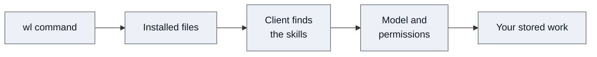

# Troubleshooting — find the failing boundary

> **TL;DR** — Find which part failed first: the `wl` command, the installed files, the client finding the skills, model access or your stored work. Fix that part before reinstalling or granting permissions. A command that exits with 0 does not prove that a whole step ran in the client.



Work from left to right: each part depends on the ones before it. These checks show you where to look; they cannot vouch for your account, a client's permissions or a service being up.

## Start with the symptom

| Symptom | Start here |
| --- | --- |
| `wl` is not found, or the bundle path disappeared | [Executable path](#the-shell-cannot-find-wholeloop) |
| Installed files exist but no skill appears | [Native discovery](#files-installed-but-the-skill-is-missing) |
| Doctor returns exit 3 | [Doctor findings](#doctor-reports-a-failure-or-unknown) |
| The client cannot run a tool or model | [Native access](#the-client-denies-a-tool-or-cannot-use-a-model) |
| An install or update refuses to overwrite files | [Ownership](#installation-reports-changed-unowned-or-pending-files) |
| A new session cannot find earlier work | [Store and identity](#a-new-session-cannot-find-my-work) |
| Status says closed after you put an idea on hold | [Closed outcomes](#on-hold-is-reported-as-closed) |
| A terminal command stops instead of drafting or building | [Core versus skill](#next-returned-json-but-did-not-run-the-whole-flow) |
| A script reports a nonzero exit | [Exit codes](#understand-exit-codes) |
| An autonomous delivery run stopped or its environment is stale | [Autonomous delivery](#autonomous-delivery-experimental) |

Examples use the `wl` command that `npm install --global wholeloop` provides. From a source build, use `node /absolute/path/to/dist/wl.mjs` in its place ([development guide](./contributing/development.md#use-the-source-build)).

## The shell cannot find wholeloop

`wl` comes from the npm package; `wl install` writes skills into a client and does not add a command.

1. Install the package: `npm install --global wholeloop`.
2. Make sure npm's global `bin` directory is on your `PATH`. `npm prefix --global` prints the prefix; the commands are in its `bin` subdirectory.
3. With a **Node version manager**, global packages belong to the active Node version. Switching versions can hide `wl`; install it again for the new version.

The CLI needs Node 20 or newer, whatever runtime your coding client needs for itself. From a source build, run `node /absolute/path/to/dist/wl.mjs`; a shell variable holding that path does not survive a new terminal.

## Files installed but the skill is missing

1. Restart the client in the application repository. A running client may have cached its list of skills.
2. Check the target and [install scope](./glossary.md#terms) you used. A project-scope install belongs to the repository you ran it from, not to whichever one the client has open.
3. Ask for the exact name: `wl-frame-problem`, or `wl-agy-frame-problem` on Antigravity. Claude Code's installed skills (`/wl-...`) and its generated plugin (`/wholeloop:...`) are separate routes.
4. Run doctor for that target and check that the installed files are current. Matching files still do not prove that the client trusts or loads them.
5. Follow the client's [local setup](./platforms/local-onboarding.md) for its directories, overrides and any separate activation step.

Do not keep reinstalling to fix a discovery problem you cannot explain. An install updates the files wholeloop wrote and leaves everything else alone.

## Doctor reports a failure or unknown

Run doctor for your client. Here the Antigravity CLI is not installed:

```console
$ wl doctor --target antigravity
Doctor: 1 required check failed.

  pass     node                  24.22.0
  pass     git                   2.54.0
  fail     cli.antigravity
           The antigravity version command is missing, failed, timed out or returned no version.
           Install the selected CLI or repair PATH, then rerun doctor. The npm recipes require Node 22 or newer; authentication remains a separate action.
           Command: agy --version
  pass     store
  …
$ echo $?
3
```

Each failed check names **what it saw**, **what to do** and often **the command it ran**, so you can repeat it yourself. A missing executable, a failing version command, a store that cannot be written and stale files are different problems with different fixes. Doctor never repairs anything itself.

- `unknown` for an optional provider or file is fine when you are not using it.
- Passing checks do not sign in to a provider, run a model or prove read-only isolation.
- A failed required check exits with **code 3**.

[Doctor checks](./getting-started.md#check-the-installation).

## The client denies a tool or cannot use a model

Sign-in, account eligibility, trust and permissions belong to the client. Look at the exact action it denied and grant that specific approval through the client's normal setup. Do not grant blanket permissions, borrow credentials or switch to another model just to get a passing result.

The recorded trials tell apart missing sign-in, ineligible accounts, denied permissions and upstream outages. Some clients exit with 0 even when a tool was denied, so the run's recorded events, not the exit code, decide whether it passed. [Observed client results](../roadmap/manual-verification.md#automatic-native-client-trials-2026-10-22).

If you have a conformance run ID, set the variable to it and read its diagnosis:

```bash
wl conformance diagnose "$CONFORMANCE_RUN_ID" --json
```

Use the same store as that run; conformance commands also accept `--store`. The diagnosis never shows raw prompts or tool arguments, and it does not fix the account. Check what an interrupted run already did before trying again. A connection error from the provider's side will not be fixed by changing permissions.

## Installation reports changed, unowned or pending files

Install and uninstall only touch files wholeloop wrote and you have not changed ([owned files](./glossary.md#terms)). A file you edited, a file wholeloop did not write, an unsafe link or unexpected content in its private directories is left alone and reported. Look at the reported path, the install receipt and the backups in your store, then decide whether to keep your edits or install somewhere else. There is no option to force over them.

After rebuilding from source, run the same target and scope's dry run first; unchanged output is reported as already installed (`already-correct` with `--json`). If an install was interrupted, its pending receipt records what it meant to do and what it saw. Use the recovery path it reports instead of deleting its state. [Managed installation](./platforms/README.md#installing).

## A new session cannot find my work

Check the ID, the store and the repository. A shell with different `XDG_*` settings reads a different store. An item with a similar title in another repository is not necessarily the same one; continue across contexts by the stored ID.

Start with everything the current store holds:

```console
$ wl status
init-3cf1140a  initiative  open  Find tasks by title in a fictional task app
  owner Demo Owner · updated 2026-11-17
  next: frame-problem

0 unread messages. Add --json for the full status.
```

If your item is missing, you are probably reading another store. If it is there, look closer with its ID: `wl status <id>`, `wl state get <id> --json` and `wl resume <id> --json`. These commands only read: they do not consume messages or move the work forward. The [local core tour](./tutorials/local-core.md) uses its own isolated store on purpose, so its recovery command must keep that store setting. [State locations](./architecture/state-and-messaging.md).

## On-hold is reported as closed

That is expected after you put an idea on hold or drop it during framing. Status shows `closed` with `next: null`; the exact outcome, the reason and what would reopen it are in the receipt and the stored record. A new session keeps that result.

Do not run the same idea again to get around the decision; that creates a duplicate. Read the record, and if circumstances changed, decide explicitly to reopen it. [First-framing receipt](./tutorials/first-framing.md#6-inspect-the-receipt) · [Framing identity rules](./flow/define/frame-problem.md#available-core-commands).

## Next returned JSON but did not run the whole flow

The terminal core never drafts anything or calls a model. `wl next` starts or resumes a [step contract](./glossary.md#terms), returns its preflight and questions, and stops. To have the work done, ask your coding client for the installed `wl-next` skill; it continues until a decision needs you.

In the same way, `questions: []` in a framing preflight means the core has the inputs it needs to start. It does not mean the eight framing questions have been answered. [Core tour](./tutorials/local-core.md#4-start-again-with-an-owner) · [Utilities](./flow/utilities.md).

## Understand exit codes

| Code | Meaning | Next action |
| --- | --- | --- |
| `0` | The requested operation succeeded | Read its result; success covers only that operation |
| `1` | Unexpected error | Keep the command and its context, and report it |
| `2` | More input is needed | Answer the returned questions; do not invent answers |
| `3` | A precondition is not met | Fix the dependency, permission, state or check it names |
| `4` | Invalid input, or the workflow refused the request | Read the validation message or receipt and correct the cause |

A command that asks a question has not crashed. Calling `wl next` with nothing to work on, for example, returns exit 2 and the questions it needs answered:

```console
$ wl next
{
  "schema": "wholeloop/next@1",
  …
  "questions": [
    {
      "id": "input",
      "prompt": "What should this step work on?",
      …
    {
      "id": "owner",
      "prompt": "Who owns this work?",
      …
$ echo $?
2
```

`--json` returns the versioned result for scripts. In a shell script, handle an expected nonzero exit explicitly rather than turning off error handling for the whole script. [Core contract](./architecture/core-cli.md#design-rules).

## Report a useful problem

[Open an issue](https://github.com/dreamingechoes/wholeloop/issues/new/choose) with:

- the wholeloop version (`wl --version`) or source revision;
- your operating system and architecture, and the Node and client versions;
- the command or skill you ran, its exit code and result, and what you expected;
- whether it ran in a real client or against fixtures;
- for a workflow problem, the IDs involved, with private details removed.

Never attach a raw journal or a transcript that contains credentials. Questions that are not bugs fit better in [Discussions](https://github.com/dreamingechoes/wholeloop/discussions).

[V1 acceptance](./v1-acceptance.md#what-evidence-to-return) describes the evidence format maintainers use. A real defect goes back to development; it is not waived as one more manual check.

## Autonomous delivery (experimental)

These problems only come up with [autonomous delivery](./architecture/autonomous-delivery.md).

### Interrupted delivery state

Use [checkpoint and recovery inspection](./tutorials/delivery-checkpoints.md) to tell four situations apart: inputs that changed, a worker nobody observed, an effect whose result is unknown and a writer lock left behind. Inspecting starts nothing.

- **Ordinary commands never take over a lock.** An explicit repair, bound to the lock's digest, keeps a record of the old writer only after observing that its process is gone.
- **A live, reused or unreadable process identity needs inspection**, not a retry.
- **Restore the real inputs and authority** instead of marking a pending write as applied or resetting an exhausted gate.

### A public run stopped before dispatch

`wl delivery run` checks its host before starting anything, and reports the first problem it finds. Nothing was dispatched; `wl delivery reconcile` shows the run.

| Reason | What it means | What to do |
| --- | --- | --- |
| `public-host-native-unbound` | The bindings document lists no client for a role the route needs | Add an exact pinned binding, then prepare a new request for that document |
| `public-host-native-runtime-unavailable` | Every role is bound, but no trusted runtime proof exists yet | Provide the runtime proof for the bound clients |
| `public-host-credential-missing` | A bound client names a worker credential its secret store does not hold | Store it with `wl delivery credential-store`, then check it with `wl delivery credential-check` |
| `public-host-credential-store-unavailable` | This host has no supported secret store, such as Linux without a desktop session | Run on a host with a secret store; there is no file fallback, on purpose |
| `runner-host-binding` | The request was prepared for a different bindings document | Prepare the request again for the document you are using |

A run in `waiting-external` whose reason names an **exhausted usage window** is waiting for the client's quota to reset. If its controller has stopped, `wl delivery pause` and then `wl delivery resume` queue it again.

### Docker environment unavailable or stale

Use the [Docker environment guide](./tutorials/delivery-docker.md), and keep the runtime ID and its history. Preflight starts nothing; it checks:

- the image cache you named, and that the engine and platform are supported;
- the requested capacity, including helper and proxy overhead;
- the current grant.

Scoped network egress and secret delivery into an environment are not available. A changed candidate, an old ready record or a Docker command exiting with 0 does not make an environment ready.

Never retry an ambiguous creation by name, and never run an undo declaration automatically. Stop, reconcile and retire explicitly with the [lifecycle guide](./tutorials/delivery-lifecycle.md). When the invoker or a resource identity is unknown, data is kept, and no stored process ID is ever signalled.

<!-- docnav -->
[◀ Small change](tutorials/small-change.md)  ·  [📖 Docs index](README.md)  ·  [🧭 Concepts](concepts.md)  ·  [Delivery request intake ▶](tutorials/delivery-intake.md)
