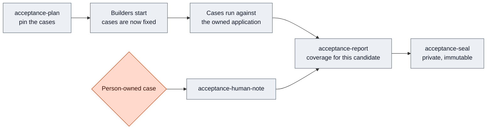

# Pin behavioral acceptance and retain its evidence

> **TL;DR** — **Acceptance cases** are written and pinned **before** any code exists: what to set up, what to do, what must be true and what counts as failure. Later, the run executes them against the exact candidate and keeps the evidence privately. A case owned by a person stays pending until that person records what they observed; no machine can fill it in.

> [!IMPORTANT]
> **Experimental.** Closed definitions, evidence validation, typed reports, human notes and budgeted artifacts are tested. Autonomous delivery may change in a minor release.



## Before you start

Complete the [planning guide](./delivery-plan.md) in the same Bash terminal, so `workspace_dir` is still set. You need Git and Node; no Docker, model, grant or account. The task API below is fictional definition data: nothing is discovered or executed.

## Inspect the contracts and pin a case

The script reads the plan, writes one acceptance case for its `search` criterion and pins it:

<details>
<summary>Acceptance script: copy once</summary>

```bash
set -euo pipefail
wl delivery acceptance-schema --json
wl delivery inspect-plan \
  --run delivery-0123456789abcdef --revision 1 \
  --store "$workspace_dir/state" --json > "$workspace_dir/delivery-receipt.json"
node --input-type=module - "$workspace_dir" <<'JS'
import { createHash } from 'node:crypto'
import { readFileSync, writeFileSync } from 'node:fs'
import { join } from 'node:path'
const directory = process.argv[2]
const prepared = JSON.parse(readFileSync(join(directory, 'delivery-receipt.json'), 'utf8'))
if (prepared.plan.criteria.length !== 1 || prepared.plan.criteria[0].id !== 'search') {
  throw Error('This example requires the exact tutorial criterion; define real cases for another plan')
}
const fixture = JSON.stringify([{ id: 'task-1', title: 'First task' }, { id: 'task-2', title: 'Second task' }])
const plan = {
  schema: 'wholeloop/acceptance-plan@1',
  run: prepared.plan.run,
  revision: prepared.plan.revision,
  plan: prepared.digest,
  source: prepared.plan.source,
  cases: [{
    id: 'find-title', criteria: ['search'], owner: 'machine',
    applicability: 'applicable',
    rationale: 'The agreed criterion requires finding tasks by title.',
    initial: 'Two fixture tasks exist with distinct titles.',
    actions: ['Search the public example endpoint for Second task.'],
    assertions: [{
      id: 'matching-ids', description: 'Return only the matching task ID.',
      subject: 'json', operator: 'equals', path: '/ids', expected: '["task-2"]'
    }],
    failureConditions: ['Missing or extra task IDs fail the criterion.'],
    runner: {
      kind: 'api', capability: 'http.request',
      input: JSON.stringify({ method: 'GET', path: '/tasks?title=Second%20task' })
    },
    fixture: {
      ref: 'fixture:two-tasks',
      sha256: createHash('sha256').update(fixture).digest('hex')
    },
    timeoutMs: 10000
  }],
  retention: { reviewAfterMs: 86400000, expiryAction: 'retain' }
}
writeFileSync(join(directory, 'acceptance.json'), JSON.stringify(plan, null, 2) + '\n')
JS
wl delivery acceptance-plan \
  --file acceptance.json --root "$workspace_dir" \
  --store "$workspace_dir/state" --json > "$workspace_dir/acceptance-receipt.json"
acceptance_digest="$(node --input-type=module - "$workspace_dir/acceptance-receipt.json" <<'JS'
import { readFileSync } from 'node:fs'
console.log(JSON.parse(readFileSync(process.argv[2], 'utf8')).digest)
JS
)"
wl delivery acceptance-inspect \
  --digest "$acceptance_digest" --store "$workspace_dir/state" --json
printf 'Retained acceptance definitions: %s\n' "$workspace_dir"
```

</details>

The case, in plain words:

| Part | In this example |
| --- | --- |
| `criteria` and `owner` | Covers `search`; a machine can decide it |
| `initial` | Two fixture tasks exist with distinct titles, pinned by the fixture's digest |
| `actions` | Search the API for "Second task" |
| `assertions` | The JSON at `/ids` equals `["task-2"]` |
| `failureConditions` | Missing or extra task IDs fail the criterion |
| `runner` | An API case: `GET /tasks?title=Second%20task`, 10 seconds at most |

Pinning returns, without running anything:

```console
$ wl delivery acceptance-plan --file acceptance.json --root "$workspace_dir" --store "$workspace_dir/state" --json
{"schema":"wholeloop/acceptance-plan-prepared@1","digest":"8844941b0a89f561cdbc0e18c1c877bea36c4f04aad7ee08b4846ff0be7009c1","plan":{…},"executed":false,"acceptance":"not-established"}
```

`acceptance-inspect` with that digest returns the same definitions. Pinning never calls an endpoint or runs a command.

**What pinning enforces.**

- Every required criterion needs an applicable case, with the same owner as the criterion.
- An inapplicable browser case cannot stand in for an applicable API or CLI case.
- The pinned definitions cannot be changed in place, and once a builder was admitted on this plan the first definition can no longer be replaced. A new accepted revision is separate.

## Current reports and execution evidence

Once an owned application exists, `wl delivery acceptance-report --digest <digest> --environment <id> --store <store>` checks the current application and candidate, then evaluates the recorded host receipts.

- Missing or changed evidence can never produce acceptance.
- Exit code 3 means incomplete, stale or unavailable coverage, or no current application.
- There is deliberately **no command to import a result**: a JSON object saying that a process exited successfully is not an observation.

**Who runs cases.** Fixed controller hosts execute them with `executeCase`, under the current private authority and finite deadlines; the [API and CLI](./delivery-behaviors.md) and [browser](./delivery-browsers.md) guides cover them. A definition can never load an arbitrary plugin. A worker's proposed pass, a zero exit or an old successful artifact never counts as coverage. The repository's own suites and the review gates keep their own budgets.

**Interruptions.** An interrupted case keeps its intent and what was observed of its process.

- Saving it uses up the original deadline; if the deadline passes before dispatch, nothing starts.
- A dispatched case stays *unknown* until its shutdown is observed, never inferred from age.
- The same key never dispatches twice, and a second request cannot skip unresolved work.
- A later failure wins over an earlier pass, even with the same timestamp.

**Inside a runner stage**, the application operations of a verification, integration or acceptance stage are bound to that stage's original environment, grant and candidate. Each effect is claimed once; each query gets its own owner, so a finished client cannot hide another still running. Pausing and recovering re-read the metadata without running a test again or resetting its allowance, and stopping reaches only that stage's own private channels, even after revocation.

## Private artifacts and sealed reports

**Capturing evidence.** `wl delivery acceptance-artifact --run <run> --file <file> --root <root> --store <store>` stores screenshots, traces or outputs. `--media-type` is optional (default `application/octet-stream`).

| Rule | Detail |
| --- | --- |
| Needs | An active grant with `report.write`, and artifact budget left |
| Size | Up to 20 MiB per object; the run's total is 200 MiB by default |
| Refused | Symlink escapes, and recognizable credential text anywhere in the object |
| Stored as | Content-addressed chunks, verified when read; empty bytes differ from a missing artifact |

Capturing authorizes no sharing. Keep evidence private, and review and redact it before any separately authorized publication: the credential check is not a general image or video redaction. Retention means *keep*; review dates never delete evidence, and partial omissions stay visible in the budget.

**Sealing.** `wl delivery acceptance-seal`, with the same options as the report, stores the current typed report as an immutable artifact. It needs current authority, runs nothing again and grants no publication. A fixture-only or incomplete report stays that way when sealed.

## Human-only observations

A case owned by a person stays `pending-human` until that person records a note:

```text
wl delivery acceptance-human-note --digest <digest> --case <case> --environment <id> --store <store> --file <note.json> --root <root>
```

The note (`wholeloop/acceptance-human-request@1`) says who observed it, what they saw and whether it passed or failed, for that exact candidate. No worker can turn its output into such a note: the broker has no method for it. Earlier supervised PR-testing records are not imported as observations for another case or candidate.

See the [behavioral QA specification](../../roadmap/specifications/autonomous-delivery/04-behavioral-qa.md).

<!-- docnav -->
[◀ Environment stop and retirement](delivery-lifecycle.md)  ·  [📖 Docs index](../README.md)  ·  [🧭 Concepts](../concepts.md)  ·  [Execute API and CLI acceptance ▶](delivery-behaviors.md)
