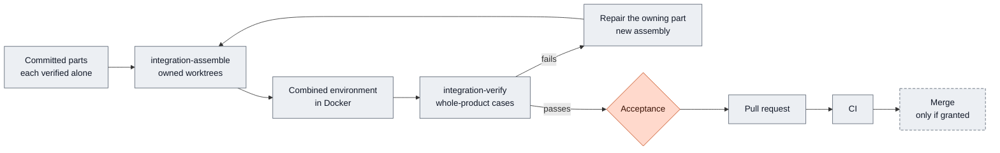

# Assemble and verify the complete milestone

> **TL;DR** — Parts that pass on their own can still fail together. **Assembly** combines every required committed part in separate worktrees the run owns, then tests the **whole product**: the real application in Docker, its contracts and the milestone's procedure. Failed assemblies and their reports are kept; a repair produces a new assembly under the same finite budget. After acceptance, the run can publish a pull request, follow CI and, only when separately granted, merge.

> [!IMPORTANT]
> **Experimental.** Owned assembly, conflict and repair ownership, verification and bounded reports are tested and were observed with Docker and Git. Autonomous delivery may change in a minor release.



Commands that start with `npm run eval` are model-free controls that run from a source checkout ([development guide](../contributing/development.md#build-from-source)); every `wl` command uses the installed CLI.

## Contents

- [Prerequisites and outcome](#prerequisites-and-outcome)
- [Pin contract and combined procedure coverage](#pin-contract-and-combined-procedure-coverage)
- [Create the owned assembly](#create-the-owned-assembly)
- [Recover or repair](#recover-or-repair)
- [Bind and run the combined environment](#bind-and-run-the-combined-environment)
- [Observe the model-free combined regression](#observe-the-model-free-combined-regression)
- [Record a person's decision on a supervised route](#record-a-persons-decision-on-a-supervised-route)
- [Publish the accepted product as a pull request](#publish-the-accepted-product-as-a-pull-request)
- [Observe CI at the exact candidate](#observe-ci-at-the-exact-candidate)
- [Read a CI repair request](#read-a-ci-repair-request)
- [Explain merge eligibility](#explain-merge-eligibility)
- [How a conditional merge behaves](#how-a-conditional-merge-behaves)
- [Inside the runner](#inside-the-runner)

## Prerequisites and outcome

| You need | Details |
| --- | --- |
| An accepted [plan](./delivery-plan.md) and an active [grant](./delivery-authorization.md) | The grant needs `workspace.create` and `git.commit` for assembly and `test.run` for verification, with the selected repositories and topic prefixes |
| Committed, clean part worktrees | One per required unit |
| Pinned [acceptance](./delivery-acceptance.md) | Including the combined cases below |
| A run that is queued or running | With no unresolved foreign effects |
| Git with `--path-format=absolute`, and the [Docker prerequisites](./delivery-docker.md) | For assembly and the combined environment |

```console
$ wl delivery integration-assembly-schema --json
{"schema":"wholeloop/integration-assembly-schema@1", …}
```

It prints the request, record, status, verification request and report contracts, and executes nothing. This guide grants nothing and publishes nothing until its publication sections.

## Pin contract and combined procedure coverage

Before any builder is admitted, add objective cases to the acceptance definition so the **combination** is tested, not only the parts:

- every selected criterion needs applicable coverage;
- for each produced **contract**, an applicable machine case must have `fixture.sha256` equal to the approved contract digest;
- a machine case must include the milestone's exact **procedure** text in its actions.

One genuine combined case can cover a criterion, a contract and the procedure at once; unrelated green component cases cannot replace a missing mapping. Use real assertions against your public entry point and seeded state. Criteria only a person can accept still need that person's note, and a gate-policy input names a requirement, not a passing receipt.

## Create the owned assembly

Write a `wholeloop/integration-assembly-request@1` file in your operator directory: the run, revision, plan, milestone, a stable key and the complete `parts` list, as in the [candidate guide](./delivery-integration-candidates.md). Each part names its work, repository, registered path, topic ref and committed head. Leave out `repairOf` for the first assembly.

```bash
set -euo pipefail
wl delivery integration-assemble --file "$assembly_request_file" --root "$operator_input_dir" --store "$delivery_store" --json
wl delivery integration-assembly-status --digest "$assembly_digest" --store "$delivery_store" --json
```

**What assembly does:**

1. creates separate worktrees in the store, and topic branches under the grant's prefix;
2. merges the parts in global dependency order, including predecessors in other repositories;
3. runs every Git change as its own finite, observed effect, with hooks, signing and prompts disabled and controller-side Git helpers refused.

Your checkout, the real target branches and worker files are never touched; application and test commands run in the Docker hosts.

| Status | Means |
| --- | --- |
| `assembled` | The complete Git combination exists. Acceptance is still `not-established` |
| `conflict`, `failed`, `partial`, `unknown`, `stale` | Exit code 3. A partial assembly never counts as success and triggers no rollback |

A command that failed can still have left files or refs behind: inspect the kept worktree and its effect rather than assuming nothing changed.

## Recover or repair

**Recover.** A lost Git command is observed, never issued again. Reconcile an operation that was already issued, even after a revocation:

```bash
set -euo pipefail
wl delivery integration-assembly-reconcile --digest "$assembly_digest" --store "$delivery_store" --json
```

It dispatches no Git write and restores no authority. Missing proof of completion stays *unknown*, and no stored process ID is signalled. Resuming real work still needs current scope and a queued or running run.

**Repair.** For a conflict or a failure of the combined behaviour:

1. repair the **owning part** in a new committed revision, through its authorized builder;
2. keep the failed integration files;
3. submit a new assembly request with a new key, the updated part heads and `repairOf` set to the previous assembly's digest.

The integration-repair counter and the effect and time limits still apply. The new assembly fences the old one. No worker is reset or rebased automatically, no conflict edit is discarded and no failed Git write is repeated blindly.

## Bind and run the combined environment

1. Prepare a current [environment recipe](./delivery-environments.md) from the assembled repositories' paths, refs and heads. **One** recipe and environment must cover every selected repository, with its files, seed data and service dependencies pinned.
2. [Prepare a candidate](./delivery-integration-candidates.md) with those exact assemblies and the original acceptance definition.
3. Start the [Docker environment](./delivery-docker.md) from that candidate.
4. Write a `wholeloop/integration-verification-request@1` file with four fields: `schema`, `candidate`, `assembly` and `environment`.

Then verify, or read the evidence again later:

```bash
set -euo pipefail
wl delivery integration-verify --file "$integration_verification_file" --root "$operator_input_dir" --store "$delivery_store" --json
wl delivery integration-report --file "$integration_verification_file" --root "$operator_input_dir" --store "$delivery_store" --json
```

| Command | Does |
| --- | --- |
| `integration-verify` | Runs the required machine cases through the fixed hosts and keeps a complete, bounded report. Completed keys never repeat their effects |
| `integration-report` | Re-reads the current evidence without running any case |

- A changed part, recipe, base, assembly or environment invalidates the matching result.
- A failed criterion names its pinned repair owner and case IDs. Failed cases and their artifacts stay as history; a new assembly cannot borrow their green results.
- A pass returns machine milestone evidence, delegated or combined with an operator's. Fixture-only, failed, stale, pending-human and unavailable outcomes exit with code 3.
- It does not establish whole-feature completion, independent review or publication, and several repositories bring no atomic code-host transaction or automatic rollback.

## Observe the model-free combined regression

With the reference images cached:

```bash
set -euo pipefail
npm run eval:assembly -- --retire-success
```

```console
$ npm run eval:assembly -- --retire-success
Retained evaluation: /tmp/wholeloop-assembly-evaluation-XXXXXX
Observed: independent-green-components-fail-the-actual-combined-api
Observed: completed-verification-keys-do-not-repeat-effects
Observed: committed-repair-invalidates-downstream-candidate-and-evidence
Observed: repaired-complete-vector-passes-real-cli-contract-and-api-checks
Observed: complete-budgeted-failed-and-passed-reports-remain-verifiable
…
Observed: personal-targets-and-independent-worker-files-remain-preserved
Observed: two-repository-acceptance-does-not-claim-atomic-delivery-or-rollback
Observed: exact-owned-environments-retired-with-evidence-preserved
{"schema":"wholeloop/assembly-evaluation@1","status":"passed","scope":"Actual disposable two-repository Git assembly and Docker CLI/API observations; native clients, accounts, hosted publication and independent Linux controller certification are not established.",…}
```

The story it tells:

1. Two repositories, a backend and a frontend: each passes on its own.
2. Assembled, the combined API **fails**.
3. A committed backend repair produces a new, complete assembly, which invalidates the old candidate and its evidence.
4. The unchanged contract, CLI and API cases now **pass**.
5. Failed and passed reports stay verifiable, private cases stay hidden in the repair feedback, and the owned environments are retired with their evidence kept.

It involves no model, account, external service, remote Git write, pull request or merge.

## Record a person's decision on a supervised route

Supervised and on-exception routes keep people at their decision points. With recorded human decisions configured, the **build-plan** and **acceptance** stages publish the exact subject a person must judge: the builder plan, or the current whole product. The stage reports *pending* and the run waits; nothing prompts. Record the decision with the subject digest from the stage's request:

```bash
wl delivery human-decide --digest <request> --stage acceptance --decision acceptance --subject <sha256> --outcome accept --operator "Your Name" --note "Ran the exact product locally"
```

- A different subject, a `none` run or a conflicting second decision is refused.
- Then reconcile observes the stage, resume puts the run back in the queue, and the local hand-off accepts the recorded acceptance of that exact product.
- The plan stage accepts only an exact-plan grant, which already names the plan; plans derived from an envelope are refused here until derived-plan authority supports recorded human decisions.

`npm run eval:runner-assembly-readiness -- --human-acceptance --retire-success` exercises this with Docker.

## Publish the accepted product as a pull request

A `to-pr` route continues after acceptance with a **publication** stage and its hand-off.

| Grant | Allows |
| --- | --- |
| `git.push`, `pr.create` | Pushing the accepted head and opening a draft PR |
| `pr.ready` | Taking the PR out of draft |

For each repository, publication reads the remote, pushes the accepted head to its owned `wl/` topic **without force**, opens one draft PR whose body carries the run's marker, and marks it ready when granted. The PR text says whether a person's recorded acceptance or a delegated machine acceptance stands behind it; machine acceptance is never called human testing.

- A different remote tip, a PR the run does not own, duplicated owned PRs or a changed head stop publication without writing.
- A lost response is resolved by reading the remote.
- The endpoint is `ready-pr` or `draft-pr`.

A `to-merge` route also needs `policy.merge` in the plan and `pr.ready` and `pr.merge` in the grant, and continues with a CI stage and a merge stage that runs only when merge stages are installed with an explicit runtime allowance. `npm run eval:runner-assembly-readiness -- --publication --retire-success` exercises publication against a stub code host.

## Observe CI at the exact candidate

CI observations are tied to the exact commit:

- a required check counts only from its **trusted issuer**, at the **exact candidate**, by its **latest attempt**;
- pending, cancelled, skipped, neutral, missing, stale and spoofed results never count as success;
- a partial set of pages, unreadable branch protection or an empty required set leaves the verdict *unknown*.

Waiting polls every 15 seconds for at most 30 minutes, inside the run's deadline, and never asks a person. Each observation is kept in the store as `wholeloop/delivery-ci@1`.

## Read a CI repair request

A failed observation becomes a recorded repair request:

| Request | When | Then |
| --- | --- | --- |
| `repair` | A trusted code or test failure, within the push budget (the first push plus one repair by default, counted from the journal) | The run goes through verification, review and publication again, within that budget |
| `blocked` | Cancelled, skipped, stale, spoofed or unreadable results, a spent budget, or current review comments | The run ends, with the request |

Review comments are kept with their identity and revision but never executed or adopted.

## Explain merge eligibility

Merge eligibility is an **explanation, not an action**: `eligible`, `ineligible` or `unknown`, with every reason, valid for 60 seconds after the oldest observation. It requires:

- an explicit `to-merge` grant with `pr.merge`, and a runtime allowance;
- current acceptance and gates;
- one open, ready GitHub PR at the candidate, with passing revision-bound checks and reviews, and strict base checks on the server;
- no conflict, stale base, undelivered dependency, sensitive path or forbidden request such as an admin bypass.

Unattended intervention and green tests never imply eligibility.

## How a conditional merge behaves

The merge executor merges a freshly eligible candidate through **one** recorded `pr.merge` intent, with `gh pr merge --match-head-commit` and the configured method. It never uses an admin bypass, auto-merge or branch deletion.

- A PR merged or queued by someone else is reported as such; a server refusal stops the run; a lost response is resolved by reading.
- A mix of merged and unmerged repositories is reported as **partial**, without a rollback.
- `to-merge` routes are not composed by the public runner yet, and are refused before dispatch.

## Inside the runner

For contributors: how the controller composes assembly and product QA. Each component is tested with real Git, Docker and processes and synthetic models; none is a public command or certifies a signed-in client.

| Guarantee | Evaluation |
| --- | --- |
| **Unit QA first.** Every unit in the milestone's dependency closure needs current verification and review at its exact commit, including any correction chain | `npm run eval:runner-assembly-readiness -- --retire-success` |
| **Foreground ownership.** Every Git operation gets the narrower deadline, both cancellation signals and an ownership watcher, registered before input; a cancelled, expired or fenced controller cannot admit another effect | same |
| **Assembly readiness** needs the complete current unit QA and the matching owned assembly, all Git effects applied and closed, rechecked after inspection | same |
| **Evidence during recovery.** A case result is reopened against its original Docker effect, artifact bytes and assertions; a stored passing flag or a copied label cannot replace it | same |
| **The combined report** is reopened with its candidate, assembly and pinned cases; coverage is derived again, and substituted claims are refused without replaying anything | `npm run eval:assembly -- --retire-success` |
| **Parent controls.** The verifier keeps the original deadline, cancellation and ownership; cancellation reaches HTTP requests too, and fencing stops late captures and reports | same |
| **Product QA** joins current unit QA and the owned assembly to the pinned CLI and API cases, consuming one original selection | `npm run eval:runner-assembly-readiness -- --retire-success` |
| **Private and browser product cases** run through their own owned evaluator or isolated browser, keeping the private definition and sensitivity policy | same |
| **One whole product.** Feature acceptance needs one declared milestone whose dependency closure covers all work, criteria and milestones, with passing cases for every procedure; separate green products are not enough | same |
| **Delegated acceptance** combines that readiness with the grant's explicit `acceptance` delegation under intervention `none`, with independent planner and challenger sessions; a rejection stays a rejection | same |
| **Local hand-off** requires the latest acceptance verdict and its exact product, and records one report tied to the original inputs | same |
| **Fixed dispatch.** Each stage kind is resolved from its original invocation and plan revision through a closed registry; a caller cannot pick another domain or store | same |

<!-- docnav -->
[◀ Integrated milestone candidates](delivery-integration-candidates.md)  ·  [📖 Docs index](../README.md)  ·  [🧭 Concepts](../concepts.md)  ·  [Delivery budgets ▶](delivery-budgets.md)
