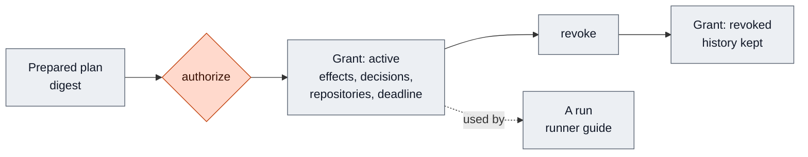

# Authorize delivery — record a bounded grant

> **TL;DR** — A **grant** is your recorded authorization for one exact plan or envelope: which effects a run may perform, which decisions it may take, which repositories it may touch, how many effects in total and until when. Recording, inspecting and revoking a grant starts no worker and performs no publication or merge.

> [!IMPORTANT]
> **Experimental.** Grant recording, deadlines, revocation and worker claim boundaries are tested. Autonomous delivery may change in a minor release.

**What you will have at the end:** an active grant for the plan from the [planning guide](./delivery-plan.md), inspected from another command, then revoked with its history kept.



## Before you start

Complete the [planning guide](./delivery-plan.md) first, and continue in the same Bash terminal so `workspace_dir` is still set. In a new terminal, set `workspace_dir` to the directory that guide printed, or run it again. The example uses its disposable repository and store, a fictional operator and no remote account. Keep request files and receipts outside application repositories.

## Record and inspect a bounded grant

The script reads the prepared plan, writes an authorization request for it and records the grant:

<details>
<summary>Grant script: copy once</summary>

```bash
set -euo pipefail
: "${workspace_dir:?Run the planning tutorial in this terminal first}"
wl delivery inspect-plan \
  --run delivery-0123456789abcdef --revision 1 \
  --store "$workspace_dir/state" --json > "$workspace_dir/plan-receipt.json"
node --input-type=module - "$workspace_dir" <<'EOF'
import { readFileSync, writeFileSync } from 'node:fs'
import { join } from 'node:path'
const directory = process.argv[2]
const prepared = JSON.parse(
  readFileSync(join(directory, 'plan-receipt.json'), 'utf8')
)
const request = {
  schema: 'wholeloop/delivery-authorization-request@1',
  id: 'authorization-0123456789abcdef',
  operator: 'Fixture Operator',
  basis: {
    kind: 'plan', digest: prepared.digest,
    run: prepared.plan.run, revision: prepared.plan.revision
  },
  effects: ['report.write', 'workspace.create', 'code.write', 'test.run', 'git.commit'],
  decisions: [],
  repositories: prepared.plan.repositories.map(repository => ({
    repository: repository.id, topicPrefix: 'wl/'
  })),
  reads: [],
  effectLimit: 20
}
writeFileSync(join(directory, 'authorization.json'), JSON.stringify(request, null, 2))
EOF
wl delivery authorize \
  --file "$workspace_dir/authorization.json" --root "$workspace_dir" \
  --store "$workspace_dir/state" --json
wl delivery grant \
  --id authorization-0123456789abcdef \
  --store "$workspace_dir/state" --json
```

</details>

The request names:

| Field | In this example | Means |
| --- | --- | --- |
| `basis` | `kind: plan`, its digest, run and revision | The exact plan this grant covers; nothing else |
| `effects` | `report.write`, `workspace.create`, `code.write`, `test.run`, `git.commit` | What the run may do. No push, PR or merge here |
| `decisions` | none | Which decisions a machine may take for you |
| `repositories` | `app`, topic prefix `wl/` | Where it may work, and the prefix of branches it may own |
| `reads` | none | Which provider reads it may make |
| `effectLimit` | 20 | How many effects in total |

The grant it records, shortened:

```console
$ wl delivery grant --id authorization-0123456789abcdef --store "$workspace_dir/state" --json
{
  "schema": "wholeloop/delivery-authorization@1",
  "digest": "08432d43a926e1447262ee33075f6bed717110be0d59cc336faa1610a9abbc62",
  "status": "active",
  "grant": {
    "schema": "wholeloop/delivery-grant@1",
    "id": "authorization-0123456789abcdef",
    "operator": "Fixture Operator",
    "effects": ["report.write", "workspace.create", "code.write", "test.run", "git.commit"],
    "decisions": [],
    "reads": [],
    "effectLimit": 20,
    "issuedAt": "2026-11-17T19:16:19.716Z",
    "expiresAt": "2026-11-18T19:16:19.716Z",
    "owner": "Fixture Owner",
    "provenance": "operator-control",
    …
  },
  "revocation": null,
  "runtime": "not-observed-by-this-command"
}
```

- **`expiresAt`** is 24 hours after issuance by default. Set a shorter or longer finite `expiresAt`, in UTC, in the request before the first issuance.
- **`runtime: not-observed-by-this-command`** says that recording a grant observed no worker or sandbox.
- **The topic prefix** applies only to branches the controller recorded as its own. It can never authorize changing someone else's branch or the target branch.

Running `authorize` again with the same file keeps the original grant and its deadline. A changed request with the same ID is refused. An expired or revoked grant is never renewed by retrying: for a new authorization, use a new ID and a current plan.

## Revoke while retaining the receipt

```bash
cat > "$workspace_dir/revoke.json" <<'EOF'
{
  "schema": "wholeloop/delivery-revocation-request@1",
  "grant": "authorization-0123456789abcdef",
  "operator": "Fixture Operator",
  "reason": "End this disposable authorization trial."
}
EOF
wl delivery revoke \
  --file "$workspace_dir/revoke.json" --root "$workspace_dir" \
  --store "$workspace_dir/state" --json
wl delivery grant \
  --id authorization-0123456789abcdef \
  --store "$workspace_dir/state" --json
```

Both commands now report `revoked`, with the original grant and the first revocation kept:

```console
$ wl delivery grant --id authorization-0123456789abcdef --store "$workspace_dir/state" --json
{
  "schema": "wholeloop/delivery-authorization@1",
  "status": "revoked",
  "grant": { … },
  "revocation": {
    "schema": "wholeloop/delivery-revocation@1",
    "grant": "authorization-0123456789abcdef",
    "operator": "Fixture Operator",
    "reason": "End this disposable authorization trial.",
    "at": "2026-11-17T19:16:19.883Z",
    "provenance": "operator-control"
  },
  …
}
```

Revoking again keeps that first receipt. Later worker requests under the grant fail, and nothing is erased. This example starts and stops no worker, and makes no commit, push, PR or merge; cancelling a running run belongs to the [runner](./delivery-runner.md).

## Initial envelopes and worker boundaries

`wl delivery authority-schema --json` prints the request, revocation and worker request contracts.

**Granting an envelope.** A basis can be `kind: envelope` with the envelope's digest and no run or revision. That authorizes the run before the detailed plan exists. Only delegated decisions already declared in the envelope's policy can be selected. Code work under an envelope still needs a plan that fits it and is accepted for that exact plan. Nothing in the request text or a profile can turn delegation on.

**Endpoint and effects are separate ceilings.**

| Endpoint | Excludes |
| --- | --- |
| `research-report` | Code and publication |
| `local-handoff` | Publication |
| `to-pr` | Merge |
| `to-merge` | Nothing, but it still needs an explicit merge effect and a code host that allows it |

Deployments, production changes, messages and flag changes are not supported at all. A **read rule** names an exact provider, tenant or repository scope and an existing read operation, so a provider write cannot pass as a read. Grants hold identifiers and references, never credential values.

**What a worker can and cannot do.**

- Each worker session is bound to the run, plan, attempt, role and cell the controller chose.
- It is admitted only when a trusted runtime reports its restricted tools and separate controller and credential views; with intervention `none`, interactive tools are excluded too.
- A worker cannot choose its role, create or revoke grants, change budgets or submit a person's acceptance.
- What it proposes is recorded as a **worker claim**, with effects not performed, until the controller observes the real result. Fixture observations stay labelled as fixtures and prove no real containment.
- Workers never get an operator endpoint; the runner launches them only through bound client hosts ([runner controls](./delivery-runner.md)). A client that cannot be restricted stays with the supervised [small-change route](./small-change.md): widening a grant cannot make it isolated.

## Stopping point

You have recorded a grant, inspected it, and revoked it with its history kept, in a disposable store. Keep the directory for inspection. Next: the [queue](./delivery-queue.md) and [runner](./delivery-runner.md) guides. None of these metadata operations marks a client or service as verified.

<!-- docnav -->
[◀ Maintenance proposals](maintenance-proposals.md)  ·  [📖 Docs index](../README.md)  ·  [🧭 Concepts](../concepts.md)  ·  [Delegated machine decisions ▶](delivery-decisions.md)
