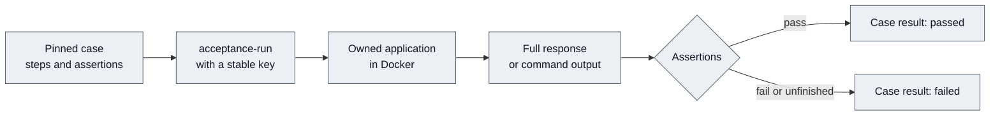

# Execute API and CLI acceptance against an owned application

> **TL;DR** — An API or CLI **acceptance case** runs against the real application, in the Docker environment the run owns: it sends real requests or runs a declared command, and compares the complete response or output with what the case expects. A green unit suite cannot stand in for it, and a case that cannot finish never counts as a pass.

> [!IMPORTANT]
> **Experimental.** The fixed host, effect and candidate binding, output checks, restart and suite reuse are tested and were observed in Docker. No model or account is needed. Autonomous delivery may change in a minor release.



Commands that start with `npm run eval` are model-free controls that run from a source checkout ([development guide](../contributing/development.md#build-from-source)); every `wl` command uses the installed CLI.

## Inspect the contract without executing anything

```console
$ wl delivery behavior-schema --json
{"schema":"wholeloop/behavior-schema@1", …}
```

It needs no Docker daemon, account or grant.

## Define a case before the builder runs

Follow [acceptance planning](./delivery-acceptance.md) and the [Docker guide](./delivery-docker.md) first. A case's `runner.input` is a JSON string holding a behaviour input. The examples below are definition data: replace the service, commands, paths and expectations with your reviewed application's contract.

**An API case** can create a task, restart the service and check that the task survived:

```json
{
  "schema": "wholeloop/behavior-input@1",
  "kind": "api",
  "service": "web",
  "port": 3000,
  "steps": [
    {
      "id": "create",
      "kind": "request",
      "method": "POST",
      "path": "/tasks",
      "headers": { "content-type": "application/json" },
      "body": "{\"title\":\"Durable task\"}"
    },
    { "id": "restart", "kind": "restart" },
    { "id": "find", "kind": "request", "method": "GET", "path": "/tasks?title=Durable" }
  ],
  "targets": [{ "assertion": "matching-ids", "step": "find" }]
}
```

Pair it with a `json` / `equals` assertion on path `/ids` expecting `["task-1"]`.

| Rule | Detail |
| --- | --- |
| Which response | The last request by default; `targets` names a request for each assertion |
| Subjects | `status`, `header` and `json`; JSON and header paths use JSON Pointer |
| Headers observed | Only `content-type`, `content-length`, `location`, `etag` and `cache-control`, so cookies and authentication material are never captured |
| Unobserved headers | Cannot satisfy an assertion, not even that a header is absent |

**A CLI case** runs one exact test-phase command from the environment recipe:

```json
{
  "schema": "wholeloop/behavior-input@1",
  "kind": "cli",
  "service": "web",
  "command": "validate",
  "stdin": ""
}
```

| Rule | Detail |
| --- | --- |
| Subjects | `exit`, `stdout`, `stderr` and `json` |
| A failing command on purpose | `exit` / `equals` 7 can check that empty input is rejected |
| Who decides the command | The recipe: its arguments, working directory and origin. A case cannot supply a different executable |
| What is recorded | The controller-side Docker client that ran it, and separately the application container and the exit the daemon observed. Both output streams are read completely before the client exits |

**Committed file scope.** The public implementation route can also check which files a change committed, with the CLI capability `repository.diff`. Set `runner.input` to `{"schema":"wholeloop/repository-diff-input@1","repository":"<id>"}` and assert on `/changedPaths`, the complete sorted list of changed paths, written as JSON text. Each change also reports its path, status and mode and object before and after, alongside `base`, `head` and `baseAncestor`. The controller picks the candidate and both revisions, refuses a dirty or moved candidate, and needs the `source.read`, `test.run` and `report.write` effects. It proves committed-tree facts only; PR, CI and merge evidence come from the code host.

## Run and inspect

Once the plan is pinned and its environment provisioned:

```text
wl delivery acceptance-run --digest <digest> --case <case> --key <key> --environment <id> --store <store> --json
```

- **The key** binds exactly one execution to those inputs. Repeating it returns the existing result; an unresolved run refuses a blind retry. Use a new key only for a deliberately new execution, and keep the old evidence.
- It returns `acceptance-case-result@1` and exits non-zero unless the case passes.
- `acceptance-report` gives the current coverage per criterion, and `acceptance-seal` keeps the report privately.
- A case result grants no publication and never records a person's test. A changed candidate, another recipe or environment, a newer failure or missing evidence stops an earlier success from counting.

## Run the reproducible model-free evaluation

It needs a local Linux Docker daemon that supports the [reference backend](./delivery-docker.md), the cached reference Node image and free capacity. It pulls nothing and uses no model or account.

```bash
set -euo pipefail
npm run eval:behaviors -- --retire-success
```

```console
$ npm run eval:behaviors -- --retire-success
Retained evaluation: /tmp/wholeloop-behavior-evaluation-XXXXXX
Observed: actual-restart-exposes-memory-only-storage
Observed: actual-wrong-exit-fails
Observed: missing-is-not-zero
Observed: green-unit-suite-cannot-hide-failed-persistence
Observed: candidate-repair-invalidates-old-evidence
Observed: actual-repair-persists-across-restart
Observed: actual-negative-cli-observes-process-and-exit-seven
…
{"schema":"wholeloop/behavior-evaluation@1","status":"passed","scope":"Actual model-free Docker API/CLI observations; independent Linux controller and native clients are not certified.","retirement":"observed-retired",…}
```

The story it tells:

1. It starts a task application that keeps tasks **only in memory**, with a unit suite that is green on purpose.
2. The API case **fails** after a real restart: the task is gone, and the green suite cannot hide it.
3. It also fails a wrong exit code, and tells missing data apart from zero.
4. It repairs the candidate to use its owned data volume, which **invalidates the old evidence**, and the case now passes across a real restart.
5. It checks a real exit 7, the recorded process facts, and that the suite runs once per round through the existing gate journal.

The failures in steps 2 and 3 are expected; the evaluation passes only if every expected failure and the repair are observed correctly. Successful environments are retired at the end; a failed evaluation keeps its resources and evidence directory.

**Application suites.** The trusted `dockerSuiteExecutor` maps each declared command to a pinned CLI case, checks its exact arguments, working directory, the current candidate and an explicit zero exit, then uses `runSuite`'s existing cache. The supervised suite executor is unchanged, and neither resets gate rounds after a repair.

## When execution cannot finish

None of these can produce a pass: a missing capability, a changed identity, an overflow, a partial HTTP body, an unsupported encoding, a redirect to another host, a revocation or a deadline.

- An uncertain HTTP action is never retried. Its environment can be fenced and stopped, keeping the data.
- Stopping a server does not tell you whether an earlier request was committed. Inspect the original effect and case records before choosing another environment or candidate.

[Lifecycle recovery](./delivery-lifecycle.md).

<!-- docnav -->
[◀ Behavioral acceptance and evidence](delivery-acceptance.md)  ·  [📖 Docs index](../README.md)  ·  [🧭 Concepts](../concepts.md)  ·  [Execute isolated browser acceptance ▶](delivery-browsers.md)
