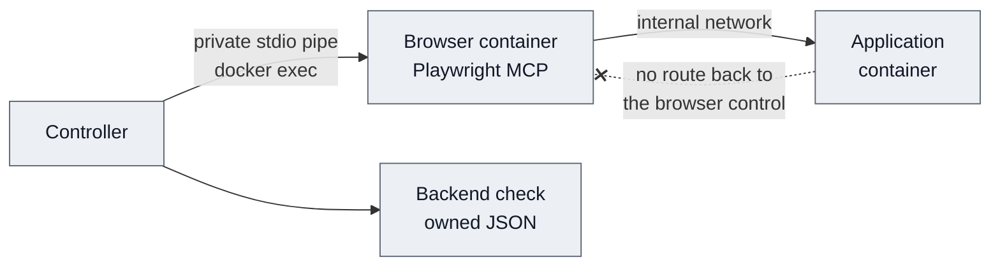

# Execute isolated browser acceptance

> **TL;DR** — A **browser acceptance case** drives a real, isolated Chromium through MCP, clicking the controls a person would, and checks the result in the UI, after a real restart, in a fresh browser context and in the backend's data. A screenshot alone can never prove that something was saved.

> [!IMPORTANT]
> **Experimental.** The fixed host drives isolated Chromium through private MCP, and the model-free evaluation observes UI failures, restarts and denied private controls. Autonomous delivery may change in a minor release.



Commands that start with `npm run eval` are model-free controls that run from a source checkout ([development guide](../contributing/development.md#build-from-source)); every `wl` command uses the installed CLI.

## Inspect the contract

```console
$ wl delivery browser-schema --json
{"schema":"wholeloop/browser-schema@1", …}
```

It returns the input schema, the reviewed engine and tool bindings, an immutable image per architecture and the exec and release schemas. It installs, pulls and starts nothing. The reference is **Playwright MCP 0.0.83** with its observed engine version; a newer server is never accepted silently.

## Prepare the owned environment

Follow the [Docker guide](./delivery-docker.md), the [lifecycle guide](./delivery-lifecycle.md) and [acceptance planning](./delivery-acceptance.md), and pin the definitions before any builder runs. In the recipe, select the application's real source and design files, its UI service with loopback publication, and add a **browser service**:

| Setting | Value |
| --- | --- |
| Image | The matching immutable image from `browser-schema`, cache-only or with a separately authorized pull. A missing image is *unavailable*, never a simulated browser |
| `after` | The UI service |
| `mounts`, `secrets` | Empty |
| `cwd` | `/tmp` |
| Start command | The command below, with `origin.kind: recipe` |
| Readiness and port | TCP on 8931; one port, container 8931, `publish: none`. This probe listens on loopback inside the browser container and is not an MCP endpoint |
| Resources | 1024 MiB and one CPU for the browser, plus the application and proxy in the recipe limits |
| Network | Internal only |

```json
["node", "-e", "const net=require('node:net');net.createServer(s=>s.end('ready')).listen(8931,'127.0.0.1')"]
```

wholeloop reaches the MCP process through a **private `docker exec` pipe**, so the application has no MCP listener it could call. No host browser profile, workspace, credential or Docker socket is mounted in the browser. Capacity admission can refuse concurrent environments; stop a finished one to free compute while keeping its data and evidence.

## Define objective actions

Set `runner.kind` to `browser` and `runner.capability` to `browser.journey`. `runner.input` is a JSON string holding this object; replace the tool digest with `reference.digest` from `browser-schema`, and the grounding hash with the real digest of the selected design file:

```json
{
  "schema": "wholeloop/browser-input@1",
  "service": "web",
  "port": 3000,
  "browser": {
    "service": "browser",
    "reference": "playwright-mcp@0.0.83",
    "tools": "REPLACE_WITH_REVIEWED_TOOL_DIGEST"
  },
  "grounding": [{ "file": "design", "sha256": "REPLACE_WITH_SELECTED_INPUT_HASH" }],
  "persistence": "backend-roundtrip",
  "backend": { "path": "/tasks?title=Durable" },
  "steps": [
    { "id": "open", "kind": "navigate", "path": "/" },
    { "id": "title", "kind": "fill", "target": { "role": "textbox", "name": "Task title" }, "text": "Durable task" },
    { "id": "submit", "kind": "click", "target": { "role": "button", "name": "Add task" } },
    { "id": "visible", "kind": "check", "assertion": "created", "text": "Durable task", "mode": "present" },
    { "id": "image", "kind": "capture", "label": "created-task" },
    { "id": "restart", "kind": "restart" },
    { "id": "fresh", "kind": "fresh" },
    { "id": "retained", "kind": "check", "assertion": "retained", "text": "Durable task", "mode": "present" }
  ]
}
```

| Step | Does |
| --- | --- |
| `navigate`, `fill`, `click` | Act on controls by **role and name**, as a person would see them |
| `check` | Looks for text in the UI; pair it with a `state` / `equals` assertion on `/checks/created` or `/checks/retained`, expecting `true` |
| `capture` | Takes a screenshot with a label |
| `restart` | Restarts the application for real |
| `fresh` | Opens a fresh browser context, with no cached state |

Add a `json` / `equals` assertion on the backend at `/ids`, expecting `["task-1"]`, using the real IDs from the agreed contract.

**Persistence needs three observations:** the UI after a real restart, a fresh browser context and the owned backend's JSON. For a journey that claims no persistence, use `persistence: not-applicable`; it still needs objective checks.

**What keeps a journey honest:**

- Every control name must appear in a selected, hashed input file and match exactly one role and name in a fresh page snapshot. wholeloop uses the observed reference and never guesses a selector.
- After every action there must be exactly one tab, at the expected owned URL. Use `expectPath` for an agreed route change, including hash routes.
- A redirect to another host, a changed tab, an ambiguous control, a missing tool or incomplete output cannot pass.
- There is no `evaluate`, no arbitrary script and no hidden way to inject state.

## Execute and inspect

With the acceptance plan, grant, recipe and environment ready, run `acceptance-run` with the plan digest, case ID, a stable key and the environment ID, exactly as for [API and CLI cases](./delivery-behaviors.md#run-and-inspect); the browser host is chosen automatically. A completed key returns its receipt, and an unresolved earlier run cannot be dispatched again. To change a pinned case, accept a new revision.

**The evidence** records the actions, control references, URLs, tool digests, checks, backend observations and screenshot labels and digests.

- Up to four complete PNGs, sharing a 20 MiB limit per case and the run's artifact budget.
- The controller-side client's process is recorded; the application's process ID and signal stay unobserved.
- Read the bytes with the verified artifact command. Nothing is shared or published.

## Run the actual model-free evaluation

Cache the helper image from `environment-runtime-schema` and the matching browser image from `browser-schema` through your usual reviewed workflow, then:

```bash
set -euo pipefail
npm run eval:browsers -- --retire-success
```

```console
$ npm run eval:browsers -- --retire-success
Retained evaluation: /tmp/wholeloop-browser-evaluation-XXXXXX
Observed: actual-ui-success-and-screenshot-do-not-prove-persistence
Observed: actual-application-cannot-reach-browser-control-listener
Observed: candidate-repair-invalidates-old-browser-evidence
Observed: actual-ui-create-restart-fresh-context-and-backend-roundtrip
Observed: completed-case-is-reused-without-replaying-ui-actions
{"schema":"wholeloop/browser-evaluation@1","status":"passed","scope":"Actual model-free isolated Chromium and private stdio MCP observations; native coding clients, accounts and independent Linux controllers are not certified.","retirement":"observed-retired",…}
```

1. A **cosmetic** application shows the new task and captures it in a screenshot, then loses it after a restart: the case fails, as it should.
2. The application cannot reach the browser's control channel.
3. A repaired, durable application invalidates the old evidence, and passes the full journey: restart, fresh context and backend check.
4. Running the completed case again reuses its result without repeating any UI action.

Everything it creates is disposable and owned, and retirement verifies that it is gone. A failed run keeps its resources and diagnostics; retire them with the [lifecycle commands](./delivery-lifecycle.md), never by removing a container with a similar name.

This does not certify coding clients, accounts, other controller platforms or a person's acceptance; those are tracked separately in [manual verification](../../roadmap/manual-verification.md).

<!-- docnav -->
[◀ Execute API and CLI acceptance](delivery-behaviors.md)  ·  [📖 Docs index](../README.md)  ·  [🧭 Concepts](../concepts.md)  ·  [Private acceptance and regression sensitivity ▶](delivery-private-acceptance.md)
