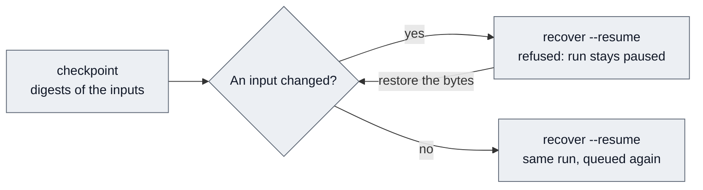

# Checkpoint inputs and recover the same queued run

> **TL;DR** — A **checkpoint** pins the exact bytes a run depends on at a given moment, by their digests. If any of them changes, the run cannot resume until you restore them, so it never continues on inputs nobody reviewed. Checkpoints, effect records and lock inspection start no worker and repeat no external operation.

> [!IMPORTANT]
> **Experimental.** Checkpoint manifests, effect and worker recovery and stopped-writer lock retention are tested with real processes. Autonomous delivery may change in a minor release.

**What you will have at the end:** a checkpoint over two inputs, a resume refused when one of them changed, the same run resumed once it was restored, and no effect or lock left behind.



## Before you start

Complete the [queue guide](./delivery-queue.md) in the same Bash terminal, so `workspace_dir` is still set. Its run is queued, has a fresh active grant and has started no attempt. Everything below changes only the disposable store.

## Capture a checkpoint

The script writes one small input file next to the source captured earlier, and checkpoints both under the key `queued-inputs`:

```bash
set -euo pipefail
: "${workspace_dir:?Run the queue tutorial first}"
node --input-type=module - "$workspace_dir" <<'JS'
import { mkdirSync, readFileSync, writeFileSync } from 'node:fs'
import { join } from 'node:path'
const directory = process.argv[2]
const source = JSON.parse(readFileSync(join(directory, 'source.json'), 'utf8')).source
mkdirSync(join(directory, 'state/delivery/artifacts'), { recursive: true })
writeFileSync(join(directory, 'state/delivery/artifacts/probe.txt'), 'Original checkpoint input.\n')
const request = {
  schema: 'wholeloop/delivery-checkpoint-request@1', key: 'queued-inputs', stage: 'source-adopted',
  inputs: [`delivery/sources/${source.id}.json`, 'delivery/artifacts/probe.txt']
}
writeFileSync(join(directory, 'checkpoint.json'), JSON.stringify(request, null, 2))
JS
wl delivery checkpoint \
  --run delivery-0123456789abcdef --file "$workspace_dir/checkpoint.json" \
  --root "$workspace_dir" --store "$workspace_dir/state" --json > "$workspace_dir/checkpoint-receipt.json"
wl delivery checkpoints \
  --run delivery-0123456789abcdef \
  --store "$workspace_dir/state" --json > "$workspace_dir/checkpoints-current.json"
```

A checkpoint stores each input's path, digest and size, never its content, so binary files work too. Only bounded source, plan, envelope and artifact paths are allowed; private authority paths and aliases are refused. Shortened:

```console
$ wl delivery checkpoints --run delivery-0123456789abcdef --store "$workspace_dir/state" --json
{
  "schema": "wholeloop/delivery-checkpoints-status@1",
  "run": "delivery-0123456789abcdef",
  "checkpoints": [
    {
      "key": "queued-inputs",
      "digest": "80282af2863ec0af90d20980924f33741b8627c67fd4ed0c82205292e36636ad",
      "status": "current",
      "problems": [],
      "manifest": {
        "schema": "wholeloop/delivery-checkpoint-manifest@1",
        "key": "queued-inputs",
        "stage": "source-adopted",
        "inputs": [
          { "ref": "delivery/sources/d7daa725….json", "sha256": "702417d0…", "bytes": 604 },
          { "ref": "delivery/artifacts/probe.txt", "sha256": "da85f759…", "bytes": 27 }
        ]
      },
      …
```

- Capturing the same inputs again keeps the same checkpoint. Different inputs under the same key are refused; use a new key for a new checkpoint.
- The **stage** label is controller metadata. It is not an approval, a passing test or a person's acceptance.

## Detect changed bytes and resume after restoring them

The next script changes the input, tries to resume, restores the input and resumes again, then checks every result:

<details>
<summary>Stale-input script: copy once</summary>

```bash
printf 'Changed checkpoint input.\n' > "$workspace_dir/state/delivery/artifacts/probe.txt"
wl delivery checkpoints \
  --run delivery-0123456789abcdef \
  --store "$workspace_dir/state" --json > "$workspace_dir/checkpoints-stale.json"
if wl delivery recover \
  --run delivery-0123456789abcdef --resume \
  --store "$workspace_dir/state" --json > "$workspace_dir/recovery-refused.json"; then
  echo 'Expected stale inputs to refuse resume' >&2
  exit 1
else
  result_code=$?
  test "$result_code" -eq 3
fi
printf 'Original checkpoint input.\n' > "$workspace_dir/state/delivery/artifacts/probe.txt"
wl delivery recover \
  --run delivery-0123456789abcdef --resume \
  --store "$workspace_dir/state" --json > "$workspace_dir/recovery-ready.json"
wl delivery effects \
  --run delivery-0123456789abcdef \
  --store "$workspace_dir/state" --json > "$workspace_dir/retained-effects.json"
wl delivery lock-status \
  --store "$workspace_dir/state" --json > "$workspace_dir/writer-lock.json"
node --input-type=module - "$workspace_dir" <<'JS'
import { readFileSync } from 'node:fs'
import { join } from 'node:path'
const directory = process.argv[2]
const json = name => JSON.parse(readFileSync(join(directory, name), 'utf8'))
if (json('checkpoints-stale.json').checkpoints[0].status !== 'stale') throw new Error('Changed input expected')
const refused = json('recovery-refused.json')
if (refused.ready || refused.state.state !== 'paused' || !refused.problems.includes('stale-checkpoint-inputs'))
  throw new Error('Stale inputs must retain a paused run')
const ready = json('recovery-ready.json')
if (!ready.ready || ready.state.run !== 'delivery-0123456789abcdef' || ready.state.state !== 'queued')
  throw new Error('Recovery must retain and resume the same run')
if (ready.workers !== 'not-started' || ready.effects !== 'not-invoked') throw new Error('No dispatch allowed')
if (json('retained-effects.json').records.length !== 0) throw new Error('No effect may be fabricated')
if (json('writer-lock.json').inspection.status !== 'clear') throw new Error('No writer should remain')
console.log('PASS: exact checkpoint inputs, stale refusal and same-run metadata recovery')
JS
```

</details>

```console
PASS: exact checkpoint inputs, stale refusal and same-run metadata recovery
```

| Step | Result |
| --- | --- |
| Input changed | The checkpoint's status becomes `stale` |
| `recover --resume` | Exit code 3: `ready: false`, the run stays `paused`, problem `stale-checkpoint-inputs` |
| Input restored, `recover --resume` again | `ready: true`, the **same** run is `queued` again |
| Throughout | `workers: not-started`, `effects: not-invoked`; no effect records; the writer lock is `clear` |

**What recovery checks** before resuming: the current checkpoint inputs, the immutable plan and its local bases, the private authority and who owns what.

- A fresh process does not reset gates or grant limits.
- It never starts a replacement worker or retries an effect; `--resume` only puts the metadata back to `queued` once everything is known.
- With intervention `none`, unresolved ownership returns *blocked* instead of asking a person, and the reservation is kept.

## Interrupted writers and ambiguous effects

**Locks.** Ordinary commands never take another writer's lock.

1. If `wl delivery lock-status` reports the writer as **stopped**, inspect its owner and digest.
2. Run `wl delivery repair-lock --owner-digest <digest>` with the same `--store`.
3. Repair accepts only a process confirmed absent for that unchanged record, checks the directory again and moves the original lock into `delivery/recovered-locks`, with a receipt. It signals no process and restores no authority.

A live or reused process ID, missing or newer owner data, an unreadable process or an interrupted repair needs inspection. Never remove a lock because it looks old.

**Effects.** `wl delivery effects` shows the local records, not a new remote read.

- The host records each operation's intent **before** running it once, and observes its result separately.
- A pending or unknown operation can never run again. Conflicting writes and a claimed success that was not observed stay blocked.
- A read showing the resource absent does not prove the operation did not happen, until the original call is confirmed stopped.
- Only an intent that was prepared but never issued can be abandoned.

`wl delivery recovery-schema --json` prints the checkpoint and effect contracts; `wl delivery state-schema --json` adds every registered event family. Keep the directory for inspection.

<!-- docnav -->
[◀ Delivery budgets](delivery-budgets.md)  ·  [📖 Docs index](../README.md)  ·  [🧭 Concepts](../concepts.md)  ·  [Delivery recovery ▶](delivery-recovery.md)
