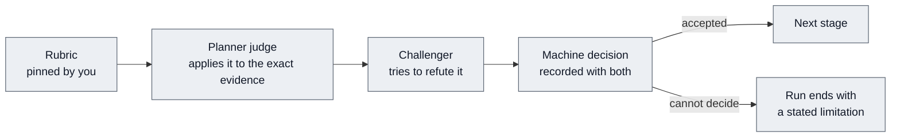

# Delegate a decision without impersonating a human

> **TL;DR** — A grant can **delegate** a named decision, such as approving the specification or accepting the product, to a machine judge. The judge must apply a **rubric** you pinned in advance; an independent challenger tries to refute its judgement; both are recorded as machine decisions, never as yours. With intervention `none`, a decision that cannot be taken ends the run with a stated limitation instead of a prompt.

> [!IMPORTANT]
> **Experimental.** The decision policy, private rubric pins, records and no-prompt fallbacks are tested on macOS and Linux. Autonomous delivery may change in a minor release.



Commands that start with `npm run eval` are model-free controls that run from a source checkout ([development guide](../contributing/development.md#build-from-source)); every `wl` command uses the installed CLI.

## Contents

- [Independent choices](#independent-choices)
- [Inspect the actual contracts](#inspect-the-actual-contracts)
- [Run the complete model-free control](#run-the-complete-model-free-control)
- [How a decision is taken](#how-a-decision-is-taken)
- [Unknowns and current eligibility](#unknowns-and-current-eligibility)
- [Optional private attribution](#optional-private-attribution)

## Independent choices

Four things are chosen separately, and none implies another:

| Choice | Example | Does not imply |
| --- | --- | --- |
| **Endpoint** | `research-report`, `to-pr` | A research report allows no code edits; a PR allows no merge |
| **Intervention** | `none` | No extra effect |
| **Delegations** | `approve-spec`, `acceptance` | Any permission beyond taking that decision |
| **Runtime** | The client hosts actually observed | Anything a profile says |

Interaction profiles change how the harness talks and how much runs at once; they cannot select any of these.

**Decisions that can be delegated:**

| Decision ID | Outcomes | Taken at |
| --- | --- | --- |
| `delivery-plan` | accept, reject | The plan stage, for a plan made inside an envelope |
| `research-plan`, `research-sources` | accept, reject | An unattended research run's plan, then its source work |
| `frame-outcome` | go, on-hold, dropped | Definition |
| `approve-spec`, `approve-scopes` | accept, reject | Definition |
| `approve-build-plan` | accept, reject | Build plan |
| `acceptance` | accept, reject | Acceptance of the whole product |
| `learning-outcome` | keep, iterate, kill, unflag | A learning observation |
| `ramp-assessment` | propose, on-hold | A ramp stage |

Learning and ramp outcomes are **assessments**: they change no flag, deploy nothing, send no message and grant no external effect. A machine acceptance never satisfies a criterion only a person can accept, a human review the code host requires, or a failed gate.

## Inspect the actual contracts

```console
$ wl delivery decision-schema --json
{"schema":"wholeloop/delegated-decision-schema@1", …}
```

This opens no store and starts no model.

- **The rubric** defines its decision, its purpose, named rules, the outcomes it allows, the unknowns it owns, explicit defaults and a finite timeout.
- **The delegation** in the plan or envelope binds the rubric's reference and digest, the evidence it requires and what happens when the judge cannot decide.
- **The grant** must list the same decision ID. Choose the delegations before you [authorize](./delivery-authorization.md).

Keep rubric and request files in the controller's workspace, outside application repositories. A source document, a profile or a worker artifact can never authorize itself, and there is no command to import a machine judgement.

With your real identifiers, the controls are:

```text
wl delivery decision-pin --grant <authorization-id> --store <external-store> --json
wl delivery decision-preflight --run <delivery-id> --revision <n> --grant <authorization-id> --store <external-store> --json
wl delivery decision-inspect --digest <decision-sha256> --store <external-store> --json
```

| Command | Does |
| --- | --- |
| `decision-pin` | Copies the exact rubric bytes into immutable controller inputs |
| `decision-preflight` | Checks the declared policy without starting a model. `scope: policy-only` and `runtime: not-observed` say it checked the policy, not a host. With `none`, undelegated decisions and mandatory human acceptance show as blocked |
| `decision-inspect` | Shows a recorded decision and whether it is still eligible |

A preflight or inspection that is not ready exits with code 3; inspect still returns the record.

## Run the complete model-free control

From a source checkout, with Git and no account:

```console
$ npm run eval:decisions
Retained evaluation: /tmp/wholeloop-decision-evaluation-XXXXXX
{"status":"passed","provenance":"fixture","runtime":{"node":"v24.22.0","platform":"darwin","arch":"arm64"},"checks":["original envelope and private rubric pinned","independent fixture judgment cannot authorize native execution","completed stable key never replays judgments","hostile changed artifact invalidates eligibility without changing authority","revocation preserves historical machine provenance"],…,"nativeAcceptance":"not-established","publication":"not-performed"}
```

It creates a disposable repository and store, authorizes an envelope, pins its rubric and records a decision from synthetic planner and challenger results, labelled as a fixture. Each item in `checks` is one boundary it exercised. No model, hosted service or application runs.

A pass means these protocol boundaries hold. It does not mean a real agent delivered a feature unattended: a real client host must still show containment, non-interactive tools, completion, independent assignments and the original budgets before its decisions count.

## How a decision is taken

**The host.** `DelegatedDecisions.decide` is a controller API, not an endpoint for importing results.

1. It checks the prerequisites and the evidence.
2. It runs a **planner** judge, then a **distinct challenger**, each a separate client process that receives only the pinned decision inputs: the selected source, plan, authorization, artifacts and evidence.
3. It verifies that both completed, under their real identities.
4. The core binds both judgements to one exact basis and keeps their uncertainties. A report cannot silently drop a finding or an uncertainty.

A missing client capability or a mandatory human prerequisite is an explicit refusal, which the runner turns into its final limitation.

**Budgets.** Each judge attempt consumes the original evaluator budget and deadline, once, before it launches; this also holds under an envelope with no implementation unit. `npm run eval:runner` exercises this with synthetic processes.

**Interruptions.**

- An interrupted write can recover a decision that was already published, without calling either judge again.
- An unpublished or orphaned result completes nothing.
- A cancelled, crashed or late judge leaves an *unknown* intent. It never becomes a successful refutation and is never run again implicitly; cancelling is a request, not proof that the process stopped. Use a new attempt only after the controller has resolved the original one.

## Unknowns and current eligibility

**Unknown facts stay unknown.** With `none`, a run can:

- investigate within its remaining budget;
- use an explicitly pinned default, while recording that the fact is still unknown;
- ask for an independent, least-scope evaluation;
- complete with unknowns that have owners;
- choose an authorized on-hold outcome.

A missing required fact, or a prerequisite that cannot be delegated, blocks. None of this asks a person or creates a hidden wait for approval.

**A decision is only valid while its inputs are.** The source, plan or envelope, rubric, artifacts, evidence, grant and Git bases stay bound to it.

- Starting a replacement judgement immediately withdraws the old acceptance, even if the replacement crashes; a late older judgement cannot overwrite the newer one.
- A change, a revocation or an expiry makes the decision ineligible, and its history stays readable.
- Machine records always say `actorKind: machine` and `humanApproval: not-recorded`. Decisions in the supervised flow keep their human meaning.

## Optional private attribution

When a person records a supervised `wl delivery human-decide`, or a `pause`, `resume` or `stop`, they can add `--channel terminal` and a private rationale with `--rationale-file <file>` or `--rationale-stdin`.

- The rationale is limited to 4096 UTF-8 bytes and left out of the default report and diagnostics.
- It grants no authority, and repeating the same decision records nothing new.
- A delegated decision copies only the reason its judge recorded; no explanation is invented.

[Optional attribution](../architecture/state-and-messaging.md#optional-event-attribution).

<!-- docnav -->
[◀ Delivery authorization](delivery-authorization.md)  ·  [📖 Docs index](../README.md)  ·  [🧭 Concepts](../concepts.md)  ·  [Delivery runner controls ▶](delivery-runner.md)
