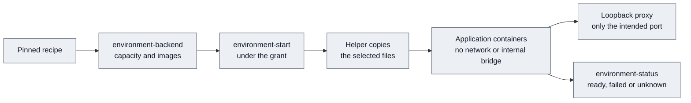

# Run owned Docker application environments

> **TL;DR** — The **Docker backend** starts your application from a pinned [recipe](./delivery-environments.md), under a current grant, in containers the run owns. It checks the real resources and readiness, keeps project code away from your machine's files, network and credentials, and keeps the evidence when something fails. A model-free evaluation exercises all of it with real applications; no client or account is needed.

> [!IMPORTANT]
> **Experimental.** Provisioning, readiness, isolated networking, loopback publication, stop and retirement are tested, and the reference trial passed on macOS arm64 with a Linux daemon and on a Linux x86_64 host. Autonomous delivery may change in a minor release.



Commands that start with `npm run eval` are model-free controls that run from a source checkout ([development guide](../contributing/development.md#build-from-source)); every `wl` command uses the installed CLI.

## Requirements and costs

| You need | Details |
| --- | --- |
| A source checkout | With development dependencies, to run the evaluation. The installed CLI runs the runtime commands |
| Docker on a local Unix socket | Permission to create disposable containers, volumes and bridge networks. The reference daemon is 29.9.2. Platform-manifest inspection and the isolation controls must work on your engine; a version number alone is not enough |
| The pinned helper image, cached | `node@sha256:925de64a85319052d6971ae81ef2417da956e8a3a2c4a0fac732327970f017f5`. Pull it yourself: the backend never downloads it silently |
| Capacity | The two-environment evaluation reserves 4 CPUs and 1 GiB in total |

**Overhead per environment.** The helper uses 256 MiB and a quarter of a CPU, and each published port adds a proxy of 128 MiB and a quarter of a CPU. Less capacity than requested is an explicit refusal.

**Images.** Application images are immutable too; using only the cache and explicitly authorized pulls are separate choices. Docker keeps its own credentials, which never enter generated configuration, arguments or the application's environment. Images must work as UID and GID 65532 and run the selected commands, and setup dependencies must already be available offline.

**Refused outright:** scoped network egress, secret delivery, direct file mounts from older recipes, and any image or engine control the daemon cannot provide.

## Run the actual disposable evaluation

From the repository root:

```bash
set -euo pipefail
npm run eval:environments -- --retire-success
```

The output, shortened:

```console
$ npm run eval:environments -- --retire-success
Retained evaluation: /tmp/wholeloop-docker-evaluation-XXXXXX
{
  "schema": "wholeloop/environment-evaluation@1",
  "status": "pass",
  "controller": { "os": "darwin", "architecture": "arm64", "node": "v24.22.0" },
  "checks": [
    { "id": "owned-input-readonly", "status": "pass", "evidence": "…" },
    { "id": "network-denied-setup", "status": "pass", "evidence": "…" },
    { "id": "disjoint-ports-and-data", "status": "pass", "evidence": "…" },
    { "id": "filesystem-and-environment-denial", "status": "pass", "evidence": "…" },
    { "id": "application-egress-denied", "status": "pass", "evidence": "…" },
    { "id": "current-ownership-and-no-reissue", "status": "pass", "evidence": "…" },
    { "id": "changed-candidate-invalidates-readiness", "status": "pass", "evidence": "…" },
    { "id": "observed-stop-retains-owned-volumes", "status": "pass", "evidence": "…" },
    { "id": "same-name-foreign-volume-is-not-retired", "status": "pass", "evidence": "…" },
    { "id": "killed-retirement-controller-recovers-exact-owned-absence", "status": "pass", "evidence": "…" },
    { "id": "setup-failure-refuses-readiness", "status": "pass", "evidence": "…" },
    …
  ],
  "environments": [
    { "id": "environment-c16080c1…", "daemon": { "os": "linux", "architecture": "aarch64", "cpus": 4, "version": "29.9.3", … } },
    { "id": "environment-022e9d72…", "daemon": { … } }
  ],
  "retirement": "exact-owned-absence-observed",
  …
}
```

It creates its own disposable Git source and worktree, fixture grants, recipes and Docker resources. It never mounts your checkout and never calls a model. The fixture owner and grant records are test data, not anyone's acceptance of a change.

| Check | What it shows |
| --- | --- |
| `disjoint-ports-and-data` | Two applications get different loopback ports and their own data volumes; a write in one does not appear in the other |
| `filesystem-and-environment-denial` | Application commands cannot read the controller's files, home, credentials, sibling data, Git internals or the Docker socket, and do not inherit the controller's environment |
| `owned-input-readonly` | Implementation and input files cannot be modified |
| `network-denied-setup`, `application-egress-denied` | Setup and the application cannot reach outside routes |
| `setup-failure-refuses-readiness` | A setup that fails (exit 7) never becomes ready or starts its service |
| `current-ownership-and-no-reissue` | Repeating a successful request re-inspects the same environment without running the effect again |
| `changed-candidate-invalidates-readiness` | A changed candidate makes earlier readiness stale |
| `observed-stop-retains-owned-volumes` | Stopping keeps the volumes |
| `same-name-foreign-volume-is-not-retired` | A volume with the same name that the run does not own is left alone |
| `killed-retirement-controller-recovers-exact-owned-absence` | After its controller is killed, retirement is finished by a freshly built CLI, which observes every owned resource gone |

With `--retire-success`, everything is retired at the end; without it, successful environments are kept on purpose. An unexpected failure keeps its resources and history for inspection. The report is the real observation: never record a run where Docker was missing as passed. It reports the controller and the daemon separately, and running it on another host is new evidence for that host only.

## Inspect contracts without Docker

```bash
set -euo pipefail
wl --version
wl delivery environment-runtime-schema --json | node --input-type=module -e '
import assert from "node:assert/strict"
let text = ""
for await (const chunk of process.stdin) text += chunk
const value = JSON.parse(text)
assert.equal(value.schema, "wholeloop/environment-runtime-schema@1")
assert.equal(value.executed, false)
assert.equal(value.runtimeSchema.additionalProperties, false)
assert.equal(value.provisionSchema.additionalProperties, false)
assert.equal(value.snapshotSchema.additionalProperties, false)
assert.equal(value.runtimeSchema.properties.acceptance.const, "not-established")
assert.equal(value.runtimeSchema.properties.publication.const, "not-performed")
assert.match(value.referenceHelper, /@sha256:[a-f0-9]{64}$/)
console.log("PASS: closed owned-runtime contracts; no execution, acceptance or publication")
'
```

```console
1.1.0
PASS: closed owned-runtime contracts; no execution, acceptance or publication
```

## Provision an existing authorized run

| Command | What it does |
| --- | --- |
| `wl delivery environment-backend --digest RECIPE --store STORE --json` | Reads the daemon's capacity and the cached images and platforms; starts nothing |
| `wl delivery environment-start --file REQUEST --root INPUT_ROOT --store STORE --json` | Starts the environment for the exact request, under the current grant |
| `wl delivery environment-status --environment ID --store STORE --json` | Re-inspects the owned resources, the selected inputs and the candidate; grants nothing |

**The start request** names the run, the recipe digest, a stable key, the helper image and, for each repository, the exact path, HEAD and snapshot of the candidate. Prepare the plan, grant and queue through the earlier [delivery guides](./delivery-authorization.md); a worker's JSON can never stand in for them.

**What start requires and does:**

- the grant's `workspace.create` and `test.run` effects, the current plan and grant digests, and a separately allocated topic worktree for every selected repository;
- the helper receives only bounded copies of regular files and its own volumes; it never mounts the source or the store;
- authority is checked again around every change, the issued effect is recorded, and the same key is never run again after an ambiguous response.

**Inputs** are mounted read-only as a directory: `/inputs/<id>/<file name>` holds the exact selected file. Older recipes that mounted a file directly can still be read, but this backend reports that capability unavailable rather than rewriting the command.

## Read outcomes and failures

| Result | Means |
| --- | --- |
| `ready` | The owned resources and readiness were observed for this exact candidate and recipe. Nothing is accepted yet |
| `unavailable` | A required backend, capacity, image, network or secret capability is missing. No fallback is chosen |
| `failed` | Setup or execution failed. Partial resources and evidence are kept |
| `unknown` | An action, identity or observation is unresolved. Inspect or reconcile before any new write |
| stale or expired | The environment cannot show readiness for a changed candidate, or its lifetime ran out |

**What is recorded**, outside Git: each resource's intent, IDs, labels and creation fingerprint, the real image and platform, process outcomes, copy digests and observations. Raw image configuration and diagnostics stay out of receipts.

**Cancelling** the Docker client does not prove the daemon stopped anything: bounded jobs stop and re-inspect their exact container. The supervised `wl env` undo recipes are never run.

**Networking.** The application has no network, or an isolated internal bridge. A separate fixed proxy exposes only the intended service, on loopback. It has no application mounts and cannot pick a destination from incoming data, and each connection is limited to 4 MiB, 30 seconds and 8 at a time, for a finite lifetime. This isolates application infrastructure; it says nothing about a client's model permissions.

When something fails, keep the printed history. Do not remove resources by guessing names or run undo recipes automatically: stop, reconcile and retire them with the [lifecycle guide](./delivery-lifecycle.md). See the [environment specification](../../roadmap/specifications/autonomous-delivery/03-execution-environments.md).

## Inside the runner

When a run prepares environments itself, the controller adds more guarantees. Each one has its own evaluation, which keeps every check above and adds its own:

| Guarantee | Evaluation |
| --- | --- |
| **The original request is captured first.** A caller changing its request during preflight cannot replace the key, run, recipe, helper or workspaces used later | `npm run eval:environments -- --parent-control --retire-success` |
| **The parent's limits hold.** Provisioning keeps the enclosing controller's deadline, cancellation and ownership. Late or fenced preflights are refused before any effect, and both setups finish inside their parent's window. Repeating a call never renews an expired parent | same command |
| **Each environment is prepared once, in its own phase**, with every read and owner recorded. A failed preflight can be inspected even before a resource exists; an existing environment or a used phase is refused | `npm run eval:runner-assembly-readiness -- --provision-owner --retire-success` |
| **A prepared input can be recovered** by a fresh controller from its recorded artifact, without provisioning again. Missing pieces return *unknown*; a recorded *ready* stays history once QA moves on | `npm run eval:runner-assembly-readiness -- --producer-result --retire-success` |
| **The product environment is selected inside dispatch**, from current unit QA, the owned assembly and the pinned candidate. Changed selections and caller overrides are refused | `npm run eval:runner-assembly-readiness -- --product-environment --retire-success` |
| **The milestone assembly is produced inside dispatch**: assembled through owned Git effects, the template recipe re-rooted at the assembled worktree, never assembled twice, and cancellable after revocation | `npm run eval:runner-assembly-readiness -- --product-production --retire-success` |

These are internal compositions with synthetic models, not the public complete-route command or a Linux host acceptance. None of them establishes semantic acceptance.

<!-- docnav -->
[◀ Environment planning](delivery-environments.md)  ·  [📖 Docs index](../README.md)  ·  [🧭 Concepts](../concepts.md)  ·  [Environment stop and retirement ▶](delivery-lifecycle.md)
