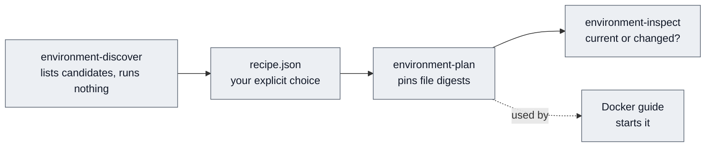

# Plan an environment without executing setup

> **TL;DR** — Before a run starts your application, you choose exactly **how** it starts: which image, which files, which command, which ports, how readiness is checked and which resources it may use. That choice is a **recipe**, pinned by the digests of the files it uses. Preparing a recipe runs no container, script, model or network request, and a file changed afterwards is detected.

> [!IMPORTANT]
> **Experimental.** Discovery, recipe validation and immutable selection are tested. [Docker provisioning](./delivery-docker.md) and [retirement](./delivery-lifecycle.md) have their own guides. Autonomous delivery may change in a minor release.

**What you will have at the end:** a pinned recipe for a tiny web application, the same recipe again on a repeat, and a *changed* result once a selected file is edited.



## Prerequisites and stopping point

You need the `wl` CLI ([getting started](../getting-started.md#install-the-cli)), Node 20 or later and Bash. Docker and service accounts are not needed: nothing is started. Everything stays in the printed temporary directory.

The image digest in the example is made up on purpose and is never pulled. For a real run, choose an immutable image your backend has, and prepare a new recipe. The architecture, Linux on arm64, is what the recipe requests, not an observation of your machine.

## Discover and select explicitly

The script writes a two-file application, a recipe for it, then discovers, plans twice, inspects, edits a selected file and inspects again:

<details>
<summary>Recipe script: copy once</summary>

```bash
set -euo pipefail
wl --version
ENVIRONMENT_DEMO="$(mktemp -d "${TMPDIR:-/tmp}/wholeloop-environment.XXXXXX")"
export ENVIRONMENT_DEMO
node --input-type=module <<'JS'
import {mkdirSync, realpathSync, writeFileSync} from 'node:fs'
import {join} from 'node:path'
import {createHash} from 'node:crypto'
const demo = realpathSync(process.env.ENVIRONMENT_DEMO)
const root = join(demo, 'app')
mkdirSync(root)
const app = "require('node:http').createServer((_req,res)=>res.end('ready')).listen(3000,'0.0.0.0')\n"
const pack = JSON.stringify({scripts: {test: 'node -e "process.exit(0)"'}})
writeFileSync(join(root, 'app.cjs'), app)
writeFileSync(join(root, 'package.json'), pack)
const hash = text => createHash('sha256').update(text).digest('hex')
const recipe = {
  schema: 'wholeloop/environment-recipe@1',
  backend: {id: 'docker', os: 'linux', architecture: 'arm64', emulation: 'forbid'},
  repositories: [{id: 'app', root}],
  files: [
    {id: 'package', repository: 'app', ref: 'package.json', sha256: hash(pack), kind: 'package'},
    {id: 'server', repository: 'app', ref: 'app.cjs', sha256: hash(app), kind: 'script'},
  ],
  data: ['fixture'],
  services: [{
    id: 'web', image: `example.invalid/wholeloop-demo@sha256:${'a'.repeat(64)}`,
    acquisition: 'cache-only', after: [],
    mounts: [
      {kind: 'workspace', source: 'app', target: '/workspace/app', access: 'read'},
      {kind: 'data', source: 'fixture', target: '/data/fixture', access: 'write'},
    ],
    start: {argv: ['node', '/workspace/app/app.cjs'], cwd: '/workspace/app', origin: {kind: 'file', file: 'server'}},
    readiness: {kind: 'tcp', port: 3000, timeoutMs: 1000},
    ports: [{container: 3000, publish: 'loopback'}], memoryMiB: 128, cpus: 1, secrets: [],
  }],
  commands: [{id: 'test', service: 'web', phase: 'test', timeoutMs: 1000,
    command: {argv: ['npm', 'run', 'test'], cwd: '/workspace/app', origin: {kind: 'package-script', file: 'package', script: 'test'}}}],
  network: {setup: 'none', runtime: 'none', destinations: []},
  limits: {setupMs: 300000, readinessMs: 120000, services: 8, memoryMiB: 8192, cpus: 4, outputBytes: 1048576},
  retention: {failure: 'keep', success: 'keep', reviewAfterMs: 86400000, expiryAction: 'retain'},
}
writeFileSync(join(root, 'recipe.json'), JSON.stringify(recipe))
JS
wl delivery environment-schema --json > "$ENVIRONMENT_DEMO/schema.json"
wl delivery environment-discover --root "$ENVIRONMENT_DEMO/app" --json > "$ENVIRONMENT_DEMO/discovery.json"
wl delivery environment-plan --root "$ENVIRONMENT_DEMO/app" --file recipe.json --store "$ENVIRONMENT_DEMO/store" --json > "$ENVIRONMENT_DEMO/prepared.json"
wl delivery environment-plan --root "$ENVIRONMENT_DEMO/app" --file recipe.json --store "$ENVIRONMENT_DEMO/store" --json > "$ENVIRONMENT_DEMO/repeated.json"
RECIPE_DIGEST="$(node --input-type=module -e 'import{readFileSync}from"node:fs";console.log(JSON.parse(readFileSync(process.argv[1],"utf8")).digest)' "$ENVIRONMENT_DEMO/prepared.json")"
wl delivery environment-inspect --digest "$RECIPE_DIGEST" --store "$ENVIRONMENT_DEMO/store" --json > "$ENVIRONMENT_DEMO/current.json"
node --input-type=module <<'JS'
import assert from 'node:assert/strict'
import {readFileSync, appendFileSync} from 'node:fs'
import {join} from 'node:path'
const read = name => JSON.parse(readFileSync(join(process.env.ENVIRONMENT_DEMO, name), 'utf8'))
assert.equal(read('schema.json').executed, false)
assert.equal(read('discovery.json').executed, false)
assert.deepEqual(read('prepared.json'), read('repeated.json'))
assert.equal(read('prepared.json').authority, 'not-granted')
assert.equal(read('current.json').inputs, 'current')
assert.equal(read('current.json').readiness, 'not-observed')
appendFileSync(join(process.env.ENVIRONMENT_DEMO, 'app/app.cjs'), '// Changed after selection.\n')
JS
wl delivery environment-inspect --digest "$RECIPE_DIGEST" --store "$ENVIRONMENT_DEMO/store" --json > "$ENVIRONMENT_DEMO/changed.json"
node --input-type=module <<'JS'
import assert from 'node:assert/strict'
import {readFileSync} from 'node:fs'
import {join} from 'node:path'
const value = JSON.parse(readFileSync(join(process.env.ENVIRONMENT_DEMO, 'changed.json'), 'utf8'))
assert.equal(value.inputs, 'changed-or-unavailable')
assert.equal(value.readiness, 'not-observed')
assert.equal(value.executed, false)
console.log('PASS: immutable recipe, unchanged repeat, no execution and stale source detected')
console.log(`Retained demo: ${process.env.ENVIRONMENT_DEMO}`)
JS
```

</details>

```console
1.1.0
PASS: immutable recipe, unchanged repeat, no execution and stale source detected
Retained demo: /tmp/wholeloop-environment.XXXXXX
```

What each command returned:

| Command | Result |
| --- | --- |
| `environment-discover` | One candidate, `package.json` with its `test` script, its digest and size; `executed: false` |
| `environment-plan` | The recipe's digest and both selected files with their digests; `executed: false`, `readiness: not-observed`, `authority: not-granted` |
| `environment-plan` again | Exactly the same result |
| `environment-inspect` | `inputs: current` |
| `environment-inspect` after editing `app.cjs` | `inputs: changed-or-unavailable`; still `executed: false` |

The recipe in the script, field by field:

| Part | In this example |
| --- | --- |
| `backend` | Docker, Linux, arm64, no emulation |
| `files` | `package.json` and `app.cjs`, each with its digest |
| `services` | One service, `web`: an image by digest from the cache only, the app mounted read-only, a writable data mount, the start command, a TCP readiness check on port 3000, the port published on loopback, 128 MiB and one CPU, no secrets |
| `commands` | `test`, the package's `test` script |
| `network` | No network during setup or at runtime |
| `limits` | Setup and readiness times, services, memory, CPUs and output bytes |
| `retention` | Keep the environment after failure and after success, for review |

## What was established

**What a recipe pins.** The digest of every selected file, the image identity, where each command comes from, service order, logical mounts, ports, the readiness check, network phases and finite resources. The store keeps the selected bytes, so editing a file afterwards gives a different recipe or a *changed* inspection. Selected files are UTF-8 text, up to 1 MiB each and 8 MiB in total.

**What a recipe can never express:**

- your home, the controller's store, a credential directory or the Docker socket;
- any arbitrary host mount. The repository is a source to read from, not a mount: real workers get workspaces the backend allocates.

**What preparation cannot turn on.** Pulling images, scoped network access and secret references are *requested* capabilities. The backend must show real support and authority for them, or refuse. Secret values never belong in recipes, command arguments or generated files.

**What happens to failed resources.** They are kept. The review deadline in `retention` never authorizes automatic deletion.

Discovery lists names and digests only; it never chooses how to run anything. The supervised `wl env declare` and `wl env report` commands keep their own meaning: recording effects and their undo. Stop here: no application has started and nothing was accepted. See the [environment specification](../../roadmap/specifications/autonomous-delivery/03-execution-environments.md).

<!-- docnav -->
[◀ Native delivery hosts](delivery-native.md)  ·  [📖 Docs index](../README.md)  ·  [🧭 Concepts](../concepts.md)  ·  [Docker application environments ▶](delivery-docker.md)
