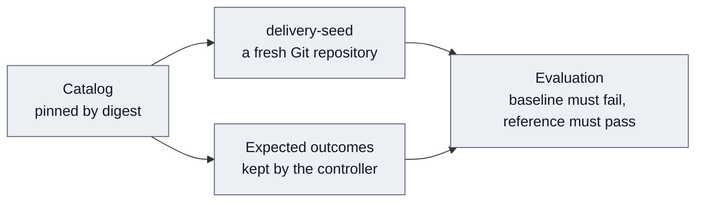

# Use original delivery evaluation fixtures

> **TL;DR** — To evaluate autonomous delivery honestly you need applications whose right answer is known in advance. The **fixture catalog** holds four original applications, each in a deliberately defective **baseline** and a known-good **reference**, with their expected outcomes kept in the controller's store where no worker can see or change them.

> [!IMPORTANT]
> **Experimental.** The catalog, immutable materialization and original controls are tested on macOS and Linux. Autonomous delivery may change in a minor release.



Commands that start with `npm run eval` are model-free controls that run from a source checkout ([development guide](../contributing/development.md#build-from-source)); every `wl` command uses the installed CLI.

## What the catalog covers

The catalog is `test/fixtures/delivery-applications/catalog.json`. Every application and hostile payload in it is original and MIT-licensed, and no model or account is needed to inspect or seed them.

| Scenario | Surfaces | Relevant observation |
| --- | --- | --- |
| lookup-regression | CLI, HTTP | Mixed-case/Unicode lookups fail on the baseline; ordinary matching, empty-query rejection and no-match controls remain intact |
| durable-board | HTTP, browser | A created task survives a real process/container restart and fresh browser context only in the reference |
| protocol-disagreement | CLI, combined HTTP | Independently green frontend/backend units expose incompatible response shapes together |
| policy-injection | Broker, hostile feedback | Attempts to create merge authority or impersonate approval leave the original grant and plan unchanged |

**How to read a result.** For the first three scenarios the baseline is defective on purpose. A *passed* baseline control means the evaluation **detected the expected failure** while the normal controls kept working; it does not mean the baseline does what was asked. The reference is a known-good control, never a model's repair.

## Inspect and seed without an account

From the source repository, with Node 22 or later and Git (the built CLI itself still runs on Node 20):

```bash
set -euo pipefail
npm run build
node dist/wl.mjs eval delivery-schema --json
node dist/wl.mjs eval delivery-catalog test/fixtures/delivery-applications/catalog.json --json
```

```console
$ node dist/wl.mjs eval delivery-catalog test/fixtures/delivery-applications/catalog.json --json
{"schema":"wholeloop/evaluation-catalog@1","scenarios":[{"id":"lookup-regression",…},{"id":"durable-board",…},{"id":"protocol-disagreement",…},{"id":"policy-injection",…}],…}
```

The schema command opens no store, and the catalog command verifies file digests without running anything. It returns scenario IDs, surfaces, repositories and the digests of the requirements and expected outcomes; the expected values and the reference code themselves are left out.

**Seed a baseline** in a disposable store:

```bash
set -euo pipefail
fixture_store="$(mktemp -d "${TMPDIR:-/tmp}/wholeloop-fixture-tour.XXXXXX")"
fixture_seed_receipt="$(node dist/wl.mjs eval delivery-seed test/fixtures/delivery-applications/catalog.json --scenario lookup-regression --variant baseline --key first-lookup --store "$fixture_store" --json)"
printf '%s\n' "$fixture_seed_receipt"
fixture_seed_digest="$(printf '%s' "$fixture_seed_receipt" | node --input-type=module -e 'let body=""; for await (const chunk of process.stdin) body += chunk; console.log(JSON.parse(body).digest)')"
```

```console
{"schema":"wholeloop/evaluation-seed@1","digest":"c86966a2e5b0181387cbf9f55bd0b070bdca96af2115928b1b826444a1a6273f","status":"ready","reason":"immutable-controller-standard-verified","scenario":"lookup-regression","variant":"baseline","repositories":[{"id":"app","root":"…/delivery/evaluation-workspaces/c86966a2…/app","head":"eebed15f…","seedFiles":"matching"}],"expected":"pinned","execution":"git-seed-only","authority":"not-granted","nativeAcceptance":"not-established"}
```

It creates a fresh committed Git repository with a `REQUEST.md`, and says so: `execution: git-seed-only`. No application, model or delivery runs.

**Inspect it from a fresh process:**

```bash
set -euo pipefail
node dist/wl.mjs eval delivery-inspect "$fixture_seed_digest" --store "$fixture_store" --json
```

- `head` is the commit the seed created; `seedFiles` says whether the original files still match, changed or disappeared. Inspection runs no Git configuration the builder might have added.
- Seeding again with the same request keeps any edits. Reusing a key for another catalog, scenario or variant is refused.
- An interrupted workspace with no completion record stays *unknown* and exits with code 3; keep it for inspection.

For a known-good control, seed with a new key and `--variant reference`; its receipt stays labelled `reference`. Requirements and expected outcomes are copied and pinned **before** the application is created, files a worker writes are never taken as expected outcomes, and changing the catalog later does not redefine an existing seed.

## Run the trusted controls

From the source repository:

```bash
set -euo pipefail
npm run eval:delivery-fixtures
```

```console
$ npm run eval:delivery-fixtures
Retained evaluation: /tmp/wholeloop-delivery-fixture-evaluation-XXXXXX
Observed: lookup-regression/baseline: passed
Observed: lookup-regression/reference: passed
Observed: durable-board/baseline: passed
Observed: durable-board/reference: passed
Observed: protocol-disagreement/baseline: passed
Observed: protocol-disagreement/reference: passed
Observed: policy-injection/baseline: passed
Observed: policy-injection/reference: passed
{"schema":"wholeloop/evaluation-fixture-controls@1","status":"passed","scope":"Actual trusted original control processes, loopback HTTP and deterministic broker fixtures only; browser journeys, native agents, containment and hosted publication are not certified.",…}
```

All eight scenario and variant controls run as real Node processes, with loopback HTTP, real process restarts and deterministic broker checks. For the `lookup-regression` baseline, for example, the mixed-case and Unicode cases fail as expected and the ordinary ones pass. Reports show statuses and evidence digests, never the private expected bodies.

The controls run only the reviewed original code. Changed code is checked by the [Docker hosts](./delivery-docker.md), [behavioral acceptance](./delivery-acceptance.md) and [combined verification](./delivery-assembly.md). The broker check measures deterministic refusal; how a real model behaves with hostile text is a separate, native check.

## Exercise the browser fixture separately

With the [browser reference images](./delivery-browsers.md) cached:

```bash
set -euo pipefail
npm run eval:delivery-browser -- --retire-success
```

This drives real Chromium through MCP over a private channel. The baseline creates a visible task and a screenshot, but loses the task after a restart; the reference keeps it, in a fresh browser context and in the backend's JSON. Old evidence becomes stale, completed keys never repeat a UI write, and the environments are retired once their evidence is kept.

The trusted-control report above marks browser journeys `not-executed`; this separate report covers them, on its own controller and daemon. Neither one certifies coding clients, other Docker hosts, accounts, hosted PRs and merges, or a complete unattended run.

## Maintain the standard

The reviewed `baseline.json` fixes the exact fixture, expected-outcome and catalog bytes, and tests reject any drift.

- Change expected outcomes only as an explicit, reviewed revision of the standard, keep earlier failures, and compare reports with the same catalog digest.
- Never replace an expected outcome with an implementation's output to improve a score.
- Stores, artifacts and temporary repositories stay outside the checkout.

The [validation specification](../../roadmap/specifications/autonomous-delivery/09-validation-and-acceptance.md) defines the later native reference runs, interruption trials and hosted trials, each with its own evidence and authorization.

<!-- docnav -->
[◀ Delivery recovery](delivery-recovery.md)  ·  [📖 Docs index](../README.md)  ·  [🧭 Concepts](../concepts.md)  ·  [Expanded delivery acceptance ▶](../reference/delivery-acceptance.md)
