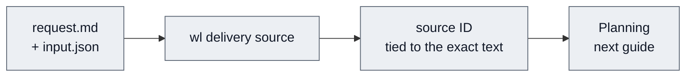

# Capture a delivery request — keep its exact revision

> **TL;DR** — Before anything is planned, capture the request once: a file, a sentence, an existing item or a complete observation of a remote document. The result is a **source**: an identity tied to the exact text, kept in your store and never changed afterwards. Intake needs no model and starts no worker.

> [!IMPORTANT]
> **Experimental.** Local and imported intake, extraction maps and the existing-provider path are tested. Autonomous delivery may change in a minor release.

**What you will have at the end:** a stored source with a stable ID, and proof that the same text gives the same ID while a changed text gives a new one.



## Before you start

Install the CLI as in [getting started](../getting-started.md#install-the-cli). The commands below create a disposable directory and a separate store; your project and your own store are not touched.

## Capture a local request

**1. Write the request** and an input file that says which lines are acceptance criteria:

```bash
set -euo pipefail
workspace_dir="$(mktemp -d "${TMPDIR:-/tmp}/wholeloop-intake.XXXXXX")"
mkdir -p "$workspace_dir/work"
cat > "$workspace_dir/work/request.md" <<'EOF'
Find tasks by title.
Match titles without searching descriptions.
EOF
cat > "$workspace_dir/work/input.json" <<'EOF'
{
  "schema": "wholeloop/delivery-source-request@1",
  "kind": "file",
  "ref": "request.md",
  "mapping": [
    { "id": "title-search", "role": "criterion", "startLine": 1, "endLine": 2 }
  ]
}
EOF
```

The **mapping** marks lines 1 to 2 as one criterion, `title-search`.

- Ranges are inclusive line numbers, starting at 1, of the exact text.
- Duplicate IDs, overlapping ranges, blank selections and missing lines are refused.
- `mapping: []` keeps the whole document as context without creating criteria.

**2. Capture it.** The output below is pretty-printed and shortened; the command prints one line:

```console
$ wl delivery source --file "$workspace_dir/work/input.json" --root "$workspace_dir/work" --store "$workspace_dir/state" --json
{
  "schema": "wholeloop/delivery-source-intake@1",
  "status": "stored",
  "source": {
    "schema": "wholeloop/delivery-source-snapshot@1",
    "kind": "file",
    "ref": "file:///tmp/wholeloop-intake.XXXXXX/work/request.md",
    "provider": "local",
    "revision": "d916b065c3cbb73a26e51e8fc9fcbaf46f67db488ad73eb672710377e063d938",
    "fetchedAt": "2026-11-17T19:11:35.176Z",
    "origin": "local",
    "mapping": [{ "id": "title-search", "role": "criterion", "startLine": 1, "endLine": 2 }],
    …
    "id": "0a91f201952eb6666db043208fa257d29bbd28717d7b016269d15f76a1cdcfc4"
  },
  "problems": [],
  "workers": "not-started"
}
```

| Field | Means |
| --- | --- |
| `status: stored` | The snapshot was saved, at `state/delivery/sources/<id>.json` |
| `source.revision` | The digest of the exact text |
| `source.id` | The source's identity; planning refers to it |
| `workers: not-started` | Nothing ran, and nothing was approved or published |

The receipt never repeats the request text. Run the same command again, even from a new terminal: the same text and mapping return the **same ID** and the same first fetch time. Edit `request.md` and run it again: you get a **new ID**, and the old snapshot is kept.

### Other kinds of request

| Kind | Use it for | What to put in the input |
| --- | --- | --- |
| `file` | A file under `--root` | `ref`: the file's path |
| `inline` | A short request typed in place | `ref`: a simple stable name such as `title-search`, and `body`: the text |
| `item` | Existing wholeloop work | `ref`: the item ID, such as `init-XXXXXXXX`, with that item's store. Its title and body become the text; a recorded repository must match `--root` |
| `tracker` · `document` | A remote issue or document | See [remote sources](#remote-sources-and-provenance) |

Only bounded UTF-8 text is accepted. Convert PDF or office documents yourself first; the core never interprets them or runs anything they contain. `wl delivery source-schema --json` prints the full input contract.

## Remote sources and provenance

For a remote issue or document, give a canonical HTTPS `ref` without credentials, an existing provider ID and the repository or tenant **scope** you expect. A GitHub issue, for example, uses provider `github-issues` and scope `example/tasks`.

Your client reads the item, and you pass its result as an **observation**:

```json
{
  "schema": "wholeloop/delivery-source-request@1",
  "kind": "tracker",
  "ref": "https://github.com/example/tasks/issues/42",
  "provider": "github-issues",
  "scope": "example/tasks",
  "mapping": [],
  "observation": {
    "schema": "wholeloop/delivery-source-observation@1",
    "provider": "github-issues",
    "scope": "example/tasks",
    "status": "succeeded",
    "ref": "https://github.com/example/tasks/issues/42",
    "complete": true,
    "body": "Find tasks by title.",
    "revision": "observed-issue-revision",
    "attachments": []
  }
}
```

This is a format example, not a real fetched issue.

- The CLI labels it `origin: import`. A JSON file you wrote does not prove a sign-in, or what the server holds.
- From the SDK, `DeliverySources.captureFromHost` reads through the provider's existing `tracker.read-item` or `docs.read` operation and records **host provenance**. The client must report the real scope, every page of content, the revision and the digests of relevant attachments.
- There is no built-in HTTP fetcher for any service, and no automatic fallback. [Provider boundaries](../configuration/providers.md#delivery-source-observations).

## Refusals and stopping point

A missing observation, a partial read, a missing revision, a provider, scope or reference that does not match, or unsafe input returns `status: missing-input`, a fixed problem category, `workers: not-started` and **exit code 3**. Nothing asks a question and nothing starts.

Limits that protect the store:

- **Size.** Content up to 1 MiB of UTF-8; the request JSON up to 8 MiB, so escaping does not reduce the text limit.
- **Files** must be regular files inside `--root`. Symlinks at the end of the path and links that escape the directory are refused.
- **Credentials.** Recognizable credential patterns are refused. The detector cannot prove that arbitrary prose holds no secret, so keep secrets out of requests.

**You are done** when the same ID survives another run and a changed text produces a new ID. Keep the temporary directory if you want to look at the snapshots. Next: [planning](./delivery-plan.md). The supervised [small-change route](./small-change.md) remains available for work you want to drive yourself.

<!-- docnav -->
[◀ Autonomous delivery design](../architecture/autonomous-delivery.md)  ·  [📖 Docs index](../README.md)  ·  [🧭 Concepts](../concepts.md)  ·  [Delivery planning ▶](delivery-plan.md)
