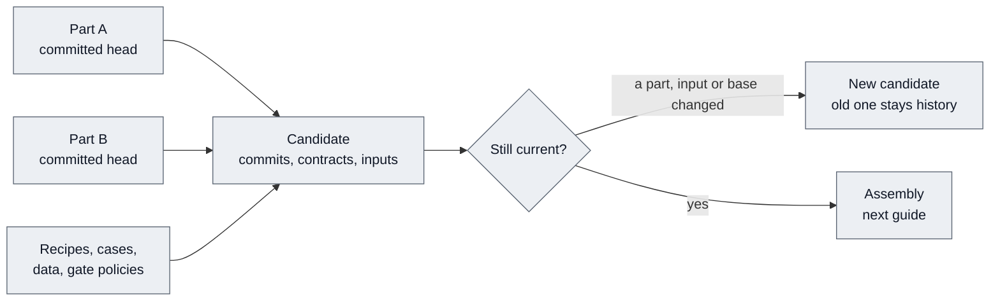

# Prepare exact integrated milestone candidates

> **TL;DR** — Before the parts of a milestone are combined and tested together, record exactly what "the milestone" is: which commits of which repositories, which contracts, recipes, acceptance definitions and data. That record is a **candidate**. You can check at any time whether it is still current; preparing it changes no Git state and authorizes nothing.

> [!IMPORTANT]
> **Experimental.** Candidate preparation, immutable records, inspection and comparison are tested; they grant no execution or publication authority. Autonomous delivery may change in a minor release.



Commands that start with `npm run eval` are model-free controls that run from a source checkout ([development guide](../contributing/development.md#build-from-source)); every `wl` command uses the installed CLI.

## Prerequisites and stopping point

You need the `wl` CLI, a Git version that supports `--path-format=absolute`, and:

- an accepted [delivery plan](./delivery-plan.md), pinned [acceptance definitions](./delivery-acceptance.md) and [environment recipes](./delivery-environments.md);
- separate, clean, registered **topic worktrees** for the parts and **assembly worktrees** for the combination;
- a code milestone whose required work has committed revisions. Research-only work has no code candidate.

```console
$ wl delivery integration-schema --json
{"schema":"wholeloop/integration-schema@1", …}
```

This prints the request, candidate and record schemas; it opens no store and changes no Git state. Preparation stops at a read-only proposal, which records execution and publication as `not-performed`, acceptance as `not-established` and authority as `not-granted`.

## Assemble the request

Write a `wholeloop/integration-candidate-request@1` file in a directory you control, outside the worker workspaces. The schema has the full shape; this table explains the identities it needs:

| Field | Required value |
| --- | --- |
| run, revision, plan | Exact accepted delivery plan identities |
| milestone, strategy | Approved milestone ID and ordered-merge |
| parts | Every required work/predecessor ID with repository, absolute registered worktree path, refs/heads topic ref and actual committed head |
| assemblies | One separate registered worktree per selected repository, with topic ref, approved base and actual assembly head containing every required part |
| contracts | Exact produced contract ID/revision/SHA triplets from the required work closure |
| inputs | Complete acceptance, recipe, data and per-repository verify/review requirement identities with a closed acyclic after graph |
| repairOwners | Exactly one work or integration owner for every selected criterion |

**Inputs.**

- For acceptance and recipe inputs, `ref` and `sha256` are both the digest of the prepared record; preparation loads and validates that record.
- For data and gate-policy inputs, `ref` names a protected file in the store and `sha256` is the digest of its bytes. Only gate-policy inputs carry `repository` and `gate`.
- Every data ID a recipe declares needs a matching data input, and every selected repository needs a recipe and one verify and one review requirement. A requirement is not evidence that the gate passed.

**Worktrees.**

- Never point at your personal checkout or the real target branch.
- Worktrees must be clean, unlocked, canonical and registered to the planned repository, and assembly worktrees separate from part worktrees.
- Parts must include their committed predecessors in the same repository; a compatible file that was never committed is refused.
- Assembly commits you supply stay proposals: preparation neither creates them nor certifies where they came from.

## Prepare, inspect and compare

Set the variables to your input directory, request file and store. These are terminal commands, not skills:

```bash
set -euo pipefail
wl delivery integration-candidate --file "$integration_request_file" --root "$operator_input_dir" --store "$delivery_store" --json
wl delivery integration-inspect --digest "$integration_candidate_digest" --store "$delivery_store" --json
wl delivery integration-compare --before "$previous_integration_digest" --after "$integration_candidate_digest" --store "$delivery_store" --json
```

| Command | Does |
| --- | --- |
| `integration-candidate` | Prepares the candidate and returns its digest. The same complete request always gives the same record, under `delivery/integration-candidates` in the store |
| `integration-inspect` | Checks the current Git state, target bases and protected input bytes against the record |
| `integration-compare` | Compares two records' inputs. Even `sameInputs: true` returns `executionReuse: not-authorized` |

A stale inspection or a blocked preparation exits with code 3; keep its typed reason. **`target-base-advanced`** means the target moved: that needs a newly authorized plan, never an implicit rebase.

**After a repair.** A committed repair, with its assembly and recipes updated, gives a new candidate; old records stay as history and become stale. Current inspection and new execution evidence are always needed. No checkout is reset, no target is updated, and several repositories never imply that the whole feature succeeded or that it can be rolled back automatically.

## Run the model-free Git evaluation

From the source repository:

```bash
set -euo pipefail
npm run eval:integration
```

```console
$ npm run eval:integration
Retained evaluation: /tmp/wholeloop-integration-evaluation-XXXXXX
{
  "schema": "wholeloop/integration-evaluation@1",
  "status": "passed",
  "controller": { "os": "darwin", "architecture": "arm64", "node": "v24.22.0", "git": "git version 2.49.0" },
  "scope": "Actual disposable local Git and protected input observations only; combined application execution, native clients, accounts and publication are not certified.",
  "checks": [
    { "id": "actual-committed-two-repository-candidate", "evidence": "…" },
    { "id": "normalized-complete-inputs-are-idempotent", "evidence": "…" },
    { "id": "dirty-required-predecessor-is-not-silently-omitted", "evidence": "…" },
    { "id": "unknown-contract-version-refuses-preparation", "evidence": "…" },
    { "id": "changed-protected-input-invalidates-candidate", "evidence": "…" },
    { "id": "new-committed-part-invalidates-old-vector-without-resetting-workers", "evidence": "…" },
    { "id": "personal-target-and-worker-files-remain-preserved", "evidence": "…" },
    { "id": "moving-base-requires-a-new-authorized-basis", "evidence": "…" }
  ],
  …
}
```

It builds disposable local repositories and a store, and needs no Docker, model or account. It runs no combined application, remote Git write, PR or merge. Next: [owned assembly and combined verification](./delivery-assembly.md), and the [integration specification](../../roadmap/specifications/autonomous-delivery/05-integration-and-change-impact.md).

<!-- docnav -->
[◀ Private acceptance and regression sensitivity](delivery-private-acceptance.md)  ·  [📖 Docs index](../README.md)  ·  [🧭 Concepts](../concepts.md)  ·  [Owned assembly and combined verification ▶](delivery-assembly.md)
