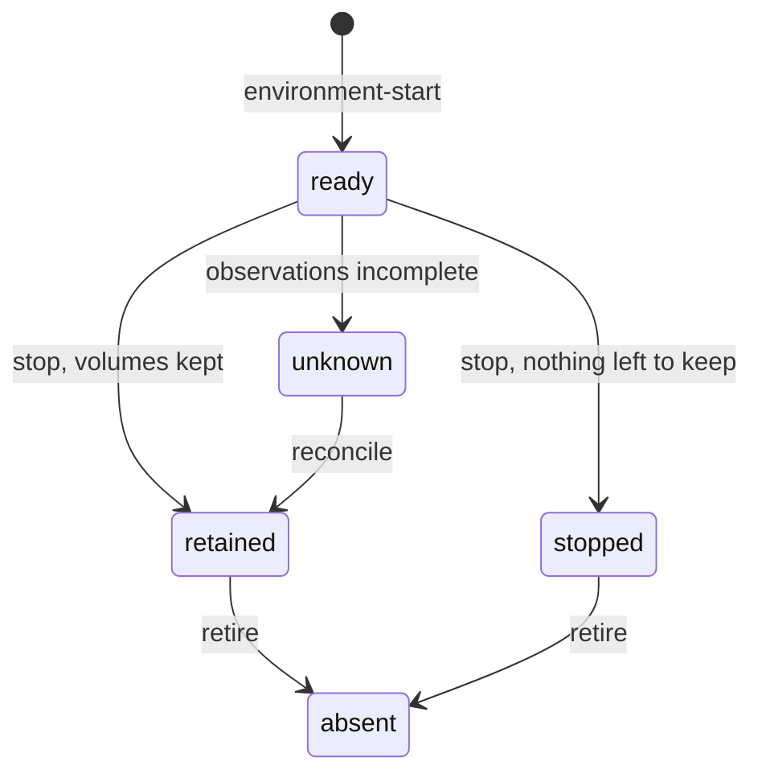

# Stop and retire an owned application environment

> **TL;DR** — **Stopping** an environment fences any further startup, stops its containers and keeps its data. **Retiring** it is a separate, explicit choice that removes exactly the resources the run created, and nothing else. Both can recover from an interruption without repeating something that already happened.

> [!IMPORTANT]
> **Experimental.** Stop requests, cancellation, partial recovery and Docker retirement are tested, and were observed on a macOS controller with a Linux daemon. Autonomous delivery may change in a minor release.



Commands that start with `npm run eval` are model-free controls that run from a source checkout ([development guide](../contributing/development.md#build-from-source)); every `wl` command uses the installed CLI.

## Prerequisites

Use an environment created as in the [Docker guide](./delivery-docker.md), with its store and the same local Docker daemon.

- **Only you run these commands.** Workers have no permission for them.
- **No new grant is needed** to shut down a stopped run's own resources.
- **A POSIX `ps`** that reports numeric process and group IDs is required. If the process table cannot be read, the result is *unknown* and resources are kept, rather than guessing that a process has stopped.

## Inspect the closed contracts without Docker

```console
$ wl delivery environment-lifecycle-schema --json
{"schema":"wholeloop/environment-lifecycle-schema@1","contracts":[…],"executed":false}
```

It returns four closed contracts and touches no backend, so it works offline. The rest of this guide needs a real environment.

## Review and stop

Set `STORE` to the store's absolute path and `ENVIRONMENT_ID` to the environment's ID. The script reads the current status, writes a stop request bound to that exact state (`expected` is its digest) and stops it:

```bash
set -euo pipefail
WORK="$(mktemp -d "${TMPDIR:-/tmp}/wholeloop-lifecycle.XXXXXX")"
export WORK ENVIRONMENT_ID
wl delivery environment-status \
  --environment "$ENVIRONMENT_ID" --store "$STORE" --json > "$WORK/status.json"
node --input-type=module <<'JS'
import { readFileSync, writeFileSync } from 'node:fs'
import { join } from 'node:path'
const work = process.env.WORK
const current = JSON.parse(readFileSync(join(work, 'status.json'), 'utf8'))
if (current.environment.record.id !== process.env.ENVIRONMENT_ID) throw Error('Wrong environment')
const request = {
  schema: 'wholeloop/environment-lifecycle-request@1',
  id: 'reviewed-stop',
  environment: process.env.ENVIRONMENT_ID,
  expected: current.environment.digest,
  action: 'stop',
  reason: 'Stop this reviewed environment and retain its data and evidence.',
}
writeFileSync(join(work, 'stop.json'), JSON.stringify(request, null, 2) + '\n')
JS
wl delivery environment-stop --root "$WORK" \
  --file stop.json --store "$STORE" --json > "$WORK/stop-receipt.json"
```

| Result | Means |
| --- | --- |
| `retained` | Containers stopped; its volumes, with their data, are kept |
| `stopped` | Containers stopped; there was no data to keep |
| `unknown`, exit code 3 | Observations are incomplete: inspect the receipts and resources |

- **`reviewAfter`** is a reminder, never an automatic deletion time.
- The recipe, runtime and operation histories survive stop and retirement.
- Stopping runs no undo recipe, deletes no branch or worktree, publishes nothing and accepts nothing.
- The fence is permanent: no later provisioning can dispatch new work to this environment. To run the application again, review and start a new environment; reconciling never replays startup.

**Never remove resources by guessing their names.** A denied or changed daemon, or a changed identity, never counts as evidence that something is gone.

## Recover an interruption

**Interrupted stop.** Run the exact same stop request again. The new controller must:

1. observe that the previous controller is gone;
2. cancel the clients it registered, through their private channels;
3. observe that their whole process groups are gone.

It never signals a process ID taken from history; a live or reused process identity stays *unknown*. Keep the original request file: an identical, completed request returns its original receipt and changes nothing.

**Reconcile.** `wl delivery environment-reconcile` takes the same request shape with `action: reconcile`, a new ID and the current runtime digest. It stops the environment for good, inspects it and keeps the data.

**Interrupted retirement.** Run the original `environment-retire` request again, unchanged. A changed binding under the same request ID is refused.

An environment created before tracking was complete cannot gain an invented proof that its clients stopped. Its known services can be stopped, but it cannot be retired while the old process is uncertain. Do not invent metadata to get around this.

## Explicit retirement

Review `environment-status` again, then write a new request with the current `environment.digest`, a new ID and `action: retire`, and pass it to `wl delivery environment-retire` with the same root and store. This is the explicit decision to delete the disposable data, including volumes kept after a failure.

**What retirement checks and does:**

- it checks the original daemon, and each resource's exact ID, name, labels, token and creation fingerprint;
- it removes stopped containers, then networks, then volumes, never forcing a removal;
- it then lists the resources again and must observe that they are gone.

A lost response is inspected before carrying on, and a resource already gone is not removed again. A resource from someone else with the same name is never touched. When the state is unknown, reservations and the evidence of a partial cleanup are kept.

## Run the actual interruption evaluation

From a source checkout, with the pinned helper image cached and permission to create disposable Docker resources:

```bash
set -euo pipefail
npm run eval:environments -- --retire-success
```

The evaluation stops an environment and keeps its volumes, refuses to touch an unrelated volume with the same name, kills its own retirement controller on purpose, and completes the retirement with a freshly built CLI. It kills only its own test controller, keeps resources when something unexpected fails, and records the host and daemon architecture separately. No model, account or publication is involved. The [Docker guide](./delivery-docker.md#run-the-actual-disposable-evaluation) shows its output.

<!-- docnav -->
[◀ Docker application environments](delivery-docker.md)  ·  [📖 Docs index](../README.md)  ·  [🧭 Concepts](../concepts.md)  ·  [Behavioral acceptance and evidence ▶](delivery-acceptance.md)
