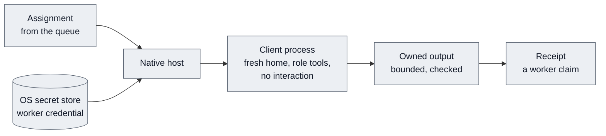

# Native delivery hosts — inspect support without granting execution

> **TL;DR** — The workers of an autonomous run are headless sessions of a real coding client, started by a **native host** that keeps them contained: a fresh home, no inherited credentials, only the role's tools, no interaction and bounded output. Today **Claude Code** and **Codex** have pinned reference recipes; the other clients are explicitly unverified as workers. Inspecting support starts nothing.

> [!IMPORTANT]
> **Experimental.** Reference recipes, capability negotiation, bounded execution and receipts are tested, and live trials passed with Codex. Autonomous delivery may change in a minor release.



Commands that start with `npm run eval` are model-free controls that run from a source checkout ([development guide](../contributing/development.md#build-from-source)); every `wl` command uses the installed CLI.

## Contents

- [Inspect the available contracts](#inspect-the-available-contracts)
- [Reference and unsupported targets](#reference-and-unsupported-targets)
- [Give a worker its credential](#give-a-worker-its-credential)
- [What a launch requires](#what-a-launch-requires)
- [Repeat actual model-free Codex permission controls](#repeat-actual-model-free-codex-permission-controls)
- [Repeat actual model-free Claude Code controls](#repeat-actual-model-free-claude-code-controls)
- [Authentication and private data](#authentication-and-private-data)
- [Read the outcome correctly](#read-the-outcome-correctly)
- [Inside the controller](#inside-the-controller)

## Inspect the available contracts

This starts no client or model and reads no credential:

```bash
set -euo pipefail
wl --version
wl delivery native-schema --json | node --input-type=module -e '
import assert from "node:assert/strict"
let input = ""
for await (const chunk of process.stdin) input += chunk
const value = JSON.parse(input)
assert.equal(value.schema, "wholeloop/delivery-native-schema@1")
assert.equal(value.targets.length, 7)
assert.equal(value.dispatch, "not-performed")
assert.equal(value.observationSchema.additionalProperties, false)
assert.equal(value.observationSchema.properties.metering.properties.hardTokens.const, false)
assert.equal(value.observationSchema.properties.metering.properties.hardCurrency.const, false)
assert.equal(value.runSchema.properties.acceptance.const, "not-established")
assert.equal(value.runSchema.properties.publication.const, "not-performed")
assert.equal(typeof value.referenceVersions.claude, "string")
assert.equal(typeof value.referenceVersions.codex, "string")
console.log("PASS: seven explicit targets, unsupported hard metering and no dispatch or acceptance")
'
```

```console
1.1.0
PASS: seven explicit targets, unsupported hard metering and no dispatch or acceptance
```

The schema lists all seven targets, says that hard token and cost limits are not supported, and that nothing is dispatched or accepted by inspecting it.

## Reference and unsupported targets

| Target | As a delivery worker | Reference version |
| --- | --- | --- |
| Claude Code | Pinned reference recipe; needs matching runtime proof | 2.1.316 |
| Codex | Pinned reference recipe; needs matching runtime proof | 0.166.0 |
| OpenCode, Copilot, Cursor, Gemini, Antigravity | Explicitly *unverified* as workers. Their supervised use keeps its own evidence | — |

- The reference versions come from `native-schema`. An unknown version is refused; it never inherits an older version's certification.
- A role in the schema is a protocol capability, not proof that a signed-in session supports it.
- Queue workers cover the work-unit roles, including research that reads sources without an application workspace.

## Give a worker its credential

Workers sign in with a credential the controller supplies, kept in your OS secret store (the macOS Keychain or the Linux Secret Service), never in a file. Store it from standard input, then check that it resolves:

```text
wl delivery credential-store --target <claude|codex> --kind <api-key|oauth-token> --item <name> --store <macos-keychain|secret-service>
wl delivery credential-check --target <claude|codex> --kind <api-key|oauth-token> --item <name> --store <macos-keychain|secret-service>
```

`credential-check` never prints the value. A host without a supported secret store, such as Linux without a desktop session, cannot hold one, and there is no file fallback. [Troubleshooting](../troubleshooting.md#a-public-run-stopped-before-dispatch) lists the related run errors.

## What a launch requires

The controller builds a fresh context from the current queue claim, the immutable source and plan, the pinned guidance and contracts, and a finite reservation. Then it needs a **trusted host observation** for that exact assignment, recipe, client version, role and model, showing:

- sign-in, and containment;
- that the controller's private store and credentials are denied;
- restricted tools and interaction switched off;
- bounded cancellation, complete output and a reader for the owned output.

The default is *unavailable*.

- No command accepts JSON as that proof, and help output or fixture records cannot switch a capability on.
- A managed client policy can refuse the recipe; the harness never overrides it or picks a more permissive one.
- **Worker MCP is off.** Reference recipes disable external and personal MCP servers in the worker; the controller's own provider reads stay MCP-first with their scopes.
- Builders get only their allocated workspace; evaluators get read-only access to the implementation. Broker methods are ceilings, not a promise that the client has the tool.

## Repeat actual model-free Codex permission controls

With Codex 0.166.0 installed, from a source checkout:

```bash
npm run eval:native-boundary
```

It uses an empty client home, public witnesses chosen by the controller and a disposable Git worktree, and checks **planner, builder and verifier** in both output modes, six controls in all:

- read and write restrictions, and denied private and credential references;
- denied network access, and recognized disabled feature flags;
- real cancellation of the owned process, and unchanged project snapshots.

It never calls a model or queries an account, so its observations stay `authenticated: false`. A separate internal check can observe the client's own sign-in through an explicit reference to its credential store; only a status, digests and ownership reach its private proof. These controls ran on macOS for the reference version; Linux checks with fixtures do not prove real containment on Linux.

## Repeat actual model-free Claude Code controls

On macOS, Claude Code runs inside a `sandbox-exec` profile that denies every file the assignment does not need. It signs in through a dedicated client home that you log in to **once**; the second command below is interactive:

```bash
mkdir -p -m 700 ~/.local/state/wholeloop-native/claude
CLAUDE_CONFIG_DIR="$HOME/.local/state/wholeloop-native/claude" claude auth login
WHOLELOOP_CLAUDE_CLIENT="$(readlink -f "$(command -v claude)")" npm run eval:claude-boundary
```

The evaluation checks planner, builder and verifier in both output modes. Each case runs the client's version check, the controller's boundary program under the launch profile, owned cancellation and the client's own login status. No model is called. `WHOLELOOP_CLAUDE_STORE` selects another client home. Off macOS there is no observation, so Claude stages are unavailable there.

## Authentication and private data

- Clients start with a **fresh home and configuration**, without the controller's tokens or runtime injection options.
- A real host may reference the client's own credential store, outside repositories, the worker's roots and the controller's state. Credentials are never copied into generated files, arguments or the model's context, and the application's environment receives none.
- Fixture observations can never enable that reference.
- Denying credentials is proven by the native host's checks, not by a prompt, a worktree, a mode flag, a successful login or a schema.

## Read the outcome correctly

- **Before** any private input is sent over standard input, the host registers the real process in the queue. Output and duration are bounded, and authority and fencing are checked again while it runs.
- Context and Git control files are checked unchanged before the controller reads Git. A change in a read-only workspace, changed metadata, a wrong response identity or an output that was not observed fails the attempt.
- Claimed artifacts must match the real output bytes and fit the [artifact budget](./delivery-budgets.md). Captured references and their charges survive retries; a quota refusal never turns missing evidence into success.
- Hard token and cost limits are not supported, and usage nobody measured stays *unknown*, never zero.

## Inside the controller

For contributors, the controller composes native workers through internal APIs. Each one is tested with real synthetic client processes; none is a public command that imports worker JSON as completion, and none certifies a signed-in client.

| Component | What it guarantees |
| --- | --- |
| **Inline artifact proposals** (`output: inline-proposal`) | A read-only worker can return a report through its structured output, without write access. The proposal echoes the assignment digest, is capped at 1 MiB, 100 artifacts and 256 KiB of text, and is refused on bad encoding, unsafe references, forged metadata or credentials. There is no fallback between file and inline modes |
| **Purpose attempts** (planner and challenger) | Decision workers run independently of implementation units, are claimed and consumed once before launch, and a report stays current only while authority, bases, inputs and outputs are unchanged |
| **Delegated decision host** | Two independent process receipts, purpose-specific claims, evidence from a separate trusted observer; neither role can pass as a person's approval |
| **Worker stages** | Implementation and unit research bound to their exact queue entry and assignment. A lost reply cannot start the claim again; a fresh controller recovers from the recorded receipt, even while paused; stop works after revocation |
| **Decision stages** | Route requirements bound before invoking; a lost call keeps its unknown request instead of launching new workers; a newer unrelated judgement never repairs an old one |
| **Artifact stages** | Definition and plan proposals, builder plans and acceptance definitions produced by read-only planners, with `approvals: not-recorded` and `acceptance: not-established` until the independent judgements run |
| **Native gate host and review stages** | Each inspection and refutation bound to its claim, finding and the committed bytes; results parsed only from the recorded receipt; the existing strict-majority rules applied; a lost final write sealed while paused without running another model |

<!-- docnav -->
[◀ Delivery workers](delivery-workers.md)  ·  [📖 Docs index](../README.md)  ·  [🧭 Concepts](../concepts.md)  ·  [Environment planning ▶](delivery-environments.md)
