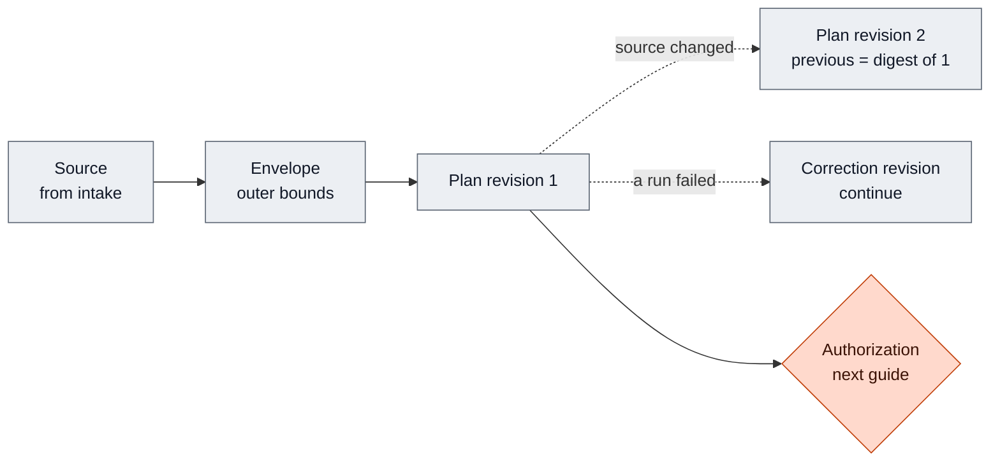
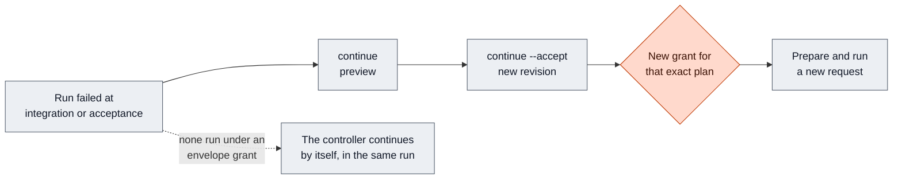

# Prepare a delivery plan — review scope before execution

> **TL;DR** — A **plan** says exactly what a run must deliver: acceptance criteria, repositories and their bases, the endpoint, how much the run may ask you and finite budgets. You can first pin an **envelope**, the outer bounds a later plan must fit. Preparing either one starts no worker and grants no authority; it gives you something exact to review and authorize.

> [!IMPORTANT]
> **Experimental.** Plan and envelope validation, immutable revisions, Git base observations and routing are tested. Autonomous delivery may change in a minor release.

**What you will have at the end:** an envelope and a plan, stored and readable from any terminal, with the route the run would take and its dependency waves.



Commands that start with `npm run eval` are model-free controls that run from a source checkout ([development guide](../contributing/development.md#build-from-source)); every `wl` command uses the installed CLI.

## Before you start

You need Git and the `wl` CLI ([getting started](../getting-started.md#install-the-cli)); no model or remote account. The commands create a disposable example repository and a separate store, so your own work is not touched.

## Capture the source and prepare proposals

The script below does four things:

1. creates a disposable Git repository with one commit, the **base** the plan builds on;
2. captures an inline request as a [source](./delivery-intake.md);
3. writes an envelope and a plan with a small Node script, filling in the source ID and the observed base commit;
4. prepares the envelope, then the plan bound to it, and reads the plan back.

<details>
<summary>Setup script: copy once</summary>

```bash
set -euo pipefail
workspace_dir="$(mktemp -d "${TMPDIR:-/tmp}/wholeloop-plan.XXXXXX")"
mkdir -p "$workspace_dir/repo"
git -C "$workspace_dir/repo" init -q -b main
git -C "$workspace_dir/repo" config user.name 'Fixture Owner'
git -C "$workspace_dir/repo" config user.email fixture@example.test
git -C "$workspace_dir/repo" config commit.gpgsign false
git -C "$workspace_dir/repo" config core.hooksPath /dev/null
printf 'Original application.\n' > "$workspace_dir/repo/app.txt"
git -C "$workspace_dir/repo" add app.txt
git -C "$workspace_dir/repo" commit -q \
  -m 'feat: seed the disposable planning example' \
  -m 'Provide an isolated initial base for the delivery tutorial.'
cat > "$workspace_dir/source-input.json" <<'EOF'
{
  "schema": "wholeloop/delivery-source-request@1",
  "kind": "inline",
  "ref": "title-search",
  "body": "Find tasks by title.",
  "mapping": [
    { "id": "search", "role": "criterion", "startLine": 1, "endLine": 1 }
  ]
}
EOF
wl delivery source \
  --file "$workspace_dir/source-input.json" --root "$workspace_dir" \
  --store "$workspace_dir/state" --json > "$workspace_dir/source.json"
node --input-type=module - "$workspace_dir" <<'EOF'
import { spawnSync } from 'node:child_process'
import { readFileSync, realpathSync, writeFileSync } from 'node:fs'
import { join } from 'node:path'
const directory = realpathSync(process.argv[2])
const root = join(directory, 'repo')
const observed = spawnSync('git', ['-C', root, 'rev-parse', 'HEAD'], {
  encoding: 'utf8'
})
if (observed.status !== 0) throw new Error('Cannot observe the example base')
const source = JSON.parse(readFileSync(join(directory, 'source.json'), 'utf8'))
const basis = {
  source: source.source.id,
  owner: 'Fixture Owner',
  scope: {
    outcomes: [{ id: 'locate', text: 'Locate tasks using their titles.' }],
    exclusions: ['Descriptions are excluded.']
  },
  repositories: [{
    id: 'app', root, target: 'refs/heads/main', base: observed.stdout.trim()
  }],
  guidance: [],
  policy: {
    endpoint: 'local-handoff', intervention: 'supervised',
    uncertainty: 'blocked', delegations: []
  },
  budgets: {
    wallTimeMs: 14400000, attemptMs: 1800000,
    builders: 2, buildersPerRepository: 1, evaluators: 4,
    restarts: 2, ciPushes: 2, integrationRepairs: 3,
    noProgress: 3, artifactBytes: 209715200
  },
  capabilities: []
}
const envelope = {
  schema: 'wholeloop/delivery-envelope@1', ...basis,
  limits: { work: 100, criteria: 1000, revisions: 10 }
}
const plan = {
  schema: 'wholeloop/delivery-plan@1', ...basis,
  run: 'delivery-0123456789abcdef', revision: 1,
  definition: { ready: true, missing: [] },
  criteria: [{
    id: 'search', text: 'Find tasks by title.', outcomes: ['locate'],
    test: 'Seed two tasks, search one title, and compare returned task IDs.',
    acceptance: 'machine'
  }],
  work: [{
    id: 'search', repository: 'app', role: 'implementation',
    criteria: ['search'], after: [], consumes: [], produces: []
  }],
  milestones: [{
    id: 'feature', work: ['search'], criteria: ['search'], after: [],
    procedure: 'Run the application and search seeded tasks by title.'
  }]
}
for (const [name, value] of [['envelope', envelope], ['plan', plan]]) {
  writeFileSync(join(directory, `${name}.json`), JSON.stringify(value, null, 2))
}
EOF
wl delivery envelope \
  --file "$workspace_dir/envelope.json" --root "$workspace_dir" \
  --store "$workspace_dir/state" --json > "$workspace_dir/envelope-receipt.json"
node --input-type=module - "$workspace_dir" <<'EOF'
import { readFileSync, writeFileSync } from 'node:fs'
import { join } from 'node:path'
const directory = process.argv[2]
const file = join(directory, 'plan.json')
const plan = JSON.parse(readFileSync(file, 'utf8'))
plan.envelope = JSON.parse(
  readFileSync(join(directory, 'envelope-receipt.json'), 'utf8')
).digest
writeFileSync(file, JSON.stringify(plan, null, 2))
EOF
wl delivery plan \
  --file "$workspace_dir/plan.json" --root "$workspace_dir" \
  --store "$workspace_dir/state" --json
wl delivery inspect-plan \
  --run delivery-0123456789abcdef --revision 1 \
  --store "$workspace_dir/state" --json
printf 'Retained tutorial files: %s\n' "$workspace_dir"
```

</details>

What the plan contains:

| Field | In this example |
| --- | --- |
| `source`, `owner`, `scope` | The captured request, its owner, the outcome `locate` and what is excluded |
| `repositories` | One repository, `app`, with its target branch and the exact base commit |
| `policy` | Endpoint `local-handoff`, intervention `supervised`, unknowns `blocked`, no delegated decisions |
| `budgets` | Finite limits: wall time, attempt time, builders, restarts, CI pushes, repairs, no-progress rounds, evidence bytes |
| `criteria` | One criterion, `search`, with its test and machine acceptance |
| `work` | One implementation unit, `search`, owning that criterion |
| `milestones` | One milestone, `feature`, with the procedure to check it |

The last two commands print the same prepared plan. Shortened, with the plan itself left out:

```console
$ wl delivery inspect-plan --run delivery-0123456789abcdef --revision 1 --store "$workspace_dir/state" --json
{
  "schema": "wholeloop/delivery-plan-prepared@1",
  "digest": "abf9d65f3e4490b52440a5d60e71b2efa992fd55422807fc699d56b497082934",
  "plan": { … },
  "route": {
    "next": "build",
    "reason": "explicit-criteria"
  },
  "waves": [["search"]],
  "authority": "not-granted",
  "workers": "not-started"
}
```

| Field | Means |
| --- | --- |
| `digest` | The plan's identity; a grant names exactly this digest |
| `route.next: build` | With explicit criteria, the run would start at building |
| `waves` | Work that can run together; here, one wave with `search` |
| `authority: not-granted` | Nothing is authorized yet |
| `workers: not-started` | Nothing ran; the repository is still on its original commit |

This is a proposal built from the source. It does not claim that Define was approved or that anything was implemented, and preparing the envelope or the plan is neither an authorization nor an acceptance.

## Read the contracts and change a proposal

```bash
wl delivery plan-schema --json
```

**Limits.** A plan has at most 100 work units, 16 repositories and 1000 criteria.

**Coverage rules.**

- Every required outcome is covered by criteria, and every criterion has exactly **one** owning work unit.
- All work and criteria belong to milestones.
- A unit that consumes a contract depends on the unit that produces it, directly or through others; milestones declare the dependencies their work needs.

**Pinned inputs.** Guidance and rubric digests and capability descriptors are pinned in the plan; the run checks their real content and capabilities when it executes. Fill `guidance` with `wl delivery guidance --file <proposal.json> --json`, which proposes the pins a supervised step would resolve at each repository's base and asks about ambiguous slots ([repository guidance in autonomous runs](../configuration/repo-skills.md#in-autonomous-runs)).

**Existing items.** `work.subject` can reference existing item IDs. The planner checks that they exist, are open and match a recorded repository; it creates no slices and no approvals. Local branches and remotes are observed without fetching. Research plans may have no repositories and only research work, and research authority never implies writing code.

**Revisions.** Changing a stored revision in place is refused. To change a plan:

1. increment `revision`;
2. set `previous` to the exact digest of the old plan, and keep its history;
3. make sure the local bases are current;
4. when the plan is bound to an envelope, keep its intent, repositories, policy, guidance and capabilities, and stay within its limits.

History stays readable after a branch or remote moves, but a new run needs fresh validation and a grant.

**Unclear intent.** When the request is not clear enough, `definition.ready` is `false` and `definition.missing` lists what is unknown.

- A `supervised` or `on-exception` plan may return *needs input*.
- A `none` plan with undelegated Define or research decisions returns *blocked*; with those decisions delegated, it proposes the Define or research route.
- A criterion that only a person can accept blocks a `none` plan.

A route is not a capability or a successful decision, and unknown facts stay unknown.

## Stopping point

You have a reviewable envelope and plan, with their route and dependency waves, stored under `state/delivery` in the temporary directory. Keep it to inspect the records from another terminal. Nothing is authorized or running yet: continue with [authorization](./delivery-authorization.md), then the [runner](./delivery-runner.md), or use the supervised [small-change route](./small-change.md).

## Preview and adopt a revision

When the source changes, write the next plan revision and preview it:

```bash
wl delivery revise --run <id> --file <plan.json> --json
```

Nothing is written. The preview lists:

- criteria changed, added and removed, and outcomes removed;
- whether authority must be renewed, and whether the envelope still covers the plan;
- which stages keep their evidence, and why;
- the workers and effects to stop or reconcile.

Adopt it with `--accept --operator "Your Name" --reason "Why"`, adding `--approve-removals` when criteria or outcomes are dropped. Adopting records the revision and your reason, nothing more: the run keeps its approved basis until a grant covering the new revision is tracked. A `none` revision outside its envelope is refused.

## Continue after a failed integration or acceptance

When a run ends `failed` or `blocked` at an integration or acceptance stage, `wl delivery report` lists `wl delivery continue` among its next actions.



**1. Preview** the correction:

```bash
wl delivery continue --run <id> --request <runner-request> --stage <stage> --unit <work-id> --json
```

The preview names the exact failure evidence, the repairs used against the run's limit and every reason it would be refused: pending effects, unresolved stages, a controller still active or a spent budget. It shows which stages keep their evidence, and writes nothing.

**2. Accept** with `--accept --operator <name> --reason <text>`. This records the next revision with one more `corrections` entry; it does not reopen the run.

**3. Authorize and run again.** Issue a new grant for that exact plan with `wl delivery authorize`, track the revision with it, then prepare and run a new runner request. The failed run's grant, and any envelope grant, are refused here, with one exception:

> A `none` run that started under an **envelope grant** can continue under that same grant while it is active and lists `code.write`, `git.commit` and `test.run`, and the plan has exactly one code unit, so the owning unit is never guessed. The controller then records the correction and carries on in the same `wl delivery run`, within the repair budget, without a person.

**What the correction run does.**

- Every unit's chain runs again under the new grant and revision. Each new workspace starts at the predecessor's committed head; the corrected unit's builder receives the recorded failure and commits its correction before independent QA. Only independent units are supported.
- Earlier decisions and commit receipts never count under the new grant, and every changed head gets fresh verification and review.
- The builder sees a public failing case's pinned actions, assertion IDs and descriptions, and failure conditions; a private case only as its ID and status. Acceptance feedback also carries past delegated outcomes, challenger verdicts and explanations, or a person's rejection and note, without identities or input files. All of it is untrusted repair input that never becomes approval or authority.
- **Restarts are counted across revisions.** After the original build, a rebuild and a correction, the default allowance may already be spent; continuation never resets it.

Retire the failed run's environments explicitly if they still hold backend capacity; continuation never retires them on its own.

## Preview a CI correction with an explicit plan version

When a required CI check failed on a published pull request because of the code, preview a correction:

```bash
wl delivery continue-ci --run <id> --request <original-runner-request> --unit <work-id> --json
```

- It checks the original publication and CI receipts, that the predecessor closed, and the remaining repair and push allowances. It refuses non-code or ambiguous failures, and writes nothing.
- `--accept --operator <name> --reason <text>` records the next **version-two** plan. It records neither a grant nor an execution.
- Every code unit must be independent, because the correction rebuilds all units from the published product.

**Plan versions.** Planning commands default to version one. Pass `--schema-version 2` to `wl delivery plan-schema`, `wl delivery plan` and `wl delivery inspect-plan` for a version-two plan; mixing versions is refused. Each new correction entry names the revision that produced it, and only the current one runs.

**Who can continue.** An operator's proposal needs a new grant for that exact plan; the previous grant and the envelope are not enough. Only the controller itself may continue a `none` run under its own envelope grant, when that grant lists `git.push` and the failure is repairable within the push budget.

**Where it runs.** The public CLI can preview, record and inspect the proposal, and says that executing it needs the installed SDK controller (`composeInstalledImplementation`, with fixed CI and merge hosts). The public composer still refuses `to-merge`, and an installed runtime allowance grants no merge: without a merge grant, merging stays blocked.

**What the correction does.**

1. It reads the original topics, the owned PRs and the current review feedback completely and consistently, and refuses on unadopted feedback, unreadable pages, a moved head, insufficient scope or a spent push budget.
2. New workspaces start at the exact published head, after checking each unit's ancestry.
3. The corrected head gets fresh verification, review, integration, acceptance and CI.
4. Publication keeps the original branch and PR, with a normal (non-force) push. The PR body stays as it was, and no copied marker or other PR can stand in for it.

`npm run eval:ci-continuation -- --retire-success` exercises this end to end with synthetic client, API, CI and protection facts, a real local bare Git repository and real Docker QA. It grants no merge, writes nothing hosted and retires the environments it owns. Signed-in clients and hosted services are verified separately.

<!-- docnav -->
[◀ Delivery request intake](delivery-intake.md)  ·  [📖 Docs index](../README.md)  ·  [🧭 Concepts](../concepts.md)  ·  [Maintenance proposals ▶](maintenance-proposals.md)
