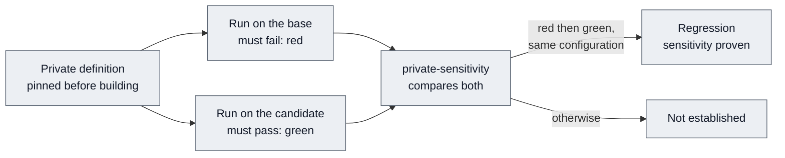

# Keep acceptance inputs private and prove regression sensitivity

> **TL;DR** — A **private** acceptance case is hidden from the builder: its requests and expected values are mounted only into an evaluator the run owns. To count a regression as caught, the same private case must **fail on the base** and **pass on the change**, with the same evaluator and the same configuration. A candidate that merely passes is not enough.

> [!IMPORTANT]
> **Experimental.** The private host, immutable definitions and the observed red and green comparison are tested and were observed in Docker. Autonomous delivery may change in a minor release.



Commands that start with `npm run eval` are model-free controls that run from a source checkout ([development guide](../contributing/development.md#build-from-source)); every `wl` command uses the installed CLI.

## Inspect the contract

```console
$ wl delivery private-schema --json
{"schema":"wholeloop/private-acceptance-schema@1", …}
```

It returns six closed contracts and the digest of the evaluator program, which is built into the CLI: you install no mutation framework or bundler. It runs no Docker, model or mutator. Before going further, follow [planning](./delivery-plan.md), [authorization](./delivery-authorization.md), the [Docker guide](./delivery-docker.md) and [acceptance definitions](./delivery-acceptance.md).

## Pin the private definition before implementation

Write the definition in a directory you control, **outside the builder's workspace**, with your real run, plan and source identities. This example requires an empty-title POST to return 400:

```json
{
  "schema": "wholeloop/private-acceptance@1",
  "run": "delivery-0123456789abcdef",
  "revision": 1,
  "plan": "REPLACE_WITH_DELIVERY_PLAN_DIGEST",
  "source": "REPLACE_WITH_SOURCE_DIGEST",
  "case": "empty-title",
  "behavior": {
    "schema": "wholeloop/behavior-input@1",
    "kind": "api",
    "service": "web",
    "port": 3000,
    "steps": [{ "id": "empty", "kind": "request", "method": "POST", "path": "/tasks", "headers": { "content-type": "application/json" }, "body": "{\"title\":\"\"}" }]
  },
  "assertions": [{ "id": "reject-empty", "description": "Reject an empty task title.", "subject": "status", "operator": "equals", "expected": "400" }],
  "sensitivity": { "mode": "regression", "relevant": ["reject-empty"] }
}
```

It is definition data, not a runnable demo. Ordinary test data is fine; recognizable credentials are refused.

| Supported here | Not supported by this private host |
| --- | --- |
| Bounded HTTP request steps; status, header and JSON assertions, with per-assertion targets | CLI, browser or semantic runners, and restart steps. Use the ordinary [API and CLI](./delivery-behaviors.md) and [browser](./delivery-browsers.md) hosts for those |

Pin it, with paths to your input directory and store:

```bash
set -euo pipefail
wl delivery private-plan --file "$private_case_file" --root "$operator_input_dir" --store "$delivery_store" --json
wl delivery private-inspect --digest "$private_definition_digest" --store "$delivery_store" --json
```

Both receipts show identity and counts only, never request bodies or expected values. Keep the returned digest. Pinning again is idempotent; changing a pinned definition, or pinning after a builder was admitted, is refused, and needs a new accepted revision.

## Connect the public acceptance case

Before any builder is admitted, add a public, machine-owned case with the **same case ID** to the acceptance plan:

| Field | Value |
| --- | --- |
| `runner.kind` | `api` |
| `runner.capability` | `evaluator.private-http` |
| `runner.input` | The JSON below, as a string |
| `fixture.sha256` | The private definition's digest |
| Assertion | Exactly one: ID `private-outcome`, `state` / `equals` at `/passed`, expecting `true` |

```json
{ "schema": "wholeloop/private-case-input@1", "manifest": "REPLACE_WITH_PRIVATE_DEFINITION_DIGEST" }
```

The public case still describes the agreed scenario in its initial state, actions and failure conditions; the hidden requests and expected values stay out of it.

**Run it twice:**

1. **On the base**, in a clean allocated base worktree, with `acceptance-run` and a stable key, **before** changing anything.
2. **On the candidate**, after the change, with another stable key. Keep the base receipt and its artifacts.

The fixed private host is chosen automatically. Its helper image must match the reference from `environment-runtime-schema`, and the network stays internal.

**What the evaluator gets, and what it does not:**

- Each run creates its own private input volume, mounted read-only into the evaluator. The copied bytes must match their digests before anything runs.
- The evaluator gets no application code, no controller directory and no credentials. Cases are up to 1 MiB and the program up to 256 KiB, within the 2 MiB transport limit.
- The application receives real HTTP requests on its own service address and port.

**What privacy depends on.** The controller's store is trusted, and the worker's client host must deny access to it. A filesystem shared by the same user cannot guarantee privacy, and the container denials observed here do not certify every coding client's sandbox.

## Inspect red/green sensitivity

Write a request with the acceptance plan digest and the two environment and key pairs:

```json
{
  "schema": "wholeloop/acceptance-sensitivity-request@1",
  "plan": "REPLACE_WITH_ACCEPTANCE_PLAN_DIGEST",
  "case": "empty-title",
  "baseline": { "environment": "environment-REPLACE_WITH_BASE_ID", "key": "baseline" },
  "candidate": { "environment": "environment-REPLACE_WITH_CANDIDATE_ID", "key": "candidate" }
}
```

```bash
set -euo pipefail
wl delivery private-sensitivity --file "$sensitivity_request_file" --root "$operator_input_dir" --store "$delivery_store" --json
```

This reads the recorded observations and dispatches nothing.

**Proven** means only this: the pinned relevant case **failed on the clean Git base** and **passed on the current candidate**, with the same evaluator and comparable configuration. It does not prove every property of the product.

- Only implementation code and allocated controller paths may differ. Fixtures, guidance, packages, tools, images, commands, networks and limits must stay the same.
- A dirty base, changed configuration, a failed setup or a stale candidate cannot supply proof.
- Assertions outside the relevant set are **baseline controls**: they must pass on the base, so an unrelated existing failure cannot pose as the regression. Add controls suited to your application rather than guessing a health endpoint.

**When regression sensitivity does not apply**, say so in the private definition with `new-feature` or `not-applicable`: a feature missing from the base is not a regression. Missing evidence stays unproven. Aggregate acceptance enforces applicable sensitivity by itself: a passing candidate without the base failure leaves acceptance `not-established`, and sealing that report keeps it incomplete. A repaired candidate must produce current evidence again.

## Optional native mutation data

The private definition can name an existing test-phase command from the recipe, under `sensitivity`, before pinning:

```json
{ "mutation": { "service": "web", "command": "mutation" } }
```

- No executable is guessed, downloaded or added as a dependency. The command runs under the same test effect, before the private HTTP assertions.
- A missing command stays *unavailable*. To make a successful mutation run a condition of acceptance, add an ordinary required CLI case.

**Counters.** For structured results, the command prints one JSON object matching `wholeloop/mutation-counters@1` (see `private-schema`): the engine and version, `complete: true` and consistent counts for total, killed, survived, timed out, uncovered and errors. Any other output keeps its process facts and digests, uninterpreted.

These are numbers the repository reports. Zero mutants, an exit 0, a scan for constant assertions or a model's statement never establish semantic sensitivity, so the report keeps `semanticSensitivity: unknown` even when regression sensitivity is proven.

## Run the model-free boundary evaluation

With the reference helper image cached:

```bash
set -euo pipefail
npm run eval:private -- --retire-success
```

```console
$ npm run eval:private -- --retire-success
Retained evaluation: /tmp/wholeloop-private-evaluation-XXXXXX
Observed: actual-application-cannot-read-or-weaken-private-evaluator-inputs
Observed: actual-unchanged-private-case-fails-on-baseline
Observed: actual-unchanged-private-case-passes-on-candidate
Observed: same-definition-and-evaluator-identity-bind-red-green
Observed: current-objective-regression-sensitivity-is-observed
Observed: missing-mutation-host-and-new-feature-absence-are-not-proven-sensitivity
Observed: native-counter-fixture-is-observed-without-semantic-certification
…
{"schema":"wholeloop/private-evaluation@1","status":"passed","scope":"Actual model-free Docker evaluator-only input and baseline/candidate observations. Same-user controller filesystems and native coding clients are not certified.","retirement":"observed-retired",…}
```

It also checks that a candidate-only pass cannot skip the required base failure, and that editing the candidate invalidates current sensitivity. The synthetic counters test the reporting path, not a real mutation engine. A failed run keeps its resources for [lifecycle inspection and retirement](./delivery-lifecycle.md); real clients, other Linux hosts, real mutators and accounts are tracked in [manual verification](../../roadmap/manual-verification.md).

<!-- docnav -->
[◀ Execute isolated browser acceptance](delivery-browsers.md)  ·  [📖 Docs index](../README.md)  ·  [🧭 Concepts](../concepts.md)  ·  [Integrated milestone candidates ▶](delivery-integration-candidates.md)
