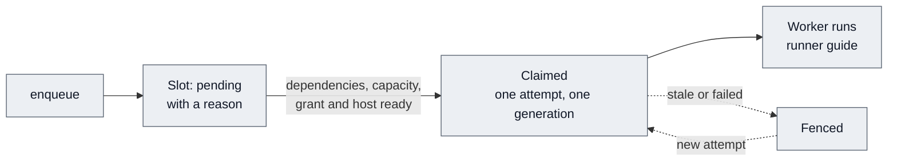

# Queue prepared work without starting workers

> **TL;DR** — The **queue** holds one slot per piece of work a run will hand to a worker: a builder for a unit, a verifier for one criterion, and so on. Slots wait for their dependencies, for capacity and for the host to admit them, and repeating a request never duplicates one. Queueing starts no worker.

> [!IMPORTANT]
> **Experimental.** Queue ordering, reservations, atomic claims and fencing are tested with real processes. Autonomous delivery may change in a minor release.

**What you will have at the end:** two queued slots for the plan's `search` unit, a builder and a verifier, both waiting for a host, and proof that enqueuing again changes nothing.



## Before you start

Complete the [planning](./delivery-plan.md) and [authorization](./delivery-authorization.md) guides in the same Bash terminal, and optionally [recovery](./delivery-recovery.md), so `workspace_dir` is still set. Authorization ended with its grant revoked, and a revoked grant is never renewed, so this guide records a **new** authorization first. Everything stays in the disposable repository and store.

## Record the new explicit action and queue its work

The script:

1. records a new grant, `authorization-aaaaaaaaaaaaaaaa`, from the same request;
2. **tracks** the plan with it, so the run has current authority;
3. enqueues a builder slot for `search` with priority 10;
4. enqueues a verifier slot for the criterion cell `title-search`, then the same request again;
5. checks the queue and prints `PASS` when everything is as expected.

<details>
<summary>Queue script: copy once</summary>

```bash
set -euo pipefail
: "${workspace_dir:?Run the planning and authorization tutorials first}"
node --input-type=module - "$workspace_dir" <<'JS'
import { readFileSync, writeFileSync } from 'node:fs'
import { join } from 'node:path'
const directory = process.argv[2]
const request = JSON.parse(readFileSync(join(directory, 'authorization.json'), 'utf8'))
request.id = 'authorization-aaaaaaaaaaaaaaaa'
writeFileSync(join(directory, 'queue-authorization.json'), JSON.stringify(request, null, 2))
JS
wl delivery authorize \
  --file "$workspace_dir/queue-authorization.json" --root "$workspace_dir" \
  --store "$workspace_dir/state" --json > "$workspace_dir/queue-grant.json"
wl delivery track \
  --run delivery-0123456789abcdef --revision 1 \
  --grant authorization-aaaaaaaaaaaaaaaa \
  --store "$workspace_dir/state" --json > "$workspace_dir/queue-tracked.json"
wl delivery enqueue \
  --run delivery-0123456789abcdef --unit search --priority 10 \
  --store "$workspace_dir/state" --json > "$workspace_dir/builder-queued.json"
wl delivery enqueue \
  --run delivery-0123456789abcdef --unit search --role verifier --cell title-search \
  --store "$workspace_dir/state" --json > "$workspace_dir/verifier-queued.json"
wl delivery enqueue \
  --run delivery-0123456789abcdef --unit search --role verifier --cell title-search \
  --store "$workspace_dir/state" --json > "$workspace_dir/verifier-repeated.json"
wl delivery queue \
  --run delivery-0123456789abcdef \
  --store "$workspace_dir/state" --json > "$workspace_dir/queue-status.json"
node --input-type=module - "$workspace_dir" <<'JS'
import { readFileSync } from 'node:fs'
import { join } from 'node:path'
const directory = process.argv[2]
const json = name => JSON.parse(readFileSync(join(directory, name), 'utf8'))
const status = json('queue-status.json')
if (status.state !== 'queued' || status.entries.length !== 2) throw new Error('Two queued slots expected')
if (status.entries.some(entry => entry.status !== 'pending')) throw new Error('No worker may start')
if (status.entries.some(entry => entry.reason !== 'awaiting-host-admission'))
  throw new Error('Both independent slots must await actual host admission')
if (JSON.stringify(json('verifier-queued.json')) !== JSON.stringify(json('verifier-repeated.json')))
  throw new Error('Repeated enqueue must retain the exact queue')
if (status.workers !== 'not-started-by-this-command' || status.effects !== 'not-performed')
  throw new Error('Metadata must not claim worker execution or effects')
console.log('PASS: two durable queue slots, separate verifier cell and idempotent enqueue')
JS
```

</details>

```console
PASS: two durable queue slots, separate verifier cell and idempotent enqueue
```

The queue it inspected, shortened:

```console
$ wl delivery queue --run delivery-0123456789abcdef --store "$workspace_dir/state" --json
{
  "schema": "wholeloop/delivery-queue-status@1",
  "run": "delivery-0123456789abcdef",
  "state": "queued",
  "entries": [
    {
      "id": "queue-e8805349e10e1e7415257166654b520f",
      "unit": "search",
      "role": "builder",
      "priority": 10,
      "status": "pending",
      "repository": "app",
      "reason": "awaiting-host-admission",
      …
    },
    {
      "id": "queue-6a0cceb73d45c270d500da72926ae78c",
      "unit": "search",
      "role": "verifier",
      "priority": 0,
      "status": "pending",
      "cell": "title-search",
      "reason": "awaiting-host-admission",
      …
    }
  ],
  "workers": "not-started-by-this-command",
  "effects": "not-performed"
}
```

Both slots are `pending` with the reason `awaiting-host-admission`: no host has admitted them, so nothing ran and nothing was verified. The repeated verifier request returned the same slot.

**Roles and priority.**

- The default role is `builder` for contract and implementation units, and `researcher` for research units. You can also ask for `verifier`, `reviewer` or `refuter`.
- Evaluators take a `--cell` to tell independent assignments apart; a builder cannot have one.
- Priority is an integer from -100 to 100. It never lets work skip its prerequisites, and changing the priority of an existing slot is refused rather than silently overriding an earlier request.

## What the scheduler enforces

**Admission.** A trusted host claims work through the core controller API. Admission is *unavailable* until that host reports its scoped capabilities, environment, budget and the plan's dependency state. Claiming starts no process: it records one attempt, one generation, one controller and one reservation, atomically, so two processes can never hold the same slot at once. Fixture admissions stay labelled as fixtures and certify no real containment.

**Capacity.**

| Limit | Default per store |
| --- | --- |
| Execution workers | 2 |
| Workers per repository | 1 |
| Evaluators | 4 |

Each plan can set tighter limits for its run. Repositories are matched by their Git identity, so two differently named clones of the same remote share one limit. A claimed or stopping worker keeps its reservation: a stale heartbeat, a timeout, a missing repository or a new controller does not free it. Work stays pending, with its reason, while dependencies, capacity, current authority or the host's prerequisites are missing.

**Retries.** Before fencing or retrying, a trusted controller must keep the worker's observed runtime identity and its final evidence. Each retry uses a new attempt and generation, and every worker request is checked against the current assignment, so an old worker can neither finish the work nor change anything through a stale peer. The scheduler orders work; whether tests passed or the endpoint was reached is decided separately.

## Stopping point

You have queued metadata without starting a model, a backend, a test application or a remote operation. Keep the directory for inspection. Continue with [checkpoints](./delivery-checkpoints.md), [budgets](./delivery-budgets.md), [environments](./delivery-environments.md) or the [runner](./delivery-runner.md).

<!-- docnav -->
[◀ Delivery runner controls](delivery-runner.md)  ·  [📖 Docs index](../README.md)  ·  [🧭 Concepts](../concepts.md)  ·  [Delivery workers ▶](delivery-workers.md)
