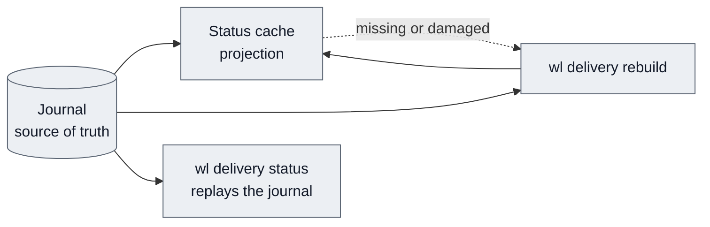

# Inspect delivery history and rebuild its cache

> **TL;DR** — Everything a run does is written to an append-only **journal**; the readable status files are only a cache built from it. So a fresh process can always read a run's history, and a missing or damaged cache can be rebuilt exactly. Rebuilding never recreates a grant, renews a deadline, starts a worker or retries an effect.

> [!IMPORTANT]
> **Experimental.** Metadata and cache recovery are tested; [checkpoint recovery](./delivery-checkpoints.md) covers ownership and stopped writers. Autonomous delivery may change in a minor release.

**What you will have at the end:** a tracked run read from another process, its cache moved aside and rebuilt byte for byte, and proof that rebuilding restored no authority.



## Before you start

Complete the [planning](./delivery-plan.md) and [authorization](./delivery-authorization.md) guides in the same Bash terminal, so `workspace_dir` is still set. Authorization ended by revoking its grant; this guide keeps that true observation on purpose. Everything stays in the disposable directory.

## Track and inspect the retained basis

**Tracking** registers the plan and its grant as a run in the delivery journal:

```bash
set -euo pipefail
: "${workspace_dir:?Run the planning and authorization tutorials first}"
wl delivery track \
  --run delivery-0123456789abcdef --revision 1 \
  --grant authorization-0123456789abcdef \
  --store "$workspace_dir/state" --json > "$workspace_dir/tracked.json"
wl delivery status \
  --run delivery-0123456789abcdef \
  --store "$workspace_dir/state" --json > "$workspace_dir/status.json"
wl delivery events \
  --run delivery-0123456789abcdef --limit 1 \
  --store "$workspace_dir/state" --json > "$workspace_dir/events.json"
```

These commands print nothing; their results are in the files. The status, shortened:

```console
$ wl delivery status --run delivery-0123456789abcdef --store "$workspace_dir/state" --json
{
  "schema": "wholeloop/delivery-status@1",
  "state": {
    "state": "planned",
    "digest": "6e1455b92e27b44873d083c958c7d670b3aaa8faab8d2ffcaad56c6264a252b1",
    "grant": { "id": "authorization-0123456789abcdef", "status": "revoked", … },
    …
  },
  "projectionCache": "current",
  "authority": "not-implied",
  "effects": "not-performed"
}
```

| Field | Means |
| --- | --- |
| `state: planned` | A plan and a grant were observed; no work ran |
| `grant.status: revoked` | The grant was revoked in the previous guide, and status says so |
| `projectionCache: current` | The status cache matches the journal |
| `authority: not-implied` | Being tracked authorizes nothing by itself |

Tracking the same thing again adds no event. To track an envelope instead, pass `--envelope <digest>` in place of `--revision`; the first plan that fits it later registers its own revision in the same run.

**Reading events.** `wl delivery events` pages through the journal:

- sequence numbers are global in the delivery journal, and `--after <sequence>` starts after that one;
- `nextCursor` is the last sequence returned when there is another page, otherwise `null`;
- `--limit` accepts 1 to 1000, 100 by default;
- reading never marks mailbox messages as read.

`wl delivery state-schema --json` prints the event envelope and every registered payload schema; validating only the envelope skips the payload checks.

## Recover a missing projection

The next script moves this run's cache aside, keeping it for comparison, reads the status without it, rebuilds it twice and compares the result with the original. It touches neither the journal nor the private authorization files.

<details>
<summary>Recovery script: copy once</summary>

```bash
node --input-type=module - "$workspace_dir" <<'JS'
import { readFileSync, renameSync } from 'node:fs'
import { join } from 'node:path'
const directory = process.argv[2]
const tracked = JSON.parse(readFileSync(join(directory, 'tracked.json'), 'utf8'))
const status = JSON.parse(readFileSync(join(directory, 'status.json'), 'utf8'))
if (tracked.state.digest !== status.state.digest || status.state.grant.status !== 'revoked')
  throw new Error('The independent inspection must retain the exact revoked basis')
const cache = join(directory, 'state/delivery/state/delivery-0123456789abcdef.json')
renameSync(cache, cache + '.retained')
JS
wl delivery status \
  --run delivery-0123456789abcdef \
  --store "$workspace_dir/state" --json > "$workspace_dir/missing-cache.json"
wl delivery rebuild \
  --store "$workspace_dir/state" --json > "$workspace_dir/rebuilt.json"
wl delivery rebuild \
  --store "$workspace_dir/state" --json > "$workspace_dir/repeated-rebuild.json"
node --input-type=module - "$workspace_dir" <<'JS'
import { readFileSync } from 'node:fs'
import { join } from 'node:path'
const directory = process.argv[2]
const json = name => JSON.parse(readFileSync(join(directory, name), 'utf8'))
if (json('missing-cache.json').projectionCache !== 'missing') throw new Error('Missing cache expected')
if (json('rebuilt.json').written !== 1 || json('repeated-rebuild.json').written !== 0)
  throw new Error('Rebuild must repair once without repeating writes')
if (json('rebuilt.json').authority !== 'not-restored') throw new Error('No authority recovery allowed')
const cache = join(directory, 'state/delivery/state/delivery-0123456789abcdef.json')
if (!readFileSync(cache).equals(readFileSync(cache + '.retained')))
  throw new Error('Rebuilt projection must match the retained bytes')
console.log('PASS: independent replay, exact cache repair and no authority reconstruction')
JS
```

</details>

```console
PASS: independent replay, exact cache repair and no authority reconstruction
```

What the script checked:

| Step | Result |
| --- | --- |
| Status without the cache | Succeeds, by replaying the journal, and reports `projectionCache: missing` |
| First `rebuild` | `{"written": 1, "authority": "not-restored"}` |
| Second `rebuild` | `{"written": 0, "authority": "not-restored"}`: nothing left to repair |
| Rebuilt cache | Byte for byte the same as the one moved aside |

Rebuilding never recreates a missing grant, renews a deadline, starts a worker or retries a remote operation. A grant that was active in the past is history, not a live permission.

## Interruption and version limits

**How writes are made safe.** Each delivery transaction first writes one immutable, numbered journal segment, replaced atomically, and only then its projections. If a projection write is interrupted, it can be rebuilt from that segment.

**What is refused**, keeping the original files for inspection:

- an incomplete or corrupt segment;
- an unknown event or facet version, or a mismatched identity;
- a cache written by a newer version, which is never overwritten;
- names that alias into other private files.

**Locks.** A killed writer may leave a store lock. Recovery does not guess whether its worker or resources are still alive, and never steals the lock; the [checkpoint guide](./delivery-checkpoints.md) covers the explicit, non-destructive repair.

Keep the directory for inspection. Item history and human or PR receipts from the supervised flow are separate and unchanged.

<!-- docnav -->
[◀ Delivery checkpoints](delivery-checkpoints.md)  ·  [📖 Docs index](../README.md)  ·  [🧭 Concepts](../concepts.md)  ·  [Original delivery evaluation fixtures ▶](delivery-evaluation-fixtures.md)
