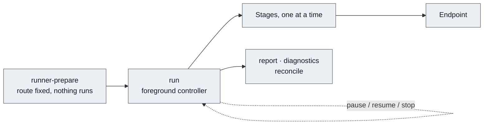

# Prepare and control an owned delivery route

> **TL;DR** — The **runner** executes a plan, stage by stage, in a controller you keep in the foreground. You prepare a request that fixes the route and its grant, run it with documents that say which coding clients you trust, and can pause, resume, stop, report and reconcile it at any time. Preparing and controlling a run, as this guide does, launches no model.

> [!IMPORTANT]
> **Experimental.** Prepare, status, operator controls, run and reconcile are tested with reference transports, and live trials passed with Codex. Autonomous delivery may change in a minor release.



Commands that start with `npm run eval` are model-free controls that run from a source checkout ([development guide](../contributing/development.md#build-from-source)); every `wl` command uses the installed CLI.

## Contents

- [Before you start](#before-you-start)
- [Prepare and inspect without execution](#prepare-and-inspect-without-execution)
- [Exercise explicit controls](#exercise-explicit-controls)
- [Run and reconcile from the terminal](#run-and-reconcile-from-the-terminal)
- [Run unattended research to a stored brief](#run-unattended-research-to-a-stored-brief)
- [Report, diagnose and move a run](#report-diagnose-and-move-a-run)
- [Inside a run](#inside-a-run)

**Which routes the public runner composes** depends on the endpoint and the intervention policy; the [source-installable boundary table](../reference/delivery-acceptance.md#source-installable-execution-boundaries) has the details. In short: the public composition supplies `research-report` and `to-pr` with intervention `none`; supervised or on-exception implementation needs registered recorded-human SDK hosts; CI and merge need the separately installed SDK composition. A valid plan or runtime document can never add a missing host or grant an effect.

## Before you start

Complete the [planning](./delivery-plan.md), [authorization](./delivery-authorization.md) and [queue](./delivery-queue.md) guides in the same Bash terminal, so `workspace_dir` is still set. The queue guide recorded a fresh active grant after authorization revoked the first one. Everything stays in the disposable example; no account, model or remote effect is needed.

## Prepare and inspect without execution

The script writes a **runner request**, prepares it twice and reads its status:

<details>
<summary>Prepare script: copy once</summary>

```bash
set -euo pipefail
: "${workspace_dir:?Run the planning, authorization and queue tutorials first}"
wl delivery runner-schema --json > "$workspace_dir/runner-schema.json"
node --input-type=module - "$workspace_dir" <<'JS'
import { readFileSync, writeFileSync } from 'node:fs'
import { join } from 'node:path'
const directory = process.argv[2]
const json = name => JSON.parse(readFileSync(join(directory, name), 'utf8'))
const prepared = json('plan-receipt.json')
const grant = json('queue-grant.json')
const request = {
  schema: 'wholeloop/delivery-runner-request@1',
  key: 'tutorial-controller',
  run: prepared.plan.run,
  revision: prepared.plan.revision,
  plan: prepared.digest,
  grant: grant.grant.id,
  host: { id: 'fixture', version: '1', configuration: 'a'.repeat(64) },
  pollMs: 250
}
writeFileSync(join(directory, 'runner-request.json'), JSON.stringify(request, null, 2))
if (json('runner-schema.json').completeRouteAvailable !== false)
  throw new Error('This increment must disclose its complete-route limitation')
JS
wl delivery runner-prepare \
  --file "$workspace_dir/runner-request.json" --root "$workspace_dir" \
  --store "$workspace_dir/state" --json > "$workspace_dir/runner-prepared.json"
runner_digest="$(node -e 'console.log(require(process.argv[1]).digest)' "$workspace_dir/runner-prepared.json")"
wl delivery runner-prepare \
  --file "$workspace_dir/runner-request.json" --root "$workspace_dir" \
  --store "$workspace_dir/state" --json > "$workspace_dir/runner-repeated.json"
wl delivery runner-status \
  --digest "$runner_digest" --store "$workspace_dir/state" --json
node --input-type=module - "$workspace_dir" <<'JS'
import { readFileSync } from 'node:fs'
import { join } from 'node:path'
const directory = process.argv[2]
const json = name => JSON.parse(readFileSync(join(directory, name), 'utf8'))
const first = json('runner-prepared.json')
if (JSON.stringify(first) !== JSON.stringify(json('runner-repeated.json')))
  throw new Error('Preparation must retain the same exact request')
if (first.ownership !== 'unclaimed' || first.stages.length || first.outcome !== null)
  throw new Error('Preparation cannot establish execution or an endpoint')
if (!first.route.some(stage => stage.kind === 'integration'))
  throw new Error('The implementation route must include whole-milestone validation')
console.log('PASS: idempotent private preparation, complete route and no execution')
JS
```

</details>

| Request field | Means |
| --- | --- |
| `key` | A stable name for this request; the same key with different content is refused |
| `run`, `revision`, `plan` | The exact plan to run |
| `grant` | The grant that authorizes it |
| `host` | The host identity the run is bound to; it loads no plugin and launches nothing |
| `pollMs` | How often the controller checks its stages |

The status, shortened:

```console
$ wl delivery runner-status --digest "$runner_digest" --store "$workspace_dir/state" --json
{
  "schema": "wholeloop/delivery-runner-status@1",
  "digest": "1cef4e4a63eed223231ef979149f68decfa84a65b47154f0ba2adeef9802cda2",
  "state": "queued",
  "ownership": "unclaimed",
  "stages": [],
  "route": [
    { "id": "plan", "kind": "plan", … },
    { "id": "acceptance-definition", "kind": "acceptance-definition", … },
    { "id": "workspace:search", … },
    { "id": "build-plan:search", … },
    { "id": "implementation:search", … },
    { "id": "commit:search", … },
    { "id": "verification:search", … },
    { "id": "review:search", … },
    { "id": "reverification:search", … },
    { "id": "integration:feature", … },
    { "id": "acceptance", … },
    { "id": "handoff", … }
  ],
  "authority": "original-private-grant-only",
  "publication": "not-implied",
  "nativeAcceptance": "not-established-by-inspection"
}
PASS: idempotent private preparation, complete route and no execution
```

The **route** is the full ordered list of stages this plan needs, from the plan to the local hand-off; [the overview](../architecture/autonomous-delivery.md#what-a-run-does-stage-by-stage) explains each one. `stages: []` and `ownership: unclaimed` say nothing ran.

- There is no way to import a result file that turns worker JSON into observations.
- A revoked or expired grant, or a moved Git base, prevents admission.
- Source instructions and profile settings create no authority.

## Exercise explicit controls

<details>
<summary>Controls script: copy once</summary>

```bash
wl delivery pause --digest "$runner_digest" \
  --operator 'Fixture Operator' --store "$workspace_dir/state" --json
wl delivery resume --digest "$runner_digest" \
  --operator 'Fixture Operator' --store "$workspace_dir/state" --json
wl delivery stop --digest "$runner_digest" \
  --operator 'Fixture Operator' --store "$workspace_dir/state" --json \
  > "$workspace_dir/runner-stop.json"
node --input-type=module - "$workspace_dir/runner-stop.json" <<'JS'
import { readFileSync } from 'node:fs'
const stopped = JSON.parse(readFileSync(process.argv[2], 'utf8'))
if (stopped.state !== 'stopping' || stopped.stages.length || stopped.outcome !== null)
  throw new Error('A stop request cannot assert actual process termination')
console.log('PASS: same-run controls preserve evidence and report cancellation honestly')
JS
```

</details>

| Command | State afterwards | Means |
| --- | --- | --- |
| `pause` | `paused` | No further stage is dispatched |
| `resume` | `queued` | The same run, grant, deadline and history continue. Refused while an owner, process or effect is unresolved, or a checkpoint is stale |
| `stop` | `stopping` | Cancellation is requested. It says `stopping`, not `stopped`, until the controller observes that its own work closed |

```console
PASS: same-run controls preserve evidence and report cancellation honestly
```

These controls never delete worktrees, signal a process ID from history, renew a budget or claim that a remote effect was undone.

## Run and reconcile from the terminal

A real run needs two documents you write:

- **Bindings**: the exact clients, models and roles you trust.
- **Runtime**: where each client lives, and the home it signs in from.

Print the host identity they define, and prepare the request with `host` set to it:

```bash
wl delivery runner-host --bindings bindings.json --runtime runtime.json --json
```

```json
{
  "schema": "wholeloop/native-runtime@1",
  "clients": [
    { "target": "codex", "client": "/opt/homebrew/bin/codex", "store": "/Users/you/.local/state/wholeloop-native/codex" },
    { "target": "claude", "client": "/Users/you/.local/share/claude/versions/2.1.316", "store": "/Users/you/.local/state/wholeloop-native/claude" }
  ]
}
```

**Implementation routes** need two more optional runtime fields. They grant nothing; the plan's grant still decides what may be touched.

| Field | Holds |
| --- | --- |
| `codeHost` | The absolute path of the `gh` binary that publication runs; never resolved through `PATH` |
| `repositories` | One entry per plan repository: the digest of an environment recipe prepared in the store, a digest-pinned helper image, and the suite (the declared command references, the recipe command each runs, and a timeout) |

With both, the controller composes the whole `to-pr` route; without them, it stops before dispatch.

**Worker credentials.** A client entry can name a credential in your OS secret store in place of `store`:

```json
{ "target": "claude", "client": "…", "credential": { "store": "macos-keychain", "item": "claude-worker", "kind": "oauth-token" } }
```

It names an item, never a value: the Keychain on macOS, the Secret Service on a Linux desktop. Claude Code takes `api-key` or `oauth-token` (from `claude setup-token`); Codex takes `api-key`, and a Codex ChatGPT sign-in needs no reference because the client keeps it. Store the value from standard input and check it:

```bash
claude setup-token   # prints a token; copy it
pbpaste | wl delivery credential-store --target claude --kind oauth-token --item claude-worker --json
wl delivery credential-check --target claude --kind oauth-token --item claude-worker --json
```

- The value never appears in arguments or output, and there is no file fallback: a Linux host without a desktop secret store reports `credential-store-unavailable`.
- Each launch reads the item, gives it to that one process through the variable the client reads, and gives the client a home inside the launch directory, so no sign-in or refreshed token outlives the launch. Claude's sandbox then has no Keychain access at all.
- A launch whose item does not resolve ends as `authentication-required` before the client starts. Neither client can check an injected credential without a model call, so a **wrong** value shows only at the first launch.
- Before dispatching anything, `wl delivery run` checks that every credential a needed role could use resolves; otherwise it stops with `public-host-credential-missing` or `public-host-credential-store-unavailable` in its `preflight`.
- Antigravity has no headless credential path and cannot be a worker.

**Run and reconcile** with the same documents:

```bash
wl delivery run --digest <request> --bindings bindings.json --runtime runtime.json --store <store> --json
wl delivery reconcile --digest <request> --bindings bindings.json --runtime runtime.json --store <store> --json
```

| Situation | What happens |
| --- | --- |
| No `--bindings` | No client is trusted. A route that needs one ends before dispatch: *blocked* with `none`, *paused* otherwise, with the reason in `preflight` |
| `--bindings` without `--runtime` | Stops with `public-host-native-runtime-unavailable` |
| Both, with the installed controller bundle | `preflight` is `null`: the bundle, after its digest is checked, composes the supported routes and evaluates the route before dispatch |
| A request prepared for other documents | Refused, because both documents are part of the host identity |

Each client launch still needs its own observed boundary. `reconcile` runs in the same bundle, so it can inspect and stop composed stages; `reconcile --cancel` cancels the controller's own work after `stop` and confirms closure separately.

**Repairing itself.** A `none` run that fails at integration or acceptance under its own envelope grant can repair itself in the same `wl delivery run`, within its repair budget ([continuation](./delivery-plan.md#continue-after-a-failed-integration-or-acceptance)). A failed required CI check continues the same way when the envelope grant also lists `git.push`, the failure is a trusted code or test failure and push budget remains; that route runs where CI stages are composed, today the installed SDK composition.

- Before continuing, the controller stops the failed request's environments, keeping data and evidence; if a stop is not observed, the run ends instead.
- The continuation spends the same grant's effect limit: size it for the original attempt plus its repairs.
- Every other failure waits for an operator.

**Usage windows.** Before each stage, the controller reads the subscription usage window of every signed-in client the stage would launch, when the client reports one without a model call; today only Codex does.

- When the window is exhausted, the run waits in `waiting-external`, with the reset time in its reason, and continues the same run after the reset.
- A reset after the run's deadline leaves it `paused`, for you to resume later.
- Claude Code reports no window, so an exhausted Claude window still ends its attempt as an infrastructure failure.
- If the controller stops during the wait, run `wl delivery pause` and then `wl delivery resume` to queue the run again.

## Run unattended research to a stored brief

A `research-report` route runs **plan → research → handoff** through the fixed research host. With intervention `none`, delegate `research-plan` and `research-sources`, and grant only `source.read` and `report.write`.

- The host pins one research plan of at most **eight angles**, queries each available source with at most two repairs, and has separate verifiers examine every claim the conclusion rests on.
- The controller pins the concrete research plan **before** the plan judgement and supplies it with the delivery plan; source work consumes those same bytes, and a missing, changed or foreign plan is refused.
- The public host uses the built-in `native-web` source, read with the bound client's own search and fetch.

| Outcome | When |
| --- | --- |
| `research-report-complete` | The brief meets its rubric and opens with an authored answer |
| `completed-with-unknowns` | The uncertainty policy is `complete-with-unknowns` and some questions stay open |
| `blocked` | It cannot meet its rubric |

After the examinations, one bounded call writes the **answer and recommendation** from the stored evidence alone: it queries no source and runs no command, and it gets the same two repair attempts as every job. The brief opens with that answer, the recommendation, a confidence the core derives from the evidence and what was not checked; every claim, refutation and source limit follows unchanged. A conclusion written for different evidence is refused. If no valid conclusion arrives, the brief says the answer was not authored and the run ends `completed-with-unknowns` or `blocked`, depending on the uncertainty policy; no answer is inferred from the claims.

Crashed or unavailable sources and missing examinations stay open questions. A refuted claim stays in the brief with its counterevidence; a refutation below the dropping quorum stays visible as a disputed, low-confidence claim with an open question, and confirming votes do not erase the conflict. The brief stays local, and supervised report research is refused.

## Report, diagnose and move a run

| Command | Does |
| --- | --- |
| `wl delivery report --run <id>` | Explains a run, read-only: its outcome, waits, effects, unresolved work and the exact next commands you may run |
| `wl delivery diagnostics --run <id>` | Safe to share: event categories, digests and states only. Never reasons, prompts, source text, provider responses or credentials |
| `wl delivery recovery-export --run <id> --out <dir> --include-private` | Writes a private bundle with checksums, to move the records to another machine |
| `wl delivery recovery-import --bundle <dir> --rebind app=/path/to/repo` | Verifies every byte and each repository's base, then archives the records under `delivery/imports` |

Imported runs hold no active claim or grant: authorize again on the new machine.

## Inside a run

For contributors: how the controller guarantees each stage. It journals each invocation **before** any client receives input, advances one exact stage at a time, and requires every mandatory verification, review, integration, acceptance and publication stage. Each internal component below is tested with real processes, Git and Docker, and synthetic models; none is a public command, and none certifies a signed-in client.

### The controller itself

| Guarantee | Evaluation |
| --- | --- |
| Real controller process groups run against disposable Git and stores. Without client admission, a supervised run **pauses** and a `none` run **blocks** without asking anything; a second supervised generation keeps the same deadline | `npm run eval:runner` |
| Each Git operation is bound to its stage and invocation before any input; topics, predecessors and the commit message are derived by the controller; the Git process inherits the stage's deadline and both cancellation signals | `npm run eval:runner` |

### Before building

| Guarantee | Evaluation |
| --- | --- |
| **Definition** joins framing, specification and scopes production to each delegated decision. It needs an unattended policy and envelope authority; an exact-plan grant cannot derive another revision, and incomplete or fixture output cannot be approved | `npm run eval:runner-definitions` |
| **Plan**, under envelope authority, needs the independent `delivery-plan` decision on the exact stored plan bytes. A lost descriptor never buys another judgement | `npm run eval:runner-definitions` |
| **Acceptance definitions** are complete, pinned and owned (machine or person) before any builder starts | `npm run eval:runner-definitions` |
| **Build plan** pairs read-only proposal production with the delegated `approve-build-plan` decision. Without that delegation, or under supervision, it stops with a limitation before any producer starts, and never writes a human approval | `npm run eval:runner` |
| **Workspaces** get an external Git topic per code unit, with the committed predecessors of the same repository merged in and the grant's narrowed branch prefix respected | `npm run eval:runner` |

### Building and checking

| Guarantee | Evaluation |
| --- | --- |
| **Commit before QA.** The candidate is staged and committed through two granted Git effects; the exact staged bytes, parent, closed invocation and resulting HEAD are verified, so QA checks exactly that commit. Your checkout is untouched | `npm run eval:runner` |
| **Contract-only units** are checked against their declared IDs, revisions and digests, from regular committed files on a clean candidate. Ignored copies, symlinks or matching names cannot stand in | `npm run eval:runner-definitions` |
| **The suite** runs in the owned environment for the current commit and round. A non-zero exit closes the round before any verifier is created; unknown output stays unknown | `npm run eval:runner-suites -- --retire-success` |
| **Criterion verification** runs only after a passing suite, with independent read-only verifiers on the unit's exact criteria; contract-only units get fail-safe contract checks instead of invented product criteria | `npm run eval:runner-verification -- --retire-success` |
| **Reverification** ends every unit after review: the original verification still counts when it attests the exact reviewed head; otherwise a fresh verification runs on the corrected head | `npm run eval:runner-reverification -- --retire-success` |
| **Unit readiness** requires completed verification and review stages, reopens their captured QA at the current commit and rechecks the bytes and records; a changed workspace is unavailable | `npm run eval:runner-verification-continuation -- --unit-readiness --retire-success` |

### Repairs

| Guarantee | Evaluation |
| --- | --- |
| **Feedback** is read from the verification and review components and their private gate binding: a known suite failure or a kept finding, with its candidate, commit, round and deadline. Stale or incomplete observations stay unavailable | `npm run eval:runner-verification-continuation -- --repeat-verification --retire-success` |
| **Admission** records the exact failure once, within the original allowance and deadline, and only with unattended authority. A lost response adds no failure and renews nothing | same |
| **Correction**: the same builder slot is fenced and requeued for the next generation only, with the exact failure in a builder-only briefing; restart and global limits stay authoritative. A suite-only failure is corrected without inventing a reviewer | same |
| **Correction commits** pin the produced snapshot and its parent with the usual owned Git effects; a lost head locator is rebuilt from the applied effects without another model | same |
| **Succession**: each correction is selected only through its fixed checkpoint, audited back to the initial commit; a new HEAD, file order or an old verdict cannot stand in. Earlier receipts and production digests stay intact | same |
| **QA after a correction** runs in a new phase with its own environment and owners, in the same run, next round and allowance, with the narrower deadline. Review can follow verification for any correction generation | `npm run eval:runner-verification-continuation -- --review-after-verification --retire-success` |
| **No endless loop**: the same observed failure across different commits counts against the no-progress limit; only a new observed behaviour, a resolved finding or an accepted candidate resets it | `npm run eval:runner-verification-continuation -- --repeat-verification --retire-success` |
| **Recovery**: a fresh controller can reopen a checkpoint, or audit a predecessor whose queue slot moved on, from the journal, without dispatching anything again | `npm run eval:runner-verification-continuation -- --reopen-checkpoint --retire-success` and `-- --predecessor-readiness --retire-success` |

<!-- docnav -->
[◀ Delegated machine decisions](delivery-decisions.md)  ·  [📖 Docs index](../README.md)  ·  [🧭 Concepts](../concepts.md)  ·  [Delivery queue ▶](delivery-queue.md)
