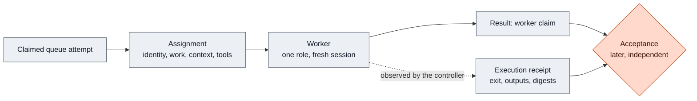

# Delivery workers — understand assignments and execution evidence

> **TL;DR** — A **worker** is a fresh headless session of a coding client, started for one stage and one role. It receives one exact assignment, the pinned context for it and only its role's tools. Whatever it answers is a **claim**: the controller records what really happened separately, and acceptance is a later, independent decision.

> [!IMPORTANT]
> **Experimental.** Assignment and result formats, lease-bound context and observation checks are tested. This guide starts no worker. Autonomous delivery may change in a minor release.



## Inspect the contracts

This reads the bundled schemas; it needs no store, account, model or permission:

```bash
set -euo pipefail
wl --version
wl delivery worker-schema --json | node --input-type=module -e '
import assert from "node:assert/strict"
let input = ""
for await (const chunk of process.stdin) input += chunk
const contracts = JSON.parse(input)
assert.equal(contracts.schema, "wholeloop/delivery-worker-schema@1")
assert.equal(contracts.assignmentSchema.additionalProperties, false)
assert.equal(contracts.resultSchema.additionalProperties, false)
assert.equal(contracts.resultSchema.properties.origin.const, "worker-claim")
assert.equal(contracts.executionSchema.properties.origin.const, "controller-observation")
assert.equal(contracts.executionSchema.properties.acceptance.const, "not-established")
assert.equal(contracts.assignmentSchema.properties.tools.properties.askUser.const, false)
assert.equal(contracts.assignmentSchema.properties.tools.properties.interactive.const, false)
assert.equal(contracts.assignmentSchema.properties.identity.properties.role.enum.length, 7)
console.log("PASS: exact worker claims, separate execution observations and no interactive worker tools")
'
```

```console
1.1.0
PASS: exact worker claims, separate execution observations and no interactive worker tools
```

The check confirms that a result is always labelled `worker-claim`, that an execution is a separate `controller-observation` with `acceptance: not-established`, and that workers have neither an *ask the user* tool nor interactive tools. There are seven roles: `builder`, `verifier`, `reviewer`, `refuter`, `researcher`, `planner` and `challenger`.

## What enters a fresh assignment

| Input | Binding |
| --- | --- |
| Identity | Exact run, immutable plan/revision, role, unit, opaque attempt and fencing generation |
| Authority metadata | Current private grant digest and independent endpoint/intervention axes; metadata creates no grant |
| Work | Source-derived brief, exact selected criteria, contracts and retained finding IDs |
| Candidate | Observed repository commit and workspace byte snapshot |
| Environment | Explicit backend environment, recipe and boundary references; references alone prove no containment |
| Resume pack | Explicit relative artifact paths, byte counts, hashes and audiences; at most 1 MiB total |
| Limits | Current finite run/attempt reservation and original deadline |

Assembling an assignment is read-only:

- Ordinary work comes only from a **current claimed queue attempt**.
- A builder gets its own topic worktree, never your checkout.
- Contract and guidance bytes must match the immutable plan; work under an envelope also needs its derived plan accepted.
- Changed inputs, a stale generation, missing guidance or expired authority refuse the assignment.

## Tools and privacy

| Role | Can |
| --- | --- |
| Builder | Write the implementation, only inside its allocated workspace |
| Reviewer, verifier, refuter | Read the implementation |
| Researcher | Read the implementation, and read providers within its separate read scopes |
| Planner, challenger | Neither: they get no implementation workspace and no generic broker methods |

- Each worker writes to its own output directory, apart from its context and from other workers' files.
- **Private acceptance cases** go only to their own verifier attempt. Shared context and builder or reviewer assignments cannot contain anything labelled as hidden acceptance. The controller must label inputs correctly: a schema cannot detect hidden meaning in a mislabelled document.
- A resume artifact never restores credentials, an old conversation's permissions or a previous fence.

**Workers never ask you anything**, even in supervised mode. They return *blocked*, *unavailable* or an unknown with an owner to the controller, which applies the run's intervention and decision policy. So a `none` run needs no question tool at all.

## Interpret a response honestly

**A complete response** carries the exact assignment and its full identity, a status, a summary, the declared artifacts, the claims about each criterion, findings and unknowns.

It is refused when:

- the identity is missing; it is never reconstructed;
- the output is truncated, not UTF-8 or too large;
- it adds process, authority or human-testing fields;
- it claims criteria outside its scope, or cites evidence that does not exist.

Even a complete result is only a claim: it cannot satisfy testing, gates, publication or merge.

**The execution receipt** is written only by the trusted host. It records the real runtime identity, the exit or cancellation, output digests and whether it was a fixture or a real host. Before recording success, the host checks every claimed artifact's real bytes and the current lease and deadline. A zero exit or a successful model call does not mean the work is accepted, and a failed or cancelled run keeps its limits without inventing a missing exit or result.

There is no command to import a successful receipt, or to mark a worker complete from a JSON file. See the [runner specification](../../roadmap/specifications/autonomous-delivery/02-durable-runner.md) and the [acceptance boundaries](../v1-acceptance.md).

<!-- docnav -->
[◀ Delivery queue](delivery-queue.md)  ·  [📖 Docs index](../README.md)  ·  [🧭 Concepts](../concepts.md)  ·  [Native delivery hosts ▶](delivery-native.md)
