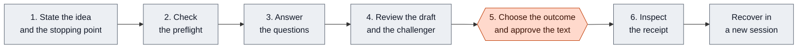

# Your first framing — from a hypothesis to a recoverable decision

> **TL;DR** — Run one framing in your coding client, answer its questions honestly, review the exact final draft and choose an outcome. Ending *on hold* counts as success. Then restart the client and check that the same decision is still there.

**What you will have at the end:** an initiative with your owner name, an explicit decision (go, on hold or dropped) and a final text you approved, stored outside your repository and readable from a new session.



The client's wording changes with the model, so every conversation on this page is **an example**, not a transcript to match word for word. This standalone framing scenario passed live on all seven supported clients ([V1 acceptance](../v1-acceptance.md)).

## Before you start

Complete [getting started](../getting-started.md) for your client. Then choose where to run the exercise:

- **A real application** with a small idea of your own; or
- **A disposable project** for the fictional scenario below.

Do not run the fictional example from the wholeloop source checkout: there is no task list there for it to find.

To create the disposable project:

```bash
demo_project="$(mktemp -d "${TMPDIR:-/tmp}/wholeloop-framing.XXXXXX")"
git -c init.templateDir= init --quiet --initial-branch main "$demo_project"
printf '# Fictional task application\n\nThis repository is a framing exercise, not an implemented or validated product.\n' > "$demo_project/README.md"
cd "$demo_project"
```

None of these commands prints anything. Start your coding client in that directory, with its usual account, model and project trust. No analytics, document or tracker account is needed.

## 1. State the context and stopping point

Ask for the `wl-frame-problem` skill: `wl-agy-frame-problem` on Antigravity, or `/wholeloop:frame-problem` if you installed the Claude plugin instead of loose skills.

```text
Use wl-frame-problem for a fictional task application used only to test
the harness. The idea is title search in a long task list.
I am the owner; ask for my name if needed. This is an unvalidated
hypothesis with no user evidence. Mark the scenario as fictional.
Complete framing only. Keep missing facts as owned TBDs, obtain my
outcome and approval of the exact final reviewed draft, and stop before
specification, code or remote publication.
```

This is a request in the client's conversation, not a shell command. For a real application, replace the fictional premise with its real users, surface and evidence.

## 2. Check the preflight

Before drafting anything, the client shows a **preflight**. Check that it names:

- the initiative and run;
- you as the owner;
- the selected framing template (`frame.template`);
- where the result is stored: local or remote;
- where it will stop.

The default template is fine when your repository has no framing guide of its own. It must not treat another installed copy of wholeloop as guidance about your product.

If the client cannot tell what the application is, give it context rather than letting it invent one. If it offers to research first, decide whether that helps; unknowns can stay unknown, and this exercise is framing only.

## 3. Answer the eight questions

For real work, give your real answers. For the fictional exercise, this set deliberately contains **no invented validation**:

| Question | Exercise answer |
| --- | --- |
| Problem | We hypothesize that people struggle to locate tasks in long lists; nobody has observed it yet |
| Who it is for | People with many tasks; the threshold and segment size are TBD |
| Evidence and hypothesis | No evidence. Separately test whether retrieval is difficult and whether remembering the title is useful |
| Expected impact | Reduce time to locate a task without increasing failed searches; baseline, target and method are TBD |
| Who validated it | Nobody. I will organize validation; do not invent a participant or responsible role |
| Cost and priority | Low priority and not scheduled; effort is TBD |
| Stop conditions | Propose conditions for me to approve; do not silently adopt the challenger's suggestions |
| Scope hint | Consider title search only; matching behavior and implementation remain undecided |

Give your owner name separately. Then check how gaps are written:

- Missing evidence appears as `TBD: <missing evidence>; who: <person or role>`.
- A newly suggested owner for a gap is a proposal; review it before treating it as agreed.
- No baseline number, interview, ticket or validation appears just to fill a field.

## 4. Review the draft and the challenger's findings

Read the draft with three questions in mind:

1. **Is every factual claim supported or marked unknown?** Evidence and hypothesis must stay separate.
2. **Do the decision rules match yours?** Stop, reopen and drop conditions must be what you decided, not extra restrictions the client added while revising.
3. **Was the final text reviewed?** The **challenger**, a reviewer role, should check the final content: problem, evidence, impact and decision rules.

If a later edit resolves the challenger's findings, that new revision needs review again. A structural checker returning `problems: []` is not a semantic review, and no reviewer may be invented.

## 5. Choose the outcome and approve exact wording

| Outcome | You supply | What happens |
| --- | --- | --- |
| **Go** | Your reason and the exact stop conditions you approve | Framing completes, and a specification step is offered; this exercise still stops here |
| **On hold** | A reason and the exact condition for reopening | The initiative closes and keeps the condition; no next step runs |
| **Dropped** | A reason | The initiative closes; no next step runs |

For the exercise, an honest on-hold decision could be:

```text
Choose on-hold. Reason: there is no evidence that the retrieval problem
exists or that title search would solve it.
Reopen when: user evidence confirms difficulty locating tasks and allows
title search to be evaluated.
Do not add segment-size thresholds, extra prerequisites or automatic drop
rules. Show the exact final text after review before completing it.
```

Approve the final revision only when it matches your intent. Behind the scenes, the skill uses two core commands so your decision is tied to that exact text:

- `wl frame draft` renders only the decision data you approved;
- `wl frame finalize` completes the framing only for that draft, identified by its digest, and its review.

The core checks that these match. It cannot authenticate who you are, or prove that the model's judgement is right. [Framing reference](../flow/define/frame-problem.md#final-decision-and-review).

## 6. Inspect the receipt

The run ends with a **receipt**. Save the initiative ID it gives you, then check:

- [ ] The stored text is outside the repository and matches the final draft you approved.
- [ ] `frame-problem` is completed, with the right owner and your exact outcome, reason and reopening condition.
- [ ] For **on hold** or **dropped**: the status is `closed`, with no next step. The outcome itself may appear in the completion receipt rather than in the status.
- [ ] For **go**: the receipt may offer the specification step, but the client stops, as you asked.
- [ ] Local document and tracker receipts point to local records, not to an invented remote URL.

If the decision wording changed, ask for a correction and another final review before completion. If it was already stored, keep that evidence; do not rewrite history to make the first run look successful.

## Recover in a new session

Close the client, open it again in the same project and ask for `wl-status` with your initiative ID. Ask for **status first**, not `wl-next`: status only reads.

You can check the same record from a terminal, with the same store the client used:

```console
$ wl status init-3cf1140a
init-3cf1140a  initiative  open  Find tasks by title in a fictional task app
  owner Demo Owner · updated 2026-11-17
  next: frame-problem

0 unread messages. Add --json for the full status.
```

That example is an initiative whose framing has not finished yet. After an on-hold or dropped decision, the same line shows `closed` and no `next:` step.

| Command | Use it to see |
| --- | --- |
| `wl status <id> --json` | The full status, including pending decisions |
| `wl state get <id> --json` | The stored record and its history |
| `wl resume <id> --json` | The compact context a new conversation receives |

The owner, the completed framing and the decision should agree across all three. Reading status does not mark messages as read, and a new session must not reopen a closed item on its own.

## What counts as finishing this tutorial

You have exercised the framing questions, an explicit decision, a final review and recovery in a new session.

That is narrower than validating every skill, role isolation, a client's hook denial, remote services or a complete go-to-build flow. If you contribute acceptance evidence, record the client, its version, what you observed and the limits, as [V1 acceptance](../v1-acceptance.md#what-evidence-to-return) describes.

Next: [a small change](./small-change.md), [the framing reference](../flow/define/frame-problem.md) or [troubleshooting](../troubleshooting.md).

<!-- docnav -->
[◀ Local core tour](local-core.md)  ·  [📖 Docs index](../README.md)  ·  [🧭 Concepts](../concepts.md)  ·  [Small change ▶](small-change.md)
