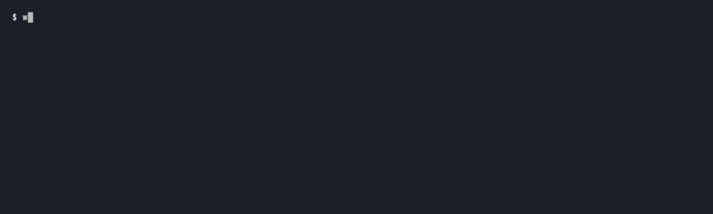

# Local core tour — try wholeloop without a model

> **TL;DR** — In five minutes and a disposable directory, see what the `wl` core does on its own: it asks for a missing fact instead of guessing, starts a framing contract, stores the work outside your project and gives it back to a fresh terminal. No coding client, model account or remote service is needed.

**What you will have at the end:** one stored initiative, seen from two terminals, and a clear idea of which half of wholeloop the core is. The core does not draft anything; drafting is the skill's job, in your coding client, and [first framing](./first-framing.md) covers it.



## Before you start

You need the `wl` CLI ([getting started](../getting-started.md#install-the-cli)) and Git. Everything below happens in a new temporary directory, with its own settings and store, so your real work is untouched and nothing is deleted or published.

## Run the tour

### 1. Create a disposable project and store

Two environment variables point wholeloop at a private configuration and store for this exercise:

```bash
demo_dir="$(mktemp -d "${TMPDIR:-/tmp}/wholeloop-core.XXXXXX")"
git -c init.templateDir= init --quiet --initial-branch main "$demo_dir/project"
export XDG_CONFIG_HOME="$demo_dir/config" XDG_STATE_HOME="$demo_dir/state"
cd "$demo_dir/project"
```

These commands print nothing.

| Variable | Points wholeloop's… | Default without it |
| --- | --- | --- |
| `XDG_CONFIG_HOME` | settings | `~/.config/wholeloop` |
| `XDG_STATE_HOME` | store: your work and history | `~/.local/state/wholeloop` |

### 2. Choose local providers

```console
$ wl setup --profile pair --docs local-docs --tracker local-tracker --scope user
{
  "schema": "wholeloop/setup@1",
  "scope": "user",
  "applied": true,
  "file": "/tmp/wholeloop-core.XXXXXX/config/wholeloop/config.yml",
  …
  "questions": []
}
```

`applied: true` means the settings were written, and only under the demo's configuration directory. Documents and tasks will be kept on disk; no service is involved.

### 3. Start without an owner

```console
$ wl next "Find tasks by title in a fictional task app" --json
{
  "schema": "wholeloop/next@1",
  "action": {
    "step": "frame-problem",
    "command": "wl step begin frame-problem"
  },
  "questions": [
    {
      "id": "owner",
      "prompt": "Who owns this work?",
      …
  "stop": "Complete the returned artifact contract before continuing."
}
$ echo $?
2
```

**Exit code 2 is the expected result here**, not an error. The core needs an owner and will not invent one, so it returns the question and creates nothing.

### 4. Start again with an owner

```console
$ wl next "Find tasks by title in a fictional task app" --owner "Demo Owner" --json
{
  "schema": "wholeloop/next@1",
  …
  "contract": {
    "schema": "wholeloop/step-begin@1",
    "step": "frame-problem",
    "subject": {
      "id": "init-3cf1140a",
      "kind": "initiative"
    },
    "owner": "Demo Owner",
    "missing": [],
    "template": [
      "Problem",
      "Who it is for",
      …
      "Owner"
    ],
    "preflight": [
      "Plan — frame-problem (flow).",
      "Where — external wholeloop store.",
      "Never — merge, send messages externally or change flags.",
      "Stop — on request or at a required decision point."
    ],
    …
}
```

Now the core creates the **initiative** and begins a framing **contract**: the template the skill must fill in and the preflight it must show you. Your ID will differ; copy it from `contract.subject.id`.

The template has nine headings: eight framing questions plus the owner. `questions: []` means the core has what it needs to begin, not that anyone answered the eight framing questions. Asking them is the skill's job.

### 5. Read the work back

```console
$ wl status
init-3cf1140a  initiative  open  Find tasks by title in a fictional task app
  owner Demo Owner · updated 2026-11-17
  next: frame-problem

0 unread messages. Add --json for the full status.
$ wl resume init-3cf1140a --json
{"schema":"wholeloop/resume@1","subject":{"id":"init-3cf1140a","kind":"initiative","title":"Find tasks by title in a fictional task app","owner":"Demo Owner","status":"open",…},"flow":{"next":"frame-problem","available":true,"pending":[],"completed":[]},…,"next":"wl step begin frame-problem --for init-3cf1140a","truncated":false}
$ wl next init-3cf1140a --json
{
  "schema": "wholeloop/next@1",
  "action": {
    "step": "frame-problem",
    …
```

| Command | What it shows | What it proves |
| --- | --- | --- |
| `status` | The same initiative, `open`, next step `frame-problem` | The work exists independently of any conversation |
| `resume` | A compact summary of the work | A client can pick up the context in another session |
| `next <id>` | The same subject, still at framing | Continuing does not invent a finished draft or a second initiative |

<details>
<summary>The whole tour as one script</summary>

Paste this into a Bash or zsh terminal. The subshell keeps the environment changes inside the exercise, and the script checks the expected exit code 2 itself. It prints the demo directory and the initiative ID at the end.

```bash
(
  set -euo pipefail
  demo_dir="$(mktemp -d "${TMPDIR:-/tmp}/wholeloop-core.XXXXXX")"
  mkdir "$demo_dir/project"
  git -c init.templateDir= init --quiet --initial-branch main "$demo_dir/project"
  export XDG_CONFIG_HOME="$demo_dir/config"
  export XDG_STATE_HOME="$demo_dir/state"
  unset WL_WORKSPACE WL_SUBJECT
  cd "$demo_dir/project"

  wl setup --profile pair --docs local-docs --tracker local-tracker --scope user --json

  input_exit=0
  wl next "Find tasks by title in a fictional task app" --json > "$demo_dir/questions.json" || input_exit=$?
  test "$input_exit" -eq 2
  cat "$demo_dir/questions.json"

  wl next "Find tasks by title in a fictional task app" --owner "Demo Owner" --json > "$demo_dir/start.json"
  cat "$demo_dir/start.json"
  initiative_id="$(node -p "JSON.parse(require('node:fs').readFileSync(process.argv[1], 'utf8')).contract.subject.id" "$demo_dir/start.json")"

  wl status "$initiative_id" --json
  wl resume "$initiative_id" --json
  wl next "$initiative_id" --json
  printf 'Demo retained at %s\nInitiative: %s\n' "$demo_dir" "$initiative_id"
)
```

</details>

## Inspect it from another terminal

Open a new terminal and point it at the same store, using the directory and ID the tour printed:

```console
$ export DEMO_DIR="/tmp/wholeloop-core.XXXXXX"
$ XDG_CONFIG_HOME="$DEMO_DIR/config" XDG_STATE_HOME="$DEMO_DIR/state" wl status init-3cf1140a
init-3cf1140a  initiative  open  Find tasks by title in a fictional task app
  owner Demo Owner · updated 2026-11-17
  next: frame-problem

0 unread messages. Add --json for the full status.
```

The work lives in the **store**, `$DEMO_DIR/state/wholeloop`, not in the demo Git repository. Without the same variables, a new terminal reads your usual store and finds nothing: the core remembers nothing about terminal sessions, only what is in the store.

## What this tour does not do

- No model drafted or challenged a framing.
- No person approved a final draft.
- No agent role ran and no service was contacted.

Leave the initiative open, or try the real thing in your client with [first framing](./first-framing.md). Do not mark the tour's preflight as a completed framing.

For everyday work, use your normal store and ask your coding client for the skill you need. For every command and exit code, see [the core reference](../architecture/core-cli.md) and [troubleshooting](../troubleshooting.md#understand-exit-codes).

<!-- docnav -->
[◀ Getting started](../getting-started.md)  ·  [📖 Docs index](../README.md)  ·  [🧭 Concepts](../concepts.md)  ·  [First framing ▶](first-framing.md)
