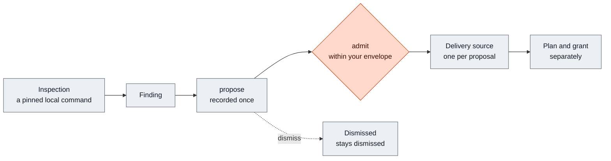

# Maintenance proposals — from a pinned finding to a delivery request

> **TL;DR** — Pin a local **inspection**, such as "find TODO notes in the docs", turn what it finds into a reviewable **proposal**, then **admit** current proposals within limits you set. Each admitted proposal becomes its own delivery request. Nothing changes code, writes to a tracker, plans a run or issues a grant.

> [!IMPORTANT]
> **Experimental.** `wl maintenance`, deduplicated proposals, kept dismissals and once-only admission are tested. Planning and authorizing an admitted run are the [planning](./delivery-plan.md) and [authorization](./delivery-authorization.md) steps.



## Before you start

Install the CLI as in [getting started](../getting-started.md#install-the-cli). The commands below create a disposable Git repository and a separate store; your project and your own store are not touched.

## Inspect and propose

An **inspection** is one local command you pin, run without a shell: its ID, category, repository name, absolute root, the command and the rule it checks. Each line it prints is part of the finding. The **proposal** says what behaviour should change, its scope, criteria, how to validate it and the risks.

The script creates a repository with one stale note, writes both files, inspects, proposes twice and lists the proposals:

<details>
<summary>Inspection script: copy once</summary>

```bash
set -euo pipefail
workspace_dir="$(mktemp -d "${TMPDIR:-/tmp}/wholeloop-maintenance.XXXXXX")"
repo="$workspace_dir/repo"
mkdir -p "$repo"
git -C "$repo" init -q -b main
printf 'Search by title.\nTODO: describe archived tasks.\n' > "$repo/search.md"
git -C "$repo" add search.md
git -C "$repo" -c user.name=Tutorial -c user.email=tutorial@example.test \
  commit -q -m 'docs: add search notes' -m 'Seed a stale note.'
cd "$workspace_dir"
cat > inspection.json <<EOF
{
  "id": "stale-search-docs",
  "category": "stale-docs",
  "repository": "app",
  "root": "$repo",
  "command": ["git", "grep", "-n", "TODO"],
  "rule": "Open TODO notes in documentation are stale."
}
EOF
cat > proposal.json <<'EOF'
{
  "behavior": "Search documentation describes archived tasks.",
  "scope": ["search.md"],
  "criteria": [
    {
      "id": "archived-docs",
      "text": "The search notes describe archived tasks.",
      "test": "The TODO inspection finds nothing in search.md."
    }
  ],
  "validation": "Run the pinned TODO inspection and the documentation check.",
  "risks": ["Readers of the old note need the archived behavior."]
}
EOF
wl maintenance inspect --file inspection.json --json
wl maintenance propose \
  --inspection inspection.json --file proposal.json --store state --json
wl maintenance propose \
  --inspection inspection.json --file proposal.json --store state --json
wl maintenance proposals --store state --json
printf 'Retained tutorial files: %s\n' "$workspace_dir"
```

</details>

The output, one line per command, shortened:

```console
$ wl maintenance inspect --file inspection.json --json
{"schema":"wholeloop/maintenance-inspection@1","inspection":"stale-search-docs","finding":{"category":"stale-docs","repository":"app","base":"9886f074…","evidence":"a78344be…","lines":["search.md:2:TODO: describe archived tasks."]},"effects":{"code":"not-changed","tracker":"not-written"}}
$ wl maintenance propose --inspection inspection.json --file proposal.json --store state --json
{"schema":"wholeloop/maintenance-propose@1","status":"recorded","key":"fe519ef1…","protected":[],"effects":{"code":"not-changed","tracker":"not-written"}}
$ wl maintenance propose --inspection inspection.json --file proposal.json --store state --json
{"schema":"wholeloop/maintenance-propose@1","status":"duplicate","key":"fe519ef1…","protected":[],…}
$ wl maintenance proposals --store state --json
{"schema":"wholeloop/maintenance-proposals@1","proposals":[{"key":"fe519ef1…","inspection":"stale-search-docs","behavior":"Search documentation describes archived tasks.","status":"open",…}],"currency":"not-inspected"}
```

- The first `propose` records the proposal; the second finds the same one and returns `duplicate` with the same key.
- **The proposal file holds no finding.** `propose` runs the inspection itself, so nobody can supply evidence by hand.
- **Protected paths.** A scope path under policy, agent instructions, harness guidance, CI configuration, rubrics, budgets or evaluations is listed in `protected`, and admission refuses it.

## Admit within an envelope

The **envelope** is yours: the operator, the categories and repositories allowed, extra protected paths, limits per run and in total, and the endpoint, `local-handoff` or `to-pr`. `to-merge` is invalid here. Pass the inspections you pin for this admission; a proposal whose inspection is not among them is not admitted.

```bash
cd "$workspace_dir"
printf '[%s]\n' "$(cat inspection.json)" > inspections.json
cat > envelope.json <<'EOF'
{
  "operator": "Tutorial Operator",
  "categories": ["stale-docs"],
  "repositories": ["app"],
  "protectedPaths": [],
  "perRun": { "maxScope": 2, "maxCriteria": 2 },
  "aggregate": { "maxRuns": 3, "windowMs": 604800000 },
  "endpoint": "local-handoff"
}
EOF
wl maintenance admit \
  --envelope envelope.json --inspections inspections.json --store state --json
wl maintenance admit \
  --envelope envelope.json --inspections inspections.json --store state --json
```

```console
$ wl maintenance admit --envelope envelope.json --inspections inspections.json --store state --json
{"schema":"wholeloop/maintenance-admit@1","envelope":"453faf7a…","results":[{"key":"fe519ef1…","admitted":true,"reasons":[],"run":"delivery-d0b8bce41b7a6f7f","source":"214efcbf…"}],"grant":"separate-exact-plan-grant-required","execution":"not-started","next":["wl delivery plan --file <plan-proposal.json>","wl delivery authorize --file <operator-request.json>"]}
$ wl maintenance admit --envelope envelope.json --inspections inspections.json --store state --json
{"schema":"wholeloop/maintenance-admit@1",…,"results":[{"key":"fe519ef1…","admitted":false,"reasons":["already-admitted"],"run":"delivery-d0b8bce41b7a6f7f",…}],…,"next":[]}
```

| Admission | Result |
| --- | --- |
| First | Runs the inspection again, finds the same evidence, `admitted: true`, with a `run` identity and a `source` ID |
| Second | `already-admitted`, with the same run and source: a key is never admitted twice |

The source, in `state/delivery/sources/<source>.json`, lists the behaviour, evidence, scope, criteria and finding, and maps each criterion line with the role `criterion`.

`grant: separate-exact-plan-grant-required` and `execution: not-started` mean exactly that: no plan, journal entry, queue entry or grant exists yet. To continue, write a plan for that `run` from that `source` with `wl delivery plan`, then issue its own grant with `wl delivery authorize`; the `next` list says so.

## Dismiss, expire and refuse

- `wl maintenance dismiss --key <key> --operator <name> --reason <text>` retains the dismissal. The same finding then reports `dismissed` when proposed and when admitted.
- Change or remove the finding in the repository and admission reports `stale-evidence`.
- An invalid inspection, proposal or envelope exits 3 with a fixed message that does not echo the input.
- If another admission is recorded while inspections run, nothing is written and the command asks you to rerun it, because run identities and the aggregate count depend on the admissions it read first.

You have reached the stopping point when there is one admission per proposal and the delivery source carries its mapped criteria. Planning and authorization stay explicit; see [delivery planning](./delivery-plan.md).

<!-- docnav -->
[◀ Delivery planning](delivery-plan.md)  ·  [📖 Docs index](../README.md)  ·  [🧭 Concepts](../concepts.md)  ·  [Delivery authorization ▶](delivery-authorization.md)
