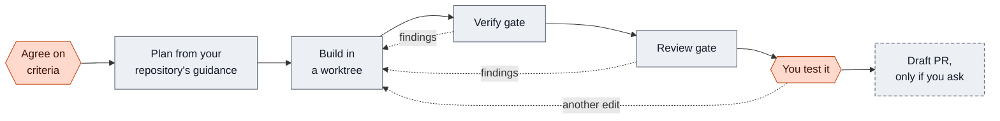

# A small change — criteria, worktree, gates and your testing

> **TL;DR** — Pick a small behaviour in an application you can run. Agree on observable criteria, let the builder work in its own Git worktree, read the verification and review evidence, and test the change yourself before deciding whether to publish it. A larger feature joins the same path after framing, specification and scope approval.

**What you will have at the end:** one change built in an isolated worktree, verified, reviewed and tested by you, and a clear decision on whether to publish it.



How the model behaves and whether publication is possible depend on your client and providers. The conversations below are examples.

## Choose a change you can verify

Use an application repository with a normal test command and a known base branch. Do not build a fictional task app inside the wholeloop source checkout unless that is really your project.

As an example, an existing task app might need to reject an empty title. The criteria below are illustrative; agree on what your application actually needs:

| Criterion | Observable test |
| --- | --- |
| Submitting an empty title creates no task | A repository test asserting that nothing is created or saved |
| The user sees an actionable validation message | A UI or component test, plus your own check in the UI |
| A normal title still creates a task | The existing happy-path test stays green |
| Whitespace behaviour is defined | Agree whether a whitespace-only title counts as empty before writing that test |

The builder should load your repository's own build and test guidance. It must not invent a test command, a UI or an application structure that is not there.

## Start directly with the build skill

In your coding client's conversation:

```text
Use wl-build-slice for a small fix: reject an empty task title in this app.
Show the existing behavior and agree on acceptance criteria first.
Load this repository's build/test guidance and show the plan before edits.
Use the allocated worktree, run verification and review, and stop for my
local testing. Do not push, open a PR, merge or deploy in this exercise.
```

Use your client's prefix; on Antigravity the skill is `wl-agy-build-slice`. You do not need a research brief, a specification or an initiative for a small, agreed fix: `build-slice` is a complete entry point on its own. [How build-slice routes standalone work](../flow/build/build-slice.md).

## Inspect the preflight and implementation plan

Before any edit, check that the preflight shows:

- the acceptance criteria you agreed;
- the repository and its base branch;
- the build and test guidance it selected from your repository;
- the **worktree** assigned to the change: a separate working copy on its own branch;
- the checks that must pass before it finishes.

If the guidance is ambiguous, settle it explicitly. The harness should follow your conventions, not whichever generated skill it happened to find first.

Save the **slice ID**, the worktree path and the run and gate IDs it reports. Check that the worktree holds the intended branch. Your own checkout is never switched.

## Read the evidence, not just the verdict

| Stage | What to inspect | Stop when |
| --- | --- | --- |
| **Build** | The changed files and the plan, against the agreed criteria | The scope drifts or a behaviour appears that nobody agreed |
| **Verification** | The command that actually ran, its receipt, its results and what it did not cover | A check failed or was unavailable, or success is claimed without evidence |
| **Review** | Findings against the current change and your repository's rubric | An important finding is still open |
| **Gate collection** | That every assigned reviewer returned a valid outcome | A worker crashed, timed out or returned something invalid |
| **Hand-off to you** | The worktree path, what to run and the known limits | You cannot reproduce the behaviour yourself |

Three rules keep the evidence honest:

- **A crashed worker is not a refutation.** Missing evidence stays missing.
- **Gates report; the builder repairs.** Findings go back to the builder within the round budget.
- **Stopping with open findings is a valid outcome** when the budget runs out. It is never permission to drop a check or invent a pass.

[Verification](../flow/build/verify-works.md) · [Review](../flow/build/review-code.md) · [Gate rules](../architecture/orchestration-and-gates.md).

## Test it yourself before publication

Open the reported worktree and use your repository's normal setup and test instructions. Try the empty title, a normal title and the whitespace behaviour you agreed. Then tell the client what happened and which revision you tested.

If it needs another edit, return your observation to the builder; the relevant checks run again on the new revision. **Approving an earlier version does not approve later changes.**

The exercise can end here. When you do want a draft pull request, ask for `wl-open-pr` with the exact tested work:

- publication follows a plan you can see first, and needs your test and approval;
- if a remote result is pending or lost, it is reconciled, never blindly repeated;
- the harness does not merge.

[Draft publication](../flow/build/open-pr.md).

## Use the full flow for a larger feature

When the problem or the solution is not agreed yet, start with `wl-next` or `wl-frame-problem`:

| Stage | Request | What you decide or provide |
| --- | --- | --- |
| Frame | `wl-frame-problem` | The evidence, the outcome and the exact final text |
| Specify | `wl-write-spec` | The stories, criteria, measurement plan and assumptions |
| Cut deliverables | `wl-cut-scopes` | What ships separately, and who owns which metric |
| Slice | `wl-slice-work` | Vertical slices, their tests, dependencies and contract-first parts |
| Build | `wl-build-slice` | The worktree, gates and testing described above |
| Prepare rollout | `wl-prepare-launch` | Launch drafts and measurement readiness; nothing is sent |
| Ramp | `wl-ramp-exposure` | Each stage of the rollout; flag changes stay explicit and separate |
| Measure | `wl-measure-impact` | Real observations with their sources, or unknowns with an owner |
| Decide | `wl-decide-next` | Keep, iterate, kill or unflag, based on the evidence shown |

Merging, deploying, sending messages and changing flags stay **outside** the harness. Providers are chosen when a step needs one; you do not need an account with every vendor. A skipped step or a measurement exception is recorded explicitly, even in a small example. [The complete flow](../flow/README.md).

## Other useful standalone requests

| Need | Request in the coding client | Stops at |
| --- | --- | --- |
| Look at the evidence before choosing a feature | `wl-research` on the question, keeping unknowns | The brief and its limits |
| Inspect an existing branch | `wl-review-code` against its real base, without edits or published comments | Findings with evidence |
| See unfinished work after a restart | `wl-status` with the ID | The current state and pending decisions; it only reads |
| Continue that work | `wl-next` with the same ID | The next required decision |

To look from a terminal, use the [core commands](../architecture/core-cli.md), not the skill names. For setup problems or missing state, see [troubleshooting](../troubleshooting.md).

<!-- docnav -->
[◀ First framing](first-framing.md)  ·  [📖 Docs index](../README.md)  ·  [🧭 Concepts](../concepts.md)  ·  [Local client setup ▶](../platforms/local-onboarding.md)
