# Roadmap — built in vertical phases, worked in session-sized tasks

> **TL;DR** — Seven phases, each split into tasks with goals, deliverables, acceptance criteria, tests and docs. The expanded 1.0 adds recoverable autonomous delivery and complete unattended research. Phase 6 is accepted for 1.0 and sequential implementation is authorized; P6-01–P6-21, P6-23, P6-25, P6-26, P6-28–P6-30, P6-31, P6-34 and P6-36–P6-38 are complete; P6-22, P6-24, P6-32 and P6-33 are implemented and await native or hosted acceptance, and 2 tasks remain in progress or await implementation.

---

Current manual checks and maintainer-only actions: [manual verification](./manual-verification.md). Start with the [V1 acceptance runbook](../docs/v1-acceptance.md) for executable trials, expected results and the distinction between maintainer decisions, implementation work and deferred service certification.

## Expanded 1.0 review

Start with the [autonomous-delivery specification](./specifications/autonomous-delivery/README.md), then the [38 Phase 6 tasks](./phase-6-autonomous-delivery.md). Every new task was reviewed and accepted on 2026-10-24, with authorization for sequential implementation, pragmatic decisions, tests/docs and incremental commits without further signals. The design includes zero-intervention research and implementation after one initial authorization, actual behavioral QA, integrated milestones, PR delivery and a separately authorized conditional merge.

The roadmap now contains 92 tasks: 72 completed tasks (forty original plus P6-01–P6-21, P6-23, P6-25, P6-26, P6-28–P6-30, P6-31, P6-34 and P6-36–P6-38), fourteen original open tasks, four implemented tasks awaiting native or hosted acceptance and 2 new pending implementation/acceptance tasks (P6-35–P6-38 added on 2026-11-04). The previous “implementation complete, acceptance remaining” assessment applied to the original 54-task scope. Original successes/failures remain unchanged; the expanded scope introduces real implementation work.

No cloud platform, marketplace, vendor API expansion or production automation is added. Local P6 implementation is authorized to proceed without waiting for unrelated native/account acceptance. Those original checks and the new capability-specific acceptance still need their stated evidence before release.

## Phases

```mermaid
flowchart LR
  P0["P0 · Foundations<br/>toolchain · checks · spikes"]:::core --> P1["P1 · Walking skeleton<br/>core + 4 CLIs + one step"]:::define
  P1 --> P2["P2 · Define<br/>research → cut-scopes"]:::define
  P2 --> P3["P3 · Build<br/>slices · worktrees · gates · PRs"]:::build
  P3 --> P4["P4 · Rollout & Learn<br/>launch · ramp · measure · decide"]:::rollout
  P4 --> P5["P5 · Reach & release<br/>tier B · headless · distribution"]:::learn
  P5 --> P6["P6 · Autonomous delivery<br/>unattended research · integrated QA"]:::build
  P6 --> V1["P5-07 · Expanded 1.0 release"]:::learn
  classDef core fill:#eceff3,stroke:#5b6573,color:#111827;
  classDef define fill:#d9f2e3,stroke:#1f7a45,color:#0b2e1a;
  classDef build fill:#dce9fb,stroke:#2f6fc4,color:#0b1f3a;
  classDef rollout fill:#fbecd0,stroke:#b7791f,color:#3a2606;
  classDef learn fill:#f6dcef,stroke:#b03a8c,color:#3a0b2c;
```



| Phase | Outcome — "done" means | Tasks |
| --- | --- | --- |
| [P0 · Foundations](./phase-0-foundations.md) | The repo builds, tests and checks itself; every ❓ in the platform matrix is answered | 7 |
| [P1 · Walking skeleton](./phase-1-walking-skeleton.md) | `frame-problem` runs end to end, standalone and via `next`, on all four tier-A CLIs, from one source | 14 |
| [P2 · Define](./phase-2-define.md) | An idea becomes an approved spec and scopes, with real providers and research | 9 |
| [P3 · Build](./phase-3-build.md) | A slice is built in a worktree, verified, reviewed and opened as a draft PR | 10 |
| [P4 · Rollout & Learn](./phase-4-rollout-learn.md) | The loop closes: launch kit, ramp evidence, measured impact, recorded decision | 7 |
| [P5 · Reach & release](./phase-5-reach-release.md) | Tier B CLIs, headless engine, nightly conformance, 1.0 published | 7 |
| [P6 · Autonomous delivery](./phase-6-autonomous-delivery.md) | Recoverable no-intervention research/implementation, actual integrated QA, authorized PR/merge and evaluation; before P5-07 | 38 |

Phase IDs preserve the existing history: P6 is inside expanded 1.0 and precedes final P5-07 closure. Tasks follow their explicit dependencies and any phase review hold; the diagram is an overview, not a requirement to wait for unrelated manual checks.

## Task format

```markdown
## P1-05 · Flow engine and the step contract

**Status:** ⬜ · **Size:** M · **Depends on:** P1-02, P1-03

**Goal** — one sentence: why this task exists.

**Deliverables** — what exists afterwards (code, tests, docs).

**Acceptance criteria:**

- [ ] observable, testable statements

**Docs** — pages whose status banner or content this task changes.
```

| Status | Meaning |
| --- | --- |
| ⬜ | To do |
| 🔄 | In progress — exactly one task at a time per contributor |
| ✅ | Done — acceptance criteria checked, docs updated, journal entry written |
| ⏸️ | Blocked or parked — the journal says why |

| Size | Roughly |
| --- | --- |
| **S** | Under half a session |
| **M** | One session |
| **L** | Two sessions — split it if you can |

## Working in sessions

1. **Orient.** Read [`AGENTS.md`](../AGENTS.md), the last three [journal](./journal.md) entries, and the current phase file.
2. **Pick.** The first ⬜ task whose dependencies are ✅ and whose phase is authorized and not on review hold. Mark it 🔄 in the phase file.
3. **Do it end to end.** Code, tests and docs land together. Keep files inside the [size budgets](../docs/decisions/0011-size-budgets-and-enforcement.md).
4. **Check.** Every acceptance criterion ticked, all local checks green.
5. **Record.** Mark the task ✅, add a journal entry (what changed, decisions taken, follow-ups), update status banners in the docs.
6. **Commit.** Conventional commits, one concern each, no tool attribution ([ADR-0017](../docs/decisions/0017-no-tool-attribution-in-history.md)). During the bootstrap, commits go **straight to `main`** — no branches, no PRs — until the maintainer announces the switch (see [AGENTS.md](../AGENTS.md)).

A decision that changes the design goes into a new ADR in the same change — never only into the journal.

## Changing the roadmap

The roadmap is a living plan, not a contract. Splitting, reordering or dropping tasks is normal; do it in a `docs(roadmap): …` commit with a journal line explaining why.

---

[📓 Journal](./journal.md)  ·  [P0 ▶](./phase-0-foundations.md)
