# Roadmap — built in vertical phases, worked in small tasks

> **TL;DR** — Eight phases, each split into tasks with goals, deliverables, acceptance criteria, tests and docs. The expanded 1.0.0 adds recoverable autonomous delivery and complete unattended research; Phase 7 prepares the repository and the public release. In Phase 6, P6-01–P6-21, P6-23, P6-25, P6-26, P6-28–P6-30, P6-31, P6-34 and P6-36–P6-39 are complete; P6-22, P6-24 and P6-33 are implemented and await native or hosted acceptance, P6-40 is complete, and P6-27 and P6-35 remain in progress or await implementation. In Phase 7, P7-01–P7-08 and P7-16 are complete, P7-09 is prepared and awaits the maintainer's switch to pull requests, and six tasks are planned.

---

Current manual checks and maintainer-only actions: [manual verification](./manual-verification.md). Start with the [V1 acceptance runbook](../docs/v1-acceptance.md) for executable trials, expected results and the distinction between maintainer decisions, implementation work and deferred service certification.

**Runtime performance:** no longer a release blocker. On 2026-11-07 the maintainer withdrew the initial five-second controller ceiling, which had been set before its consequences were known, and closed P6-39 at the measured state: the complete model-free EVAL-09 route takes 68–72 seconds, about 40 of them wholeloop overhead. A future performance problem is handled as an ordinary defect; see the [executed audit ledger](./performance-audit.md) and [ADR-0227](../docs/decisions/0227-verified-read-observation-scopes.md).

## Expanded 1.0 review

Start with the [autonomous-delivery specification](./specifications/autonomous-delivery/README.md), then the [39 Phase 6 tasks](./phase-6-autonomous-delivery.md). The original Phase 6 scope was accepted on 2026-10-24; P6-35–P6-38 were added on 2026-11-04 and P6-39 on 2026-11-05, retaining authorization for sequential implementation, pragmatic decisions, tests/docs and incremental commits without further signals. The design includes zero-intervention research and implementation after one initial authorization, actual behavioral QA, integrated milestones, PR delivery and a separately authorized conditional merge.

The roadmap now contains 107 tasks: 83 completed tasks (forty original plus P6-01–P6-21, P6-23, P6-25, P6-26, P6-28–P6-31, P6-34, P6-36–P6-40, P7-01–P7-08 and P7-16), twelve original open tasks in P0–P5, three Phase 6 tasks implemented and awaiting native or hosted acceptance, two pending Phase 6 implementation/acceptance tasks (P6-27 and P6-35) and seven open Phase 7 tasks (P6-35–P6-38 added on 2026-11-04, P6-39 on 2026-11-05, P6-40 and Phase 7 on 2026-11-07, absorbing P5-05, P5-07 and P6-32 as P7-14, P7-15 and P7-13). The previous “implementation complete, acceptance remaining” assessment applied to the original 54-task scope. Original successes/failures remain unchanged; the expanded scope introduces real implementation work.

No cloud platform, marketplace, vendor API expansion or production automation is added. Local P6 implementation is authorized to proceed without waiting for unrelated native/account acceptance. Those original checks and the new capability-specific acceptance still need their stated evidence before release.

## Phases

```mermaid
flowchart LR
  P0["P0 · Foundations<br/>toolchain · checks · spikes"]:::core --> P1["P1 · Walking skeleton<br/>core + 4 CLIs + one step"]:::define
  P1 --> P2["P2 · Define<br/>research → cut-scopes"]:::define
  P2 --> P3["P3 · Build<br/>slices · worktrees · gates · PRs"]:::build
  P3 --> P4["P4 · Rollout & Learn<br/>launch · ramp · measure · decide"]:::rollout
  P4 --> P5["P5 · Reach & release<br/>tier B · headless · distribution"]:::learn
  P5 --> P6["P6 · Autonomous delivery<br/>unattended research · integrated QA"]:::build
  P6 --> P7["P7 · Release readiness<br/>maintenance · security · docs · launch"]:::core
  P7 --> V1["P7-15 · 1.0.0"]:::learn
  classDef core fill:#eceff3,stroke:#5b6573,color:#111827;
  classDef define fill:#d9f2e3,stroke:#1f7a45,color:#0b2e1a;
  classDef build fill:#dce9fb,stroke:#2f6fc4,color:#0b1f3a;
  classDef rollout fill:#fbecd0,stroke:#b7791f,color:#3a2606;
  classDef learn fill:#f6dcef,stroke:#b03a8c,color:#3a0b2c;
```



| Phase | Outcome — "done" means | Tasks |
| --- | --- | --- |
| [P0 · Foundations](./phase-0-foundations.md) | The repo builds, tests and checks itself; every ❓ in the platform matrix is answered | 7 |
| [P1 · Walking skeleton](./phase-1-walking-skeleton.md) | `frame-problem` runs end to end, standalone and via `next`, on all four tier-A CLIs, from one source | 14 |
| [P2 · Define](./phase-2-define.md) | An idea becomes an approved spec and scopes, with real providers and research | 9 |
| [P3 · Build](./phase-3-build.md) | A slice is built in a worktree, verified, reviewed and opened as a draft PR | 10 |
| [P4 · Rollout & Learn](./phase-4-rollout-learn.md) | The loop closes: launch kit, ramp evidence, measured impact, recorded decision | 7 |
| [P5 · Reach & release](./phase-5-reach-release.md) | Tier B CLIs, headless engine, nightly conformance; distribution and the release moved to P7 | 5 |
| [P6 · Autonomous delivery](./phase-6-autonomous-delivery.md) | Recoverable no-intervention research/implementation, actual integrated QA, authorized PR/merge and evaluation | 39 |
| [P7 · Release readiness](./phase-7-release-readiness.md) | Maintainer skills and agents, service access only through MCP or installed clients, supply-chain checks, automated release with one approval, user README and docs, public repository, 1.0.0 | 16 |

Phase IDs preserve the existing history: P6 is inside expanded 1.0.0, and P7 closes it with P7-15. Moved tasks keep a redirect at their former heading. Tasks follow their explicit dependencies and any phase review hold; the diagram is an overview, not a requirement to wait for unrelated manual checks.

## Task format

```markdown
## P1-05 · Flow engine and the step contract

**Status:** ⬜ · **Size:** M · **Depends on:** P1-02, P1-03

**Goal** — one sentence: why this task exists.

**Deliverables** — what exists afterwards (code, tests, docs).

**Acceptance criteria:**

- [ ] observable, testable statements

**Docs** — pages whose status banner or content this task changes.
```

| Status | Meaning |
| --- | --- |
| ⬜ | To do |
| 🔄 | In progress — exactly one task at a time per contributor |
| ✅ | Done — acceptance criteria checked, docs updated, journal entry written |
| ⏸️ | Blocked or parked — the journal says why |

| Size | Roughly |
| --- | --- |
| **S** | A narrow change: one module or document |
| **M** | One complete feature with its tests and docs |
| **L** | Several connected changes — split it if you can |

## Working on a task

1. **Orient.** Read [`AGENTS.md`](../AGENTS.md), the last three [journal](./journal.md) entries, and the current phase file.
2. **Pick.** The first ⬜ task whose dependencies are ✅ and whose phase is authorized and not on review hold. Mark it 🔄 in the phase file.
3. **Do it end to end.** Code, tests and docs land together. Keep files inside the [size budgets](../docs/decisions/0011-size-budgets-and-enforcement.md).
4. **Check.** Every acceptance criterion ticked, all local checks green.
5. **Record.** Mark the task ✅, add a journal entry (what changed, decisions taken, follow-ups), update status banners in the docs.
6. **Commit.** Conventional commits, one concern each, no tool attribution ([ADR-0017](../docs/decisions/0017-no-tool-attribution-in-history.md)). During the bootstrap, commits go **straight to `main`** — no branches, no PRs — until the maintainer announces the switch (see [AGENTS.md](../AGENTS.md)).

A decision that changes the design goes into a new ADR in the same change — never only into the journal.

## Changing the roadmap

The roadmap is a living plan, not a contract. Splitting, reordering or dropping tasks is normal; do it in a `docs(roadmap): …` commit with a journal line explaining why.

---

[📓 Journal](./journal.md)  ·  [P0 ▶](./phase-0-foundations.md)
