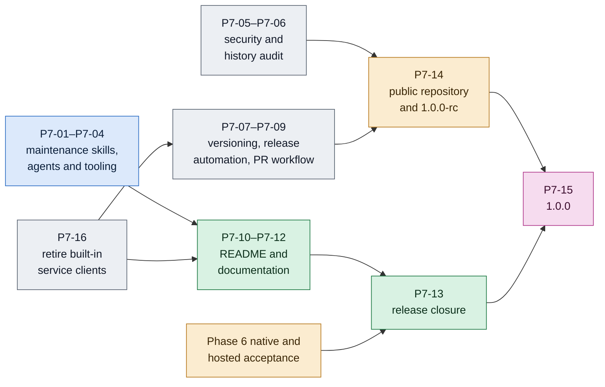

# Phase 7 — Release readiness and public launch

> **Outcome** — The repository maintains itself with its own skills and agents, releases are automated up to one human approval, supply-chain and history risks are checked, users meet a README written for them and contributors a guide written for them, and wholeloop 1.0.0 is public, published and announced.

> [!NOTE]
> **Status: 🔄 in progress · added on 2026-11-07 for 1.0.0; P7-01–P7-05 and P7-16 complete.** The maintainer adds this phase as the final step before the first public release. It absorbs the release tasks that were spread over earlier phases: P5-05 becomes P7-14, P5-07 becomes P7-15 and P6-32 becomes P7-13; their former headings remain as redirects so existing links keep working. P7-01–P7-12 and P7-16 do not depend on native or hosted acceptance and can proceed while the Phase 6 campaign runs. P7-16, added the same day, retired the built-in service clients on 2026-11-07, before the versioning, README and documentation work.

Versions are always full semantic versions: the first public release is `1.0.0`, preceded by release candidates such as `1.0.0-rc.1` on the npm `next` dist-tag.

## Decisions taken when the phase was added

| Topic | Decision |
| --- | --- |
| Repository maintenance tools | Dogfooding: maintainer skills and agents are authored once in wholeloop's canonical format and rendered for every supported client by the repository's own generator. The rendered files are committed, so contributors use them natively without installing `wl`; only editing them requires the repository build. |
| Publication | Everything is automated except one explicit maintainer approval in the protected release environment. |
| First publication | A release candidate on `next` precedes `1.0.0` on `latest`. |
| Contribution workflow | Pull requests replace direct commits to `main` before the repository becomes public. |
| History scan | gitleaks, run through Docker so it adds no project dependency, before the repository becomes public. |
| Visibility before publication | npm cannot generate provenance from a private source repository, even for a public package ([npm trusted publishers](https://docs.npmjs.com/trusted-publishers)). The repository therefore becomes public before the first release candidate is published. |
| Service access | wholeloop never talks to a third-party service itself: only through MCP servers of the user's client or command-line clients the user installed (P7-16). |
| Root README | Half story, half user guide: what wholeloop is, why the loop exists and how to install and use it, written to convince a new user. Source builds and development setup move to the contributor documentation. |

## Order

---

## P7-01 · Repository maintenance design

**Status:** ✅ · **Size:** S · **Depends on:** —

**Goal** — Decide where the repository's own skills and agents live and how they reach every client, without confusing them with the harness wholeloop ships.

**Deliverables** — An ADR covering the canonical source directory for maintainer skills and agents, how the existing generator renders them per client, where the rendered files are committed, how a check keeps source and rendered files in sync, how unsupported capabilities are marked per client, and the size budgets and front-matter rules they follow. A stub skill rendered for every supported client proves the path end to end.

**Acceptance criteria:**

- [x] Maintainer tools are clearly separate from the shipped harness: nothing in them is packaged or installed for users.
- [x] A contributor who clones the repository gets the rendered skills in each supported client without running `wl`.
- [x] Editing a rendered file by hand, or a source without regenerating, fails `npm run check`.

**Evidence** — [ADR-0246](../docs/decisions/0246-dogfooded-maintainer-skills-and-agents.md). `maint-check` renders into all seven clients' project directories and Claude Code picked it up on disk. `test/unit/maintainer/render.test.ts` covers per-client rendering, drift on hand edits, unrendered source edits and stale files, source budgets and front matter, and the absence of maintainer code from the bundle; the package check still publishes exactly five files. `npm run check` runs `maintainer:check`.

**Tests** — Generation golden files per client; a drift test for the sync check; package allowlist test showing no maintainer file is published.

**Docs** — The new ADR, contributing guide, authoring guide, `enforcement.yml`.

## P7-02 · Maintainer workflow skills

**Status:** ✅ · **Size:** M · **Depends on:** P7-01

**Goal** — Make the repository's own working agreement executable by any coding client.

**Deliverables** — Skills for: starting a roadmap task (the session loop in AGENTS.md), closing a task (criteria, journal, status banners, counts, docnav), amending an existing ADR instead of adding one per fix, adding a provider, a client adapter or a shipped skill by following the authoring guide, preparing a release, triaging an issue, and investigating a performance problem with the tools from P7-04.

**Acceptance criteria:**

- [x] Each skill is original work, within its size budget and rendered for every supported client.
- [x] Each skill names the repository checks it relies on rather than restating them.
- [x] Skills never commit, push, publish or change repository settings on their own.

**Evidence** — Seven workflow skills plus `maint-check`, rendered for all seven clients. `test/unit/maintainer/skills.test.ts` checks that each names checks that exist (every `npm run` script and repository path it cites), never instructs a commit, push, tag, publication or settings change except to forbid it, and the deterministic part of closing a task: `scripts/roadmap-status.mjs` counts tasks from the phase files and `npm run roadmap:check`, now a gate step, fails when `roadmap/README.md` disagrees. The test caught three skills without the no-commit statement and one naming no check before they were fixed. The release commands the release skill cites were run.

**Tests** — Front matter, budgets and rendering through `harness:check`; a workflow test per skill with stubbed agents where its behaviour is deterministic.

**Docs** — Contributing guide, authoring guide.

## P7-03 · Maintainer specialist agents

**Status:** ✅ · **Size:** M · **Depends on:** P7-01

**Goal** — Give contributors read-only reviewers that know this repository's rules.

**Deliverables** — Agents for: convention review (docs style, no tool attribution, size budgets, Conventional Commits, English on disk), documentation audit (banners, TL;DR, links, generated references), security and dependency audit, and release management (notes, changelog, version, checklist).

**Acceptance criteria:**

- [x] Reviewing agents are read-only in every client that can enforce it; where a client cannot, the limitation is stated.
- [x] Every finding an agent reports cites the rule it comes from.

**Evidence** — Four read-only agents, rendered for all seven clients. `test/unit/maintainer/agents.test.ts` checks each client's read-only mapping (Claude plan mode and disallowed write tools, Codex without shell, OpenCode deny-by-default, Copilot, Gemini and Antigravity without write or shell tools, Cursor `readonly`), that the Codex render states it cannot enforce read-only itself, and that every agent defines a `rule` field and cites existing sources.

**Tests** — Role and permission mapping per client; budgets and front matter through `harness:check`.

**Docs** — Contributing guide, authoring guide.

## P7-04 · Performance investigation tooling

**Status:** ✅ · **Size:** S · **Depends on:** —

**Goal** — Keep the method used in the P6-39 audit available for the day a performance problem appears.

**Deliverables** — The measurement-only preloads (calibrated phase profiler, caller attribution, memory peaks) and the equivalence comparison promoted to `scripts/perf/`, with a short guide. They record no arguments, environments, prompts or bodies.

**Acceptance criteria:**

- [x] One documented command produces a per-phase table and caller attribution for the model-free EVAL-09 rehearsal.
- [x] A calibration script verifies the counters before a measurement is trusted.
- [x] No preload is loaded by the shipped CLI.

**Evidence** — `npm run perf:route -- --callers` ran the model-free EVAL-09 rehearsal end to end on 2026-11-07 and printed per-phase tables for the CLI, controller and bundled eval runner, with top callers per phase and no overflow; `compare.mjs` reproduced an equivalent outcome on that run. `npm run perf:calibrate` and `test/unit/perf/preload.test.ts` check the counters, the privacy of a profile and that neither bundle references the preload. The tools came from the audit's own preload and comparison scripts, generalised and given caller attribution and memory peaks.

**Tests** — Calibration control; a privacy test showing no raw argument or environment value is written.

**Docs** — Determinism and testing, performance audit ledger.

## P7-05 · Supply-chain and security automation

**Status:** ✅ · **Size:** M · **Depends on:** —

**Goal** — Detect vulnerable or risky dependencies and code patterns before they reach a release.

**Deliverables** — Dependabot for npm and for the SHA-pinned GitHub Actions; dependency review on pull requests; CodeQL; OpenSSF Scorecard; `npm audit signatures`; a dependency license allowlist check; an SBOM attached to every release.

**Acceptance criteria:**

- [x] Every workflow keeps least-privilege permissions and SHA-pinned actions.
- [x] A dependency with a disallowed license or a high-severity runtime advisory fails CI.
- [x] Each tool's findings have a documented triage path.

**Evidence** — The package declares no runtime dependencies, so the previous `npm audit --omit=dev` audited nothing that ships; `scripts/check-dependencies.mjs` reads esbuild's metafile, finds the 11 bundled packages, requires permissive licences for them and reviewed ones for development tools (a gate step), fails CI on high or critical advisories in bundled packages, and writes the CycloneDX SBOM that release preparation now hashes and attaches. `test/unit/ci/supply-chain.test.ts` lints every workflow for top-level read-only permissions, SHA-pinned actions with version comments and no `pull_request_target`, and covers the licence evaluator, advisory filter and SBOM with fixtures. `npm audit signatures` verified 73 attestations locally. The hosted runs of CodeQL, Scorecard, dependency review and Dependabot, and enabling them in the repository settings, are in manual verification.

**Tests** — License check fixtures; workflow linting.

**Docs** — `SECURITY.md`, contributing guide, releasing guide.

## P7-06 · Pre-publication repository audit

**Status:** ⬜ · **Size:** S · **Depends on:** —

**Goal** — Make sure nothing in the source or its history should stay private.

**Deliverables** — A gitleaks scan of the complete history through Docker, plus a review of personal data, local absolute paths, large files, fixture licenses and neutral wording (no mention of the tools or sessions that helped build the repository). Findings and their resolution are recorded without copying any secret.

**Acceptance criteria:**

- [ ] gitleaks reports no unresolved finding on the full history.
- [ ] Any history rewrite is the maintainer's explicit decision and happens before the repository is public.
- [ ] The scan is repeated on the final history immediately before the visibility switch in P7-14.

**Tests** — A reproducible scan command with a pinned image digest.

**Docs** — Releasing guide, journal.

## P7-07 · Versioning policy and changelog

**Status:** ⬜ · **Size:** S · **Depends on:** P7-16

**Goal** — Make every version and its changes predictable for users and extension authors.

**Deliverables** — A versioning policy with full `x.y.z` versions, what counts as a breaking change (schemas frozen at version 1 and the existing deprecation policy), pre-release identifiers and npm dist-tags; a `CHANGELOG.md` generated from Conventional Commits with the existing release-note engine.

**Acceptance criteria:**

- [ ] The changelog is generated, never hand-edited, and contains no tool attribution.
- [ ] A breaking change cannot be released under a minor or patch version.

**Tests** — Changelog generation from fixture commit ranges, including breaking markers and rejected subjects.

**Docs** — Releasing guide, compatibility policy, ADR-0068.

## P7-08 · Release automation

**Status:** ⬜ · **Size:** M · **Depends on:** P7-05, P7-07

**Goal** — Automate the whole release except the maintainer's approval.

**Deliverables** — A release workflow that prepares a release pull request with the version and changelog; on merge it creates the tag and the GitHub Release with notes, native delivery trees and SBOM, then waits for approval in the protected environment before publishing to npm with OIDC and provenance. A post-publication job installs the package from npm on a clean runner and runs `wl --version` and `wl doctor`. A deprecate-and-supersede procedure covers a bad release.

**Acceptance criteria:**

- [ ] The only manual step is the approval of the protected release environment.
- [ ] Publication never rebuilds: it publishes the exact reviewed artifacts.
- [ ] A failed post-publication check marks the release as failed and names the recovery procedure.

**Tests** — Workflow ordering and failure tests with synthetic publication, extending the existing release tests.

**Docs** — Releasing guide, ADR-0068, ADR-0069.

## P7-09 · Pull-request contribution workflow

**Status:** ⬜ · **Size:** S · **Depends on:** P7-05

**Goal** — Switch from the bootstrap workflow to reviewed pull requests before the repository is public.

**Deliverables** — Branch rules for `main` with required checks, CODEOWNERS, an updated pull request template, and the bootstrap line in AGENTS.md replaced as AGENTS.md itself prescribes, with the switch recorded in the journal.

**Acceptance criteria:**

- [ ] `main` accepts changes only through pull requests with passing required checks.
- [ ] Contributor and agent instructions describe the same workflow.

**Tests** — Commit-message and PR checks in CI.

**Docs** — AGENTS.md, contributing guide, pull request template, journal.

## P7-10 · Root README for users

**Status:** ⬜ · **Size:** M · **Depends on:** P7-07, P7-16

**Goal** — Make the README the place where a new user understands wholeloop and decides to use it.

**Deliverables** — A README that is half story and half user guide: what wholeloop is, the philosophy and the loop, why it beats ad hoc prompting, installation from npm, installing it into a client with `wl install`, a first skill, practical examples, supported clients and links into the documentation. It contains no roadmap counts and no source build. Cloning, building, tests, gates, Docker and hooks move to the contributing guide and a new `docs/contributing/development.md`.

**Acceptance criteria:**

- [ ] A reader who has never seen the project can say what `wl` is and install it from the README alone.
- [ ] Every command in the README runs against the published package (verified in P7-14).
- [ ] Development instructions exist only in the contributor documentation.

**Tests** — Docs check and Markdown lint; README commands executed against the release candidate in P7-14.

**Docs** — README, contributing guide, `docs/contributing/development.md`, getting started.

## P7-11 · User documentation pass

**Status:** ⬜ · **Size:** L · **Depends on:** P7-10, P7-16

**Goal** — Bring every user-facing page to release quality.

**Deliverables** — Every page under `docs/` reviewed: accurate status banners for 1.0.0, TL;DR, working links, generated references current, tutorials that run as written, FAQ, troubleshooting and glossary. Pages written as roadmap or acceptance tracking get user-facing wording or move under the roadmap.

**Acceptance criteria:**

- [ ] No user page describes released behaviour as planned, or planned behaviour as released.
- [ ] Every tutorial has been executed against the release candidate or states what it needs.

**Tests** — Docs check, link check, Markdown and diagram lint.

**Docs** — All of `docs/`.

## P7-12 · Code and contributor documentation pass

**Status:** ⬜ · **Size:** M · **Depends on:** P7-02, P7-03

**Goal** — Make the code and the contributor guides easy to understand for someone new.

**Deliverables** — Module headers that explain why each module exists, comments on constraints where they are missing and noise removed; architecture overview, AGENTS.md and authoring guide current, including the maintainer skills and agents.

**Acceptance criteria:**

- [ ] Every source module states its purpose in one short header.
- [ ] Comments explain constraints and rejected alternatives, not what the code already says.

**Tests** — Lint and docs check.

**Docs** — `docs/architecture/`, `docs/contributing/`, AGENTS.md.

## P7-13 · Expanded 1.0.0 documentation and release closure

Moved from P6-32 on 2026-11-07; its history and checked criteria are unchanged.

**Status:** ⏸️ · **Size:** M · **Depends on:** P6-27, P6-28, P6-29, P6-30, P6-31, P6-33, P6-34, P6-35, P6-36, P6-37, P6-38, P6-40, P5-06, P7-11, P7-12

**Design review:** accepted on 2026-10-24 · **Release:** 1.0.0

**Goal** — Ship only the expanded capabilities and evidence actually implemented and accepted.

**Deliverables** — Updated ADRs, schemas/migrations, generated references, skills/guards/enforcement, operator tutorials and reconciled release/native/manual matrix.

**Acceptance criteria:**

- [x] All applicable specification case IDs map to concrete tests/enforcers and stated evidence-level results.
- [x] Source-installable docs explain supervised/on-exception/none and report-to-PR-to-merge boundaries without claiming unsupported clients.
- [x] Original native/runtime/release obligations remain explicit; the 1.0.0 release (P7-15, formerly P5-07) cannot close before this task and its original prerequisites.

**Tests** — AUTH-01–AUTH-08, DEC-01–DEC-06, RUN-01–RUN-09, ENV-01–ENV-07, QA-01–QA-08, INT-01–INT-07, REL-01–REL-10, OPS-01–OPS-07, LEARN-01–LEARN-06, RSR-01–RSR-06 and EVAL-01–EVAL-12 at their required evidence levels; complete local checks and explicit commit-range validation.

**Docs** — [Detailed contract](./specifications/autonomous-delivery/09-validation-and-acceptance.md); README, all affected docs, acceptance, roadmap and journal.

**Completed technical work** — By the maintainer's instruction, implement local documentation/release controls before remaining native/account prerequisites. The acceptance map now retains all 86 accepted cases, exact definitions, concrete tests and registered enforcers, with required native/hosted/backend/platform classes and explicit local-only results. The docs gate checks that map without changing its public JSON identity; unrelated documentation trees remain independent. Source-installable docs distinguish policy from installed endpoint support, including public none-policy report/to-PR, required recorded-human SDK hosts and separately installed CI/merge composition. Final integrated focused controls pass 51 tests in four files, the per-commit gate passes 119 tests in five files, and the complete macOS arm64/Node 24.22.0 gate passes 4287 tests in 252 files, offline packaging and every remaining check (CHECK PASS in 737s). Separate compiled Linux arm64 Node 20.0.0/24.22.0 component controls pass. Explicit precommit validation accepts all ten commits in d3c2616..3c8d66f; the new commit retains the message guard and final range validation. External evidence is not waived.

**Awaiting** — The documentation/release controls are implemented, but the task's required native/hosted evidence levels and release dependencies remain open under P6-27, P6-35 and the original acceptance matrix. No fixture becomes a native/service pass. This task and P7-15 remain open; credential implementation still follows real account measurements and the maintainer's design decision.

## P7-14 · Public repository and 1.0.0 release candidate

Moved from P5-05 (Distribution) on 2026-11-07 and extended with the public switch and the release candidate; its local implementation is unchanged.

**Status:** ⏸️ · **Size:** M · **Depends on:** P1-13, P7-06, P7-08, P7-09, P7-10

**Goal** — One command to install, wherever you work — proven with a published release candidate.

**Deliverables** — npm release automation (conventional-commit changelog, provenance), Claude Code marketplace entry with bundled core, Agent Plugins root manifest, Gemini extension, optional compiled binaries in GitHub Releases. Switching the repository from private to public is part of this task and is the maintainer's explicit decision. After the switch: private vulnerability reporting, secret scanning with push protection and repository metadata enabled; `1.0.0-rc.1` published on `next` through the P7-08 workflow.

**Acceptance criteria:**

- [ ] The repository is made public only after the maintainer explicitly approves it, and after P7-06 passes on the final history.
- [ ] `1.0.0-rc.1` is published on `next` with provenance through the release workflow.
- [ ] A fresh machine goes from nothing to `wl doctor` green in under five minutes for each tier-A CLI (documented run), using the published release candidate.
- [ ] Release notes contain no tool attribution.

**Local implementation:** release artifacts exports seven independently valid native delivery trees and a relative local Claude marketplace from one exact source/core/version. Root/child integrity manifests, read-only dry-run preflight, complete ownership validation, idempotency and backup-preserving upgrades are tested. Native Claude static marketplace validation passes without registration or models. Local Conventional Commit release-note drafts now share commit subject parsing, pin an explicit complete local range and omit bodies/trailers/attribution. Review entries identify rejected commits without copying unsafe subjects; a semantic version remains a label and changes no version/ref/tag/publication. Declared impact does not establish compatibility. Actual public hosting, npm ownership/provenance, optional binaries and publication remain separate maintainer decisions. Offline npm archive verification now preflights the four-file allowlist, checks actual tarball integrity and installs into an isolated prefix/HOME/config/cache. Both linked aliases and embedded managed-file install/idempotency/removal execute from the actual package. Source bytes, privacy/version and publication stay unchanged. Native discovery/fresh-machine timing remain manual checks. The explicit publication automation below covers hosted release assets and provenance requests. Read-only release preflight now checks exact build/package/lock/source and supplied CI metadata, refusing private/mismatched/dirty/masked input. Ready is consistency only, not authenticated context or authorization. No source/ref/publication changes or service call occurs. The actual current development package remains blocked. Reviewed-bundle automation now prepares actual offline npm/native archives and exact notes, binding all hashes/sizes to source/context. Manual dispatch defaults to preparation only; explicit publication uses a protected release environment, immutable artifact ID/independent manifest digest, no rebuild, OIDC/provenance and non-overwriting tags. Synthetic publication ordering/failure tests are local only. Actual public hosting, configured owner protection/npm ownership and real OIDC/provenance/release remain manual checks; no publication has run.

**Docs** — getting-started, ADR-0015, ADR-0062, ADR-0063, ADR-0067, ADR-0068, ADR-0069.

## P7-15 · 1.0.0

Moved from P5-07 on 2026-11-07; its checked criterion and local implementation are unchanged.

**Status:** ⏸️ · **Size:** S · **Depends on:** P7-14, P5-06, P7-13

**Goal** — A stable contract others can build extensions against.

**Deliverables** — schema versions frozen at 1 (config, manifests, step contract, journal events), deprecation policy, release. `1.0.0` published on `latest`, tagged, with its GitHub Release and an announcement drafted with wholeloop's own `prepare-launch` step.

**Acceptance criteria:**

- [x] Every schema has a version and a compatibility test.
- [ ] The 1.0.0 release is tagged, published on `latest` and announced.
- [ ] Phase 6's expanded contracts, zero-intervention research/implementation, actual QA/integration, authorized PR/merge and required capability-level acceptance are closed through P7-13.

**Local implementation:** source/compiled command registration checks every declared output. The v1 candidate records fifty-three source schemas, 147 output variants, thirteen step definitions, 157 command signatures and five exit codes. Individual compatibility cases retain declaration identities, command options/signatures and exit meanings; public adapter/distribution manifests validate before emission. The compatibility/deprecation policy preserves existing 1.x contracts and requires new identities/migrations for changed formats. Conservative fingerprints do not prove runtime semantics or native support. Actual release/tag/announcement, released README status and remaining delivery/native acceptance remain open; package version/privacy are unchanged. Further collector, headless and distribution code does not wait for manual checks and adds new identities to this candidate.

**Docs** — compatibility policy, ADR-0065, ADR-0066; released README status remains pending.

## P7-16 · Retire built-in service clients

**Status:** ✅ · **Size:** M · **Depends on:** —

**Goal** — wholeloop never talks to a third-party service itself: it reaches services only through MCP servers of the user's client or through command-line clients the user installed.

**Context** — Rollout and learning work added HTTP flag readers (PostHog, GrowthBook, Unleash; ADR-0076–ADR-0079), HTTP dashboard writers (Grafana, PostHog, Metabase, Mixpanel; ADR-0080–ADR-0083) and a PostgreSQL host through `psql` that nothing outside its tests uses. ADR-0085 already made MCP the default and froze new HTTP clients, but kept these as experimental options until a reviewed retirement. The maintainer intended services to be used through MCP or existing clients, not through code in this repository. The package was never published, so no user depends on these paths.

**Deliverables** — Remove the flag readers, the dashboard writers, their shared HTTP code and bridges, the PostgreSQL host and their tests; remove the `http` provider transport, leaving `mcp` and `native` (local draft or handoff). `wl provider read-flags` and `wl launch dispatch` stay and lose only their `--bridge`/`--live` HTTP path: they use an MCP operation when the client exposes one and otherwise leave the local handoff. A test-backed enforcer refuses any network client in `src/` (`fetch`, `http`/`https` requests, sockets) outside an explicit allowlist — the behavioural probe of the user's own application in Docker and the local Docker Engine socket — and is registered in `enforcement.yml`. ADR-0085 is amended with the final rule and ADR-0076–ADR-0083 are marked superseded. Provider manifests keep their declarative MCP mappings and guidance, with any HTTP-only claim removed.

**Acceptance criteria:**

- [x] No module in `src/` opens a connection to a third-party service; the enforcer fails on a new one.
- [x] Code hosts stay on the installed `gh` and `glab` clients; local providers are unchanged.
- [x] `read-flags` and `launch dispatch` work through a synthetic client MCP inventory and degrade to the local handoff without one, with no HTTP option left.
- [x] The v1 compatibility inventory, generated command and configuration references and every affected document reflect the removal; the manual-verification backlog no longer lists per-service HTTP certification.

**Evidence** — The network-boundary test passes on the current tree and fails on planted fetch, HTTPS, TLS, curl and WebSocket uses and on a stale exception. Compiled-CLI tests plan read-flags and launch dispatch through a synthetic client MCP inventory, fall back to the open question, local configuration read or pending handoff, refuse `--bridge` and `--live`, and write no state. Transport tests show `http` is refused and an explicit native choice never becomes MCP. The macOS full gate passes (669s, 4505 tests); Linux was not run for this change.

**Tests** — The network-client enforcer with a planted violation; transport selection limited to `mcp` and `native`; MCP and handoff paths of both commands; package allowlist and compatibility inventory.

**Docs** — Providers configuration, launch and ramp steps, provider catalogue, ADR-0084, ADR-0085, ADR-0076–ADR-0083, manual verification, `enforcement.yml`.

---

[◀ P6](./phase-6-autonomous-delivery.md) · [Roadmap](./README.md) · [Journal](./journal.md)
