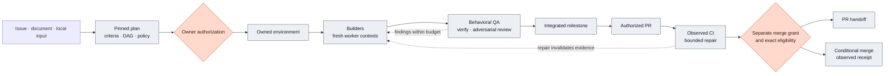

# Expanded V1 — autonomous delivery specification

> **TL;DR** — Start from a revision-bound issue, document, approved initiative or local request. Run implementation, behavioral QA, independent adversarial review and integration validation through recoverable workers, or complete an evidence-backed research flow. An explicit initial policy can delegate the entire flow with no subsequent human intervention. Deliver a report, pull request or separately authorized conditional merge. Keep the deterministic core, existing clients and external state.

> [!NOTE]
> **Status: 🚧 partial.** The owner requested this expanded 1.0 scope on 2026-10-24. The owner reviewed/accepted all new tasks and authorized sequential implementation on 2026-10-24. P6-01 revision-bound source intake and P6-02 plan/envelope preparation are implemented; the remaining chapters retain accepted design targets, not actual run grants. Only explicitly evidenced intake/planning criteria are checked. The existing supervised behavior, native failures and release checks remain in force.

## Read and review

| Document | Owns |
| --- | --- |
| [Contract and authorization](./01-contract-and-authorization.md) | Inputs, delivery modes, scope, grants, delegation and protected effects |
| [Durable runner](./02-durable-runner.md) | Queue, claims, worker protocol, recovery and cancellation |
| [Execution environments](./03-execution-environments.md) | Reproducible services/data, containment and owned cleanup |
| [Behavioral QA](./04-behavioral-qa.md) | Executable acceptance, baseline sensitivity, independent evaluation and evidence |
| [Integration and change impact](./05-integration-and-change-impact.md) | Milestones, multiple repositories, candidate assembly and invalidation |
| [Publication, CI and merge](./06-publication-ci-and-merge.md) | PR lifecycle, bounded repairs, exact-revision eligibility and conditional merge |
| [Controls and observability](./07-controls-and-observability.md) | Budgets, progress, timeline, diagnostics and portable inspection |
| [Learning and maintenance](./08-learning-and-maintenance.md) | Scheduled observations and reviewable maintenance proposals |
| [Validation and acceptance](./09-validation-and-acceptance.md) | Case IDs, executable fixtures, native trials, manual boundaries and release evidence |
| [Fully unattended decisions and research](./10-unattended-decisions-and-research.md) | Zero-intervention execution, delegated decisions, ambiguity resolution and complete research flows |
| [Phase 6 task breakdown](../../phase-6-autonomous-delivery.md) | Session-sized deliverables, dependencies, tests and acceptance checkboxes |

The specification defines intended contracts. Command names, schema names, event names and defaults below are proposed interfaces until implemented and compatibility-tested. Existing commands must not begin accepting these options merely because documentation describes them.

## Product outcomes

1. An owner selects an issue/document and authorizes a bounded delivery plan. The system can complete the implementation-to-PR loop without repeated conversational instructions when all prerequisites are satisfied.
2. Independent workers build separate parts; the integrated application is executed against the approved acceptance criteria.
3. After a process crash or host restart, another invocation explains what happened and resumes eligible work without guessing whether an external write succeeded.
4. Missing evidence, access or budget yields an honest policy-selected outcome. Supervised/on-exception runs may ask; zero-intervention runs never prompt and autonomously resolve an authorized decision or return a structured terminal limitation.
5. An independently authorized merge is possible only for an eligible exact revision under observed repository protections. Default supervised operation never acquires that permission.
6. Local operation requires no proprietary cloud control plane and no accounts with every provider. Actual model access and deliberately selected code-host access remain necessary for their operations.

## Existing foundations and actual gaps

| Existing foundation | Reuse | New work |
| --- | --- | --- |
| State journal, transactions, mailbox and bounded resume | Keep outside repositories; preserve event history | Durable delivery attempts, claims, effect intents and process reconciliation |
| Scope/slice/part DAG and builder scheduling | Keep exact criteria, contract-first parts and ready waves | A persistent worker host and explicit integrated milestone candidates |
| Verify/review gates and refutation rules | Keep all required lenses, quorums and failed budgets | Behavioral evidence, isolated acceptance execution and current whole-product validation |
| Worktree allocation and port reservations | Keep personal checkout protection | Provision owned application/services/data environments and verify teardown |
| Draft publication and exact tested snapshots | Preserve supervised receipt semantics | Distinct delegated acceptance, authorized publication and conditional merge |
| MCP-first provider routing | Reuse client-owned connections and reviewed tool contracts | Narrow trusted delivery-host operations; no vendor API expansion |
| Impact checkpoints and learning decisions | Keep observed/unknown distinctions and human outcomes | Trigger due reads and prepare bounded maintenance proposals |

## End-to-end route

Intervention-enabled nodes can pause and retain pending decisions. None-policy runs use bounded automatic resolution or a terminal limitation, without waiting for a person. The final handoff states whether code, a draft PR, a ready PR, a queued merge or an observed merge exists; those results are not interchangeable.

## Delivery modes

| Mode | Maximum authority | Human boundaries |
| --- | --- | --- |
| `supervised` | Existing behavior | Current approvals and human testing; no automatic merge |
| `to-pr` | Approved implementation, delegated acceptance, commits/pushes and PR lifecycle explicitly named in the grant | Intervention policy decides whether an exception can ask; merge forbidden |
| `to-merge` | `to-pr` plus a separately scoped conditional merge | Repository review/protection requirements remain; intervention policy never bypasses them |

Interaction profiles do not select a mode, create a grant or weaken coverage. A green suite does not itself supply publication or merge permission. Source text and issue labels are work requests, never operator authority.

Intervention is a separate axis: `supervised` keeps current stops, `on-exception` delegates named routine decisions and asks only on unresolved exceptions, and `none` permits no interactive human dependency after initial authorization. Endpoints also include `research-report` and `local-handoff`. A single initial authorization can select `none` for a complete research or implementation route, including explicitly delegated Define/build-plan/acceptance decisions. This never fabricates historical human approval. Non-delegable criteria or mandatory external reviewer requirements make that endpoint ineligible unless already satisfied. See the [decision policy](./10-unattended-decisions-and-research.md).

## Scope and release ordering

Phase 6 is inside the expanded 1.0, numbered after the existing phases to retain stable task links. It runs before P5-07's release closure. Local implementation can proceed independently of unresolved original native/account checks under the owner's implementation authorization; those checks remain release obligations at their existing scope.

The expanded roadmap has 88 tasks: 54 original tasks (40 complete, fourteen open) and 34 new tasks (P6-01/P6-02 complete, 32 pending). The owner has lifted the review hold and authorized sequential implementation; pending tasks still need their actual tests and evidence before completion. Its size estimates are planning hypotheses and may be split without weakening acceptance.

## Opportunity disposition

| Research opportunity | Expanded V1 treatment |
| --- | --- |
| Durable execution, environments, behavioral proof, integration, CI repair, scoped merge, budgets and evaluation | Required Phase 6 capabilities |
| Complete research and implementation with zero human intervention after initial authorization | Required independent intervention policy; no native permission bypass or invented evidence |
| Requirement-change impact and scheduled Learn | Included, reusing the same plan/recovery model |
| Recurring maintenance | Included as proposals requiring a new approved run |
| Import existing specifications | Included through explicit revision-bound generic input mappings; dedicated OpenSpec/Spec Kit importers are deferred |
| ACP transport | Deferred interoperability experiment; existing native hosts remain the implementation boundary |
| Cloud platform, fleet service, marketplace or new vendor HTTP APIs | Excluded from this expansion |
| Automatic production deployment, messages, flag mutation or rollback | Excluded; existing drafts/proposals and explicit human decisions remain |
| Distributed atomic merge across repositories | Excluded; ordered per-repository delivery exposes partial completion |

## Accepted design direction

The accepted design direction covers: zero-intervention decision delegation, opt-in delegated acceptance, the trusted effect broker and containment requirement, GitHub as the first conditional-merge host, separately reported GitLab capabilities, the native reference-client scope, bounded repair defaults and conservative cross-repository merge behavior. The owner authorized pragmatic implementation refinements; preserve acceptance and record material changes in technical decisions.

## Research provenance

These specifications are original designs for wholeloop. Architectural comparisons inform problem selection; they do not import another project's prompts, code or methodology.

- [Stripe's bounded deterministic/agent execution](https://stripe.dev/blog/minions-stripes-one-shot-end-to-end-coding-agents-part-2).
- [Symphony's service specification](https://github.com/openai/symphony/blob/main/SPEC.md), including its documented persistence limitations.
- [Independent scenario evaluation](https://factory.strongdm.ai/) and [long-running generator/evaluator tradeoffs](https://www.anthropic.com/research/harness-design-long-running-apps).
- [Product-execution evidence](https://cognition.com/blog/testing-development) and [agent evaluation design](https://www.anthropic.com/research/demystifying-evals-for-ai-agents).

[◀ Roadmap](../../README.md) · [Phase 6 tasks ▶](../../phase-6-autonomous-delivery.md)
